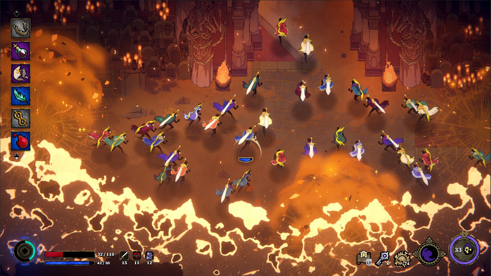
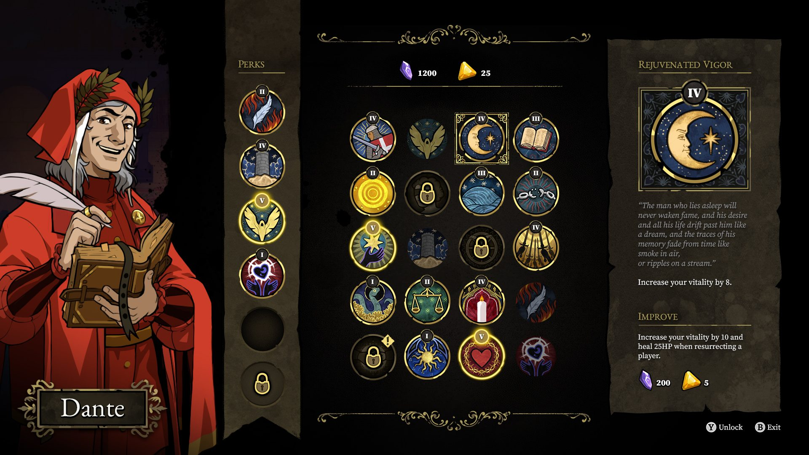

*Crédit images : Thunder Lotus Games*

## Le studio québécois [Thunder Lotus](https://thunderlotusgames.com/), qui nous a donné, entre autres, Jotun et Spiritfarer, était présent au Gamescom 2023 cette semaine pour dévoiler plus détails sur leur jeu en développement, 33 Immortals.

Il s’agit d’un jeu de rôle et d’action en multijoueur en ligne où des groupes de 33 joueurs doivent explorer des donjons et affronter des créatures.

**À LIRE AUSSI : [5 choses à savoir sur Sea of Stars](/2023/08/21/5-choses-a-savoir-sur-sea-of-stars/)**

Dans une entrevue avec le producteur Nicolas Godin, donnée au Gamescom et publiée sur leurs réseaux sociaux, Thunder Lotus a dévoilé des détails supplémentaires.

L’entrevue complète est disponible ci-dessous en anglais, mais voici quelques faits saillants :

- **Pick-up and raid** : il n’y a pas d’attente ou de phase de préparation aux raids, on saute directement dans l’action avec 32 autres joueurs.
- On peut créer des groupes avec des amis, le reste du groupe de 33 se forme automatiquement avec du ***matchmaking*.**
- Le **rôle/classe** du joueur est déterminé par le choix de son arme. Les rôles seront : tank, support, attaque à distance, mêlée.
- Dans l’histoire, le joueur joue un personnage qui est décédé et s’en va dans l’au-delà où il sera immortel. Notre personnage, qui n’était pas une bonne personne dans sa vie, se voit donner une **punition éternelle** par Dieu.
- Le jeu tire des inpirations de la **[Divine Comédie de Dante Alighieri](https://fr.wikipedia.org/wiki/Divine_Com%C3%A9die)** pour la représentation du purgatoire, de l’enfer et du paradis, où les joueurs veulent affronter Dieu.
- On meurt souvent, mais certaines améliorations sont permanentes, avec **un système de *perks*** et expérience.
- **Le nombre 33** vient du fait que dans la Divine Comédie, chaque chapitre a 33 chants.
- Au début 2024, il y aura une **phase de test** ouvertes au joueurs. Vous pouvez vous inscrire pour en faire partie au [33Immortals.com](https://thunderlotusgames.com/33-immortals/)
- Le jeu sortira **quelque part en 2024 sur PC et Xbox**.

https://www.youtube.com/watch?v=nOPGLHJsNEo

[À LIRE SUR BÊTA-TESTEUR : Sony fait l’acquisition d’Audeze](https://www.lebetatesteur.ca/sony-interactive-entertainment-fait-lacquisition-du-leader-en-technologie-audio-audeze/)
