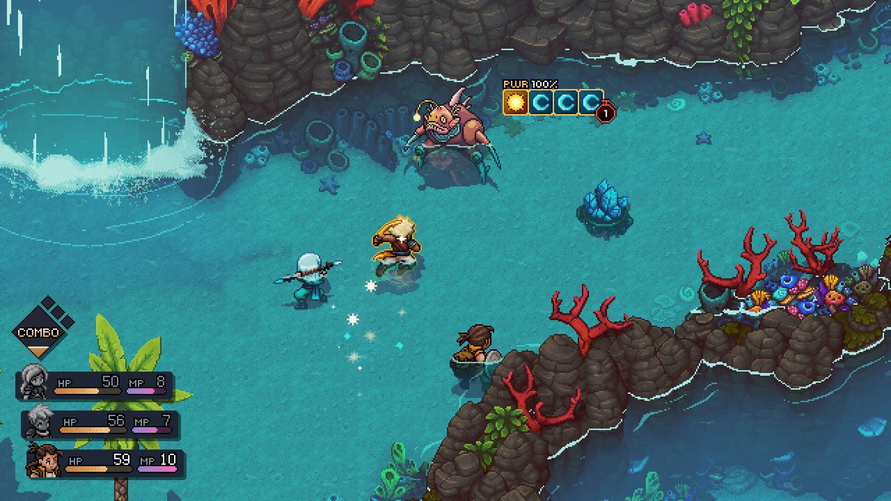
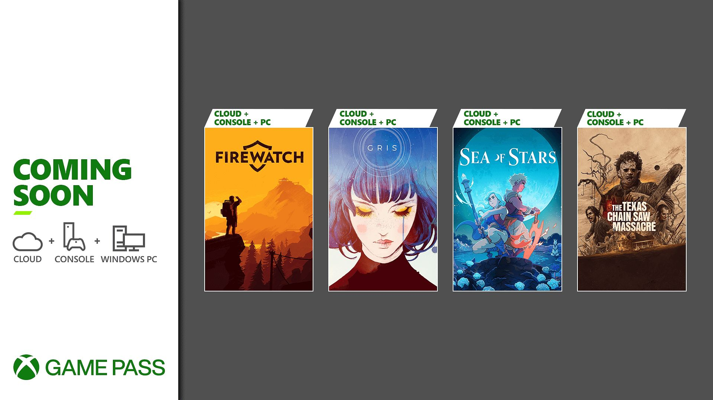
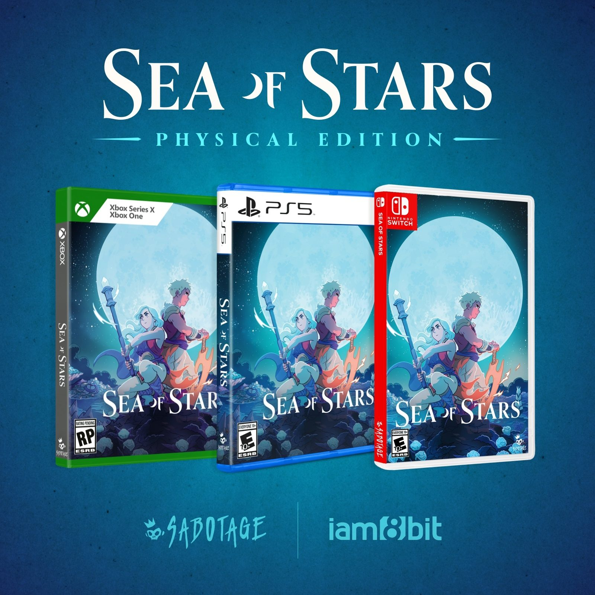

**Sea of Stars, le 2e jeu du studio québécois [Sabotage](https://sabotagestudio.com/) qui nous a donné The Messenger en 2018, sort dans quelques jours sur PC et consoles. Intrigué? Voici 5 choses à savoir sur le jeu.**

*Crédit images : Sabotage Studio*

## 1- Ça se déroule dans le même univers que The Messenger, mais dans un genre différent

Si The Messenger s’inspirait notamment de Ninja Gaiden et de metroidvania dans les séquences en 16-bits, Sea of Stars est plutôt un RPG qui s’inspire directement de Chrono Trigger, Super Mario RPG et Illusion of Gaia, entre autres.

Les combats sont en tour par tour, avec des moments où le timing du *pitonnage* devient important pour maximiser des attaques.

Il s’agit d’un antépisode à The Messenger, donc dans le même univers, mais ce sont des événements qui se déroulent plusieurs milliers d’années avant dans une autre partie de ce monde, avec de nouveaux protagonistes.

On contrôle les personnages principaux Valere et Zale, mais on peut également recruter d’autres personnages à joindre l’équipe.

**À LIRE AUSSI : [Call of Duty Modern Warfare III : le studio québécois Beenox développe la version PC](/2023/08/17/call-of-duty-modern-warfare-iii-le-studio-quebecois-beenox-developpe-la-version-pc/)**

## 2- Disponible Jour 1 sur Xbox Game Pass et PlayStation Plus

Si vous êtes abonnés au Xbox Game Pass, nous n’aurez pas à débourser un sous de plus pour profiter de Sea of Stars. Les abonnés PlayStation Plus, par contre, doivent passer aux paliers Extra ou Premium pour avoir accès au jeu.

Sinon, vous pouvez bien entendu l’acheter, que ce soit sur PlayStation, Xbox, PC ou Nintendo Switch.

## 3- Versions physiques disponibles en 2024

La date du 29 août 2023 est seulement pour la sortie numérique. Si vous souhaitez vous procurer une version physique, il faudra attendre le début 2024 via un partenariat avec iam8bit.

## 4- On peut jouer en mode « Québécois »

The Messenger contenait une bonne dose d’humour dans ses dialogues, mais c’était d’autant plus hilarant quand on choisissait « Québécois » comme langue du jeu. Cette option est de retour dans Sea of Stars, on peut donc profiter de l’aventure avec des dialogues contenant nos expressions colorées.

## 5- Une démo est disponible

Pas certain que le jeu vous intéresse? Une démo est également disponible sur toutes les plateformes. Elle donne une bonne idée de la jouabilité dans les phases d’exploration et phases de combats.

**À LIRE AUSSI : [Les 20 meilleurs jeux faits au Québec, selon Metacritic](/2023/08/19/les-20-meilleurs-jeux-faits-au-quebec-selon-metacritic/)**
