*image à la une : Eidos Montréal*

**Voici une liste de 50 jeux vidéo créés au Québec, qui sont à mes yeux essentiels pour comprendre l’importance et la diversité de notre patrimoine vidéoludique. Cette liste essaie de couvrir les 30 dernières années, des débuts modestes de l’industrie, à l’arrivée d’Ubisoft puis au statut de 3e pôle mondial de création de jeux vidéo.**

**Notes importantes :**

- *Les jeux sont listés en ordre alphabétique; il n’y a aucune intention d’importance ou préférence dans l’ordre des jeux listés.*
- *Certains jeux peuvent ne pas avoir été développés complètement au Québec, mais par une équipe internationale dont le studio principal est au Québec ou à parts égales entre les différents studios.*
- *Un seul jeu par franchise est listé, même si d’autres jeux de la franchise ont été importants aussi.*
- *La partie « Mon appréciation » est indiquée À venir quand il s’agit d’un jeu que je n’ai pas joué; mes appréciations personnelles de ces jeux seront ajoutées au fur et à mesure*.

## Anamorphine

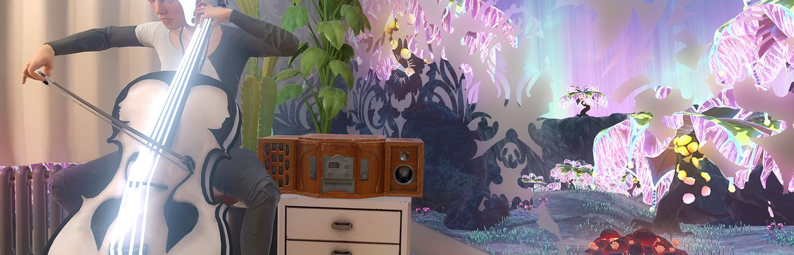

**Synopsis officiel :** *Découvrez ce que l’on ressent en perdant le contrôle de la réalité à mesure que l’on se rapproche du coin le plus sombre de son esprit. Le récit d’Anamorphine se déroule à travers les souvenirs oniriques de Tyler. Idéal pour l’exploration et la contemplation de l’environnement, l’histoire est racontée sans dialogue ni bouton d’action.* *Allez-vous affronter le passé et essayer de trouver un moyen d’avancer, ou allez-vous le laisser vous consumer ?*

**Mon appréciation :** Un jeu expérimental et surréaliste qui utilise de façon efficace des effets d’espaces liminaux pour nous faire voyager dans les souvenirs d’une personne en deuil.

**Développeur :** Artifact 5

**Éditeur :** Artifact 5

**Date de sortie :** 31 juillet 2018

**Plateformes :** PC, PlayStation 4, Xbox One

**Où l'acheter :** [Steam](https://store.steampowered.com/app/545620/) · [PlayStation Store](https://store.playstation.com/fr-ca/product/UP3874-CUSA09308_00-ANAMORPHINE00001)

---

## Ancestors : The Humankind Odyssey

**Synopsis officiel :** *Ancestors: The Humankind Odyssey est un jeu de survie à la troisième personne en monde ouvert provenant du studio indépendant Panache Jeux Numériques et édité par Private Division. D’après l’idée originale du directeur créatif Patrice Désilets, découvrez la splendeur de l’Afrique d’il y a 10 millions d’années et bravez tous ses dangers avec votre clan d’hominidés qui devra partir en exploration, s’agrandir et évoluer pour survivre à travers 8 millions d’années. C’est à vous d’écrire votre propre histoire sur l’évolution humaine. Parviendrez-vous à survivre comme l’ont fait nos ancêtres?*

**Mon appréciation :** Pour mieux comprendre ce qu’a à offrir Ancestors, imaginez Civilisation, mais joué à la 3e personne, où il faut gérer chaque moment, chaque journée, chaque petite décision à un niveau micro plutôt que macro. Sinon, on parle ici d’une oeuvre unique, à contre-courant des tendances de l’industrie et qui plaira aux joueurs qui n’aiment pas se faire prendre par la main. Une découverte aussi simple que comprendre comment utiliser une roche pour ouvrir une noix de coco devient un moment de gaming inoubliable.

**Développeur :** Panache Jeux Numériques

**Éditeur :** Private Division

**Date de sortie :** 27 août 2019

**Plateformes :** PC, PlayStation 4, Xbox One

**Où l'acheter :** [Steam](https://store.steampowered.com/app/536270/) · [Epic Games Store](https://store.epicgames.com/p/ancestors) · [PlayStation Store](https://www.playstation.com/fr-ca/games/ancestors-the-humankind-odyssey/) · [Xbox](https://www.xbox.com/fr-CA/games/store/_/BTT48FGF6SWM) · [Nintendo eShop (Switch 2, dès le 8 décembre)](https://www.nintendo.com/fr-ca/store/products/ancestors-the-humankind-odyssey-switch-2/)

---

## Army of Two

**Synopsis officiel :** *Travaillez ensemble en incarnant Alpha et Bravo, deux mercenaires mortels qui entreprendront les missions les plus difficiles avec des tactiques imbattables. Améliorez votre arsenal avec des armes et des tenues personnalisables et exécutez des plans stratégiques audacieux.*

**Mon appréciation :** À venir.

**Développeur :** EA Montreal

**Éditeur :** Electronic Arts

**Date de sortie :** 4 mars 2008

**Plateformes :** Xbox 360, PlayStation 3

**Où l'acheter :** [Xbox (rétrocompatible)](https://www.xbox.com/fr-CA/games/store/_/C1LM235H6FZ1)

---

## Assassin’s Creed 2

**Synopsis officiel :** *Assassin’s Creed 2 est l’épopée d’une famille, d’une vengeance et d’une conspiration dans les temps radieux et cruels de la Renaissance italienne. Ezio se lie d’amitié avec Leonardo da Vinci, affronte les plus puissantes familles de Florence et s’aventure jusque dans les canaux de Venise, où il deviendra un Maître Assassin.*

**Mon appréciation :** Si le premier Assassin’s Creed a inventé une nouvelle formule, Assassin’s Creed 2 l’a perfectionné. Si les mondes ouverts vastes et détaillés sont devenus choses communes, ce n’était pas le cas à l’époque. De recréer des villes complètes et une époque historique particulière, c’était du jamais vu à cette échelle et cela reste impressionnant aujourd’hui. Il est difficile d’expliquer à quel point AC2 a été important non seulement pour le développement de la franchise, mais pour établir Ubisoft Montréal comme uns des meilleurs studios au monde et amener l’industrie vidéoludique québécoise à un autre niveau.

**Développeur :** Ubisoft Montréal

**Éditeur :** Ubisoft

**Date de sortie :** 17 novembre 2009

**Plateformes :** PlayStation 3, Xbox 360, PC, PlayStation 4, Xbox One, Nintendo Switch

**Où l'acheter :** [Steam](https://store.steampowered.com/app/33230/) · [Epic Games Store](https://store.epicgames.com/p/assassins-creed-2) · [Xbox (rétrocompatible)](https://www.xbox.com/fr-CA/games/store/_/BNVMH8NVCRCT) · [PlayStation Store (The Ezio Collection)](https://www.playstation.com/fr-ca/games/assassins-creed-the-ezio-collection/) · [Nintendo eShop (The Ezio Collection)](https://www.nintendo.com/fr-ca/store/products/assassins-creed-the-ezio-collection-switch/)

---

## Baldur’s Gate 3

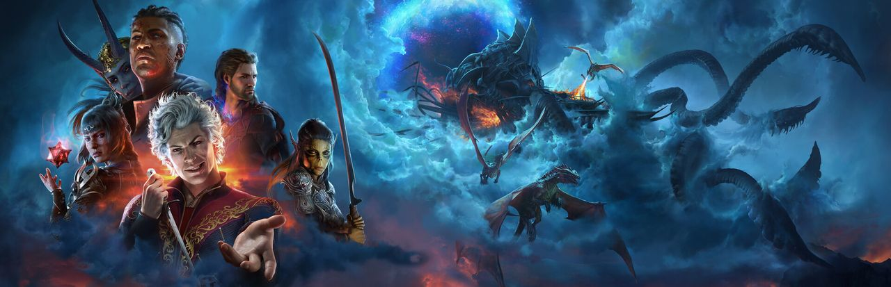

**Synopsis officiel :** *Rassemblez votre groupe et retournez dans les Forgotten Realms dans une histoire de camaraderie et de trahison, de sacrifice et de survie, et d’attrait du pouvoir absolu. De mystérieuses capacités s’éveillent en vous, tirées d’un parasite Mind Flayer implanté dans votre cerveau. Résistez et retournez les ténèbres contre elles-mêmes. Ou acceptez la corruption et devenez le mal ultime.*

**Mon appréciation :** À venir.

**Développeur :** Larian Studios Québec (conjointement aux autres studios Larian à travers le monde)

**Éditeur :** Larian Studios

**Date de sortie :** 3 août 2023

**Plateformes :** PC, PlayStation 5, Xbox Series

**Où l'acheter :** [Steam](https://store.steampowered.com/app/1086940/) · [GOG](https://www.gog.com/fr/game/baldurs_gate_iii) · [PlayStation Store](https://www.playstation.com/fr-ca/games/baldurs-gate-3/) · [Xbox](https://www.xbox.com/fr-CA/games/store/_/9ND58LQTG09T)

---

## Batman : Arkham Origins

**Synopsis officiel :** *Batman : Arkham Origins présente un Gotham City étendu et introduit un scénario préquel original se déroulant plusieurs années avant Batman : Arkham Asylum et Batman : Arkham City. Se déroulant avant la montée des criminels, vilains et assassins les plus dangereux de Gotham City, les joueurs rencontreront pour la première fois de nombreux personnages importants. Le jeu met en scène un Batman jeune, brut et non raffiné alors qu’il fait face à un moment déterminant de son début de carrière de combattant du crime qui ouvre la voie pour devenir le Chevalier Noir. Au fur et à mesure que l’histoire se déroule, des identités se forment et des relations clés se forgent.*

**Mon appréciation :** Arkham Origins est inexplicablement le mal-aimé de la série Arkham. Personnellement, c’est celui qui a été le plus mémorable pour moi, avec Gotham City sous la neige, des séquences de détective intéressantes et une histoire mettant un scène un jeune et arrogant Bruce Wayne qui fait des erreurs.

**Développeur :** WB Games Montréal

**Éditeur :** Warner Bros Interactive Entertainment

**Date de sortie :** 25 octobre 2013

**Plateformes :** PlayStation 3, Wii U, Xbox 360, PC

**Où l'acheter :** [Steam](https://store.steampowered.com/app/209000/) · [GOG](https://www.gog.com/fr/game/batman_arkham_origins)

---

## Bloodroots

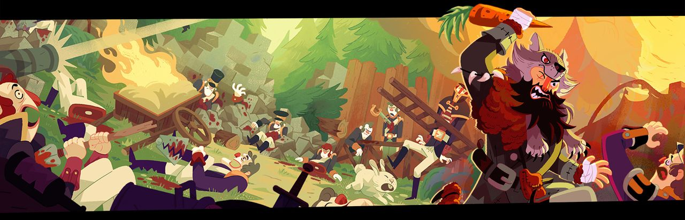

**Synopsis officiel :** *Trahi et laissé pour mort, M. Wolf est déterminé à retrouver son assassin et à se venger – seul et largement en infériorité numérique. Heureusement pour M. Wolf, le monde est votre arme : un jeu d’action implacable qui se déroule à travers le vaste Weird West.*

**Mon appréciation :** En toute transparence, j’ai travaillé très brièvement sur le synopsis du jeu au début de son développement. Cela étant dit, ce travail n’a pas été utilisé et la présence du jeu dans cette liste est dûe à l’originalité et la qualité de la jouabilité de Bloodroots, ce à quoi je n’ai pas contribué. Un jeu d’action au rythme endiablé qui devrait plaire aux joueurs qui recherchent un bon challenge et aux *speedrunners.*

**Développeur :** Paper Cult Games

**Éditeur :** Paper Cult Games

**Date de sortie :** 28 février 2020

**Plateformes :** PC, Xbox Series, PlayStation 4

**Où l'acheter :** [Steam](https://store.steampowered.com/app/820540/) · [Epic Games Store](https://store.epicgames.com/p/bloodroots) · [PlayStation Store](https://store.playstation.com/fr-ca/product/UP3949-PPSA10470_00-9656509665050290) · [Xbox](https://www.xbox.com/fr-CA/games/store/_/9MXPZ33Z9PWH) · [Nintendo eShop](https://www.nintendo.com/fr-ca/store/products/bloodroots-switch/)

---

## Boyfriend Dungeon

**Synopsis officiel :** *Sortez vos épées ! Charmez le cœur de vos armes pour les faire gagner en puissance et parcourez les donjons de ce « shack-and-slash ».*

**Mon appréciation :** À venir.

**Développeur :** Kitfox Games

**Éditeur :** Kitfox Games

**Date de sortie :** 11 août 2021

**Plateformes :** PC, PlayStation 5, Xbox Series, Nintendo Switch

**Où l'acheter :** [Steam](https://store.steampowered.com/app/674930/) · [Epic Games Store](https://store.epicgames.com/p/boyfriend-dungeon) · [PlayStation Store](https://store.playstation.com/fr-ca/product/UP0379-PPSA10976_00-2501734834468143) · [Xbox](https://www.xbox.com/fr-CA/games/store/_/9N5PHZ0D92LD) · [Nintendo eShop](https://www.nintendo.com/fr-ca/store/products/boyfriend-dungeon-switch/)

---

## Broken Edge

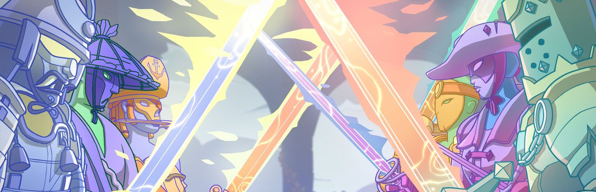

**Synopsis officiel :** *Broken Edge est un jeu de duel fantastique multijoueur VR dans lequel vous incarnez des combattants à l’épée emblématiques. Utilisez leurs techniques et pouvoirs uniques combinés à des mécanismes d’escrime de pointe pour remporter la victoire contre des adversaires en ligne et gravir les échelons !*

**Mon appréciation :** À venir.

**Développeur :** Trebuchet

**Éditeur :** Fast Travel Games

**Date de sortie :** 17 novembre 2022

**Plateformes :** Meta Quest, PC, PS VR 2

**Où l'acheter :** [Steam](https://store.steampowered.com/app/1947070/) · [Meta Quest](https://www.meta.com/experiences/broken-edge/5136958036416423/) · [PlayStation Store (PS VR2)](https://www.playstation.com/fr-ca/games/broken-edge/)

---

## Child of Light

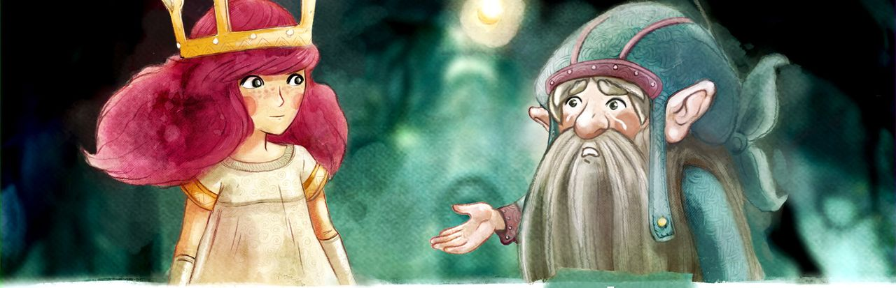

**Synopsis officiel :** *La Reine Noire a volé le soleil, la lune et les étoiles. Incarnez Aurora, une jeune princesse au cœur pur dont l’âme vient de rejoindre le royaume de Lemuria. Préparez-vous à vivre une quête palpitante à la recherche des trois sources de lumière volées. Triomphez de la Reine Noire et rendez au royaume sa grandeur passée.*

**Mon appréciation :** Un envoûtant jeu de rôle avec des combats tour par tour, accompagné d’une superbe bande sonore par Coeur de Pirate. Le genre de « petit » projet qu’on aimerait davantage voir de la part d’Ubisoft.

**Développeur :** Ubisoft Montréal

**Éditeur :** Ubisoft

**Date de sortie :** 30 avril 2014

**Plateformes :** PC, PlayStation 3, PlayStation 4, Xbox Series, Xbox One, Wii U, PlayStation Vita, Google Stadia, Amazon Luna, Nintendo Switch

**Où l'acheter :** [Steam](https://store.steampowered.com/app/256290/) · [Epic Games Store](https://store.epicgames.com/p/child-of-light) · [PlayStation Store](https://www.playstation.com/fr-ca/games/child-of-light/) · [Xbox](https://www.xbox.com/fr-CA/games/store/_/BQ9Q620NC614) · [Nintendo eShop](https://www.nintendo.com/fr-ca/store/products/child-of-light-ultimate-edition-switch/)

---

## Contrast

**Synopsis officiel :** *Contrast est un jeu de plateforme/puzzle, dans lequel vous passez en un clin d’œil d’un monde fantastique en 3D, à un mystérieux univers d’ombres en 2D. Plongez dans l’ambiance onirique et surréaliste des années 20, inspirée par le vaudeville et le film noir, et bercée par une ambiance très jazzy.*

**Mon appréciation :** Un jeu de plateforme avec des mécaniques rafrachissantes et originales où l’ombre et la lumière jouent un rôle qui nous force à repenser les perspectives 2D et 3D. Une leçon en level design qui mérite d’être davantage connue.

**Développeur :** Compulsion Games

**Éditeur :** Focus Home Interactive

**Date de sortie :** 15 novembre 2013

**Plateformes :** Steam, PlayStation 3, PlayStation 4, Xbox 360, Xbox Series, Xbox One

**Où l'acheter :** [Steam](https://store.steampowered.com/app/224460/) · [PlayStation Store](https://store.playstation.com/fr-ca/product/UP2092-CUSA00011_00-CONTRASTUS000001) · [Xbox](https://www.xbox.com/fr-CA/games/store/_/BSLTQT4L0RLV)

---

## Crash Team Racing Nitro-Fueled

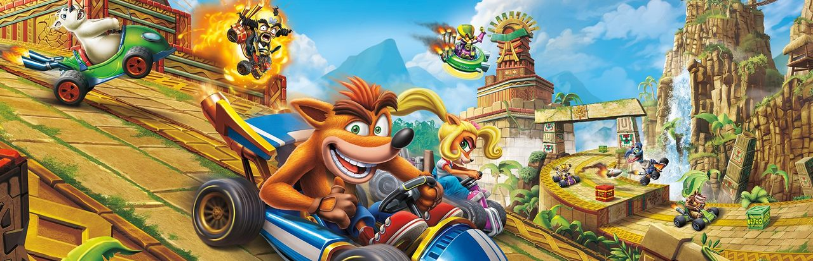

**Synopsis officiel :** *Crash est de retour aux commandes ! Préparez-vous à accélérer avec Crash Team Racing Nitro-Fueled. C’est l’expérience CTR authentique et bien plus encore, désormais entièrement remasterisée et optimisée au maximum.*

**Mon appréciation :** Un remake d’un jeu de course de Crash Bandicoot mené brillamment par l’équipe de Beenox à Québec.

**Développeur :** Beenox

**Éditeur :** Activision

**Date de sortie :** 21 juin 2019

**Plateformes :** Nintendo Switch, PlayStation 4, Xbox One

**Où l'acheter :** [PlayStation Store](https://www.playstation.com/fr-ca/games/crash-team-racing-nitro-fueled/) · [Xbox](https://www.xbox.com/fr-CA/games/store/_/BQRB60PW2SDL) · [Nintendo eShop](https://www.nintendo.com/fr-ca/store/products/crash-team-racing-nitro-fueled-switch/)

---

## Dead by Daylight

**Synopsis officiel :** *Suivez, surinez et sacrifiez votre proie en tant que tueur monstrueux, ou rejoignez une équipe de quatre survivants rusés collaborant pour s’enfuir.*

**Mon appréciation :** Dead by Daylight est un rare jeu en ligne où on met l’emphase davantage sur le plaisir des joueurs que sur la compétition; il n’est pas toujours clair qui a gagné ou perdu, car on met de l’avant l’évolution du joueur/personnage plutôt que le résultat du match. Tous les 3 mois, un nouveau chapitre est disponible, que ce soit de nouveaux personnages originaux ou une collaboration avec une de vos franchises d’horreur préférées. Après 7 ans et 60 millions de joueurs, on peut dire que Behaviour a adopté la bonne formule.

**À lire sur Vidéoludique** : [Dead by Daylight : 60 millions de joueurs, un film, un jeu narratif… un chapitre québécois?](/2023/11/01/dead-by-daylight-60-millions-de-joueurs-un-film-un-jeu-narratif-un-chapitre-quebecois/)

**Développeur :** Behaviour

**Éditeur :** Behaviour

**Date de sortie :** 14 juin 2016

**Plateformes :** PlayStation 4, PlayStation 5, Xbox One, Xbox Series, Nintendo Switch, iOS, Android, Google Stadia, Steam, Epic Games Store

**Où l'acheter :** [Steam](https://store.steampowered.com/app/381210/) · [Epic Games Store](https://store.epicgames.com/p/dead-by-daylight) · [PlayStation Store](https://www.playstation.com/fr-ca/games/dead-by-daylight/) · [Xbox](https://www.xbox.com/fr-CA/games/store/_/C0N22P73QZ60) · [Nintendo eShop](https://www.nintendo.com/fr-ca/store/products/dead-by-daylight-switch/)

---

## Dead Space Remake

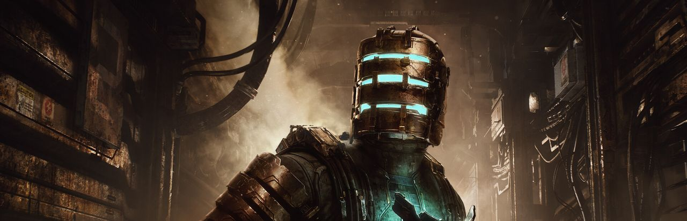

**Synopsis officiel :** *Lorsque Isaac Clarke et l’USG Kellion sont envoyés pour réparer le vaisseau de forage USG Ishimura, ils sont loin de se douter à quel point leur mission de routine va se transformer en véritable cauchemar. Qu’a découvert l’équipage de l’Ishimura dans les ténèbres ? Que leur est-il arrivé ? Et qu’est-ce que cela implique pour l’avenir de l’humanité ?*

**Mon appréciation :** À venir.

**Développeur :** Motive Studio

**Éditeur :** Electronic Arts

**Date de sortie :** 27 janvier 2023

**Plateformes :** Steam, Epic Games Store, PlayStation 5, Xbox Series

**Où l'acheter :** [Steam](https://store.steampowered.com/app/1693980/) · [Epic Games Store](https://store.epicgames.com/p/dead-space) · [PlayStation Store](https://www.playstation.com/fr-ca/games/dead-space/) · [Xbox](https://www.xbox.com/fr-CA/games/store/_/9NLB6V0GNC9P)

---

## Destination : Primus Vita

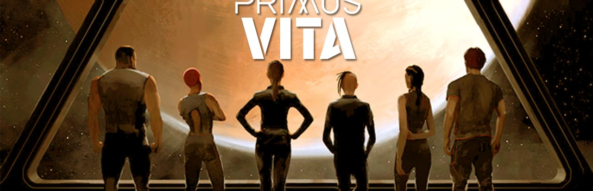

**Synopsis officiel :** *En 3044, un équipage de six humain se rendent sur Primus Vita pour récupérer l’eau qui nous fût volée plusieurs centaines d’années auparavant par des extra-terrestres. À bord du vaisseau le ‘’Beaufort’’, suivez l’expérience de simulation extraordinaire que vivront nos six protagonistes alors qu’ils seront soumis au cry-sommeil pendant les quatre années que dure le voyage vers Primus Vita.*

**Mon appréciation :** Un drame psychologique dans l’espace qui se présente sous forme de jeu narratif et de puzzles avec un ensemble de personnages fascinants. Malheureusement, il semble qu’il n’y aura pas de suite au premier épisode, mais vous pouvez le [découvrir gratuitement sur Steam.](https://store.steampowered.com/app/680750/Destination_Primus_Vita__Ep_1/)

**Développeur :** Epsilon Games

**Éditeur :** Epsilon Games

**Date de sortie :** 16 août 2018

**Plateformes :** PC, Mac OS

**Où l'acheter :** [Steam (gratuit)](https://store.steampowered.com/app/680750/)

---

## Deus Ex : Human Revolution

**Synopsis officiel :** *Vous incarnez Adam Jensen, un ancien du SWAT choisi pour superviser les besoins défensifs de l’une des plus grosses sociétés de biotechnologie expérimentale des États-Unis. Votre mission consiste à protéger les secrets du groupe, mais lorsqu’une équipe d’agents espions parvient à entrer par effraction dans le bâtiment et assassine les scientifiques que vous étiez chargé de protéger, toutes vos certitudes sur votre travail volent en éclats !*

**Mon appréciation :** À venir.

**Développeur :** Eidos Montréal

**Éditeur :** Square Enix

**Date de sortie :** 25 octobre 2013

**Plateformes :** PlayStation 3, Xbox 360, Wii U, Steam, PC, Mac

**Où l'acheter :** [Steam (Director’s Cut)](https://store.steampowered.com/app/238010/) · [GOG](https://www.gog.com/fr/game/deus_ex_human_revolution_directors_cut) · [Xbox (rétrocompatible)](https://www.xbox.com/fr-CA/games/store/_/BZK0PF5LXPDV)

---

## Disney Dreamlight Valley

**Synopsis officiel :** *Explorez un monde où abonde la magie de Disney, découvrez des histoires complexes et construisez le voisinage parfait où se côtoient les héros et les méchants de Disney et Pixar dans ce nouveau jeu d’aventure et de simulation de vie. Bienvenue dans Disney Dreamlight Valley.*

**Mon appréciation :** À venir.

**Développeur :** Gameloft Montréal

**Éditeur :** Gameloft

**Date de sortie :** 5 décembre 2023

**Plateformes :** iOS, Mac OS, Nintendo Switch, PlayStation 4, PlayStation 5, PC, Xbox One, Xbox Series

**Où l'acheter :** [Steam](https://store.steampowered.com/app/1401590/) · [Epic Games Store](https://store.epicgames.com/p/disney-dreamlight-valley) · [PlayStation Store](https://www.playstation.com/fr-ca/games/disney-dreamlight-valley/) · [Xbox](https://www.xbox.com/fr-CA/games/store/_/9NSF0BGH8D86) · [Nintendo eShop (Switch)](https://www.nintendo.com/fr-ca/store/products/disney-dreamlight-valley-switch/) · [Nintendo eShop (Switch 2)](https://www.nintendo.com/fr-ca/store/products/disney-dreamlight-valley-nintendo-switch-2-edition-switch-2/) · [App Store (Apple Arcade)](https://apps.apple.com/ca/app/disney-dreamlight-valley/id6456945575)

---

## Far Cry 3

**Synopsis officiel :** *Incarnez Jason Brody, un homme solitaire et perdu sur une île tropicale, à l’écart de toute civilisation. Dans ce paradis sauvage où violence et brutalité sont le quotidien, vous aurez le pouvoir de décider où, quand et comment se dérouleront les évènements. Pour vous frayer un chemin sur cette île hostile où bien et mal ne veulent plus rien dire, vous devrez vous infiltrer, assassiner ou même tout faire exploser !*

**Mon appréciation :** Far Cry 3 a réinventé la franchise en capitalisant sur les meilleures aspects des premiers jeux et en les amenant à un autre niveau, ainsi qu’en empruntant à certains éléments de l’autre franchise à succès d’Ubisoft Montréal, Assassin’s Creed. Outre le monde ouvert, c’est le gameplay émergeant qui marque avec ses environnements destructibles et l’IA très développée des ennemies qui nous gardent constamment aux aguets. Le jeu a marqué avec tout son marketing autour du mémorable Vaas, l’antagoniste imprévisible du jeu.

**Développeur :** Ubisoft Montréal

**Éditeur :** Ubisoft

**Date de sortie :** 29 novembre 2012

**Plateformes :** PC, PlayStation 3, Xbox 360, PlayStation 4, Xbox One

**Où l'acheter :** [Steam](https://store.steampowered.com/app/220240/) · [PlayStation Store (Classic Edition)](https://www.playstation.com/fr-ca/games/far-cry-3-classic-edition/) · [Xbox (rétrocompatible)](https://www.xbox.com/fr-CA/games/store/_/BPX57N768756)

---

## FEZ

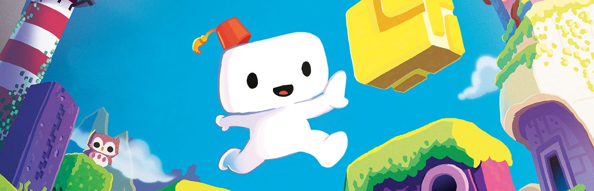

**Synopsis officiel :** *Gomez est une créature 2D vivant dans un monde 2D. Enfin, c’est ce qu’il croit… Quand il découvre l’existence d’une mystérieuse troisième dimension, Gomez se lance dans une aventure qui le mènera aux confins du temps et de l’espace. Utilise ta capacité à te déplacer dans des structures 3D à partir de 4 perspectives 2D classiques. Explore un vaste monde où sérénité et beauté règnent et qui abrite secrets, énigmes et trésors cachés. Révèle les mystères du passé et découvre la vérité sur la réalité et la perception. Change ta perspective et regarde le monde sous un angle différent.*

**Mon appréciation :** À venir.

**Développeur :** Polytron Corporation

**Éditeur :** Trapdoor

**Date de sortie :** 13 avril 2012

**Plateformes :** Xbox 360, PC, Linux, Mac OS, PlayStation 3, PlayStation 4, PlayStation Vita, iOS, Nintendo Switch

**Où l'acheter :** [Steam](https://store.steampowered.com/app/224760/) · [Epic Games Store](https://store.epicgames.com/p/fez) · [PlayStation Store](https://store.playstation.com/fr-ca/product/UP4427-CUSA00383_00-FEZTHEGAMEPOLYTR) · [Microsoft Store (PC)](https://www.xbox.com/fr-CA/games/store/_/9P75C19SZFNZ) · [Nintendo eShop](https://www.nintendo.com/fr-ca/store/products/fez-switch/) · [App Store (FEZ Pocket Edition)](https://apps.apple.com/ca/app/fez-pocket-edition/id1209489068)

---

## Hitman Go

**Synopsis officiel :** *Hitman GO est un jeu de réflexion au tour par tour dans lequel vous naviguerez stratégiquement dans des espaces fixes sur une grille pour éviter les ennemis, infiltrer des endroits bien gardés et éliminer votre cible sur des décors de style diorama magnifiquement rendus.*

**Mon appréciation :** Une brillante façon de réinventer Hitman pour le mobile, avec une expérience premium sans microtransactions. Avec une formulaire similaire, Square Enix Montréal nous a ensuite donné Lara Croft Go.

**Développeur :** Square Enix Montréal

**Éditeur :** Square Enix Europe

**Date de sortie :** 17 avril 2014

**Plateformes :** iOS, Android, PC, PlayStation 4, PlayStation Vita

**Où l'acheter :** [Steam](https://store.steampowered.com/app/427820/) · [PlayStation Store](https://store.playstation.com/fr-ca/product/UP0082-CUSA04126_00-HITMANGOPS4SQENM) · [App Store](https://apps.apple.com/ca/app/hitman-go/id731645633) · [Google Play](https://play.google.com/store/apps/details?id=com.squareenixmontreal.hitmango)

---

## Infernax

**Synopsis officiel :** *Infernax raconte les aventures d’un grand chevalier qui revient dans sa contrée natale et la trouve sous l’emprise d’une force sinistre et mystérieuse. Perce les secrets de la malédiction et affronte les conséquences de tes actions.*

**Mon appréciation :** Imaginez que Castlevania 2 et Zelda 2 ont un enfant illégitime, créé dans les feux de l’enfer accompagné d’une incantation maléfique. Infernax, du studio qui nous a donné le très bon Just Shapes and Beats, propose ici un metroidvania qui n’arrête pas de surprendre et où le joueur peut faire des choix qui ont un impact sur l’aventure et son monde, lui donnant une bonne rejouabilité. Cette rejouabilité a été décuplée avec l’ajout de nouveaux personnages jouables et un mode coop.

**Développeur :** Berzerk Studio

**Éditeur :** The Arcade Crew

**Date de sortie :** 14 février 2022

**Plateformes :** PC, Nintendo Switch, PlayStation 4, Xbox One, Xbox Series

**Où l'acheter :** [Steam](https://store.steampowered.com/app/374190/) · [PlayStation Store](https://store.playstation.com/fr-ca/product/UP5358-CUSA30993_00-INFERNAXTACSIEA0) · [Xbox](https://www.xbox.com/fr-CA/games/store/_/9NK7HNCG0R8D) · [Nintendo eShop](https://www.nintendo.com/fr-ca/store/products/infernax-switch/)

---

## Infini

**Synopsis officiel :** *Mettez votre esprit à l’épreuve d’un voyage psychédélique rempli de puzzles et de rencontres marquantes avec le Temps, la Poésie, la Mémoire, la Technologie, la Guerre et la Fatalité. Alors que l’Espoir s’enfonce au plus profond de l’Infini, le monde réel souffre de son absence. Il ne semble pas y avoir de solution, et l’Espoir est par nature condamné à toujours essayer.*

**Mon appréciation :** Un jeu expérimental, brillant, absorbant.

**Développeur :** Barnaque

**Éditeur :** Nakano.io

**Date de sortie :** 4 mars 2020

**Plateformes :** PC, Nintendo Switch

**Où l'acheter :** [Steam](https://store.steampowered.com/app/1120420/) · [Xbox](https://www.xbox.com/fr-CA/games/store/_/9NHR2Z6GD4G9) · [Nintendo eShop](https://www.nintendo.com/fr-ca/store/products/infini-switch/)

---

## Jotun

**Synopsis officiel :** *Jotun est un jeu d’action et d’exploration dessiné à la main dont le décor est planté dans la mythologie nordique. Dans Jotun, vous incarnez Thora, une guerrière viking qui, privée d’une mort glorieuse, doit montrer aux dieux qu’elle est digne d’entrer au Valhalla. Impressionnez les dieux !*

**Mon appréciation :** À venir.

**Développeur :** Thunder Lotus Games

**Éditeur :** Thunder Lotus Games

**Date de sortie :** 29 septembre 2015

**Plateformes :** PC, Mac OS, Linux, Nintendo Switch, Wii U, PlayStation 4, Xbox One, Stadia

**Où l'acheter :** [Steam](https://store.steampowered.com/app/323580/) · [GOG](https://www.gog.com/fr/game/jotun) · [Epic Games Store](https://store.epicgames.com/p/jotun) · [PlayStation Store](https://www.playstation.com/fr-ca/games/jotun-valhalla-edition/) · [Xbox](https://www.xbox.com/fr-CA/games/store/_/BVWPHR3TVQ6F) · [Nintendo eShop](https://www.nintendo.com/fr-ca/store/products/jotun-valhalla-edition-switch/)

---

## Kona

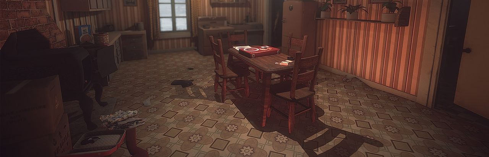

**Synopsis officiel :** *Nord du Québec, 1970. Un étrange blizzard sévit sur le Lac Atâmipêk. Entrez dans la peau d’un détective pour explorer un village des plus mystérieux, enquêter sur des événements surnaturels et survivre à la colère des éléments. Kona est un conte interactif qui vous donnera froid dans le dos!*

**Mon appréciation :** Un des premiers jeux à démontrer que la culture et le folklore québécois peuvent être le sujet d’un jeu vidéo enlevant, et notre nordicité, notre hiver rigoureux et territoire peuvent être le décor parfait pour un mystère qui mêle le surnaturel à la réalité des canadiens français. Un jeu à jouer en français pour profiter de la magnifique narration de Guy Nadon.

**Développeur :** Parabole

**Éditeur :** Parabole, Deep Silver, Ravenscourt, Koch Media

**Date de sortie :** 17 mars 2017

**Plateformes :** PC, Linux, Mac OS, PlayStation 4, PlayStation 5, Xbox One, Nintendo Switch, Shield TV, Google Stadia

**Où l'acheter :** [Steam](https://store.steampowered.com/app/365160/) · [GOG](https://www.gog.com/fr/game/kona_day_one) · [PlayStation Store](https://www.playstation.com/fr-ca/games/kona/) · [Xbox](https://www.xbox.com/fr-CA/games/store/_/BXDSG249D6Q2) · [Nintendo eShop](https://www.nintendo.com/fr-ca/store/products/kona-switch/)

---

## La vallée qui murmure

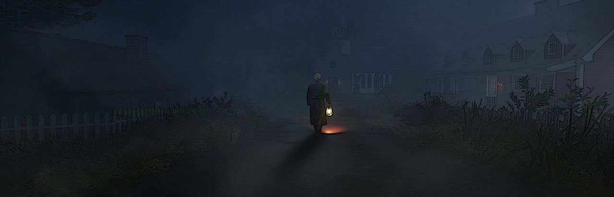

**Synopsis officiel :** *Province de Québec, 1896. Caché au creux d’une vallée, le village Sainte-Monique-Des-Monts renferme un secret qui pèse lourd la communauté. Le village est laissé à l’abandon. Ceux qui restent ne peuvent faire autrement qu’attendre. Mais autre chose tourmente les habitants. Une ombre rôde aux alentours du village. Quelques-uns l’ont vu, d’autres l’ont entendu. Ils l’ont entendu murmurer.*

**Mon appréciation :** Un jeu important, car un des premiers faits avec une démarche explicite de création de jeu vidéo national par Olivier Leclair, fondateur du studio Chien d’Or. Un jeu d’aventure pointer-et-cliquer dans le style de Myst, avec des éléments d’horreur qui mettent en lumière les cicatrices profondes laissées par le clergé sur le peuple québécois. Le studio Chien d’Or compte récidiver dans une démarche similaire avec [Cauchemars d’Octobre, qui nous plongera dans la Crise d’Octobre.](/2023/10/17/cauchemars-doctobre-un-jeu-video-sur-la-crise-doctobre/)

**Développeur :** Studio Chien d’Or

**Éditeur :** Studio Chien d’Or

**Date de sortie :** 30 novembre 2022

**Plateformes :** PC, Mac OS

**Où l'acheter :** [Steam](https://store.steampowered.com/app/1512390/)

---

## Legends of Ethernal

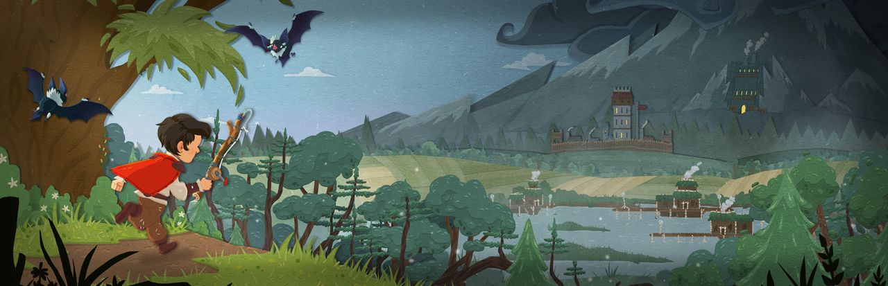

**Synopsis officiel :** *Legends of Ethernal est un jeu d’action-aventure en 2D où vous devez explorer de superbes environnements dessinés à la main, résoudre des énigmes et affronter des créatures monstrueuses pour découvrir la vérite sur la disparition de vos parents.*

**Mon appréciation :** Un superbe premier effort de Lucid Dreams Studio avec une aventure qui offre un excellent challenge.

**Développeur :** Lucid Dreams Studio

**Éditeur :** Natsume Inc.

**Date de sortie :** 30 octobre 2020

**Plateformes :** PC, Nintendo Switch, PlayStation 4, Xbox One

**Où l'acheter :** [Steam](https://store.steampowered.com/app/908480/) · [PlayStation Store](https://store.playstation.com/fr-ca/product/UP1014-CUSA24878_00-LOEUS00000000001) · [Xbox](https://www.xbox.com/fr-CA/games/store/_/9PDWW3822QS6) · [Nintendo eShop](https://www.nintendo.com/fr-ca/store/products/legends-of-ethernal-switch/)

---

## Lunark

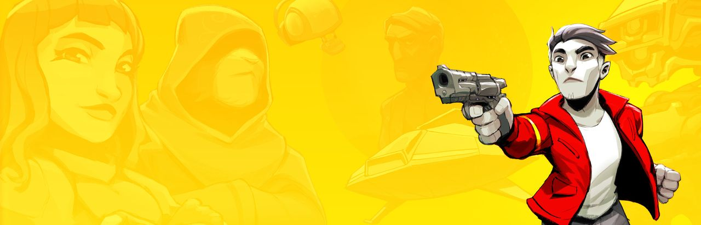

**Synopsis officiel :** *Une aventure de science-fiction en pixel-art au milieu d’une révolution contre un régime totalitaire… LUNARK revisite le jeu de plateforme cinématique en 2D des années 1990. Courez, sautez, accrochez-vous, grimpez, roulez et tirez dans des lieux étranges et merveilleux !*

**Mon appréciation :** Une véritable lettre d’amour à des jeux tels que Prince of Persia, Flashback, Another World, mais avec une touche de modernité. Johan Vinet a pratiquement créé le jeu seul, de l’art au code, en passant par les cinématiques où il s’est mis en scène en utilisant une technique de rotoscopie.

**Développeur :** Canari Games

**Éditeur :** Wayforward

**Date de sortie :** 30 mars 2023

**Plateformes :** PC, Mac OS, Xbox One, Xbox Series, PlayStation 4, PlayStation 5, Nintendo Switch

**Où l'acheter :** [Steam](https://store.steampowered.com/app/1050370/) · [PlayStation Store](https://store.playstation.com/fr-ca/product/UP2053-PPSA12664_00-LUNARK0PS50US000) · [Xbox](https://www.xbox.com/fr-CA/games/store/_/9N583C661MTG) · [Nintendo eShop](https://www.nintendo.com/fr-ca/store/products/lunark-switch/)

---

## Mages of Mystralia

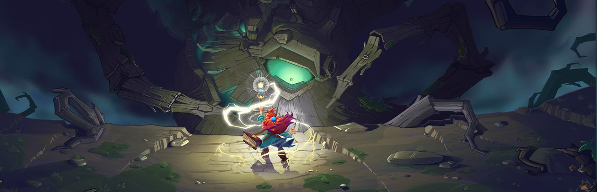

**Synopsis officiel :** D*ans un monde de magie, votre esprit est votre plus grande arme. Apprenez à contrôler cette magie et créez vos propres sorts pour combattre vos ennemis, explorer des régions mystérieuses et corriger les erreurs passées du royaume de Mystralia.*

**Mon appréciation :** Un jeu d’action et d’aventure avec une mécanique originale de création et personnalisation de sorts pour optimiser nos performances en combat ou résoudre des puzzles précis.

**Développeur :** Jeux Boréalys

**Éditeur :** Jeux Boréalys

**Date de sortie :** 18 mai 2017

**Plateformes :** PC, PlayStation 4, Xbox One, Nintendo Switch

**Où l'acheter :** [Steam](https://store.steampowered.com/app/529660/) · [GOG](https://www.gog.com/fr/game/mages_of_mystralia) · [Epic Games Store](https://store.epicgames.com/p/mages-of-mystralia) · [PlayStation Store](https://store.playstation.com/fr-ca/product/UP1709-CUSA08083_00-0000000000000004) · [Xbox](https://www.xbox.com/fr-CA/games/store/_/C3S0NLB4QFG7) · [Nintendo eShop](https://www.nintendo.com/fr-ca/store/products/mages-of-mystralia-switch/)

---

## Marvel’s Guardians of the Galaxy

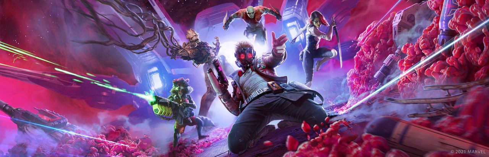

**Synopsis officiel :**  *Embarquez pour une virée déjantée à travers la galaxie dans cette version inédite de Marvel’s Guardians of the Galaxy. Incarnez Star-Lord et menez les Gardiens dans des situations plus explosives les unes que les autres. Ça va le faire. Normalement.*

**Mon appréciation :** L’effort d’Eidos Montréal est à la fois très inspirée de la version du MCU des Gardiens de la Galaxie, et à la fois une version fraîche et originale. C’est tout un exploit. La jouabilité est superbe et le scénario, solide, est porté par des performances magistrales, dont la comédienne québécoise Romane Denis dans le rôle de Nikki Gold.

**Développeur :** Eidos Montréal

**Éditeur :** Square Enix

**Date de sortie :** 26 octobre 2021

**Plateformes :** PC, PlayStation 4, PlayStation 5, Xbox One, Xbox Series, Nintendo Switch

**Où l'acheter :** [Steam](https://store.steampowered.com/app/1088850/) · [Epic Games Store](https://store.epicgames.com/p/marvels-guardians-of-the-galaxy) · [PlayStation Store](https://www.playstation.com/fr-ca/games/marvels-guardians-of-the-galaxy/) · [Xbox](https://www.xbox.com/fr-CA/games/store/_/9PGLL77C201J) · [Nintendo eShop (Switch 2)](https://www.nintendo.com/fr-ca/store/products/marvels-guardians-of-the-galaxy-encore-edition-switch-2/)

---

## Mercenary Kings

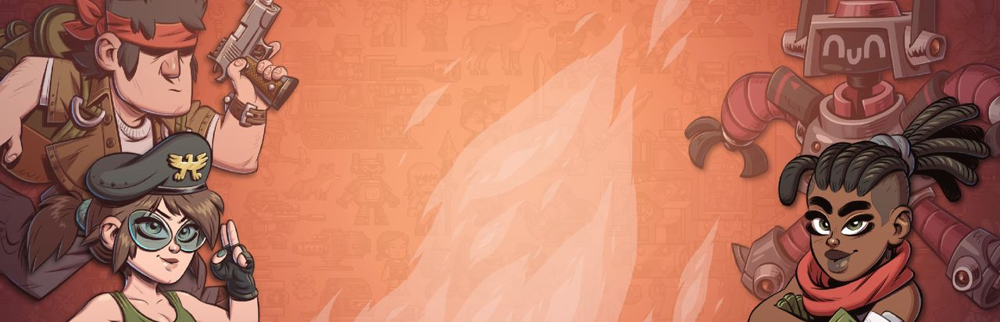

**Synopsis officiel :** *Dans ce jeu d’action 2D à couper le souffle, vous faites partie des Mercenary Kings, l’équipe de mercenaires la plus qualifiée sur Terre! Lorsque vos camarades tombent au combat et que les sbires de CLAW prennent contrôle d’une île-laboratoire ultra-secrète, c’est à vous de les détruire une fois pour toutes!*

**Mon appréciation :** Si vous aimez les jeux multijoueurs accessibles où vous pouvez compléter des missions en quelques minutes seulement, Mercenary Kings a beaucoup d’heures de plaisir à offrir.

**Développeur :** Tribute Games

**Éditeur :** Tribute Games

**Date de sortie :** 25 mars 2014

**Plateformes :** PC, Mac OS, PlayStation 4, PlayStation Vita, Xbox One, Nintendo Switch

**Où l'acheter :** [Steam](https://store.steampowered.com/app/218820/) · [PlayStation Store](https://store.playstation.com/fr-ca/product/UP2114-CUSA00324_00-0000000000000001) · [Xbox](https://www.xbox.com/fr-CA/games/store/_/C0MH97VDRS26) · [Nintendo eShop](https://www.nintendo.com/fr-ca/store/products/mercenary-kings-reloaded-edition-switch/)

---

## Missing : An interactive thriller

**Synopsis officiel :** *Vous incarnez David Newcastle, la victime. Enlevé sans raison apparente, David devra trouver le chemin de la sortie tout en cherchant l’identité de son ravisseur ; tandis que, pendant ce temps, l’inspecteur Lambert mène l’enquête sur les mystérieuses disparitions dont la ville fait l’objet.*

**Mon appréciation :** Un jeu d’aventure en FMV qui rappelle la belle époque de ce genre populaire dans les années 90. Malheureusement, il n’y a eu qu’un seul épisode de Missing : An Interactive Thriller, qui n’est d’ailleurs plus disponible à la vente. Vous pouvez cependant [regarder des playthroughs complets sur YouTube](https://www.youtube.com/watch?v=wg0po20HxXo) pour y voir Patrick Hivon et Roy Dupuis à l’oeuvre.

**Développeur :** Zandel Media

**Éditeur :** Zandel Media

**Date de sortie :** 25 mai 2015

**Plateformes :** PC

**Où l'acheter :** le jeu n'est plus offert en version numérique (il a été retiré de Steam).

---

## Outlast

**Synopsis officiel :** *L’enfer est une expérience à laquelle vous ne pouvez pas survivre dans Outlast, un jeu d’horreur et de survie à la première personne développé par des vétérans de certaines des plus grandes franchises de jeux de l’histoire. Dans la peau du journaliste d’investigation Miles Upshur, explorez Mount Massive Asylum et tentez de survivre assez longtemps pour découvrir son terrible secret… si vous l’osez.*

**Mon appréciation :** Il ne fait aucun doute qu’Outlast a revigoré le genre de l’horreur en jeu vidéo en contribuant à populariser les jeux d’horreur sans combat, où le joueur doit survivre en courant, se cachant et en déjouant les ennemis. Le jeu a donné suite à Outlast 2, qui amène l’horreur et le gore à un autre niveau, et maintenant The Outlast Trials qui connait un énorme succès en introduisant du multijoueur en coopérative.

**Développeur :** Red Barrels

**Éditeur :** Red Barrels

**Date de sortie :** 4 septembre 2013

**Plateformes :** PC, Linux, Mac OS, PlayStation 4, Xbox One, Nintendo Switch

**Où l'acheter :** [Steam](https://store.steampowered.com/app/238320/) · [GOG](https://www.gog.com/fr/game/outlast) · [Epic Games Store](https://store.epicgames.com/p/outlast) · [PlayStation Store](https://store.playstation.com/fr-ca/product/UP2113-CUSA00325_00-OUTLAST000000000) · [Xbox](https://www.xbox.com/fr-CA/games/store/_/BP3GH4D3HP2H) · [Nintendo eShop (Bundle of Terror)](https://www.nintendo.com/fr-ca/store/products/outlast-bundle-of-terror-switch/)

---

## Outward

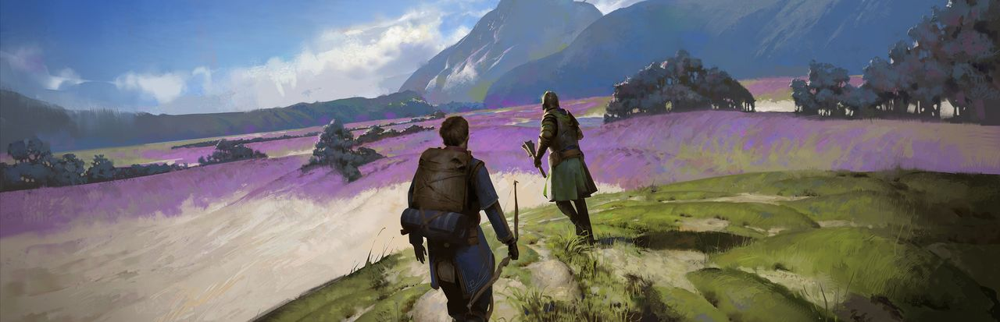

**Synopsis officiel :** *Dans Outward, le froid de la nuit ou l’infection guettant une blessure peuvent s’avérer aussi dangereux que le prédateur rôdant dans les ténèbres. Explorez le vaste monde d’Aurai en solo ou en coop.*

**Mon appréciation :** Un impressionnant jeu de rôle à monde ouvert avec des éléments de survie et la possibilité de jouer en coop. Nine Dots Studio a réussi un tour de force avec les moyens d’un studio indépendant.

**Développeur :** Nine Dots Studio

**Éditeur :** Prime Matter

**Date de sortie :** 26 mars 2019

**Plateformes :** PC, PlayStation 4, PlayStation 5, Xbox One, Xbox Series, Stadia, Nintendo Switch

**Où l'acheter :** [Steam](https://store.steampowered.com/app/794260/) · [GOG](https://www.gog.com/fr/game/outward_definitive_edition) · [Epic Games Store](https://store.epicgames.com/p/outward) · [PlayStation Store](https://www.playstation.com/fr-ca/games/outward/) · [Xbox](https://www.xbox.com/fr-CA/games/store/_/9N4RBWQ471VX) · [Nintendo eShop](https://www.nintendo.com/fr-ca/store/products/outward-definitive-edition-switch/)

---

## Pewdiepie : Legend of the Brofist

**Synopsis officiel :** *PewDiePie: La Légende du Brofist. Accompagnez vos YouTubers préférés dans cette aventure épique!*

**Mon appréciation :** La première de plusieurs collaborations entre le studio québécois Outerminds et PewDiePie, un youtubeur suédois qui est un des plus populaires au monde.

**Développeur :** Outerminds

**Éditeur :** Outerminds

**Date de sortie :** 10 décembre 2015

**Plateformes :** iOS, Android, PC, Mac OS

**Où l'acheter :** [Steam](https://store.steampowered.com/app/390520/) · [App Store](https://apps.apple.com/ca/app/pewdiepie-legend-of-brofist/id1028623510) · [Google Play](https://play.google.com/store/apps/details?id=com.outerminds.pewdiepie)

---

## Prince of Persia : The Sands of Time

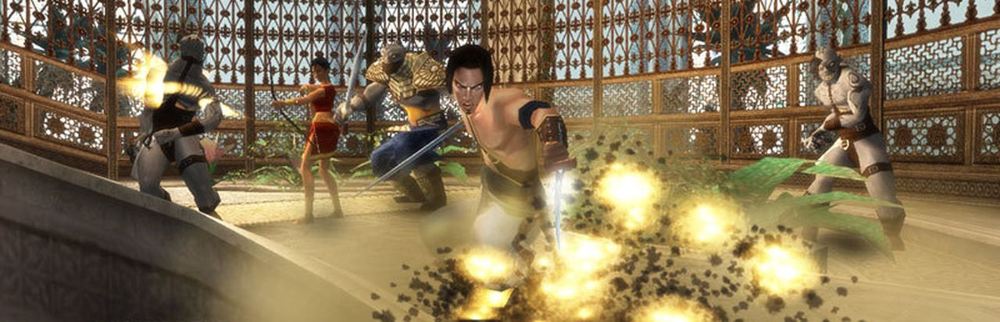

**Synopsis officiel :** *Des sables de la Perse, une légende rapporte l’histoire d’un jeune prince qui permit au Mal de se répandre sur le royaume. Avec l’aide d’une princesse séduisante et du pouvoir absolu des sables du temps, ce prince va relever le défi de réclamer le palais et le royaume.*

**Mon appréciation :** Avant The Sands of Time, le titre Prince of Persia évoquait un vieux jeu DOS avec des contrôles difficiles. Ubisoft Montréal a réinventé la franchise en jeu d’action et d’aventure avec des mécaniques de manipulations temporelles et de parkour qui ont marqué une génération de joueurs.

**Développeur :** Ubisoft Montréal

**Éditeur :** Ubisoft

**Date de sortie :** 11 novembre 2003

**Plateformes :** PlayStation 2, Xbox, Nintendo Gamecube, PC

**Où l'acheter :** [Steam](https://store.steampowered.com/app/13600/) · [GOG](https://www.gog.com/fr/game/prince_of_persia_the_sands_of_time)

---

## Rainbow Billy : The curse of the Leviathan

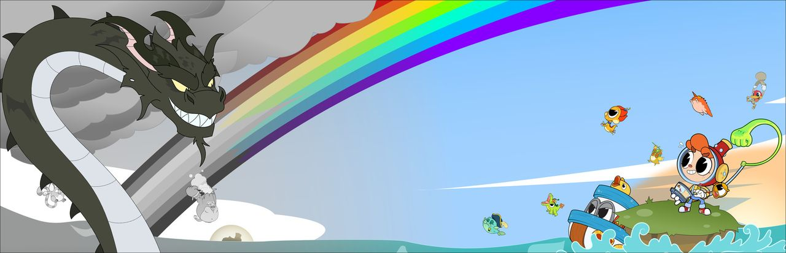

**Synopsis officiel :** *Rainbow Billy: The Curse of the Leviathan est un jeu d’aventure-puzzle-plateforme sain et non-violent en 2.5D avec des éléments de jeu de rôle, dans lequel vous devez sauver de fantasques créatures en rendant à votre monde ses couleurs d’autrefois !*

**Mon appréciation :** À venir.

**Développeur :** Manavoid Entertainment

**Éditeur :** Skybound Games

**Date de sortie :** 5 octobre 2021

**Plateformes :** PC, Xbox One, PlayStation 4, Nintendo Switch

**Où l'acheter :** [Steam](https://store.steampowered.com/app/1106830/) · [Epic Games Store](https://store.epicgames.com/p/rainbow-billy-the-curse-of-the-leviathan) · [PlayStation Store](https://store.playstation.com/fr-ca/product/UP2908-CUSA28644_00-RAINBOWBILLYGAME) · [Xbox](https://www.xbox.com/fr-CA/games/store/_/9PMGFL6KM0T2) · [Nintendo eShop](https://www.nintendo.com/fr-ca/store/products/rainbow-billy-the-curse-of-the-leviathan-switch/)

---

## Tom Clancy’s Rainbow Six : Siege

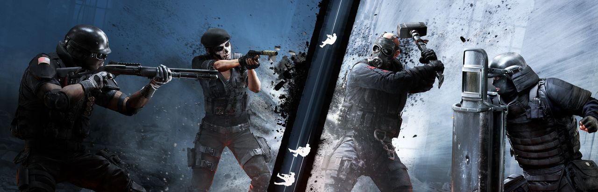

**Synopsis officiel :** *Tom Clancy’s Rainbow Six® Siege est un jeu de tir tactique réaliste qui se joue en équipe, où vous devrez allier talent et stratégie. Entre phases d’attaque et de défense en 5c5, préparez-vous à des combats rapprochés intenses.*

**Mon appréciation :** Avec Rainbow Six : Siege, Ubisoft Montréal a non seulement réinventé la franchise Rainbow Six, mais aussi établi un nouveau esports majeur avec des ligues internationales à un haut niveau de compétition.

**Développeur :** Ubisoft Montréal

**Éditeur :** Ubisoft

**Date de sortie :** 1er décembre 2015

**Plateformes :** PC, PlayStation 4, PlayStation 5, Xbox One, Xbox Series, Google Stadia

**Où l'acheter :** [Steam](https://store.steampowered.com/app/359550/) · [Epic Games Store](https://store.epicgames.com/p/rainbow-six-siege-x) · [PlayStation Store](https://www.playstation.com/fr-ca/games/tom-clancys-rainbow-six-siege/) · [Xbox](https://www.xbox.com/fr-CA/games/store/_/C12T09DSVP8J)

---

## Sang-Froid : Tales of Werewolves

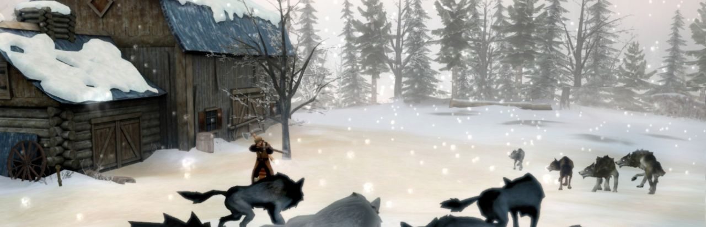

**Synopsis officiel :** *Écrit en collaboration avec l’auteur québécois best-seller Bryan Perro (Amos Daragon, Wariwulf), Sang-Froid – Un conte de loups-garous vous transporte au 19ème siècle dans un Québec légendaire peuplé de feux-follets, de Windigos et de loups-garous.*

**Mon appréciation :** Probablement le premier jeu vidéo qui se déroule au Québec et qui met en scène l’histoire et le folklore local. Avec des phases de préparation et des phases d’action, la propositon de Sang-Froid est audacieuse et offre un bon challenge aux joueurs expérimentés. [Il est maintenant disponible gratuitement sur Steam.](https://store.steampowered.com/app/227220/SangFroid__Tales_of_Werewolves/)

**Développeur :** Artifice Studio

**Éditeur :** Artifice Studio

**Date de sortie :** 5 avril 2013

**Plateformes :** PC

**Où l'acheter :** [Steam](https://store.steampowered.com/app/227220/) · [GOG](https://www.gog.com/fr/game/sangfroid_tales_of_werewolves)

---

## Scott Pilgrim vs The World

**Synopsis officiel :** *Redécouvrez le beat ’em up façon jeu d’arcade 2D inspiré par la BD culte et le film Scott Pilgrim contre le Monde !*

**Mon appréciation :** Un excellent beat’em up qui s’inspire du classique du NES River City Ransom. Une bonne partie de l’équipe derrière le jeu fondera par la suite le studio indépendant Tribute Games.

**Développeur :** Ubisoft Montréal

**Éditeur :** Ubisoft

**Date de sortie :** 10 août 2010

**Plateformes :** PlayStation 3, PlayStation 4, Xbox 360, Xbox One, PC, Google Stadia, Amazon Luna

**Où l'acheter :** [Steam (Complete Edition)](https://store.steampowered.com/app/2215260/) · [Epic Games Store](https://store.epicgames.com/p/scott-pilgrim-vs-the-world-the-game) · [PlayStation Store](https://www.playstation.com/fr-ca/games/scott-pilgrim-vs-the-world-the-game/) · [Xbox](https://www.xbox.com/fr-CA/games/store/_/9NFJBW6B6D78) · [Nintendo eShop](https://www.nintendo.com/fr-ca/store/products/scott-pilgrim-vs-the-world-the-game-complete-edition-switch/)

---

## Sea of Stars

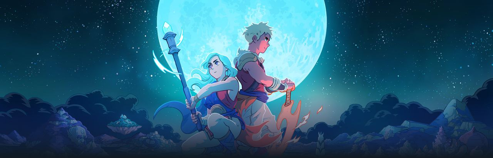

**Synopsis officiel :** *Sea of ​​Stars est un RPG au tour par tour inspiré des classiques. Il raconte l’histoire de deux Enfants du Solstice qui combineront les pouvoirs du soleil et de la lune pour réaliser la Magie de l’Éclipse, la seule force capable de repousser les créations monstrueuses de l’alchimiste maléfique connu sous le nom de Fleshmancer.*

**Mon appréciation :** À venir.

**Développeur :** Sabotage Studio

**Éditeur :** Sabotage Studio

**Date de sortie :** 28 août 2023

**Plateformes :** PC, Nintendo Switch, PlayStation 4, PlayStation 5, Xbox One, Xbox Series

**Où l'acheter :** [Steam](https://store.steampowered.com/app/1244090/) · [GOG](https://www.gog.com/fr/game/sea_of_stars) · [PlayStation Store](https://www.playstation.com/fr-ca/games/sea-of-stars/) · [Xbox](https://www.xbox.com/fr-CA/games/store/_/9NLLTTJZH40L) · [Nintendo eShop (Switch)](https://www.nintendo.com/fr-ca/store/products/sea-of-stars-switch/) · [Nintendo eShop (Switch 2)](https://www.nintendo.com/fr-ca/store/products/sea-of-stars-switch-2/)

---

## Season : A letter to the future

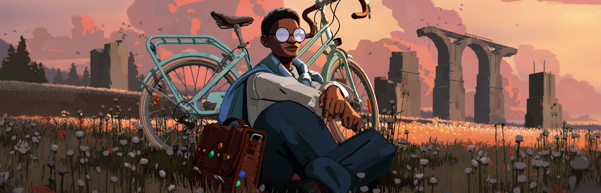

**Synopsis officiel :** *Quittez votre maison pour la première fois et enregistrez des souvenirs avant qu’un mystérieux cataclysme ne ravage tout sur son passage. Parcourez un monde insolite à vélo, faites des rencontres et percez les mystères de Season, un jeu d’exploration méditatif à la troisième personne.*

**Mon appréciation :** Un véritable chef d’oeuvre et un des meilleurs jeux vidéo de 2023.

**Développeur :** Scavengers Studio

**Éditeur :** Scavengers Studio

**Date de sortie :** 31 janvier 2023

**Plateformes :** PC, PlayStation 4, PlayStation 5

**Où l'acheter :** [Steam](https://store.steampowered.com/app/695330/) · [Epic Games Store](https://store.epicgames.com/p/season) · [PlayStation Store](https://www.playstation.com/fr-ca/games/season-a-letter-to-the-future/)

---

## Spiritfarer

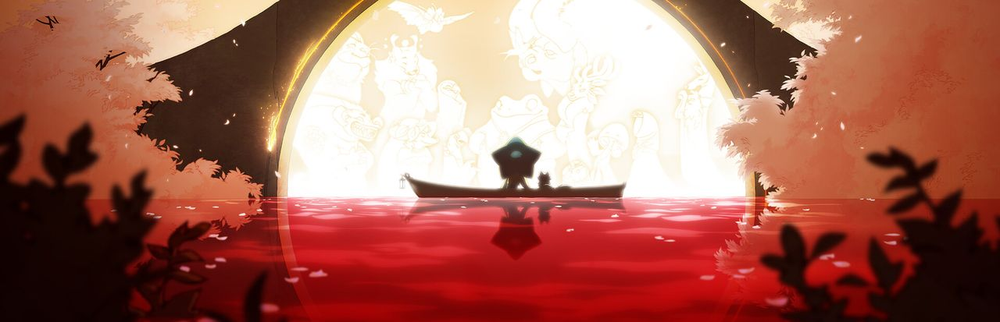

**Synopsis officiel :** *Spiritfarer est un jeu de gestion cosy sur le thème de la mort, dans lequel vous incarnez une passeuse d’âmes. Construisez un bateau pour explorer le monde, prenez soin de vos esprits et guidez-les au jusqu’à l’au-delà. Inclut le jeu de base émouvant et trois mises à jour de contenu majeures.*

**Mon appréciation :** Un jeu relaxant, mais aussi envoûtant et touchant.

**Développeur :** Thunder Lotus Games

**Éditeur :** Thunder Lotus Games

**Date de sortie :** 18 août 2020

**Plateformes :** PC, Linux, Mac OS, Nintendo Switch, PlayStation 4, Xbox One, iOS, Android

**Où l'acheter :** [Steam](https://store.steampowered.com/app/972660/) · [GOG](https://www.gog.com/fr/game/spiritfarer) · [Epic Games Store](https://store.epicgames.com/p/spiritfarer) · [PlayStation Store](https://www.playstation.com/fr-ca/games/spiritfarer/) · [Xbox](https://www.xbox.com/fr-CA/games/store/_/9NG5L58FD3X5) · [Nintendo eShop](https://www.nintendo.com/fr-ca/store/products/spiritfarer-switch/) · [App Store (Netflix)](https://apps.apple.com/ca/app/spiritfarer-netflix-edition/id1610577424) · [Google Play (Netflix)](https://play.google.com/store/apps/details?id=com.netflix.NGP.Spiritfarer)

---

## Tom Clancy’s Splinter Cell

**Synopsis officiel :** *Infiltrez des positions terroristes, obtenez des renseignements cruciaux peu importe les moyens, exécutez avec extrême préjudice, et sortez sans laisser de trace !Vous êtes Sam Fisher, un agent secret de haut niveau d’une branche secrète de la NSA : Third Echelon.*

**Mon appréciation :** Le début d’une franchise qui a redéfini les jeux d’espionnage et de furtivité.

**Développeur :** Ubisoft Montréal

**Éditeur :** Ubisoft

**Date de sortie :** 18 février 2003

**Plateformes :** PC, Xbox, PlayStation 2, Nintendo Gamecube, Mac OS, PlayStation 3

**Où l'acheter :** [Steam](https://store.steampowered.com/app/13560/) · [GOG](https://www.gog.com/fr/game/splinter_cell) · [Epic Games Store](https://store.epicgames.com/p/splinter-cell)

---

## Tape to Tape

**Synopsis officiel :** *Avec son rythme effréné, son réalisme et sa profondeur, Tape to Tape offre une expérience de hockey sans pareil. TTT propose une formule inédite en fusionnant le gameplay ultra-addictif d’une campagne Roguelite à l’intérieur d’un jeu de hockey!*

**Mon appréciation :** Beaucoup de plaisir avec une approche originale pour un jeu de hockey avec une campagne solo et des éléments roguelite.

**Développeur :** Excellent Rectangle

**Éditeur :** Null Games

**Date de sortie :** 3 mai 2023

**Plateformes :** PC

**Où l'acheter :** [Steam](https://store.steampowered.com/app/1566200/) · [PlayStation Store](https://store.playstation.com/fr-ca/concept/10012034) · [Xbox](https://www.xbox.com/fr-CA/games/store/_/9P51DN776TFV) · [Nintendo eShop](https://www.nintendo.com/fr-ca/store/products/tape-to-tape-switch/)

---

## The Messenger

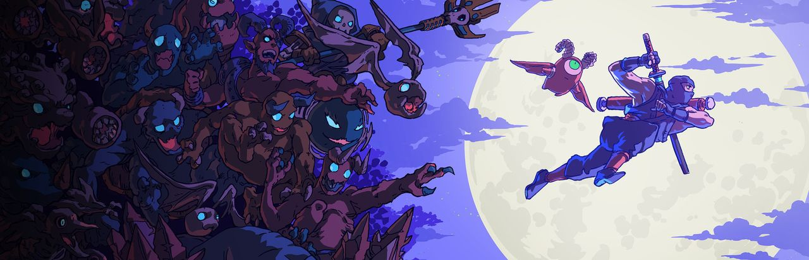

**Synopsis officiel :** *Alors qu’un Démon menace de raser son village, un jeune ninja porteur d’un parchemin vital pour la survie des siens doit traverser un monde maudit.*

**Mon appréciation :** Ce qui semble d’abord un simple hommage à Ninja Gaiden, se dévoile à être beaucoup plus que cela. À jouer en mode « Québécois » pour augmenter le plaisir.

**Développeur :** Sabotage Studio

**Éditeur :** Devolver Digital

**Date de sortie :** 30 août 2018

**Plateformes :** PC, PlayStation 4, Xbox One, Nintendo Switch

**Où l'acheter :** [Steam](https://store.steampowered.com/app/764790/) · [GOG](https://www.gog.com/fr/game/the_messenger) · [Epic Games Store](https://store.epicgames.com/p/the-messenger) · [PlayStation Store](https://www.playstation.com/fr-ca/games/the-messenger/) · [Xbox](https://www.xbox.com/fr-CA/games/store/_/9P5C81K094KW) · [Nintendo eShop](https://www.nintendo.com/fr-ca/store/products/the-messenger-switch/)

---

## This bed we made

**Synopsis officiel :** *This Bed We Made est jeu de mystère à la troisième personne. Plongez dans la peau d’une femme de chambre d’hôtel des années 50 et fouinez dans les possessions d’inconnus afin de découvrir leurs terribles secrets. Découvrez ce qui lie les clients entre eux dans cette histoire d’amour et de meurtre!*

**Mon appréciation :** Intrigant jeu narratif et d’enquêtes avec une protagoniste inhabituelle : une femme de ménage! Le jeu se déroule au Québec et peut être apprécié en français.

**Développeur :** Lowbirth Games

**Éditeur :** Lowbirth Games

**Date de sortie :** 1er novembre 2023

**Plateformes :** PC, PlayStation 5, Xbox Series

**Où l'acheter :** [Steam](https://store.steampowered.com/app/1243850/) · [PlayStation Store](https://store.playstation.com/fr-ca/product/UP7666-PPSA17884_00-0193558750092408) · [Xbox](https://www.xbox.com/fr-CA/games/store/_/9MXJSVP2NW44)

---

## Teenage Mutant Ninja Turtles : Shredder’s Revenge

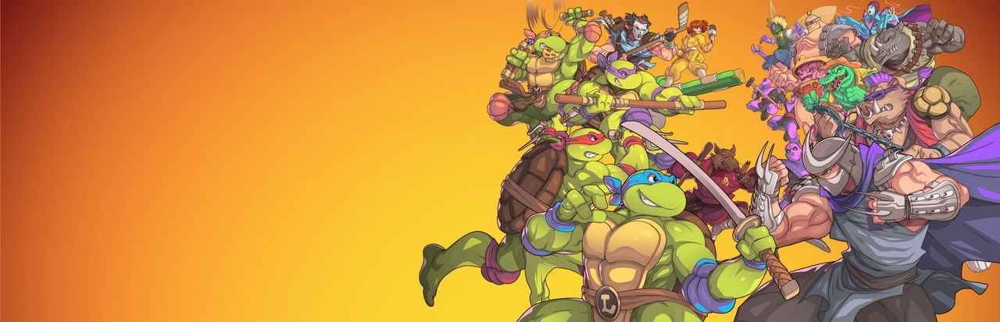

**Synopsis officiel :** *TMNT: Shredder’s Revenge réunit Leonardo, Michelangelo, Donatello et Raphaël dans un beat’em up qui ne fait pas dans la dentelle. Une réalisation exceptionnelle qui rend hommage à des jeux classiques estampillés TMNT.*

**Mon appréciation :** Il y a eu beaucoup de jeux vidéo des TMNT au cours des années, mais peu ont autant été apprécié que les beat’em up de l’époque 16-bits tels que Turtles in Time. Tribute Games ramène le style graphique et la jouabilité de l’époque tout en la modernisant pour créer un classique instantané.

**Développeur :** Tribute Games

**Éditeur :** Dotemu

**Date de sortie :** 16 juin 2022

**Plateformes :** PC, Linux, PlayStation 4, PlayStation 5, Xbox One, Xbox Series, Nintendo Switch, iOS, Android

**Où l'acheter :** [Steam](https://store.steampowered.com/app/1361510/) · [Epic Games Store](https://store.epicgames.com/p/teenage-mutant-ninja-turtles-shredders-revenge) · [PlayStation Store](https://www.playstation.com/fr-ca/games/teenage-mutant-ninja-turtles-shredders-revenge/) · [Xbox](https://www.xbox.com/fr-CA/games/store/_/9NS3673HVH41) · [Nintendo eShop](https://www.nintendo.com/fr-ca/store/products/teenage-mutant-ninja-turtles-shredders-revenge-switch/) · [App Store](https://apps.apple.com/ca/app/tmnt-shredders-revenge-mobile/id1597084360) · [Google Play](https://play.google.com/store/apps/details?id=com.playdigious.tmnt)

---

## Tribes of Midgard

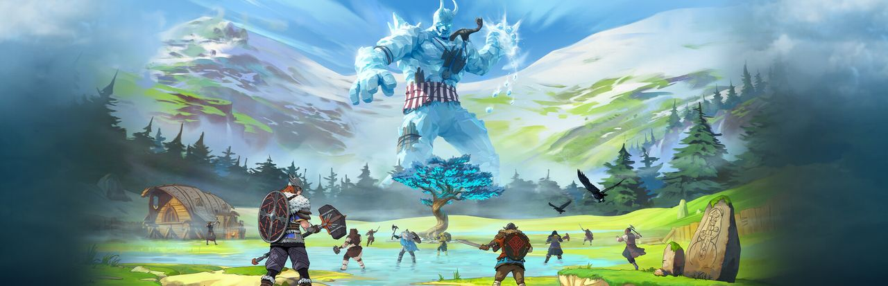

**Synopsis officiel :** *Fabriquez des objets légendaires, construisez une base de plus en plus imposante, embarquez pour un voyage épique à travers des mondes générés de manière procédurale, et affrontez d’immenses adversaires bien déterminés à déclencher le Ragnarök.*

**Mon appréciation :** À venir.

**Développeur :** Norsfell

**Éditeur :** Gearbox Publishing

**Date de sortie :** 27 juillet 2021

**Plateformes :** PC, PlayStation 4, PlayStation 5, Xbox One, Xbox Series, Nintendo Switch

**Où l'acheter :** [Steam](https://store.steampowered.com/app/858820/) · [Epic Games Store](https://store.epicgames.com/p/tribes-of-midgard) · [PlayStation Store](https://www.playstation.com/fr-ca/games/tribes-of-midgard/) · [Xbox](https://www.xbox.com/fr-CA/games/store/_/9NNGTS145NBM) · [Nintendo eShop](https://www.nintendo.com/fr-ca/store/products/tribes-of-midgard-switch/)

---

## Ultimate Chicken Horse

**Synopsis officiel :** *Ultimate Chicken Horse est un jeu de plateformes festif qui vous permet de construire le niveau tout en jouant et en plaçant des pièges et autres dangers pour attraper vos amis tout en essayant de ne pas vous attraper vous-même.*

**Mon appréciation :** À venir.

**Développeur :** Clever Endeavour Games

**Éditeur :** Clever Endeavour Games

**Date de sortie :** 4 mars 2016

**Plateformes :** PC, Linux, PlayStation 4, Xbox One, Nintendo Switch

**Où l'acheter :** [Steam](https://store.steampowered.com/app/386940/) · [PlayStation Store](https://www.playstation.com/fr-ca/games/ultimate-chicken-horse/) · [Xbox](https://www.xbox.com/fr-CA/games/store/_/BNNMLWZRNQF6) · [Nintendo eShop](https://www.nintendo.com/fr-ca/store/products/ultimate-chicken-horse-switch/)

---

## We Happy Few

**Synopsis officiel :** *We Happy Few est un jeu d’action/aventure qui se déroule dans une Angleterre des années 60 alternative, au sein d’une ville rétrofuturiste ravagée par la drogue. Cachez-vous, battez-vous et fondez-vous dans la foule pour échapper à ce monde délirant et obsédé par la Joy.*

**Mon appréciation :** À venir.

**Développeur :** Compulsion Games

**Éditeur :** Gearbox Publishing

**Date de sortie :** 10 août 2018

**Plateformes :** PC, Linux, PlayStation 4, Xbox One

**Où l'acheter :** [Steam](https://store.steampowered.com/app/320240/) · [GOG](https://www.gog.com/fr/game/we_happy_few) · [PlayStation Store](https://store.playstation.com/fr-ca/product/UP0292-CUSA09406_00-WEHAPPYFEW000000) · [Xbox](https://www.xbox.com/fr-CA/games/store/_/BPR2TBS2KMQJ)

---

**À LIRE AUSSI : [Les 20 meilleurs jeux faits au Québec, selon Metacritic](/2023/08/19/les-20-meilleurs-jeux-faits-au-quebec-selon-metacritic/)**
