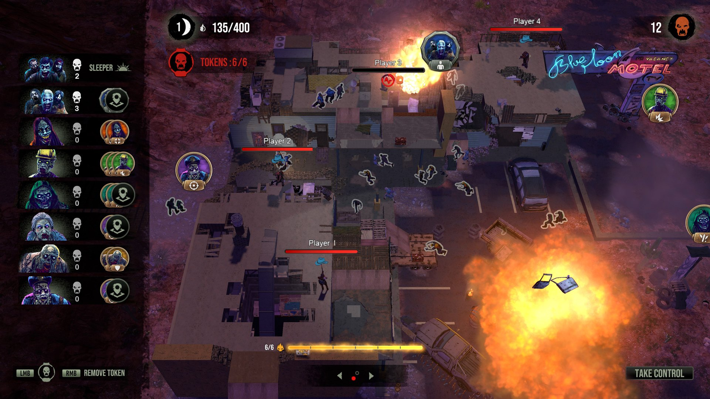
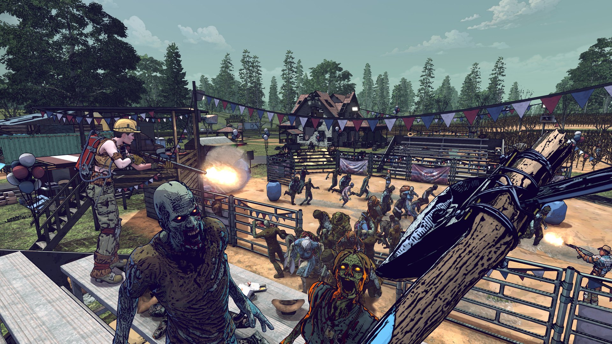
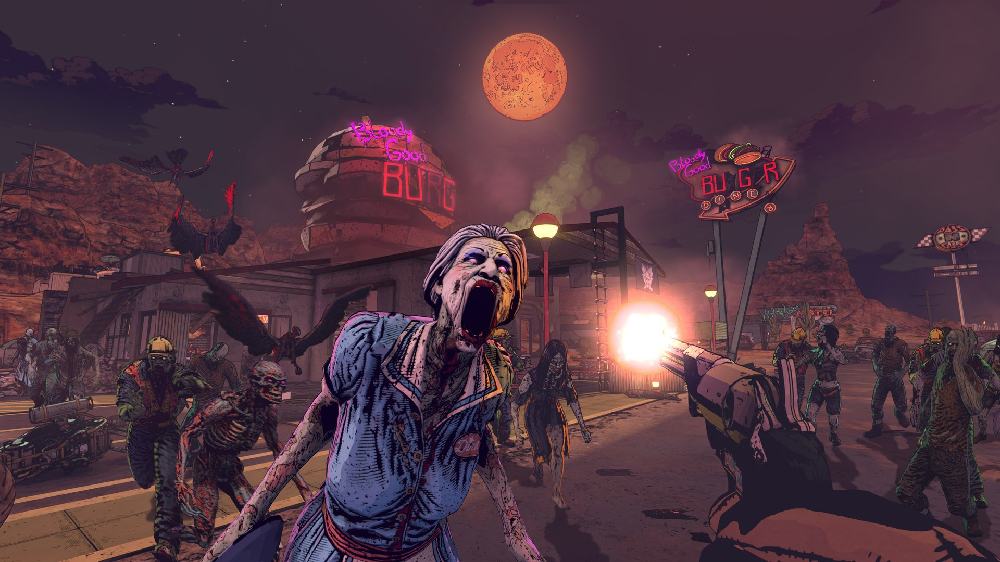

*images gracieuseté de iLLOGIKA*

**Le studio québécois [iLLOGIKA](https://www.illogika.com/) a annoncé, le 18 décembre dernier, le lancement d’une version d’essai gratuite de son titre [*7 Days Blood Moons*](https://store.steampowered.com/app/2312280/7_Days_Blood_Moons/) sur la plateforme Steam. Cette initiative s’accompagne d’une série de correctifs et d’ajouts de contenu visant à stabiliser l’expérience de jeu en accès anticipé.**

https://videopress.com/v/dYJtNPTd

Lancé le 4 novembre dernier, ***7 Days Blood Moons*** est un jeu de survie asymétrique en format 4 contre 1, se déroulant dans l’univers de la franchise ***7 Days to Die***. Depuis sa sortie, le studio montréalais indique avoir concentré ses efforts sur l’analyse des retours de la communauté et des performances techniques du titre.

> « *Depuis le premier jour, nous écoutons attentivement notre communauté. La démo gratuite est notre façon de rendre l’expérience plus accessible, de montrer le chemin parcouru et d’inviter davantage de joueurs à découvrir la direction que prend le jeu. L’accès anticipé vise à impliquer les joueurs dans le processus de développement, et leurs commentaires influencent chacune de nos décisions.* »
> **— David Fugère-Lamarre, PDG et co-fondateur d’iLLOGIKA**

Selon les informations communiquées par iLLOGIKA, les interventions récentes ont porté prioritairement sur l’infrastructure des serveurs et la connectivité. Des correctifs ont été déployés pour résoudre les bogues signalés par les utilisateurs et pour optimiser la conception des niveaux.

Le studio précise que la démo gratuite, désormais accessible, intègre l’ensemble de ces améliorations techniques afin d’offrir une vitrine représentative de l’état actuel du développement.

Malgré l’accent mis sur la résolution de problèmes techniques, le titre a connu plusieurs ajouts de contenu depuis son passage en accès anticipé. Les joueurs ont vu l’introduction de :

- De nouveaux ennemis et des cartes additionnelles ;
- Des éléments cosmétiques pour les Survivants ;
- Un système de badges de mérite.

Le développement actuel s’oriente désormais vers l’ajustement de la réactivité des combats et l’équilibrage entre les deux camps (les Survivants et le Maître Zombie). iLLOGIKA travaille également sur l’élargissement du soutien linguistique pour accommoder une base de joueurs internationale.

Le studio rappelle qu’une feuille de route publique est disponible sur Steam, permettant aux joueurs de suivre les prochaines étapes de production et les fonctionnalités à venir.

**À LIRE AUSSI : [Incarnez un goéland déjanté dans ce jeu d’un développeur solo](/2025/09/27/incarnez-un-goeland-dejante-dans-ce-jeu-dun-developpeur-solo/)**
