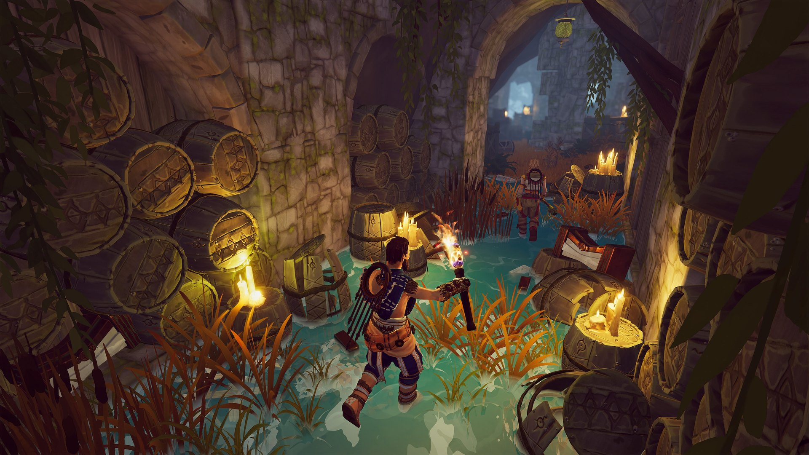
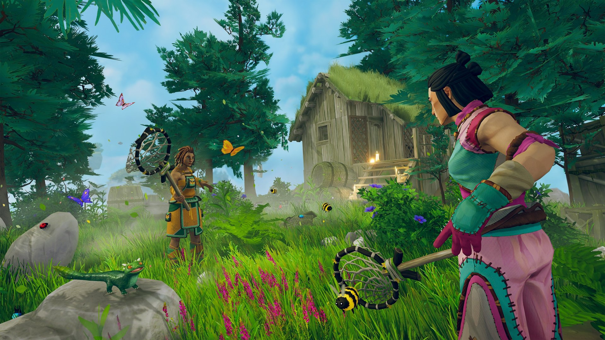
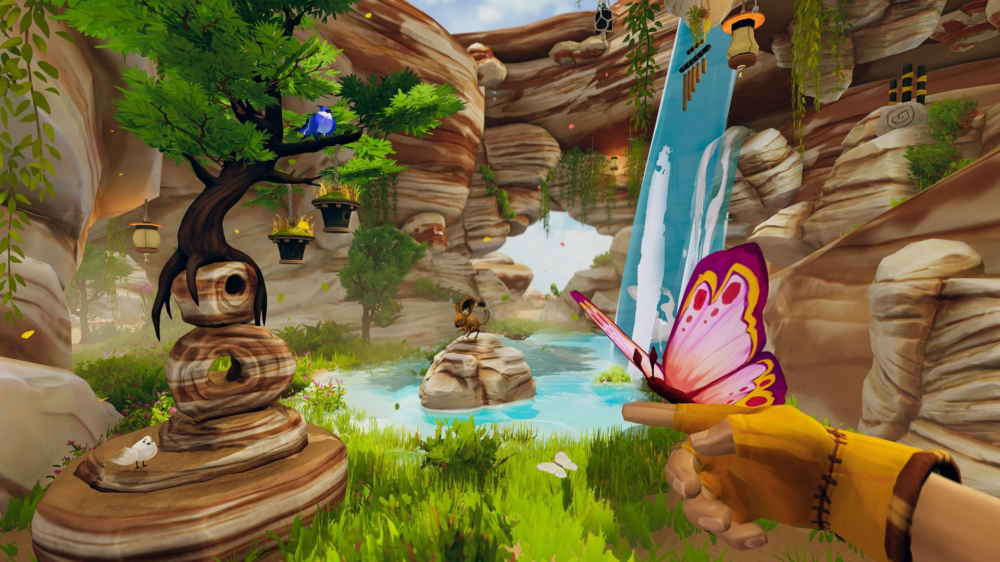
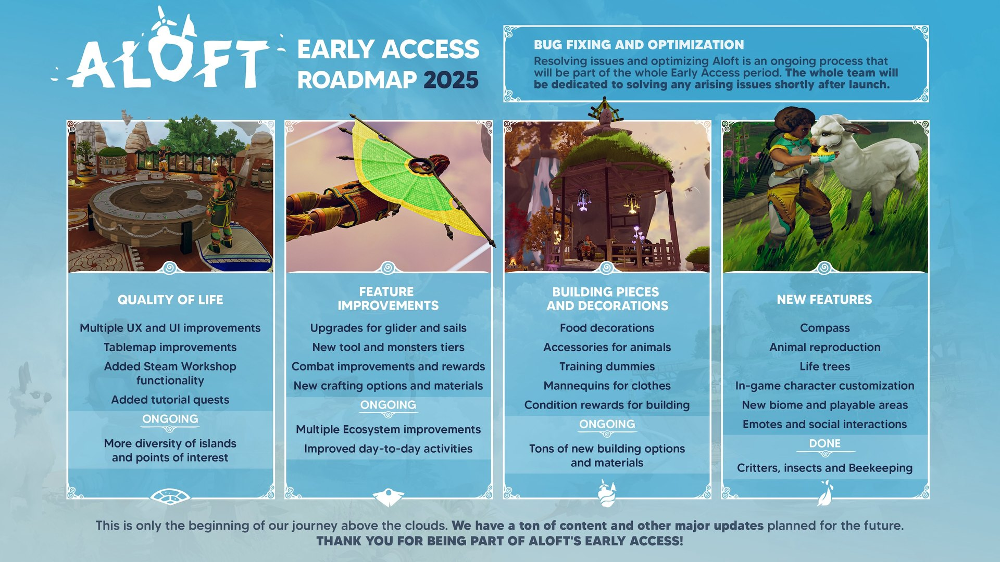

*images gracieuseté de Astrolabe Interactive*

**Le studio québécois [Astrolabe Interactive](https://www.astrolabe.games/) lance aujourd’hui la mise à jour « Critters & Wonders » de son jeu [Aloft](https://store.steampowered.com/app/1660080/Aloft/), sorti sur Steam en Accès Anticipé le 15 janvier dernier. Le *buzz* pré-lancement s’est concrétisé pour l’équipe montréalaise alors que plus de 100 000 copies du jeu ont été vendues pendant ses deux premières semaines.**

https://www.youtube.com/watch?v=VzpBJbhPzBM

Je me suis entretenu avec le studio à propos de cet exploit et du parcours de développement d’Aloft.

**Premièrement, félicitations pour avoir atteint le plateau des 100 000 copies vendues en seulement 14 jours! Comment avez-vous vécu cela à l’interne?**

*Merci beaucoup ! C’est pour nous la reconnaissance des années de travail pour construirece jeu qui nous passionne. C’est aussi une belle marque de soutien de la part de notre communauté qui suit le développement du jeu depuis plus de 3 ans, ainsi que notre éditeur [Funcom](https://www.funcom.com/), qui a permis au jeu d’atteindre de nouveaux sommets en termes de visibilité. Toute l’équipe est très fière de voir autant de joueurs et de joueuses se projeter dans l’univers d’Aloft, ça fait chaud au cœur.*

**Racontez-nous un peu le parcours de ce projet et comment est venue la collaboration avec Funcom pour l’édition du jeu.**

*En 2021 nous venions de terminer un projet avec un client, puis on cherchait à créer un nouvel univers encourageant et beau, un endroit où s’évader et se ressourcer. L’équipe d’Astrolabe était alors composée de seulement 5 personnes et l’embauche de notre artiste de concept fut la première étape pour concrétiser le projet et initier une préproduction. En quelques mois nous avons développé un prototype et une bible de design qui nous ont permis d’aller chercher le financement nécessaire à accomplir nos ambitions. Ceci dit, nous étions quand même à la recherche de support financier supplémentaire pour assurer la pérennité du projet, ainsi que d’un support en mise en marché pour assurer le succès commercial d’Aloft. C’est pourquoi nous nous sommes mis en recherche d’un éditeur.*

*Dans les années qui suivirent, nous avons participé à des dizaines d’événements d’affaires pour trouver un partenaire. Rencontré initialement à Gamescom 2022 lors d’une endiablée semaine de pitchs, il semble que le directeur d’édition de Funcom a vu quelque chose qui allait lui plaire. Un an plus tard, il avait suivi l’évolution du projet et nous a recontacté pour avoir plus d’informations sur ce que nous cherchions comme deal. Dans les semaines et mois qui ont suivis, nous avons négocié avec Funcom et avons finalement pu sceller une entente en personne lors de la Game Developer Conference (GDC) en 2024. Nous sommes ravis d’avoir pu trouver des partenaires professionnels, efficaces et qui croient dur comme fer au potentiel d’Aloft, tout autant que nous!*

**Quelles ont été vos inspirations et qu’est-ce que vous cherchiez à offrir d’unique avec Aloft?**

*Aloft a été conceptualisé à l’hiver durant la pandémie de la COVID-19. Dans un contexte de confinement, l’équipe souhaitait créer un jeu qui offre un sentiment de liberté et de retour à la nature, un endroit où s’évader virtuellement quand le monde paraît gris tout autour. Aloft s’inspire de divers médias, mais surtout des œuvres du studio Ghibli et de leurs thèmes. Des jeux comme Valheim, Green Hell, et Zelda : Breath of the wild ont également été des sources d’inspiration importantes par leurs mécaniques et la richesse de leurs univers.*

*Dans Aloft, nous voulions explorer la liberté de voler et la relation entre l’humain et la nature. Nous souhaitions créer un monde où l’on peut directement avoir un impact positif sur l’environnement, en quelque sorte offrir une manière de réduire l’éco anxiété qui touche notre génération. Les mécaniques d’Aloft encouragent ses joueurs à améliorer le monde qui les entoure, en éliminant la corruption fongique, en restaurant les écosystèmes et en vivant de manière durable, ce qui est atypique pour les jeux de survie.*

**Aloft est actuellement en Accès Anticipé sur Steam; quel est le plan pour la suite en termes de version finale et d’éventuels mises à jour ou DLC?**

*Nous avons plusieurs mises à jour de contenu prévues pour cette année. Chacune de celles-ci sera aussi accompagnée de son lot de corrections de bogues, d’améliorations générales, et plus. Ce qui est prévu pour cette année se trouve dans la feuille de route (roadmap) ci-dessous. Notre souhait est d’intégrer et regrouper ces éléments dans des mises à jour thématiques gratuites. Nous ne prévoyons pas ajouter d’extensions payantes (DLC) pour Aloft pendant la période d’accès anticipé. Nous espérons aussi porter le jeu sur console, mais ce sera pour plus tard au cours du développement du jeu. Nous avons aussi bien d’autres ambitions pour Aloft, mais il faudra attendre pour en savoir plus !*

**À LIRE AUSSI : [Mecha : un jeu québécois avec une héroïne en chaise roulante](/2025/02/25/mecha-un-jeu-quebecois-avec-une-heroine-en-chaise-roulante/)**
