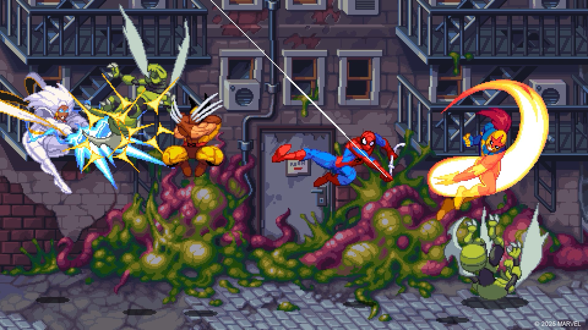
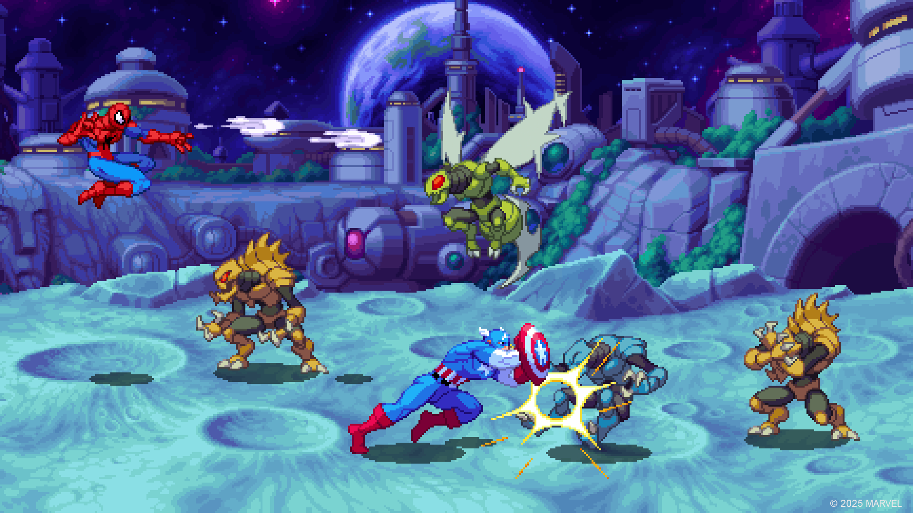

*images gracieuseté de Tribute Games*

**C’est durant le [Nintendo Direct](https://www.youtube.com/watch?v=9OqoRxXUjGA) d’aujourd’hui que [Marvel Cosmic Invasion](https://store.steampowered.com/app/2753970/MARVEL_Cosmic_Invasion/) a été dévoilé. Il s’agit d’un jeu d’action *beat’em up* à saveur rétro édité par le Français [Dotemu](https://www.dotemu.com/) et développé par le Québécois [Tribute Games.](https://tributegames.com/)**

Après le succès critique et commercial de [Teenage Mutant Ninja Turtles : Shredder’s Revenge](/2024/01/26/50-jeux-video-essentiels-crees-au-quebec/), le studio québécois Tribute Games nous propose un jeu dans le même genre, mais cette fois-ci dans l’univers de Marvel. Bien entendu, le tout à la sauce rétro, la marque de commerce de Tribute.

**Voici la bande-annonce :**

https://www.youtube.com/watch?v=cTcWRLN5khM

Dans un communiqué, Tribute Games confirme l’identité des personnages jouables à date : **Captain America, Wolverine, Spider-Man, Storm, Phyla-Vell, Venom** et **Nova.**

*Dans **MARVEL Cosmic Invasion**, le super vilain immortel Annihilus lance une attaque sans précédent dans toute la galaxie, menaçant toute forme de vie connue. Pour affronter cette redoutable Vague d’Annihilation, les plus grands super-héros de notre planète doivent unir leurs forces avec leurs homologues venus de toute la galaxie pour une aventure stellaire à couper le souffle. Combattez dans les rues de New York et jusqu’aux confins de la Zone négative pour empêcher Annihilus de répandre la mort dans le cosmos.*

Une différence marquante entre la jouabilité de Shredder’s Revenge et Cosmic Invasion, est que le joueur peut sélectionner d’emblée un duo de personnages et qu’il peut alterner entre les deux en plein combat grâce à la mécanique *Cosmic Swap*. Il est possible de jouer en coopération jusqu’à 4 joueurs, en multijoueur local ou en ligne, avec possibilité de *crossplay* entre les différentes plateformes.

> *« Je suis presque certain que je parle au nom de toute l’équipe de Tribute Games quand j’affirme que nous sommes profondément honorés de travailler sur MARVEL Cosmic Invasion. Ce projet nous permet de rendre hommage non seulement aux personnages emblématiques de MARVEL, mais aussi aux grands classiques des jeux d’arcade qui ont façonné notre amour pour le jeu vidéo. Nous abordons cette licence adorée avec le plus grand des respects, infusant dans chaque pixel le soin et la passion qu’elle mérite. Une fois encore, nous comptons moderniser et faire avancer le genre tout en respectant ce qui a fait la grandeur de ses titres de légende. Nous ne pouvions espérer meilleurs partenaires que MARVEL et Dotemu, qui tous deux comprennent et partagent notre passion. C’est grâce à eux que notre projet peut prendre une si grande ampleur. »*
>
> **– Jean-François Major, PDG et co-fondateur de Tribute Games.**

Marvel Cosmic Invasion est prévu pour une sortie en sur PC et consoles en 2025.

**À LIRE AUSSI : [Rainbow Six Siege X : Une nouvelle ère s’ouvre le 10 juin](/2025/03/13/rainbow-six-siege-x-une-nouvelle-ere-souvre-le-10-juin/)**
