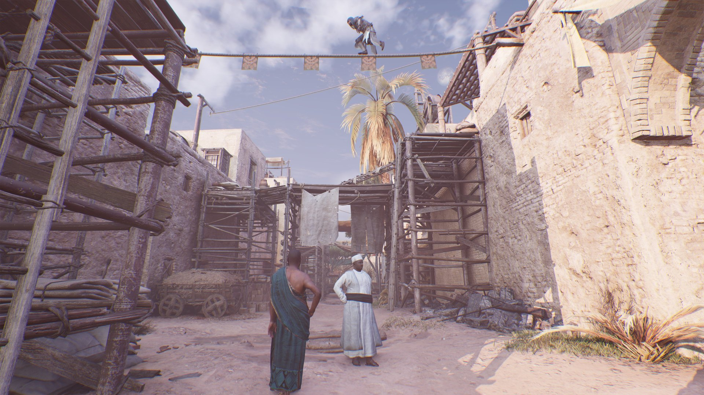
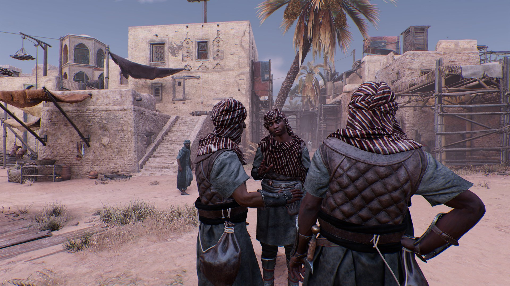
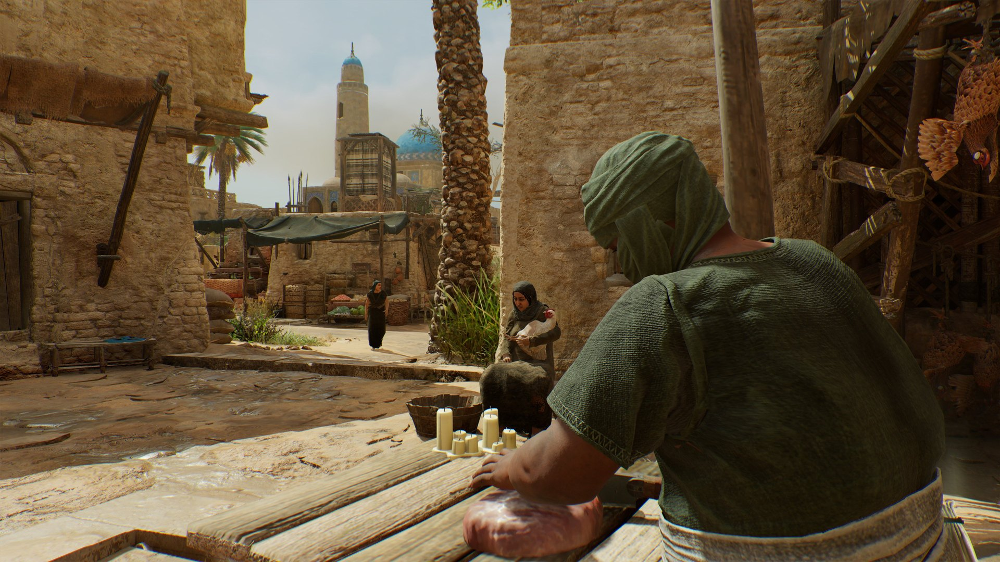
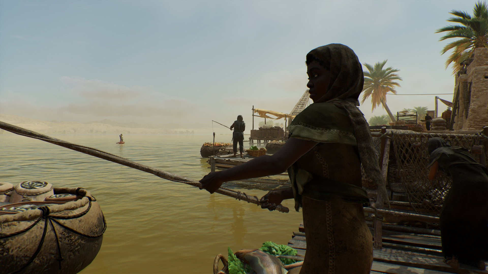

*Copie du jeu et images gracieuseté d’Ubisoft*

**Avec Assassin’s Creed Mirage, Ubisoft a promis un retour aux sources pour la série. Il faut dire que les titres plus récents, tels que Origins, Odyssey et Valhalla, tombaient plutôt dans une catégorie de jeu de rôle d’action à monde ouvert qui ressemblait plus à un Elder Scrolls qu’à ce qui différenciait Assassin’s Creed d’autres franchises d’action. Ubisoft ne met pas de côté cette approche, mais pour Mirage on a voulu faire plaisir aux amateurs des premiers jeux avec une aventure plus compacte. Est-ce que c’est réussi?**

Nous sommes dans la région de Baghdad au 9e siècle. L’ordre des Assassins existe, mais on s’y réfère plutôt comme aux Hidden Ones. Notre personnage principal, Basim, est un simple voleur, mais qui rêve de pouvoir se rebeller comme le régime autoritaire du calife, et l’Ordre des Templiers qui sont derrière le vrai pouvoir.

On s’attache rapidement au personnage de Basim, qui après quelques petites missions d’introduction, se voit recruté par les Hidden Ones. Son entraînement, durant plusieurs mois, ne se fait pas facilement, mais sous le mentorat de Roshan, il devient un assassin prometteur.

Ce qui intéressant en partant avec Assassin’s Creed Mirage est le lieu, Baghdad, car il ne reste pratiquement plus rien de cette version de la ville, dû au passage du temps et les nombreux conflits dont elle a été le théâtre. C’est donc tout un remarquable travail de reconstitution qu’a entrepris Ubisoft. Il n’existe pas, à ma connaissance, de meilleure façon de découvrir ce lieu à cette époque spécifique.

La jouabilité est véritablement un retour aux sources avec des situations et des missions qui récompensent la furtivité. Par récompense, je veux surtout dire que ça facilite les choses de prendre son temps et trouver une façon d’assassiner les ennemis d’un coup, plutôt qu’essayer de les combattre. C’est difficile de gérer plusieurs ennemis à combattre, et même un seul, car les erreurs ne pardonnent pas et on meurt rapidement. Et contrairement aux premiers jeux, les ennemis n’attendent pas gentiment de vous frapper chacun leur tour.

Une nouveauté intéressante est l’Assassin Focus, qui aide beaucoup à gérer les ennemis quand ils sont nombreux avec la possibilité de marquer plusieurs cibles à assassiner que Basim va tuer en quelques mouvements automatisés; à condition de ne pas avoir été repéré avant.

Heureusement, il n’y a pas de dissonance entre l’intention et le design des missions. Ça ne fonctionne pas de foncer dans le tas, même si on est bon en combat. La solution n’est pas toujours évidente, et il faut parfois faire appel à notre fidèle aigle pour déceler des indices et débloquer le prochain objectif d’une mission.

Par exemple, tôt dans le jeu, on doit infiltrer une prison et retrouver un certain prisonnier. Il est possible d’essayer de donner un pot-de-vin à des gardes (sous la forme de jetons qui sont plutôt rares) ou cibler (avec notre aigle) un personnage qui pourra nous aider à créer une distraction et entrer dans la prison par un autre chemin.

Les missions principales se présentent également sous forme d’enquête où on doit procéder par étape, trouver des indices et éventuellement connaître la véritable cible. Cela ne change pas réellement grand-chose à la jouabilité, mais la façon que les choses sont présentées pousse vraiment l’idée qu’il s’agit d’un jeu de furtivité et que rester dans l’ombre et être stratégique est la meilleure façon de procéder.

Exit les points d’expérience et la quantité astronomique d’équipement possible. On a une épée, une dague, notre fidèle lame cachée et quelques accessoires telles que des couteaux à lancer, des bombes fumigènes, etc. On peut en avoir des différentes, les améliorer et les personnaliser, mais tout a été pensé pour qu’on passe moins de temps dans les menus et plus de temps dans l’action. Même l’arbre d’habiletés est plutôt humble.

Là où le jeu innove très peu, c’est dans l’exploration. On retrouve bien entendu le parkour, un des éléments emblématiques de la série. On retrouve aussi les tours et point de sychronisation, les bottes de foin… bref, c’est du déjà vu. C’est du déjà vu assumé, oui, mais c’est une chose de revenir aux sources, et c’est une autre de donner l’impression au joueur qu’il joue à un vieux titre oublié de la série.

Un autre élément qui donne l’impression de jouer à un vieux titre, c’est les graphismes. Oui, les environnements sont beaux, la direction artistique est superbe et détaillée et on sent qu’il y a un énorme travail de reconstitution historique. Cela dit, le facteur « wow » n’est pas là et on n’a pas le sentiment qu’il s’agit d’un jeu qui met à profit les capacités de la nouvelle génération de consoles, malgré qu’il faut choisir les modes Fidèlité et Performance.

Cela ne m’a pas empêché de m’amuser avec le mode photo et d’être impressionné par tous les petits détails qu’on remarque quand on observe la vie à Baghdad au 9e siècle, comme en témoigne mes images dans cet article.

Globalement, Mirage est un titre solide et bravo à Ubisoft d’avoir fait l’exercice de distiller la franchise aux éléments qui font son unicité. Il y a beaucoup de contenu, mais on a enlevé beaucoup de flafla, on a minimisé la course aux *sidequests* redondantes et objets à collectionner, pour offrir une aventure qui ne s’éparpille pas et qui nous en donne pour notre argent, tout en respectant le temps, parfois restreint, du joueur moyen.

## Très bon 8/10

Titre : Assassin’s Creed Mirage

Date de sortie : 5 octobre 2023

Éditeur : Ubisoft

Développeurs : Ubisoft Bordeaux et autres studios Ubisoft

Plateformes : PC, Xbox, PlayStation
