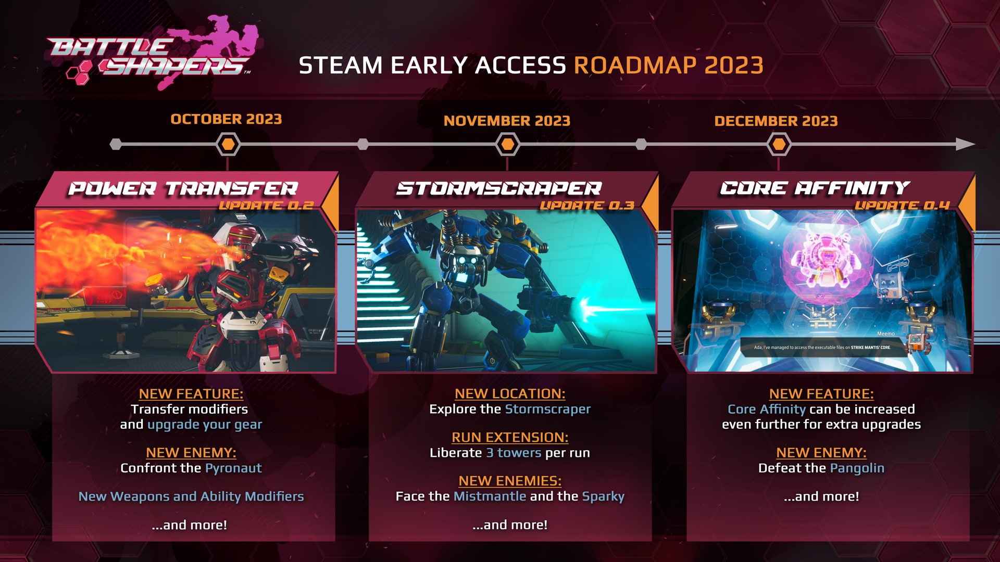

*Crédits images : Metric Empire*

## Le studio québécois [Metric Empire](https://www.battleshapers.com/) vous invite à découvrir leur premier jeu : Battle Shapers. Il s’agit d’un jeu de tir à la première personne avec des mécaniques *roguelite.*

https://www.youtube.com/watch?v=UPKxPn2XuzQ

L’accès anticipé de Battle Shapers est disponible dès maintenant [sur Steam.](https://store.steampowered.com/app/1421290/Battle_Shapers)

Metric Empire a été co-fondé par Nicholas Routier et Pier-Luc Papineau, deux vétérans de chez Ubisoft qui ont travaillé sur les franchises Assassin’s Creed, Prince of Persia et Far Cry. Ils ont rassemblé une équipe de 25 personnes pour développer Battle Shapers.

> « Nous sommes vraiment reconnaissants envers ceux qui nous rejoignent en accès anticipé pour essayer Battle Shapers, un projet dans lequel notre équipe passionnée met vraiment tout son cœur. Ce faisant, vous pourrez également voir comment le jeu évoluera à mesure que nous travaillons vers la sortie de la v1.0 en 2024. Au moment où l’accès anticipé commencera, les joueurs auront l’occasion de découvrir une partie de ce que le jeu final offrira, offrant ainsi un excellent aperçu du contenu passionnant à venir, dont vous pourrez voir une partie dans la feuille de route de l’équipe pour le reste de l’année. »
>
> **– Pier-Luc Papineau, directeur du design**

## Quelques infos supplémentaires sur le jeu :

**COMBATTEZ LE LASER AVEC LE LASER** — Abattez des hordes de machines ennemies rusées avec des stratégies risquées et de combat rapproché avec lesquelles chaque victoire alimente vos capacités de combat. Apprenez à vous adapter aux attaques dangereuses et aux représailles des Overlords qui vous sont lancées à chaque étape du processus.

**LE COMBAT N’EST QUE LA MOITIÉ DE LA BATAILLE** — Débloquez de nouvelles armes, capacités et talents pour augmenter de manière permanente votre capacité de survie et votre potentiel de combat à chaque *run.* Chaque tour promet différentes améliorations et armes cachées pour vous faire progresser d’avantage dans votre aventure.

**CONSTRUISEZ VOTRE FORCE « CORE »** — Acquérez les pouvoirs des Overlords déchus et voyez changer non seulement vos capacités, mais aussi votre apparence et votre gameplay. À mesure que vos pouvoirs grandissent et changent, soyez prudent : à chaque Overlord vaincu, le chemin d’Ada devient de plus en plus difficile.

**À LIRE AUSSI : [Checkmate showdown : une démo avec des défis quotidiens pendant le mois d’octobre](/2023/09/30/checkmate-showdown-une-demo-avec-des-defis-quotidiens-pendant-le-mois-doctobre/)**

**À LIRE SUR BÊTA-TESTEUR : [Critique de Forza Motorsport](https://www.lebetatesteur.ca/test-forza-motorsport/)**
