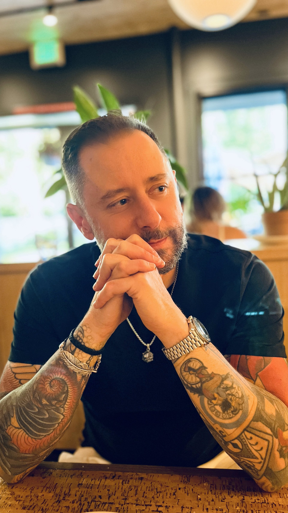

*image à la une : Behaviour Interactive*

**Le géant québécois du jeu vidéo [Behaviour Interactive](https://www.bhvr.com/) a annoncé aujourd’hui l’acquisition de [Red Hook Studios](https://www.redhookgames.com/), le développeur indépendant basé à Vancouver et créateur de la célèbre franchise Darkest Dungeon. Cette acquisition stratégique vise à renforcer la position de Behaviour en tant que leader dans le domaine des jeux d’horreur.**

Fondé par Chris Bourassa et Tyler Sigman, Red Hook Studios s’est fait un nom dans l’industrie grâce à sa série [Darkest Dungeon](https://store.steampowered.com/app/262060/Darkest_Dungeon/), une franchise d’horreur gothique qui a connu un succès retentissant. Les deux opus de la série, sortis respectivement en 2016 et 2023, se sont vendus à plus de sept millions d’exemplaires. L’équipe de 29 personnes de Red Hook continuera à fonctionner de manière indépendante au sein de Behaviour, préservant ainsi sa culture créative unique.

Cette acquisition s’inscrit dans la stratégie de Behaviour de devenir synonyme d’horreur dans l’industrie du jeu vidéo. Le studio montréalais est déjà bien connu pour sa franchise phare [Dead by Daylight](https://deadbydaylight.com/), qui a terrifié plus de 60 millions de joueurs depuis son lancement en 2016. Récemment, Behaviour a également élargi son portefeuille avec des partenariats, notamment avec Haenir Studios pour le développement de [Blight : Survival](https://store.steampowered.com/app/1774880/Blight_Survival/), et avec Supermassive Games pour [The Casting of Frank Stone.](https://store.steampowered.com/app/2223840/The_Casting_of_Frank_Stone/)

Seule ombre au tableau est l[‘annulation récente de Project-T et la fermeture de Midwinter Entertainment,](https://ici.radio-canada.ca/nouvelle/2105428/behaviour-interactif-project-t-midwinter?depuisRecherche=true) un studio de Seattle que Behaviour a acquis en 2022, suite à, entre autres, des *playtests* aux résultats insatisfaisants. Behaviour assure cependant un suivi avec les employés de Midwinter, offrant relocalisation dans un studio canadien ou une généreuse indemnité de départ.

Pour revenir à Red Hook, Rémi Racine, cofondateur et PDG de Behaviour, a exprimé son enthousiasme quant à cette acquisition, la qualifiant de « nouveau pas » vers l’objectif de l’entreprise de créer un catalogue de jeux d’horreur exceptionnels aux côtés de Dead by Daylight.

*Tyler Sigman, cofondateur de Red Hook*

*Chris Bourassa, cofondateur de Red Hook*

> « *Nous avons trouvé des âmes sœurs au sein de l’équipe Behaviour. Les deux studios sont canadiens, indépendants et dédiés aux jeux d’horreur fantastiques. Notre différence réside dans l’ampleur, et cette acquisition ouvre la porte à de nouvelles possibilités. Le soutien de Behaviour nous aidera à poursuivre notre vision quant à l’avenir de Red Hook, et à nous concentrer pleinement sur la transformation de Darkest Dungeon en un géant incontesté du genre dark fantasy.* »
>
> – Chris Bourassa, **cofondateur** de Red Hook

**À LIRE AUSSI : [Spiral de Folklore Games est disponible dès aujourd’hui](/2024/09/20/spiral-de-folklore-games-est-disponible-des-aujourdhui/)**
