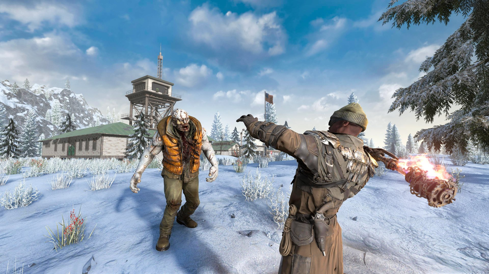

*images gracieuseté de Behaviour Interactive*

[Behaviour Interactive](https://www.bhvr.com/fr/), le studio montréalais derrière [*Dead by Daylight*](https://store.steampowered.com/app/381210/Dead_by_Daylight/), vient de réaliser une acquisition majeure : les équipes de [The Fun Pimps](https://thefunpimps.com/), créateurs du célèbre jeu de survie [*7 Days to Die*](https://store.steampowered.com/app/251570/7_Days_to_Die/), rejoignent le giron de la compagnie québécoise. Une transaction qui confirme l’envergure croissante de Behaviour sur l’échiquier mondial.

## 7 Days to Die : un succès indépendant colossal

*7 Days to Die* est l’un des jeux de survie les plus endurés de l’histoire de Steam. Lancé en accès anticipé en 2013, le titre des The Fun Pimps a maintenu une communauté fidèle pendant plus d’une décennie, avant de sortir officiellement en version 1.0 en 2024. Avec des millions de copies vendues, le jeu mélange survie, construction et horde de zombies dans une formule qui n’a pas vieilli aux yeux de ses fans.

En acquérant The Fun Pimps, Behaviour ne met pas seulement la main sur un studio — il intègre une franchise avec une base de joueurs massive et une *IP* reconnue mondialement.

## Une stratégie d’expansion soutenue

Cette acquisition s’inscrit dans une stratégie d’expansion que Behaviour déploie depuis plusieurs années. Le studio montréalais a diversifié son portefeuille bien au-delà de *Dead by Daylight* et a confirmé son statut de joueur incontournable de l’industrie. En dehors du Québec, Behaviour opère également des bureaux à Toronto, Seattle et en Europe.

---

📚 **À LIRE AUSSI :** [Behaviour fait l’acquisition du développeur de Darkest Dungeon](https://mariojramos8.wordpress.com/2024/09/24/behaviour-fait-lacquisition-du-developpeur-de-darkest-dungeon/)
