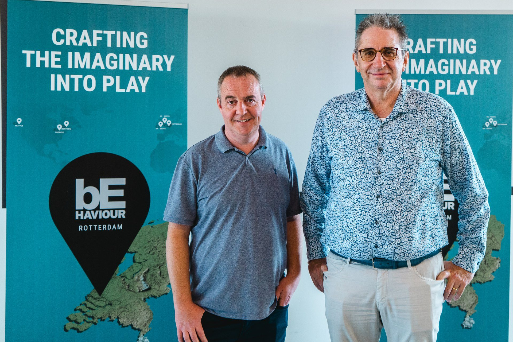

*Images gracieuseté de Behaviour*

**Le plus gros studio indépendant au Québec est en expansion mondiale depuis plus d’un an. Codeglue aux Pays-Bas est le 3e studio européenne racheté en six mois.**

Après l’ouverture de Behaviour Toronto et le rachat d’un studio de Seattle, Midwinter Entertainement, aux États-Unis, l’entreprise québécoise Behaviour s’est lancée dans une expansion européenne.

En effet, Behaviour vient d’annoncer l’acquisition d’un 3e studio en moins de six mois dans le Vieux Continent. Il s’agit de Codeglue aux Pays-Bas, qui sera dorénavant connu sous le nom de Behaviour Rotterdam. Ce dernier a été primé aux Dutch Game Awards en 2022 en remportant le prix de Meilleur Studio.

**À LIRE AUSSI : [Les 20 meilleurs jeux faits au Québec, selon Metacritic](/2023/08/19/les-20-meilleurs-jeux-faits-au-quebec-selon-metacritic/)**

> « Nous sommes très fiers de poursuivre notre expansion stratégique au Royaume-Uni en établissant notre première présence en Europe continentale. L’ajout de l’équipe chevronnée de Codeglue améliore les capacités de notre division Services de classe mondiale. Nous sommes toujours prêts à saisir les occasions qui s’harmonisent aux besoins et à la culture de Behaviour. Codeglue représentait une adéquation évidente sur ces deux fronts. »
>
> Rémi Racine, cofondateur, chef de la direction et producteur exécutif de Behaviour.

Pour rappel, Behaviour a établi plus tôt cette année Behaviour UK – North (ex-SockMonkey Studios) et Behaviour UK – South (ex-Antimatter Games).

> « Codeglue et Behaviour ont beaucoup en commun, ayant connu les nombreuses évolutions de l’industrie du jeu au cours des 23 dernières années. Nous avons toujours admiré le travail et la culture de Behaviour. Nous sommes ravis de participer à ce nouveau chapitre de son histoire à succès. »
>
> Peter de Jong, qui sera directeur général de Behaviour Roterdam

[À LIRE SUR BÊTA-TESTEUR : Sony dévoile la PlayStation Portal](https://www.lebetatesteur.ca/playstation-lancera-la-playstation-portal-dici-la-fin-de-lannee/)
