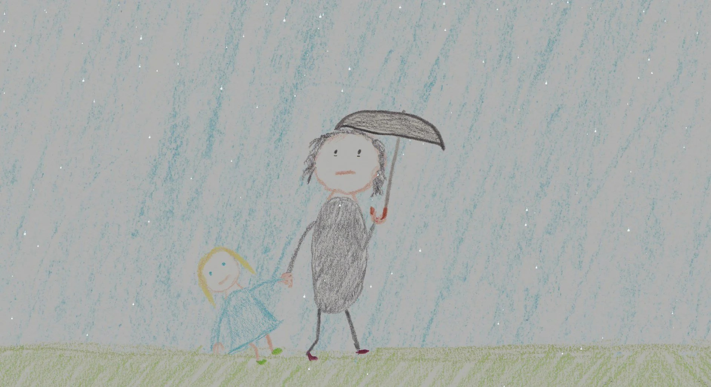
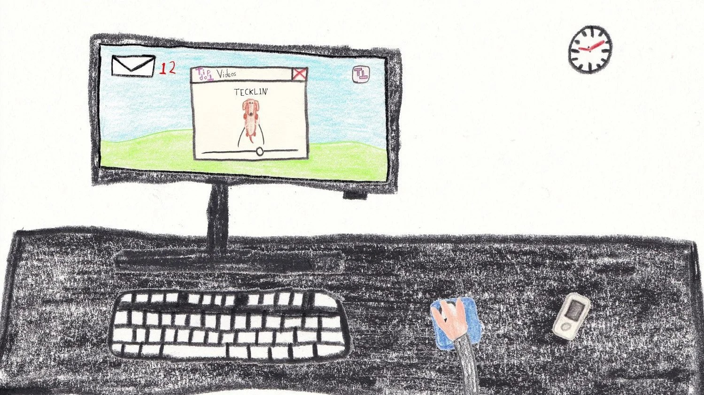

*copie du jeu et images gracieuseté de BonjourBorzoi*

**Dans le paysage souvent saturé de superproductions explosives et de mondes fantastiques démesurés, certains jeux choisissent une voie plus intime, plus humaine. C’est le cas de *[Camille et Laura](https://store.steampowered.com/app/3129110/Camille_and_Laura/)*, le premier titre du studio québécois [BonjourBorzoi](https://bonjourborzoi.net/), fondé par le développeur solo Olivier Bouchard. Loin de nous proposer une évasion spectaculaire, ce jeu pointer-et-cliquer nous plonge tête première dans le quotidien poignant d’une mère et de sa fille, et réussit à transformer la routine en une expérience narrative profondément touchante.**

https://videopress.com/v/kLXNPpsW

Le jeu nous présente Laura, une mère monoparentale au bord de l’épuisement, et sa fille, Camille, qui s’apprête à faire son entrée en première année du primaire. L’entièreté de l’aventure se déroule sur une seule semaine, celle de la rentrée scolaire, une période universellement reconnue pour son potentiel de stress et de bouleversements.

Ici, pas d’énigmes complexes ou de trésors cachés. Les puzzles à résoudre sont ceux de la vie de tous les jours : préparer un petit-déjeuner équilibré, amener Camille à l’école à l’heure, affronter une boîte de courriels qui déborde au travail, faire les courses avec un budget serré et trouver l’énergie de préparer le souper, entre autres.

*Camille et Laura* réussit brillamment à nous faire ressentir la lourdeur de la répétition, la monotonie écrasante d’une liste de tâches qui ne diminue jamais. Chaque jour apporte son lot d’obligations familières, et le joueur ressent viscéralement la fatigue et l’anxiété qui habitent Laura.

Ce n’est pas seulement raconté par les dialogues, bien que ceux-ci soient écrits avec justesse et sensibilité. C’est la mécanique même du jeu qui devient le vecteur de l’émotion. Le simple acte de cliquer sur les mêmes objets, jour après jour, pour accomplir les mêmes tâches, devient une métaphore puissante de la charge mentale. On sent le poids des responsabilités de Laura, son désir de tout offrir à sa fille pour qu’elle puisse s’épanouir, et la peur constante de ne pas être à la hauteur.

Heureusement, le jeu est d’une durée parfaitement calibrée. Assez long pour que l’on s’imprègne de la réalité de cette petite famille et que l’on comprenne les enjeux de leur quotidien, mais assez court pour que la redondance ne devienne trop lassante pour le joueur.

La direction artistique est d’une simplicité magnifique. En adoptant un style qui rappelle les dessins d’un enfant, le jeu crée une atmosphère à la fois douce et mélancolique. Les traits épurés et les couleurs douces contrastent avec la complexité des émotions vécues par les personnages, rendant le tout encore plus poignant.

*Camille et Laura* est une œuvre sensible, intelligente et nécessaire qui nous offre une tranche de vie d’une authenticité rare, et qui nous rappelle que les plus grandes aventures sont parfois celles que l’on vit chaque jour. C’est une exploration touchante de l’amour parental, du sacrifice et de la beauté fragile que l’on peut trouver au cœur de la routine.

**VERDICT 8/10 – TRÈS BON**

*Camille et Laura* sera disponible sur [Steam](https://store.steampowered.com/app/3129110/Camille_and_Laura/) et [Itch.io](https://byolivierb.itch.io/camille-and-laura) au prix de 12.99$ le 12 août 2025.

**À LIRE AUSSI : [Where is Billy? de Dodo Tako maintenant disponible sur Nintendo Switch](/2025/07/31/where-is-billy-de-dodo-tako-maintenant-disponible-sur-nintendo-switch/)**

**À lire sur Bêta-Testeur : [Résumé du Nintendo Direct Partner Showcase](https://www.lebetatesteur.ca/nintendo-direct-partner-showcase-juillet-2025/)**
