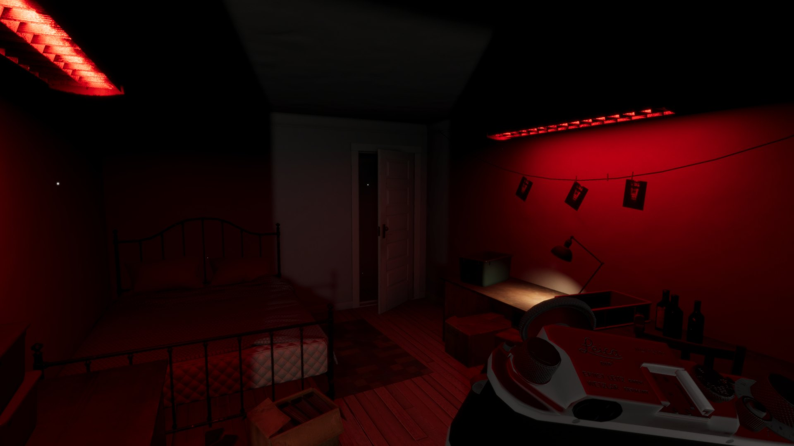
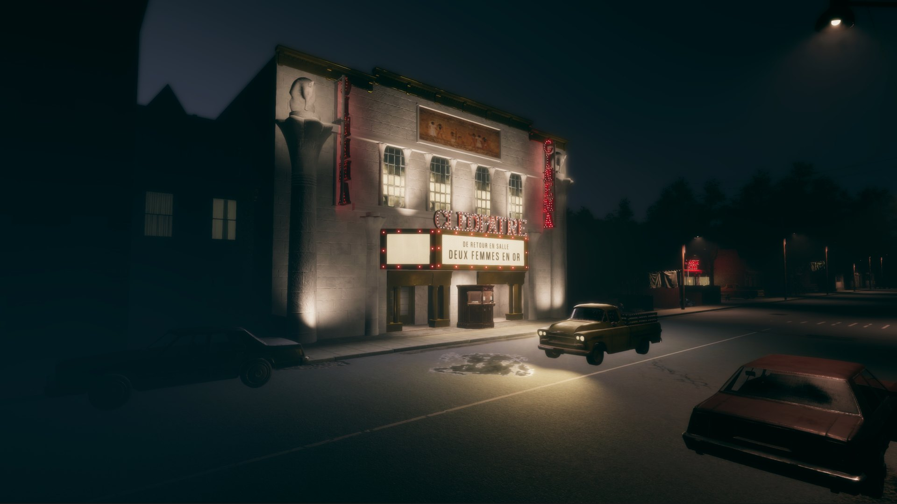
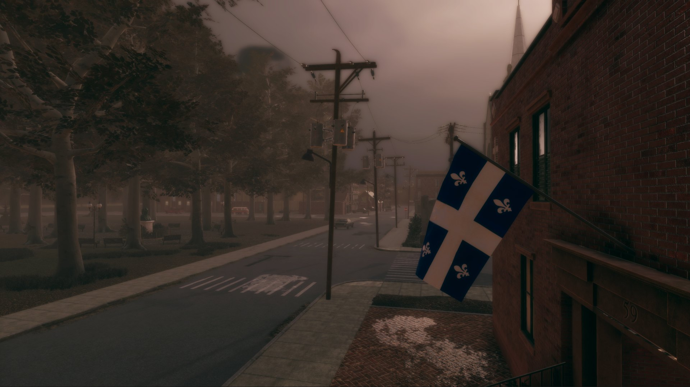
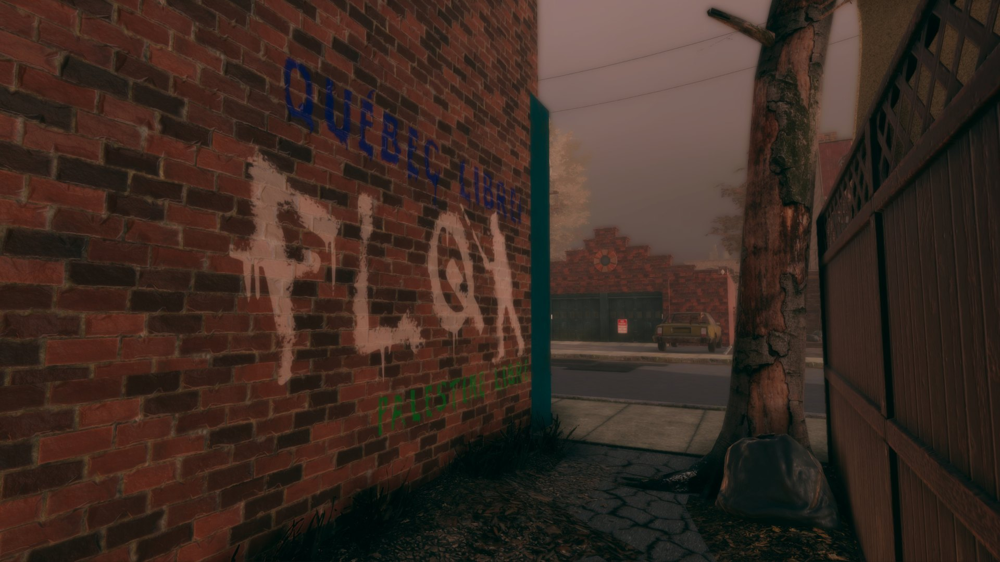
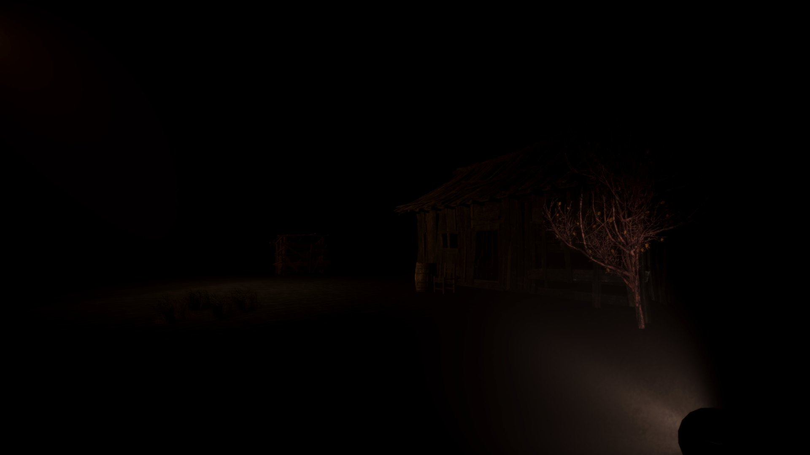
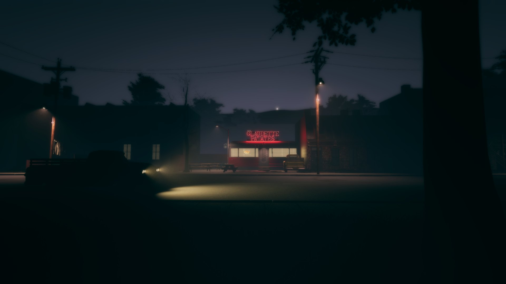
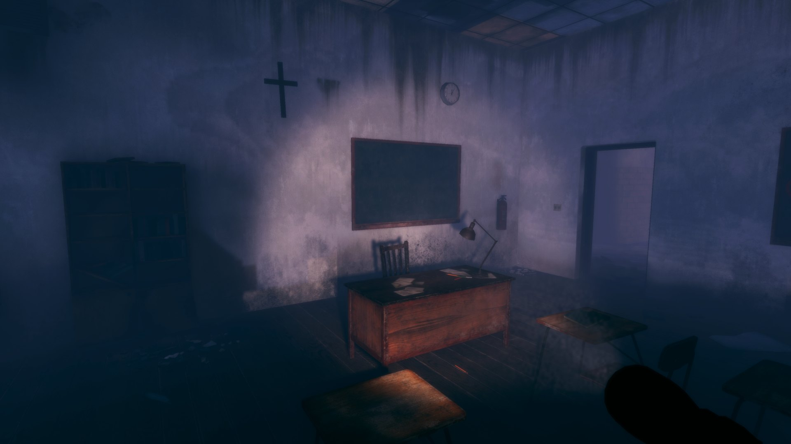
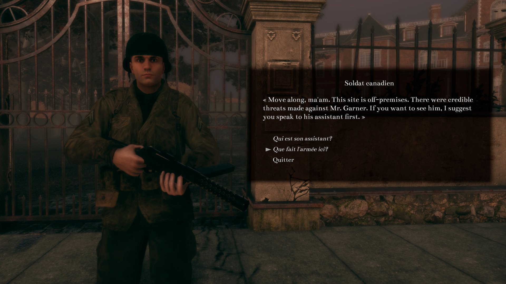
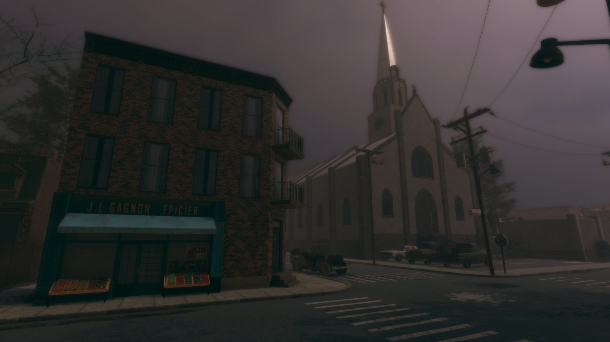

*Crédit images : Studio Chien d’Or*

## **J’ai eu le plaisir d’être invité hier au dévoilement de [Cauchemars d’Octobre](https://store.steampowered.com/app/2645250/October_Nightmares__Cauchemars_doctobre/), un jeu d’aventure et d’horreur pointer-et-cliquer qui a l’événement historique la Crise d’Octobre comme trame de fond.**

Il y a quelques années, Olivier Leclair, fondateur du studio Chien d’Or, développait des jeux sérieux dont des applications pour des banques. Puis, il a eu une épiphanie en lisant une citation du feu cinéaste Pierre Falardeau.

> ***« …chaque fois qu’on fait exister la culture québécoise un peu plus, quel que soit le domaine où on est, on fait venir au monde le Québec. »***
>
> – Pierre Falardeau

C’est là qu’Olivier a compris qu’il pouvait utiliser ses connaissances en jeu vidéo pour parler de l’histoire nationale du Québec et carrément inscrire sa démarche artistique dans le développelement d’un jeu vidéo national.

C’est ce nous a raconté hier Olivier au dévoilement de son prochain jeu, Cauchemars d’Octobre, qui était accompagné d’une projection du film Octobre de Pierre Falardeau, en compagnie du comédien et député Denis Trudel.

*Olivier Leclair, fondateur du studio Chien d’Or*

*Denis Trudel, comédien et député bloquiste*

Si avec son premier jeu, [La vallée qui murmure](https://store.steampowered.com/app/1512390/The_Whispering_Valley__La_valle_qui_murmure/), il explorait les cicatrices laissées par le clergé sur des générations de Québécois, avec Cauchemars d’Octobre, il touche à un autre événement encore douloureux dans notre conscience collective : la Crise d’Octobre.

Pour rappel, en octobre 1970, le Front de Libération du Québec a kidnappé le diplomatique britannique James Cross et le député provincial Pierre Laporte, plongeant le pays dans une crise sociale et politique menant à l’application de la loi des mesures de guerres par le gouvernement canadien. Cette loi, suspendant les libertés civiles pour les citoyens, a mené à plus de 400 arrestations sans inculpations, sans date de remise en liberté.

Bien que Cauchemars d’Octobre a comme théâtre cet événement historique, le récit du jeu touchera davantage au monde du rêve et de l’horreur lovecraftienne.

En voici une présentation :

https://www.youtube.com/watch?v=DptayXRYtH8

Si ça vous parle, la campagne Kickstarter [est lancée et disponible ici.](https://www.kickstarter.com/projects/studiochiendor/cauchemars-doctobre-october-nightmares?ref=discovery_category_newest)

**Quelques images tirées du jeu en développement :**

**La sortie de Cauchemars d’Octobre est prévue pour 2025 [sur Steam.](https://store.steampowered.com/app/2645250/October_Nightmares__Cauchemars_doctobre/)**
