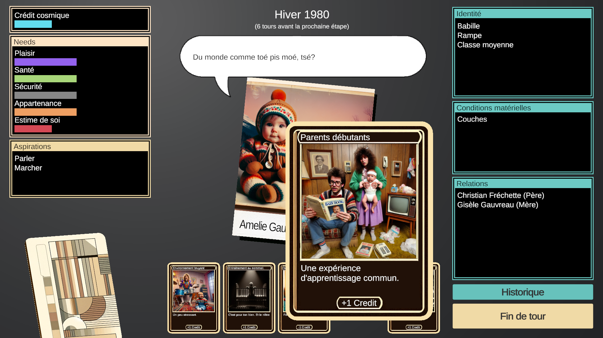

*images gracieuseté de Jonathan Lessard*

**C’est la vie!,** créé par Jonathan Lessard, professeur à l’Université Concordia et titulaire de la Chaire de recherche Behaviour Interactive, propose une expérience unique où les joueurs traversent les étapes de la vie dans un Québec des années 1980 réinventé par l’intelligence artificielle.

Les joueurs naviguent à travers différentes phases de l’existence, de la naissance à la mort, en gérant des cartes représentant des événements marquants. Le système de jeu repose sur trouver un équilibre : les cartes d’événements négatifs, comme l’acné à l’adolescence ou l’absence d’un parent, génèrent du crédit cosmique que les joueurs peuvent investir dans des cartes avec des expériences positives.

Le jeu se démarque également par son ancrage dans la culture québécoise. L’action se déroule dans un Québec des années 1980 « halluciné » par l’IA, créant un univers d’une étrange familiarité. Les joueurs peuvent choisir de jouer en français québécois ou en anglais.

L’utilisation de l’intelligence artificielle pour créer une esthétique et humour décalés est assumée et exploratoire et sert à créer une expérience unique pour chaque joueur, notamment en générant en direct des portraits et poèmes inspirés par le choix de parcours du joueur.

Une démo gratuite est disponible [dès maintenant sur Itch.io.](https://lablablab.itch.io/cest-la-vie-francais)

**À LIRE AUSSI : [Les Canadian Game Awards 2025 : le Québec brille avec 18 nominations](/2025/01/16/les-canadian-game-awards-2025-le-quebec-brille-avec-18-nominations/)**
