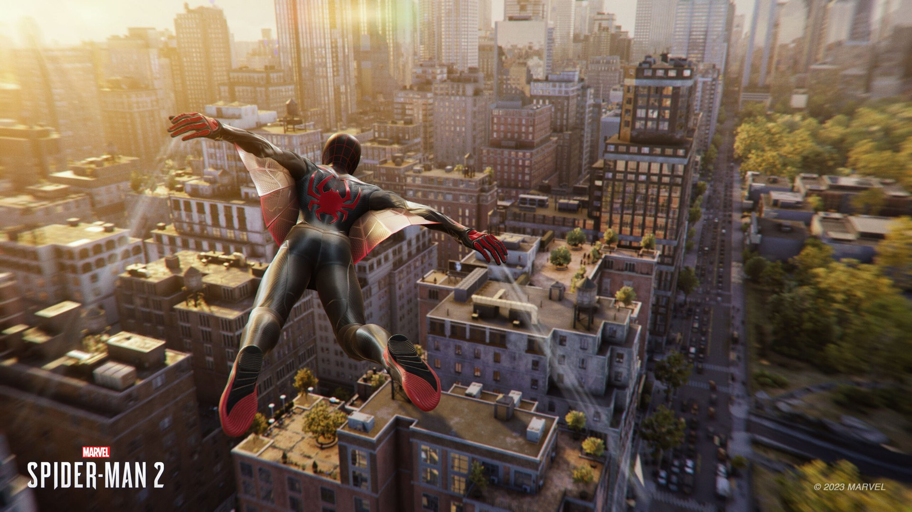
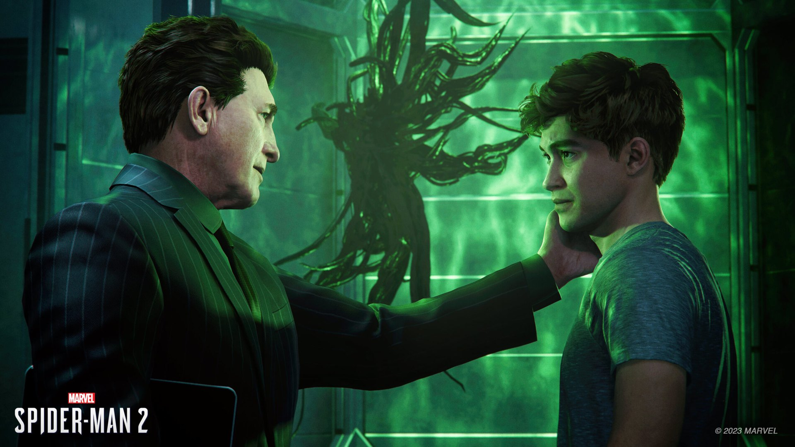
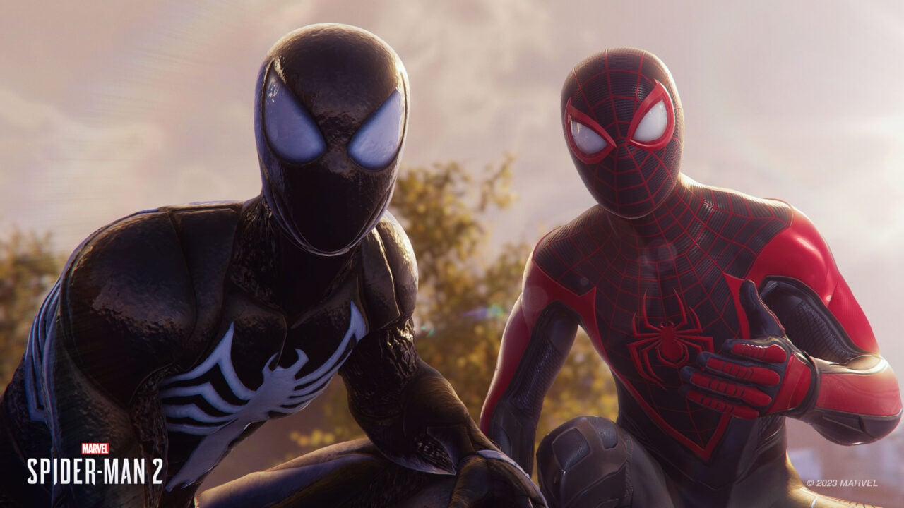

*copie du jeu et images gracieuseté de Sony Interactive Entertainment Canada*

**Joué sur Steam Deck**

**[Click here for english version](#spiderman2-english)**

**La version PC de [Marvel’s Spider-Man 2](https://store.steampowered.com/app/2651280/Marvels_SpiderMan_2/) offre une expérience solide sur Steam Deck, malgré quelques compromis visuels inévitables et des bogues graphiques occasionnels. Cette adaptation réussit à capturer l’essence de l’expérience console tout en s’adaptant aux contraintes du hardware portable.**

**Un récit captivant fidèle à l’univers**

Le scénario reste l’un des points forts de la série. [Insomniac Games](https://insomniac.games/) démontre une nouvelle fois sa maîtrise du *lore* Spider-Man en proposant une histoire qui puise intelligemment dans les thèmes classiques tout en introduisant suffisamment de rebondissements pour surprendre les fans. Les performances des acteurs sont particulièrement convaincantes, donnant vie à ces personnages emblématiques avec une profondeur émotionnelle remarquable.

Le système de changement entre Peter Parker et Miles Morales s’avère fluide et intuitif. C’est une mécanique qui enrichit considérablement l’expérience de jeu, permettant d’alterner entre deux styles et personnalités distinctes.

**New-York sous un nouveau jour**

Se balancer entre les gratte-ciel new-yorkais demeure un plaisir viscéral, amplifié par la nouvelle capacité de planer qui transforme l’exploration en une expérience encore plus dynamique. L’ajout de quartiers résidentiels comme Queens apporte une touche de fraîcheur bienvenue à la carte. Cependant, le contenu secondaire souffre d’un sentiment de déjà-vu pour les vétérans de la série ayant déjà complété les précédents opus.

**Une jouabilité toujours aussi efficace**

Le système de combat conserve sa fluidité et sa variété caractéristiques, offrant un équilibre parfait entre accessibilité et profondeur. La multitude de costumes déblocables pour les deux protagonistes titillera les collectionneurs, tandis que les trois arbres de compétences (un commun et un spécifique à chaque Spider-Man) permettent une personnalisation plutôt profonde de l’expérience de jeu.

**Verdict : 8/10**

**Marvel’s Spider-Man 2 sur PC livre une aventure superhéroïque de grande qualité qui ravira autant les fans de longue date que les nouveaux venus. Si l’on peut regretter un certain recyclage dans les activités secondaires, l’ensemble reste remarquablement solide avec une histoire prenante, un gameplay affiné et un monde ouvert toujours aussi agréable à parcourir.**

[**Procurez-vous Marvel’s Spider-Man 2**](https://amzn.to/4ii8nCq)

*Ce site web contient des liens d’affiliation. Si vous cliquez sur un lien d’affiliation et effectuez un achat, je peux recevoir une commission sans frais supplémentaires pour vous. Ces commissions aident à soutenir ce site web et me permettent de continuer à fournir du contenu. Je ne recommande que des produits ou services qui, selon moi, apporteront une valeur ajoutée à mes lecteurs. Votre soutien via ces liens d’affiliation est grandement apprécié.*

---

## English :

**The PC version of Marvel’s Spider-Man 2 offers a solid experience on Steam Deck, despite some inevitable visual compromises and occasional graphical bugs. This adaptation successfully captures the essence of the console experience while adapting to the constraints of portable hardware.**

**A captivating story faithful to the universe**

The storyline remains one of the series’ strengths. Insomniac Games once again demonstrates its mastery of Spider-Man lore by delivering a story that intelligently draws from classic themes while introducing enough twists to surprise fans. The performances of the actors are particularly convincing, bringing these iconic characters to life with remarkable emotional depth.

The system for switching between Peter Parker and Miles Morales proves to be fluid and intuitive. It’s a mechanic that considerably enriches the gaming experience, allowing players to alternate between two distinct styles and personalities.

**New York in a new light**

Swinging between New York skyscrapers remains a visceral pleasure, amplified by the new gliding ability that transforms exploration into an even more dynamic experience. The addition of residential neighborhoods like Queens brings a welcome freshness to the map. However, the side content suffers from a sense of déjà vu for veterans of the series who have already completed previous installments.

**Gameplay as effective as ever**

The combat system maintains its characteristic fluidity and variety, offering a perfect balance between accessibility and depth. The multitude of unlockable costumes for both protagonists will tantalize collectors, while the three skill trees (one common and one specific to each Spider-Man) allow for rather deep personalization of the gaming experience.

**Verdict: 8/10**

**Marvel’s Spider-Man 2 on PC delivers a high-quality superhero adventure that will delight both longtime fans and newcomers alike. While one might regret some recycling in the side activities, the overall package remains remarkably solid with an engaging story, refined gameplay, and an open world that’s still a pleasure to traverse.**

[**Buy Marvel’s Spider-Man 2**](https://amzn.to/4ii8nCq)

*This website contains affiliate links. If you click on an affiliate link and make a purchase, I may receive a commission at no additional cost to you. These commissions help support this website and allow me to continue providing content. I only recommend products or services that I believe will add value to my readers. Your support through these affiliate links is greatly appreciated.*
