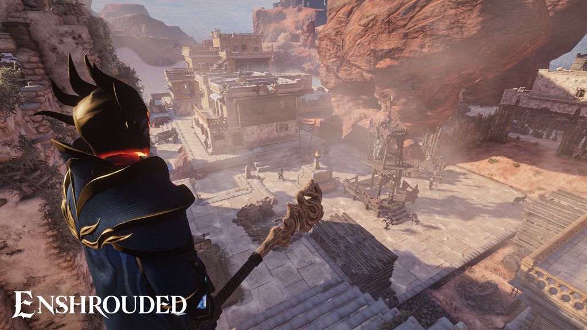
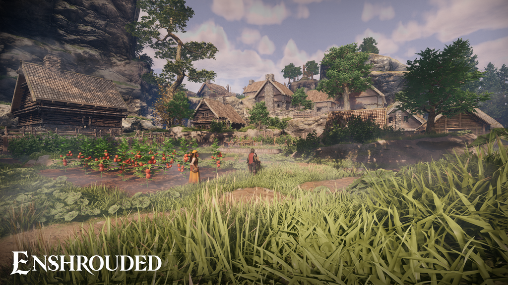
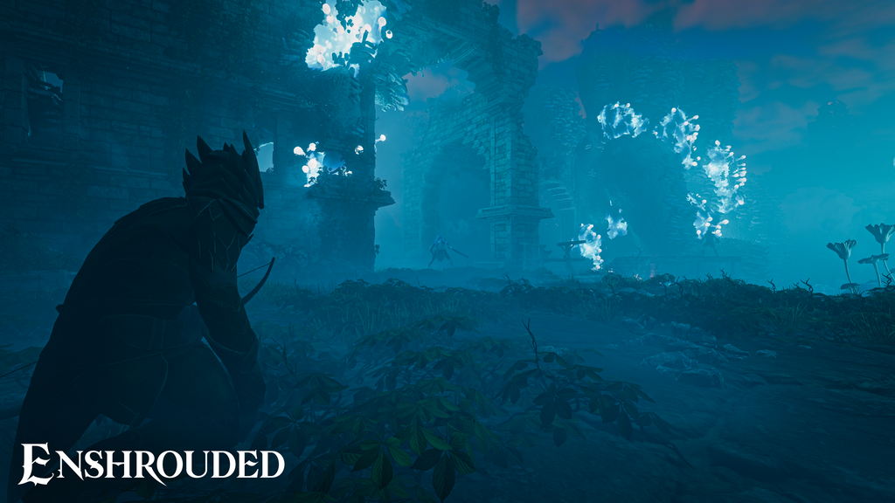

*images gracieuseté de Keen Games*

**En commençant à jouer Enshrouded, un jeu de survie et construction dans un contexte médiéval fantaisiste, j’ai rapidement réalisé que c’était un jeu plus intéressant avec des amis. J’ai donc remis les codes extra que j’avais à deux membres de la [communauté Discord HUB](https://discord.gg/MUxn4WY4Qx), Eric « Trent Faucon » Laforce et Dominic Arsenault.**

N’ayant finalement pas eu le temps de jouer autant qu’eux, je leur ai demandé de donner leurs points de vue pour cette critique.

**Les points forts de Enshrouded selon Trent Faucon :**

1. **Exploration et découverte grisantes :** L’exploration dans *Enshrouded* se révèle étonnamment plaisante. Contrairement à de nombreux jeux du même genre qui proposent des mondes vastes mais désolément vides, celui-ci semble bien rempli, avec des éléments intéressants disséminés un peu partout. Les panoramas sont souvent magnifiques à contempler, et la navigation, grâce aux voyages rapides vers les tours et à la combinaison du design vertical avec notre planeur, n’est pas pénible. On pourrait presque y voir une version de *Zelda* revisitée par Ubisoft.
2. **Intégration fluide du crafting et de la survie :** Le jeu réussit habilement à intégrer les aspects de « crafting et survie » sans que cela ne devienne trop fastidieux. Bien sûr, l’idée de devoir cuire des côtes levées et ramasser des lucioles peut toujours sembler un peu lourde. Néanmoins, cela se déroule de manière organique, sans donner l’impression de perdre son temps à collecter des broutilles. La progression des quêtes est intelligemment conçue pour que l’on accumule la plupart des matériaux nécessaires aux constructions débloquées au fur et à mesure.
3. **Expérience utilisateur soignée :** Les menus, les interfaces et les autres fonctionnalités relevant de l’expérience utilisateur remplissent leur rôle à merveille. L’information recherchée est facile à trouver, et si l’on se perd dans les quêtes, tout est clairement indiqué. Cette clarté rend la prise en main extrêmement aisée et constitue un atout précieux pour ceux qui accordent de l’importance à leur temps de loisir vidéoludique.

****Les points faibles de Enshrouded selon Trent Faucon :****

1. **Manque d’originalité et narration fade :** J’ai hésité à inclure la direction artistique dans mes points positifs, car le rendu visuel du jeu est agréable, propre et professionnel. Cependant, un élément crucial fait défaut : l’originalité. L’univers manque cruellement de personnalité, évoquant un produit “générique”. De plus, l’histoire est totalement inintéressante, au point qu’il est facile de passer les cinématiques et les textes sans ressentir la moindre culpabilité.
2. **Cohérence du monde brisée par la régénération de la carte :** Les deux aspects les plus importants pour moi dans un jeu sont sa personnalité et sa narration. Bien que le processus narratif d’exploration et de construction fonctionne très bien pour me divertir en découvrant ce monde, un élément m’a profondément dérangé. Dans un jeu qui nous invite à construire, creuser et couper du bois, on s’attend à ce que la carte ne se régénère pas à chaque fois que l’on quitte la partie. Aussi ridicule que cela puisse paraître, cela nuit énormément à la crédibilité de l’univers dans mon récit de bâtisseur. Je déforeste un chemin et creuse une galerie… et la prochaine fois que je relance le jeu, tout est revenu. Booouuuuhhh.
3. **Surcharge de fonctionnalités :** Le jeu semble vouloir en faire trop. J’imagine les séances de brainstorming des créateurs, lançant des idées de fonctionnalités pour finalement décider de tout implémenter. Le résultat est qu’il y a beaucoup de choses dont l’utilité reste à prouver, et d’autres qui fonctionnent à moitié. Parfois, il vaut mieux se concentrer sur quelques points forts et y mettre le paquet.

**Les points forts de Enshrouded selon Dominic Arsenault :**

1. **La construction d’habitations et de structures :** Le moteur du jeu basé sur des voxels fonctionne remarquablement bien, permettant de créer de belles choses facilement et dès le début. Les coins, les arches, les murs, les toits sont esthétiques, agréables et s’assemblent bien. La flexibilité du moteur m’a rapidement permis de construire des voûtes, des mezzanines, des lucarnes, des puits de lumière, des terrasses, etc.
2. **Un équilibre pour tous les types de joueurs :** Le jeu est bien dosé pour plaire à un large public plutôt qu’aux joueurs hardcore. Les combats ne sont pas excessivement difficiles, et la progression est assez aisée. En cas de mort, on peut réessayer sans que cela soit trop punitif.
3. **Combinaison exploration / construction réussie :** L’intégration de l’exploration et de la construction est bien pensée. Les mécanismes de déplacement et de combat rappellent l’esprit d’aventure et de liberté que l’on trouvait dans *World of Warcraft* et *Zelda: Breath of the Wild*, avec une belle progression initiale. Le système de construction robuste à la *Minecraft* est renforcé par la possibilité de recruter des personnages non-joueurs qui rejoignent notre base, ce qui donne de l’intérêt au module de construction qui aurait pu être marginal et mal intégré.

**Les points faibles de Enshrouded selon Dominic Arsenault :**

1. **Gestion du multijoueur contraignante :** Lorsque l’on crée une partie en ligne, il faut être connecté pour qu’un ami puisse rejoindre notre monde. S’il n’est pas en ligne, l’accès est impossible, à moins de payer pour un serveur (ou de le configurer soi-même). Cela nuit au partage de l’expérience (qui voudrait créer un personnage sur un serveur disponible uniquement lorsque son propriétaire est connecté ?). Pourtant, les mécanismes du jeu se prêteraient idéalement à une expérience multijoueur plus flexible.
2. **Thème et direction artistique génériques :** Le thème du jeu, son titre, le sujet, la direction artistique, le monde : tout cela est quelconque, voire générique. Le « shroud » ressemble au blight de *Warcraft III*, au creep de *StarCraft*, à la shadow curse de *Baldur’s Gate III*, etc. Est-il intéressant, captivant ou intrigant de découvrir le mystère de sa présence, le passé de ce monde, les empires déchus d’autrefois ? Pas vraiment. C’est suffisant pour nous donner un prétexte pour continuer à construire et explorer, sans plus.
3. **Gestion d’inventaire et d’objets laborieuse :** Il y a beaucoup de manutention à faire dans l’inventaire et la gestion des objets. De nombreux matériaux, objets transformés à construire, ressources à ramasser sur les ennemis ou dans l’environnement s’entassent pêle-mêle dans un sac à dos ou dans des coffres que l’on doit construire. Bien que l’on finisse par débloquer des coffres plus grands et des coffres magiques permettant d’utiliser les ressources sans les avoir sur soi, on regrette les fonctionnalités et les automatisations que l’on trouve dans un *Baldur’s Gate III*, par exemple. Ne serait-ce qu’avoir des sacs séparés pour les matériaux et les consommables, que les objets soient regroupés automatiquement, et ainsi de suite.

En résumé, Enshrouded offre une expérience de jeu solide avec des mécaniques d’exploration et de construction bien réalisées. Cependant, un manque d’originalité, des choix de conception discutables comme la régénération de la carte, et une gestion d’inventaire perfectible tempèrent l’enthousiasme et suggèrent des axes d’amélioration pour l’avenir.

## VERDICT : 7.5 – BON

**À LIRE AUSSI : [Gameloft Montréal inaugure ses nouveaux locaux et souffle 25 bougies](/2025/05/18/gameloft-montreal-inaugure-ses-nouveaux-locaux-et-souffle-25-bougies/)**

**À lire sur Bêta-Testeur : [Critique de Revenge of the Savage Planet](https://www.lebetatesteur.ca/test-revenge-of-the-savage-planet/)**
