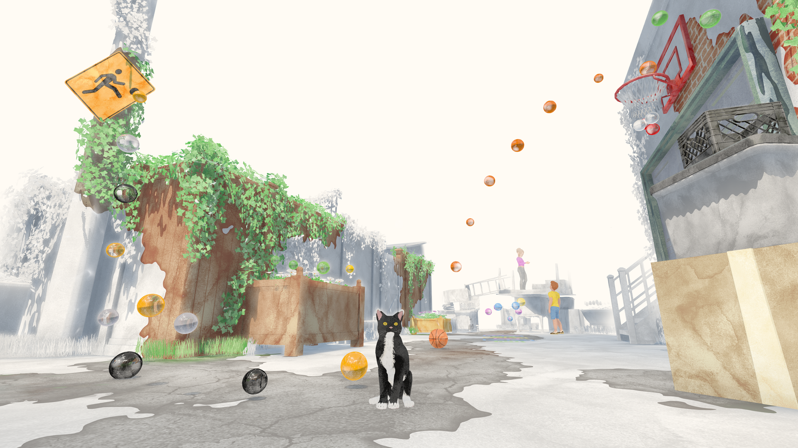
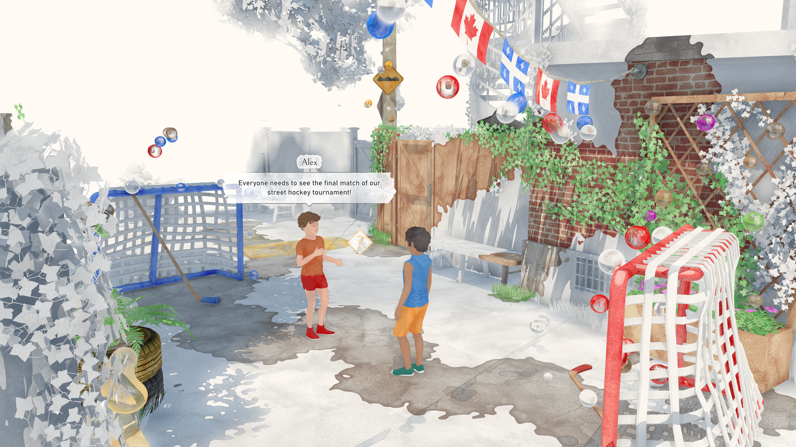
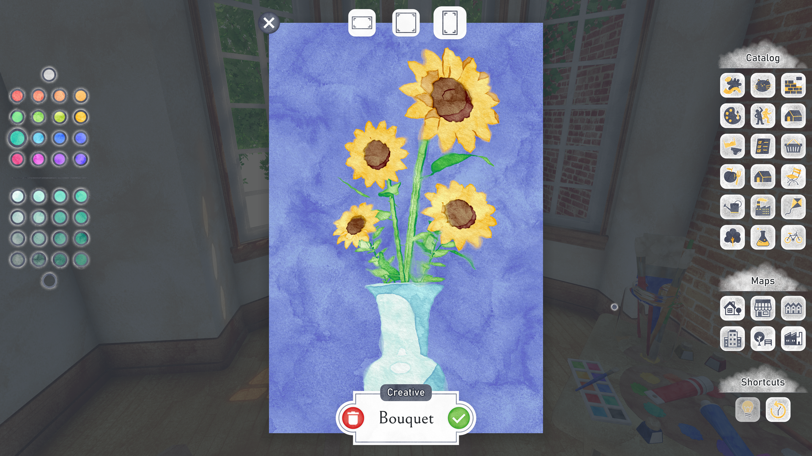
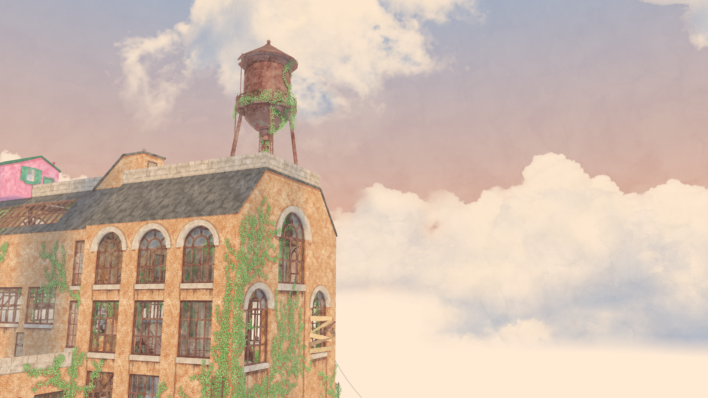

*image à la une : impossible*

*Une copie du jeu a été fournie par l’éditeur.*

**[Été](https://store.steampowered.com/app/1065070/Ete/), le jeu d’aventure narratif du studio québécois [Impossible](https://impossible.dev/), est une véritable ode à la ville de Montréal. Ce jeu propose aux joueurs d’incarner un peintre en vacances dans la métropole québécoise, le temps d’un été.**

L’un des aspects les plus marquants de Été est la façon dont le jeu intègre la peinture dans ses mécaniques. Le joueur doit peindre les environnements pour les dévoiler, ce qui ajoute une dimension unique à l’exploration. Les objets observés peuvent être ensuite reproduits sur toile.

Ce qui rend cette mécanique particulièrement satisfaisante, c’est la façon dont elle s’intègre organiquement avec le thème du jeu. Montréal, dans Été, est une ville à découvrir et à redécouvrir, non pas en suivant des cartes ou des indicateurs de quête, mais en suivant sa propre curiosité. L’environnement du jeu, bien qu’il ne soit pas une reproduction exacte de Montréal, distille l’essence de la ville à travers des lieux emblématiques et des éléments idéalisés.

Les joueurs peuvent aussi créer des œuvres d’art entièrement originales. Ces créations peuvent ensuite être exposées dans un petit café local, où elles sont mises en vente aux clients. L’argent fictif peut ensuite servir à acheter des objets dans les boutiques et marchés pour meubler notre appartement où on ne retrouve qu’au départ un lit et un chevalet.

Pour progresser, le joueur doit réaliser des commissions de peinture données par des habitants de la ville. Chaque commande vient avec ses propres critères, mais laisse également une grande liberté créative, ce qui encourage les joueurs à laisser libre cours à leur imagination, cela grâce aux nombreux outils et options de création qu’offre le jeu.

Cette liberté de création contribue également à la rejouabilité du jeu. Même après avoir exploré tous les environnements et complété les quêtes principales, les joueurs peuvent passer d’innombrables heures à simplement créer. Ensuite, pourquoi pas échanger vos oeuvres avec la communauté de joueurs sur [le serveur Discord de Été](https://discord.gg/NdrYyMGy)?

Le jeu adopte un style visuel inspiré de l’aquarelle, qui donne à l’ensemble une douceur et une chaleur particulières. Ce choix stylistique ne se limite pas à l’esthétique; il soutient également les mécaniques de jeu. L’effet visuel de l’environnement qui se révèle sous les coups de pinceau est à la fois satisfaisant et poétique.

Été possède un cycle de quatre périodes durant le jour, ainsi que le changement de jours de la semaine, ajoutant une dimension temporelle. Les magasins qui ouvrent et ferment, les PNJ qui apparaissent à différents moments de la journée, tout cela rend la ville vivante. Le joueur est ainsi invité à explorer la ville à différents moments pour découvrir de nouvelles interactions et opportunités.

Été se distingue également par son approche décontractée du gameplay. Il n’y a pas de pression, pas de danger, et pas de possibilité d’échec. Cependant, cette fluidité du gameplay est parfois interrompue par des temps de chargement un peu longs lors des transitions entre les différents lieux.

La combinaison d’une direction artistique inspirée, de mécaniques de jeu originales centrées sur la peinture, et d’une liberté créative presque infinie fait de Été une expérience incontournable.

Été est disponible sur [Steam.](https://store.steampowered.com/app/1065070/Ete/)

## Très bon 8/10

Titre : Été

Date de sortie : 23 juillet 2024

Éditeur : Impossible

Développeurs : Impossible

Plateformes : PC

**À LIRE AUSSI : [Le jeu montréalais Été présenté à Salut Bonjour](/2024/07/26/le-jeu-montrealais-ete-presente-a-salut-bonjour/)**

**À lire sur Bêta-Testeur : [Critique de Deathbound](https://www.lebetatesteur.ca/test-deathbound/)**
