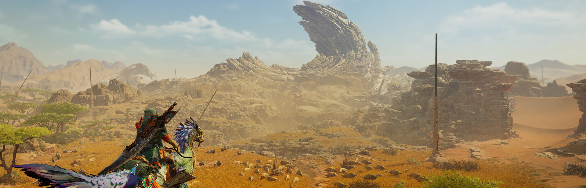
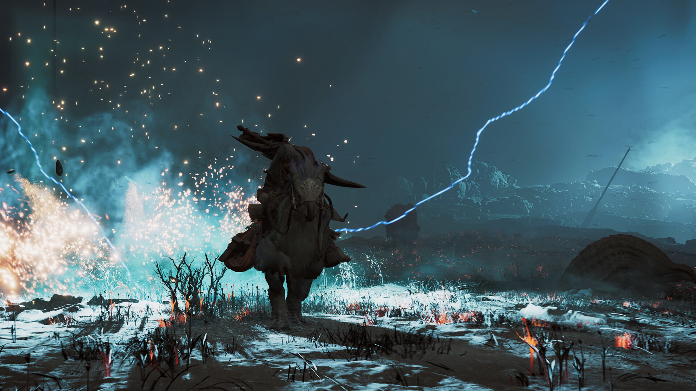
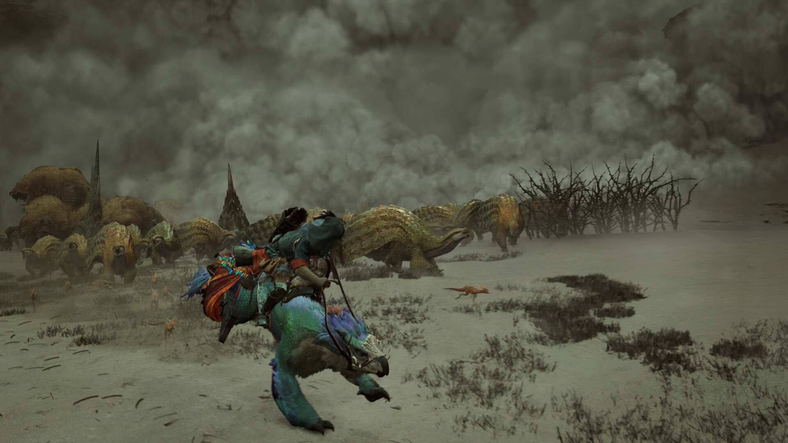
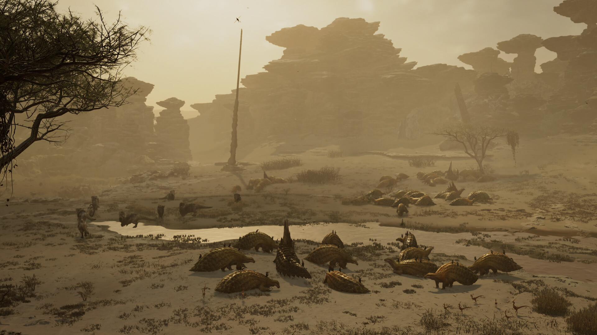
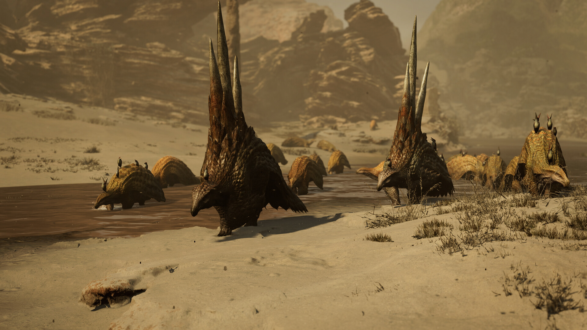

*copie du jeu gracieuseté de Sony Interactive Entertainement Canada et images gracieuseté de Capcom*

**Joué sur PlayStation 5**

[Click here for english version](#monsterhunterwilds-english)

***Monster Hunter Wilds* représente un pas de géant pour la célèbre série de Capcom, offrant une expérience à la fois fidèle à ses racines tout en repoussant les limites établies par ses prédécesseurs. Cette nouvelle itération réussit l’exploit de séduire les nouveaux venus, mais certains vétérans pourraient rester sur leur faim.**

## Un monde vivant et sans coutures

Pour la première fois dans l’histoire de la franchise, *Monster Hunter Wilds* nous plonge dans un véritable monde ouvert cohérent et organique. Fini le temps où il fallait constamment retourner au hub principal pour découvrir de nouvelles quêtes ou activités. Ici, les opportunités se présentent naturellement au détour d’un chemin, lors d’une rencontre fortuite avec un monstre inconnu.

Cette fluidité narrative et ludique constitue sans doute la plus grande innovation du titre, permettant une immersion sans précédent. Le monde n’est plus un simple décor pour vos chasses, mais un écosystème crédible où les monstres interagissent entre eux et réagissent aux changements environnementaux de façon cohérente.

## Une accessibilité bienvenue

*Monster Hunter Wilds* s’impose comme l’épisode le plus accessible de la série, avec une courbe d’apprentissage retravaillée et des mécaniques de jeu optimisées. Les longues animations impossibles à interrompre, marque de fabrique de la série, ont été légèrement assouplies pour offrir plus de réactivité, tandis que le tutoriel intégré guide efficacement les nouveaux joueurs sans les submerger d’informations.

Si cette approche plus accessible est une bénédiction pour les néophytes, certains vétérans pourront regretter un manque de défi, notamment dans les premières dizaines d’heures. Heureusement, le contenu post-générique réserve des défis un peu plus corsés.

## Une prouesse visuelle

Visuellement, *Monster Hunter Wilds* est tout simplement époustouflant. Que ce soit la modélisation minutieuse des monstres, la richesse des environnements, ou les effets de lumière et de particules lors des combats, le jeu repousse les limites techniques des consoles actuelles. Chaque biome possède une identité visuelle forte et cohérente, des vastes plaines balayées par le vent aux jungles luxuriantes grouillant de vie.

Les animations des créatures méritent une mention spéciale, tant elles confèrent à chaque monstre une personnalité unique et crédible.

## Un arsenal diversifié

La diversité des armes reste l’une des forces de la franchise, et *Wilds* ne fait pas exception. Les quatorze types d’armes offrent chacun un style de jeu radicalement différent, de la mobilité de l’insectoglaive à la puissance brute du marteau. Chaque arme bénéficie d’améliorations spécifiques qui enrichissent encore les possibilités tactiques.

Face à ces chasseurs surarmés, le bestiaire s’est lui aussi étoffé avec de nouvelles créatures mémorables qui viennent rejoindre les monstres emblématiques de la série. Chaque affrontement demande une préparation adéquate et une stratégie adaptée, renforçant le sentiment de satisfaction lorsqu’une bête particulièrement coriace est finalement terrassée.

## Une narration ambitieuse

Contrairement aux précédents opus où la narration servait principalement de prétexte aux chasses, *Monster Hunter Wilds* propose une histoire intrigante et des personnages attachants. La diversité des protagonistes qui vous accompagnent dans cette aventure est rafraîchissante, chacun apportant sa personnalité et ses motivations propres.

Bien que la campagne principale puisse sembler un peu courte (environ 15-20 heures), elle sert efficacement de porte d’entrée vers le véritable cœur du jeu : le contenu post-générique qui prolonge considérablement l’expérience.

## Quelques accrocs dans la chasse

Malgré toutes ses qualités, *Monster Hunter Wilds* n’est pas exempt de défauts. Le système multijoueur, bien que fonctionnel, souffre d’une interface peu intuitive qui complique inutilement le processus d’invitation et de communication entre joueurs. Un problème regrettable pour un jeu dont l’expérience coopérative constitue l’un des piliers.

Avec *Monster Hunter Wilds*, Capcom démontre sa maîtrise et sa vision pour faire évoluer sa franchise phare. En conciliant accessibilité et profondeur, tradition et innovation, ce nouvel opus parvient à satisfaire presque toutes les attentes. Quelques imperfections subsistent, mais elles ne ternissent en rien l’expérience globale exceptionnelle que propose ce jeu.

Pour les amateurs de longue date comme pour les curieux qui souhaitent découvrir la série, *Monster Hunter Wilds* représente une porte d’entrée idéale vers cet univers captivant. Ce titre s’impose comme l’un des incontournables de cette année vidéoludique.

**Verdict 8.5/10**

[**Achetez Monster Hunter Wilds**](https://amzn.to/3FsTlM2)

**À LIRE AUSSI : [Critique de Marvel’s Spider-Man 2 sur Steam Deck](/2025/02/27/critique-de-marvels-spider-man-2-sur-steam-deck/)**

*Ce site web contient des liens d’affiliation. Si vous cliquez sur un lien d’affiliation et effectuez un achat, je peux recevoir une commission sans frais supplémentaires pour vous. Ces commissions aident à soutenir ce site web et me permettent de continuer à fournir du contenu. Je ne recommande que des produits ou services qui, selon moi, apporteront une valeur ajoutée à mes lecteurs. Votre soutien via ces liens d’affiliation est grandement apprécié.*

---

# Monster Hunter Wilds – A Major Evolution for the Franchise

*game copy courtesy of Sony Interactive Entertainement Canada and images courtesy of Capcom*

**Played on PlayStation 5**

**Monster Hunter Wilds represents a giant leap forward for Capcom’s famous series, offering an experience that’s both faithful to its roots while pushing the boundaries established by its predecessors. This new iteration accomplishes the feat of appealing to newcomers, but some veterans might be left wanting more.**

## A Living, Seamless World

For the first time in the franchise’s history, Monster Hunter Wilds immerses us in a truly coherent and organic open world. Gone are the days when you had to constantly return to the main hub to discover new quests or activities. Here, opportunities present themselves naturally around the corner, during a chance encounter with an unknown monster.

This narrative and gameplay fluidity is undoubtedly the title’s greatest innovation, allowing unprecedented immersion. The world is no longer just a backdrop for your hunts, but a credible ecosystem where monsters interact with each other and react to environmental changes in a coherent manner.

## A Welcome Accessibility

Monster Hunter Wilds establishes itself as the most accessible episode in the series, with a reworked learning curve and optimized game mechanics. The long, impossible-to-interrupt animations, a trademark of the series, have been slightly relaxed to offer more responsiveness, while the integrated tutorial effectively guides new players without overwhelming them with information.

While this more accessible approach is a blessing for newcomers, some veterans may regret the lack of challenge, especially in the first dozens of hours. Fortunately, the post-campaign content offers somewhat more challenging tests.

## A Visual Achievement

Visually, Monster Hunter Wilds is simply breathtaking. Whether it’s the meticulous modeling of monsters, the richness of environments, or the light and particle effects during combat, the game pushes the technical limits of current consoles. Each biome has a strong and coherent visual identity, from vast wind-swept plains to lush jungles teeming with life.

The animations of the creatures deserve special mention, as they give each monster a unique and credible personality.

## A Diverse Arsenal

The diversity of weapons remains one of the franchise’s strengths, and Wilds is no exception. The fourteen weapon types each offer a radically different playstyle, from the mobility of the Insect Glaive to the brute force of the Hammer. Each weapon benefits from specific improvements that further enrich the tactical possibilities.

Facing these well-armed hunters, the bestiary has also expanded with memorable new creatures joining the series’ iconic monsters. Each confrontation requires adequate preparation and an adapted strategy, reinforcing the sense of satisfaction when a particularly tough beast is finally defeated.

## An Ambitious Narrative

Unlike previous titles where the narrative primarily served as a pretext for hunts, Monster Hunter Wilds offers an intriguing story and engaging characters. The diversity of protagonists accompanying you on this adventure is refreshing, with each bringing their own personality and motivations.

Although the main campaign might seem a bit short (about 15-20 hours), it effectively serves as a gateway to the true heart of the game: the post-campaign content that considerably extends the experience.

## Some Snags in the Hunt

Despite all its qualities, Monster Hunter Wilds is not without flaws. The multiplayer system, while functional, suffers from an unintuitive interface that unnecessarily complicates the process of inviting and communicating between players. This is an unfortunate problem for a game whose cooperative experience constitutes one of its pillars.

With Monster Hunter Wilds, Capcom demonstrates its mastery and vision in evolving its flagship franchise. By reconciling accessibility and depth, tradition and innovation, this new installment manages to satisfy almost all expectations. Some imperfections remain, but they don’t tarnish the exceptional overall experience this game offers.

For longtime fans as well as those curious to discover the series, Monster Hunter Wilds represents an ideal entry point into this captivating universe. This title establishes itself as one of the must-plays of this gaming year.

**Verdict 8.5/10**

[**Buy Monster Hunter Wilds**](https://amzn.to/3FsTlM2)

*This website contains affiliate links. If you click on an affiliate link and make a purchase, I may receive a commission at no additional cost to you. These commissions help support this website and allow me to continue providing content. I only recommend products or services that I believe will add value to my readers. Your support through these affiliate links is greatly appreciated.*
