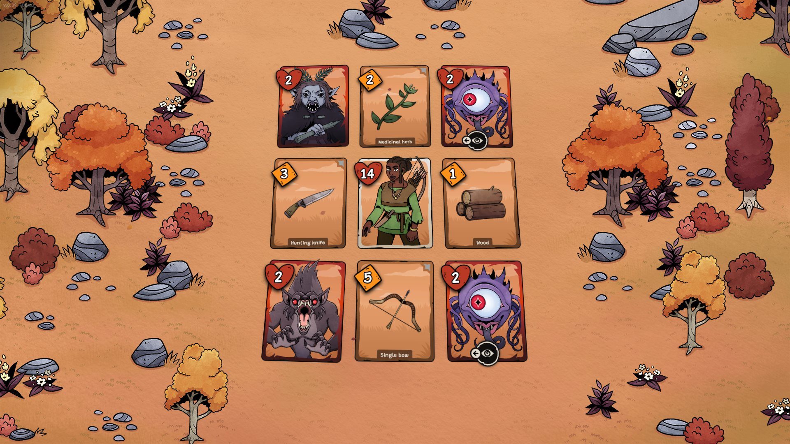
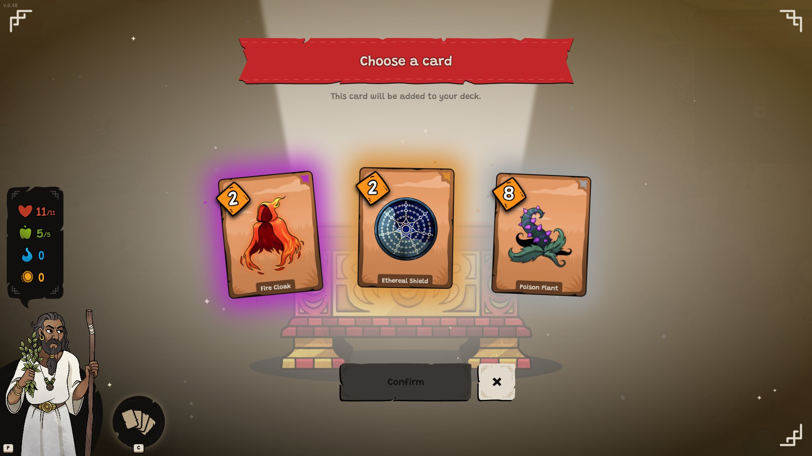
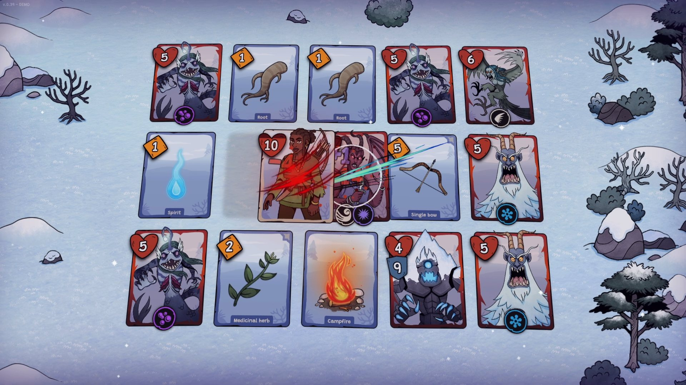
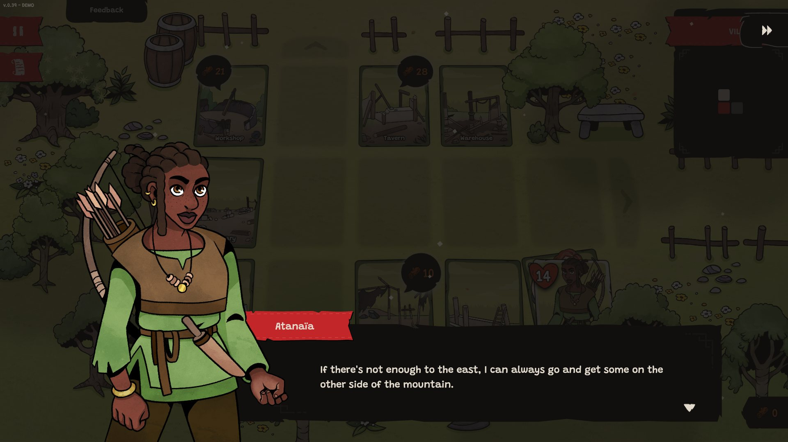

*copie du jeu et images gracieuseté de Two Tiny Dice/Indie Asylum*

**Cette semaine, le studio [Two Tiny Dice](https://www.twotinydice.com/pyrene/) nous propose son jeu [Pyrene](https://store.steampowered.com/app/2468100/Pyrene/), publié par l’Indie Asylum. Il s’agit d’un *dungeon crawler* qui mêle habilement des éléments de roguelike et de construction de deck de cartes pour une expérience de jeu rafraîchissante et stratégique.**

Pyrene nous plonge dans un univers fantastique où le réveil d’Herensuge, un serpent légendaire à sept têtes, a semé le chaos. Atanaïa, jeune chasseuse orpheline, découvre son village dévasté et ses habitants disparus suite à l’apparition soudaine d’une chaîne de montagnes. Déterminée, elle s’engage dans une quête périlleuse pour retrouver ses compagnons et reconstruire sa communauté, tout en affrontant les hordes de monstres qui menacent désormais la région.

Cette prémisse, inspirée de la peu exploitée [mythologie pyrénéenne](https://fr.wikipedia.org/wiki/Mythologie_pyr%C3%A9n%C3%A9enne), sert de toile de fond à une histoire qui se dévoile au fil des rencontres avec les personnages non-jouables.

La véritable force de Pyrene réside dans son approche novatrice du genre dungeon crawler. Plutôt que de naviguer dans des couloirs labyrinthiques traditionnels, le joueur évolue sur un plateau composé de cartes représentant à la fois les ennemis et les éléments de son propre deck. Cette représentation transforme l’exploration en un défi stratégique rappelant les problèmes de circuits hamiltoniens de nos cours de mathématiques à l’école secondaire. À quoi ça sert d’essayer de compléter une figure sans repasser deux fois sur la même ligne? Maintenant, vous le savez.

Le joueur doit donc traverser le « donjon » en visitant chaque carte une seule fois, optimisant son parcours pour maximiser les bonus et minimiser la perte de points de vie.

Lorsque le joueur se retrouve bloqué, il peut choisir de passer une nuit, ce qui réinitialise le plateau avec de nouvelles cartes de son deck, tout en permettant aux ennemis survivants de récupérer partiellement. Cette décision consomme des ressources, ajoutant une couche supplémentaire de tension et de réflexion à chaque tour.

Le jeu intègre également des éléments de roguelike et de construction de deck de cartes qui s’harmonisent avec le concept central. Au fil de l’aventure, le joueur débloque de nouveaux personnages jouables, chacun doté de capacités uniques, permettant ainsi d’expérimenter diverses stratégies et styles de jeu. La personnalisation du deck et l’amélioration progressive du village d’origine offrent une sensation satisfaisante de progression, même après un échec.

Visuellement, Pyrene adopte un style *cartoon* charmant qui sert efficacement le gameplay. Les graphismes simples, mais expressifs permettent une lecture claire du plateau de jeu. L’interface utilisateur, intuitive et épurée, facilite la prise en main.

Le studio Two Tiny Dice a réussi à créer un jeu qui se démarque par son originalité tout en restant accessible. Que vous soyez un amateur de dungeon crawlers en quête de nouveauté ou un néophyte curieux, Pyrene mérite amplement votre attention. C’est un témoignage éloquent de la créativité et du talent de la scène indépendante québécoise du jeu vidéo.

Pyrene sera disponible sur [Steam](https://store.steampowered.com/app/2468100/Pyrene/) le 13 septembre prochain.

## Très bon 8/10

**À LIRE AUSSI : [Critique – Roots of Yggdrasil : une odyssée nordique entre stratégie et survie](/2024/09/05/critique-roots-of-yggdrasil-une-odyssee-nordique-entre-strategie-et-survie/)**

**À lire sur Bêta-Testeur : [Critique de Astro Bot](https://www.lebetatesteur.ca/test-astro-bot/)**
