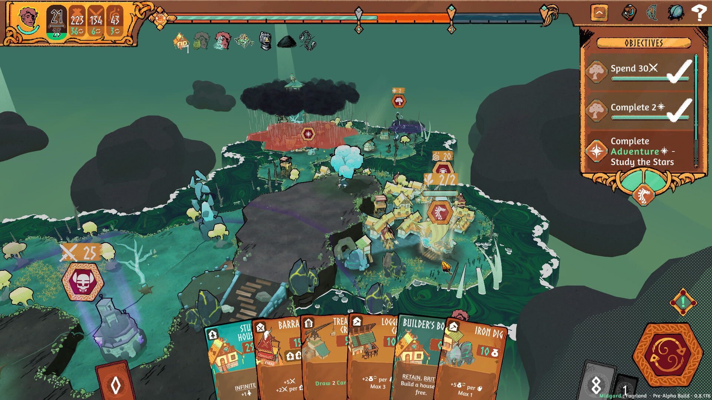
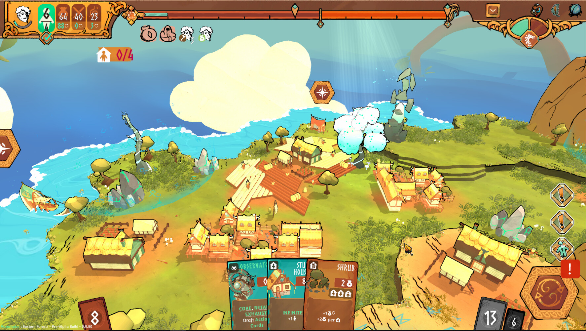
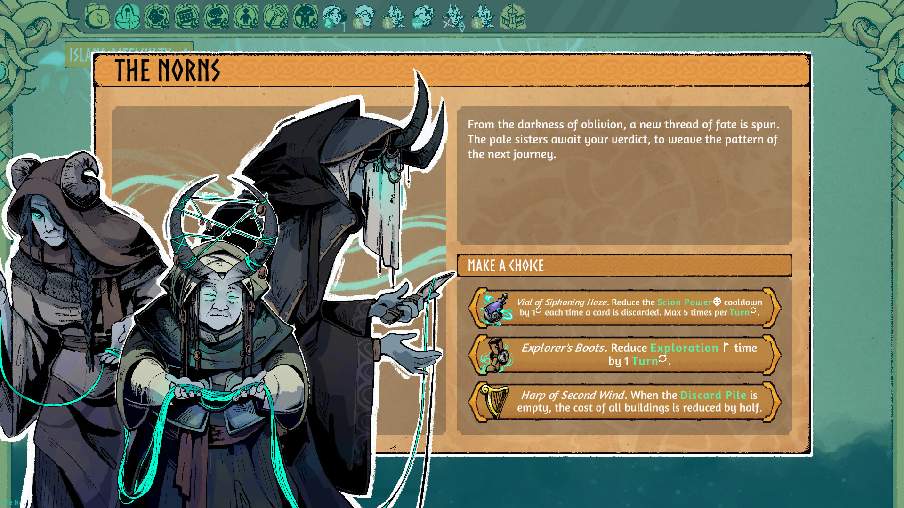
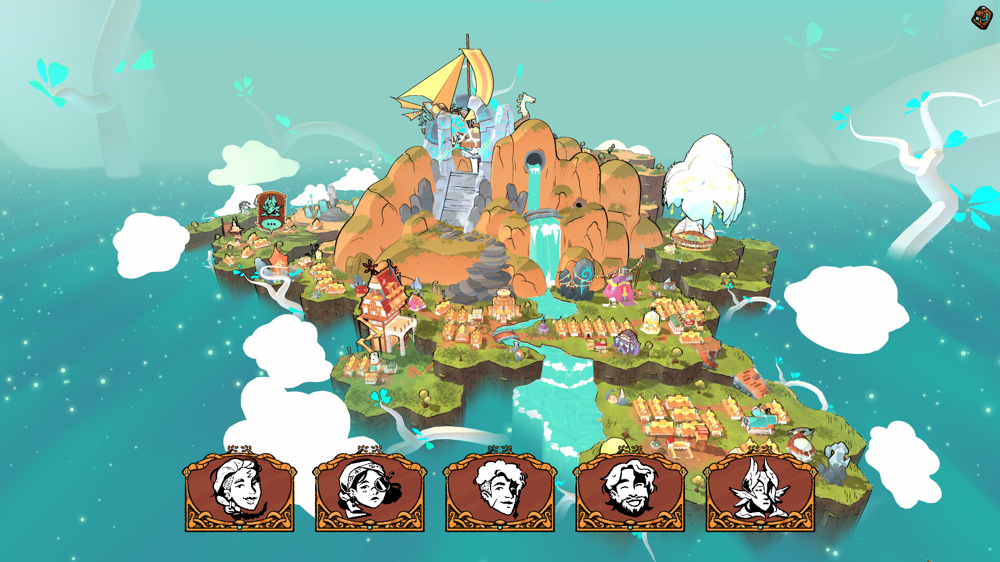

*copie du jeu et images gracieuseté de Manavoid Entertainment*

**Dans un paysage vidéoludique saturé, [Roots of Yggdrasil](https://store.steampowered.com/app/2071430/Roots_of_Yggdrasil/) se démarque en fusionnant habilement plusieurs genres pour offrir une expérience de jeu unique et captivante. Développé par [Manavoid Entertainment](https://www.manavoid.com/), qui nous a donné [Rainbow Billy and the Curse of the Leviathan](https://store.steampowered.com/app/1106830/Rainbow_Billy_The_Curse_of_the_Leviathan/), ce nouveau titre nous plonge dans un univers post-apocalyptique inspiré de la mythologie nordique.**

L’histoire débute après le Ragnarök, la fin du monde selon les légendes nordiques. Les joueurs incarnent un groupe de survivants Vikings, propulsés dans un monde mystérieux et fracturé, composé d’îles flottantes. Cette prémisse sert de toile de fond à une jouabilité varié, mêlant gestion de ressources, construction de village, deck-building et éléments de roguelike.

Le cœur du jeu réside dans sa mécanique de progression par niveau. À chaque nouvelle île, les joueurs doivent rapidement établir une colonie, collecter des ressources et accomplir des objectifs spécifiques. L’urgence est omniprésente, car le Ginnungagap, un brouillard noir vorace, menace constamment d’engloutir tout sur son passage.

L’aspect roguelike du jeu se manifeste à travers la mort permanente et la progression persistante entre les cycles de jeu. Chaque échec devient une opportunité d’apprentissage et d’amélioration du village de départ, créant ainsi un sentiment de progression satisfaisant à long terme. Cette boucle de jouabilité addictive est renforcée par le système de deck-building, qui permet aux joueurs de personnaliser leur stratégie au fil des parties.

Visuellement, Roots of Yggdrasil est plus qu’agréable aux yeux, avec sa direction artistique colorée. Cependant, les bâtiments manquent parfois d’identité visuelle distincte, ce qui peut rendre la lecture de l’espace urbain difficile, surtout lorsque la colonie s’agrandit. Le système de placement libre des bâtiments, bien qu’offrant une grande flexibilité, peut rapidement mener à un chaos visuel où il devient difficile de distinguer les différentes structures.

Heureusement, l’interface utilisateur vient compenser pour cela. Intuitive et bien conçue, elle fournit des informations claires sur les possibilités de construction, les prérequis manquants et les conséquences de chaque décision. Cette transparence dans la jouabilité permet aux joueurs de se concentrer sur la stratégie plutôt que de lutter contre des mécaniques obscures.

Outre le *lore* nordique qui habille tout le concept, Roots of Yggdrasil contient de forts éléments narratifs, notamment avec des personnages aux personnalités distinctes et aux séquences de dialogues qui ponctuent les étapes de progression du joueur.

L’un des plus grands atouts de Roots of Yggdrasil est sa capacité à créer des trous temporels dans notre horaire. Il n’est pas rare de se perdre dans le jeu pendant des heures, enchaînant le récurrent mensonge à soi-même de « *j’arrête après ce tour-là* » . Cette addictivité témoigne de la qualité de la boucle de jouabilité et de la satisfaction que procure chaque petite réussite.

Roots of Yggdrasil est une expérience de jeu rafraîchissante et engageante, combinant avec brio des éléments de stratégie, de gestion et de roguelike. Ce nouvel opus de Manavoid Entertainment risque de vous tenir en haleine pendant de nombreuses heures, afin de percer les mystères de ce monde post-ragnarok .

Roots of Yggdrasil était déjà disponible en Accès Anticipé sur Steam, [la version 1.0 sort officiellement demain le 6 septembre 2024 sur PC.](https://store.steampowered.com/app/2071430/Roots_of_Yggdrasil/)

## Bon 7.5/10

**À LIRE AUSSI : [Game Over? Comment allier la santé et les écrans : entrevue avec Jonathan Harvey](/2024/08/28/game-over-comment-allier-la-sante-et-les-ecrans-entrevue-avec-jonathan-harvey/)**

**À lire sur Bêta-Testeur : [Toutes les annonces du Nintendo Direct du 27 août 2024](https://www.lebetatesteur.ca/nintendo-direct-tout-sur-les-annonces-du-jour/)**
