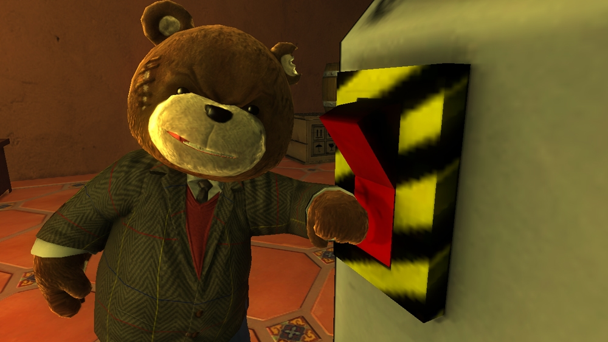
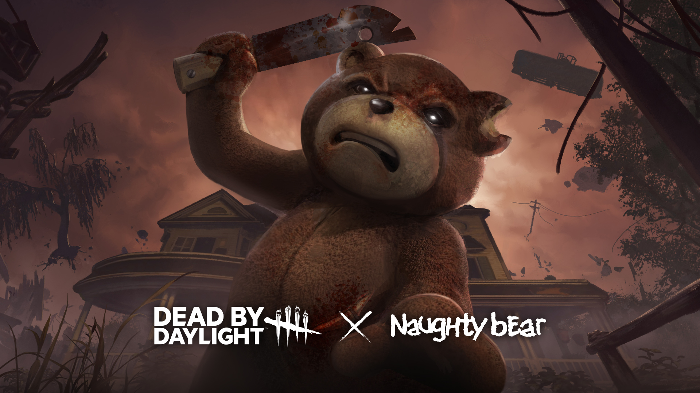
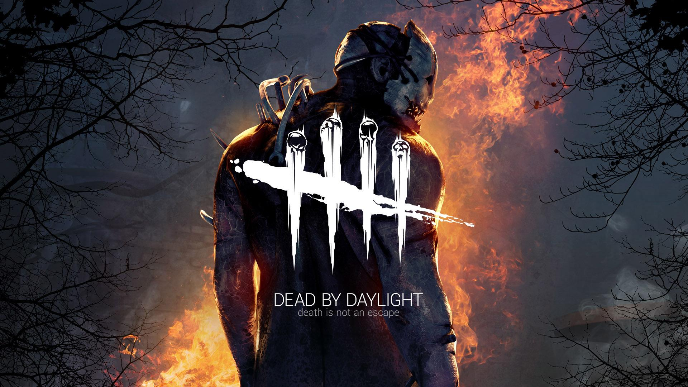
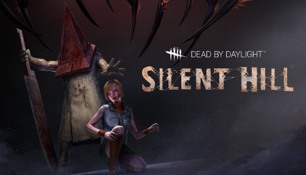
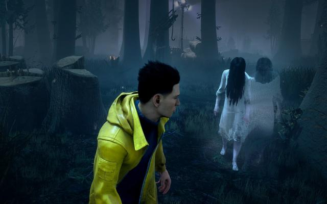
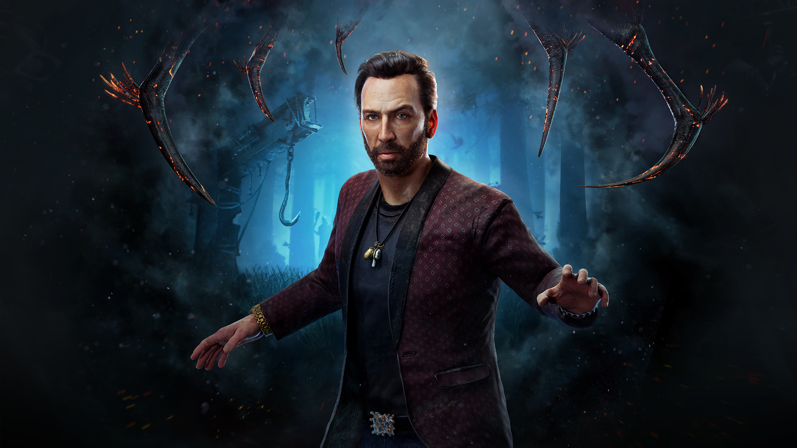
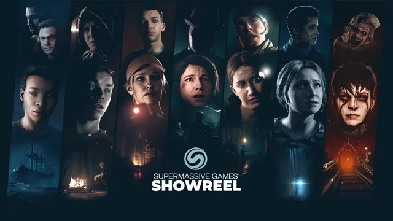
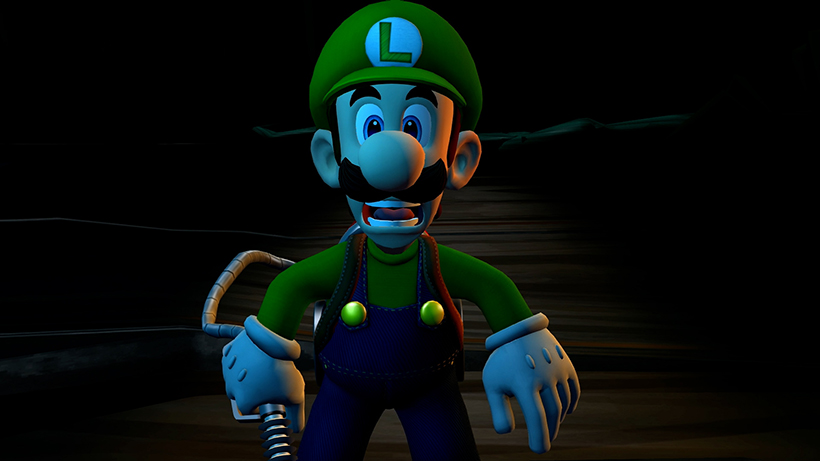
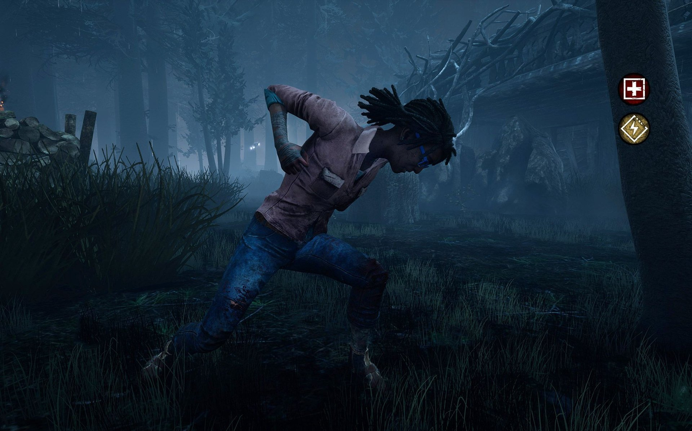
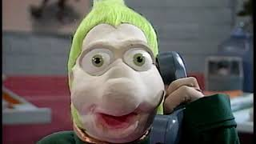

*Crédit images : Behaviour*

**Dead by Daylight est un méga succès. Après plus de 7 ans d’existence, le jeu en ligne d’horreur asymétrique du studio québécois Behaviour est très populaire à travers le monde, avec notamment un *fandom* très impliqué au Japon. Alors que l’univers du jeu est sur le point de déborder sur d’autres médiums et jeux vidéo d’autres genres, on m’a invité pour une entrevue intimiste avec Dave Richard, directeur créatif et Mathieu Côté, chef des partenariats, pour discuter du passé, présent et futur de Dead by Daylight.**

## De Naughty Bear au jeu de la cachette

**Mario J. Ramos : Commençons par le commencement. Ça fait sept ans que Dead by Daylight existe, vous êtes à 60 millions de joueurs, mais si on revient au début, c’était quoi la genèse? Comment ça a parti? C’est qui qui a eu l’idée de : ce serait le fun de faire ce genre de jeu?**

**Mathieu Côté** : C’est l’idée de faire un jeu où t’as la fantaisie d’être le méchant dans un film d’horreur. On la traîne depuis longtemps, cette idée-là, puis elle a eu plusieurs formes.

**Dave Richard** : Bien avant l’idée de Dead by Daylight, d’un jeu asymétrique. Il y avait d’autres projets, c’était quelque chose qui nous passionnait, mais aussi qui était une niche intéressante à explorer.

**Mathieu Côté** : Un des défis, c’est qu’à l’époque, on travaillait beaucoup avec des éditeurs externes. On ne faisait pas tout nous-mêmes, parce que ça se faisait moins bien à l’époque. Ce n’était pas aussi numérique, donc il fallait avoir des contacts pour mettre des jeux sur des tablettes, des trucs comme ça. Et en général, ils nous disaient que l’horreur ça ne vend pas, à moins que tu sois les gros, les Silent Hill ou Resident Evil ou quelque chose de même, oublie ça, faites autre chose. Entre autres, on s’était fait pousser dans la direction de l’humour, ce qui a donné lieu à Naughty Bear.

**Dave Richard** : Ah oui, ça, c’est ce qui est le plus intéressant de l’histoire, étant donné que le produit existe. C’est qu’en travaillant sur des jeux d’horreur, ça ne marchait pas très bien. Je me souviens, c’était juste avant un Noël, l’équipe était *down.* Ça ne marche pas, on n’arrive pas à signer nos projets.

Il y avait un de nos ingénieurs qui avait dit « Le système qu’on est en train de bâtir, on fait des jeux d’horreur avec, l’AI poussée et tout ça, mais on pourrait faire n’importe quoi. Ça pourrait être un jeu de Calinours avec des ours rigolos. » Juste avant les fêtes, on s’est dit : « On fait ça. On fait ce jeu-là, mais horreur. » C’est comme ça que Naughty Bear est venu à exister. Pourquoi je te raconte ça? C’est que Naughty Bear, ça fait partie de la genèse de Dead by Daylight parce que c’est le même genre, c’est la même expérience.

**Mathieu Côté** : C’est la même fantaisie, en fait, mais c’est traité de manière comique au lieu de traité sérieux, horreur. Puis là, *fast forward* une couple d’années plus tard où on se retrouve avec… Il y a quelqu’un qui avait fait un petit prototype vraiment à temps perdu comme ça. La manière la plus simple de décrire ça, c’est littéralement de jouer à la cachette. Une personne qui court et qui essaie d’accomplir quelque chose, pas important, c’est générique. Il y a quelqu’un d’autre qui te court après, puis que s’il te touche, c’est fini. C’était assez basique.

*Behaviour vient d’ailleurs d’annoncer l’arrivée de Naughty Bear dans Dead by Daylight*

C’était sur un ordi. En fait, on avait un gros morceau de carton qui allait sur le moniteur comme ça pour que l’autre ne voit pas de l’autre bord, puis on se courait après. C’était super le fun, puis on a eu l’idée de merger ça avec la fantaisie des films d’horreur. Vraiment inspiré des films d’horreur des années 70-80, le *slasher movie* vraiment plus classique. Puis, ça a marché.

**Dave Richard** : Les gens comprenaient tout de suite ce qu’on essayait de faire.

**Mathieu Côté** : Oui, parce que souvent, c’est ça qui est très dur quand tu fais un nouveau jeu, c’est d’essayer d’expliquer au monde ce que ça va être. Que les attentes soient mises d’une certaine manière pour qu’après, les gens commencent à jouer, puis font « C’est exactement ce que tu m’as dit. » Dans ce cas-ci, on avait une fantaisie, puis des mécaniques de jeu qui étaient vraiment faciles à comprendre. C’était facile de dire « C’est ça qui se passe. » Puis le monde prenait les contrôles, puis faisait « OK, je comprends. »

**Dave Richard** : J’ai l’émotion, puis j’ai compris.

**Mathieu Côté** : C’est ça. C’est comme ça que tout a commencé.

## Le sport ou le chaos

**Mario : Donc là, vous lancez Dead by Daylight. C’est à quel moment vous avez dit « OK, là, on a quelque chose, il faut bâtir là-dessus »?**

**Mathieu Côté** : C’est pendant la production, qui a duré un peu plus d’un an, mettons 18 mois, quelque chose comme ça au total, on a eu une couple de moments où on a eu des décisions à prendre. Une des premières que je me rappelle, c’était : est- ce qu’on veut faire un jeu qui est littéralement super *tight*, balancé comme un sport, où il va y avoir des compétitions ou est- ce qu’on va un peu plus lousse, chaotique, narratif, où on va générer des émotions, mais ça ne sera jamais vraiment *tight,* ça ne deviendra probablement jamais un esport.

Puis ça, on l’a pris assez tôt cette décision-là de dire : non, on va embrasser le chaos et le *random*, juste pour s’assurer que c’est un jeu où tu vas être tout le temps surpris, il va se passer des affaires, puis on va s’arranger pour qu’il y ait des surprises, puis des inattendus, mais ça va coûter le *tight* et le sport, si on veut.

**Dave Richard** : Ça, c’était vraiment avant la sortie, mais c’est quelque chose qu’on a revu quand c’est tombé dans les mains de nos joueurs en bêta, même aujourd’hui à chaque fois qu’on sort un nouveau chapitre. C’est quand on faisait des playtests à l’interne pour tester un *feature* ou quoi que ce soit. Toute l’équipe s’allumait, tu voyais dans leurs yeux, tout le monde se levait, puis racontait leur partie. « Il s’est passé ça, puis j’ai vécu ça. » Tout le monde avait un scénario différent. Toutes les histoires étaient intéressantes. On s’est dit : « OK, on a vraiment quelque chose et on va continuer à travailler dans ce sens-là. »

**Mathieu Côté** : Halloween 2015, c’était avant la sortie. On avait fait un playtest dans le studio où on avait mis les quatre survivants dans une pièce, puis le tueur sur un gros écran géant. C’était cool, mais à un moment donné, on a switché, puis on a mis le Survivant sur le gros écran, puis le monde se mettait à crier. Tu espères qu’il va survivre. C’était vraiment le feeling d’écouter un film d’horreur.

Moi, pour la première fois, c’est là que j’ai fait « Oh shit, on a quelque chose. » Pas juste le jeu, il est fun à jouer, mais regarder du monde jouer à ça. C’est quasiment aussi fun que de jouer. Ça, c’était vraiment important pour nous. L’autre affaire aussi pour moi qui était super importante pendant le début de la production, à un moment donné, on se demandait si on devrait mettre un *« meter »* pour dire est-ce que le personnage a peur ou pas, ou peut-être si à l’écran, ça se met à trembler ou des trucs comme ça. Puis, on a vite réalisé qu’à quelque part, on n’en avait rien à foutre de savoir si le personnage a peur ou pas.

On veut savoir si le joueur a peur. Est-ce que tu as les mains moites? Est-ce que tu es en train de crier? Ça, oui. C’est drôle, des fois, on le faisait jouer, mettons, à du monde en finance ou du monde HR qui habituellement sont moins gamers. Sans généraliser trop. Je me rappelle, on l’avait fait jouer à notre avocate, puis littéralement, elle s’était installée dans un casier, puis elle est restée là tout le long. Elle capotait, puis elle était cachée. « Je ne veux pas mourir! » OK, on peut dire, oui, elle jouait mal, mais non. Elle a joué, puis le tueur la cherchait. Pour le tueur, c’était une expérience cool parce qu’il était comme « Voyons, il en reste une, elle est où? ». Elle capotait tout le long.

**Dave Richard** : Elle a eu une expérience.

**Mathieu Côté** : Il n’y a pas de mauvaise manière de jouer à ce jeu-là, puis ça, c’était vraiment important. Il y avait très peu de jeux asymétriques quand Dead by Daylight est sorti. En fait, même le terme « asymétrique » était rarement utilisé pour parler de jeux vidéo. Puis, il y en a plusieurs qui ont essayé après, puis on l’a vu beaucoup. Un des plus gros problème… Dans ce type de jeu-là, ça marche quand tout le monde essaie de créer une expérience agréable pour les autres. Un peu comme un maître de jeu de Donjons et Dragons. Si le tueur essaye de jouer pour faire chier ou pour être méchant ou juste pour gagner, tout s’écroule, ce n’est plus le fun pour personne. Alors que Dead by Daylight, ça marche. C’est sûr qu’il y a des stratégies qui sont un peu plus frustrantes que d’autres.

**Dave Richard** : On a quand même eu une petite leçon d’humilité une fois que ça a sorti en ligne, les joueurs nous ont prouvé qu’ils pouvaient briser ça.

**Mathieu Côté** : Même si tu n’essaies pas de jouer pour faire du fun pour les autres, si tu fais juste penser à toi, ça reste que ça se tient. Ça, c’est quelque chose qui… C’est dur à expliquer exactement pourquoi ça marche, mais ça marche. Puis on a réussi à le maintenir, littéralement à l’image des assiettes qui *spinnent,* puis que tu essaies d’en garder le plus en train de *spinner.* C’est un peu ça, surtout ta job à chaque jour.

**Mario** : Vous avez fait le choix que ce ne soit pas compétitif. Est- ce qu’il y a quand même une demande? Y a-il une partie de la communauté qui sont comme « Nous autres, on aimerait ça que le jeu soit plus compétitif? »

**Dave Richard** : Très, très certainement. D’ailleurs, au début, juste avant de le sortir, on a intégré dans les derniers features un système de rang dans le jeu, un système de pointage qui était en vue de dire « C’est possible de jouer ce jeu-là d’une manière compétitive. » Selon les règles quand même que ça va être chaotique. Mais oui, il y a un certain nombre, un bon quart de nos joueurs, je dirais, qui aimerait ça avoir quelque chose qui est plus poussé vers l’esport.

**Mathieu Côté** : Il y a des tournois qui ont été organisés… Des fois, on les a aidé, mais en général, ce n’est pas organisé officiellement par nous. Mais il y a des groupes qui ont organisé des tournois, puis souvent, on les appuie, on les épaule, on leur offre du support d’une manière ou d’une autre. Ça peut être super cool, mais en général, ils créent leurs propres règles et autres. Parce que le jeu, quand tu finis un match, ce n’est pas nécessairement clair qui a gagné, puis ça faisait partie du design.

**Dave Richard** : La manière qu’on a bâti le jeu, puis surtout aujourd’hui avec une équipe plus robuste, on peut donner un meilleur sport, puis on peut même considérer à un certain point d’avoir un *feature set,* par exemple, qui serait plus en ligne avec ça. Rien qui est impossible.

## Un univers original

**Mario : Donc, Dead by Daylight, ça s’est beaucoup bâti aussi avec des collaborations, mais vous avez aussi des créations originales. Vous alternez un peu entre les deux. C’est quoi le processus créatif derrière des créations originales? Où est-ce que vous essayez de vous dire « OK, là, on va faire de quoi qui est sci-fi dans l’espace », comme vous avez fait récemment? Comment ça arrive, cette décision-là?**

**Dave Richard** : Il y a énormément de différentes stratégies ou différentes choses qu’on va regarder quand on veut trouver un trou, soit « gameplay-wise », est-ce qu’il y a une mécanique en ce moment que nos joueurs demandent ou qu’on trouve qui est manquante dans Dead by Daylight? Est-ce qu’il y a une fantaisie ou un monde ou une époque ou un sous-genre d’horreur qui n’a pas été encore exploré et qu’on veut offrir à nos joueurs?

L’idée, c’est de donner le plus de possibilités, puis d’inclure le plus de gens possible, que les gens retrouvent ce qu’ils aiment dans un ou un autre personnage. Donc, on a énormément de listes, on a énormément d’idées dans notre « warchest », dans notre *bucket*. Puis on va se puiser là-dedans pour voir en ce moment, stratégiquement, c’est quoi qui serait le mieux? C’est comme ça qu’on commence à penser à nos idées. On tombe en pré-production, on développe nos tueurs pour qu’ils soient amusants à travers des prototypes, des tests, puis aussi avec l’équipe créative pour les rendre le plus proche de la fantaisie qu’on essaie de créer, soit épeurant ou te donner un sentiment de puissance quand tu joues le tueur.

Même chose pour les Survivants. C’est plus une question d’inclusivité, de représentation. Qui sont ces personnes? Comment est-ce que nos joueurs peuvent se rallier ou s’identifier à cette personne?

**Mathieu Côté** : Nos créations originales sont extrêmement importantes. T’as raison de dire on a beaucoup de contenu licencé, du contenu qui vient d’ailleurs, mais pour nous, ça a toujours été critique du début que ça ne dilue pas ce que nous, on a créé. On a notre propre univers, nos propres personnages, notre fiction qu’on a établie et que toutes les licences qu’on intègre, elles s’intègrent à l’intérieur de notre univers.

**Dave Richard** : Ce n’est pas *ragtag*. Ce n’est pas un *mash-up* ou du n’importe quoi. Nos personnes originales font avancer l’univers de Dead by Daylight, qui est comme un tout. Nos joueurs, on leur donne une petite pièce à la fois. Ça se développe très lentement.

**Mario : Ce n’est pas comme Snoop Dogg dans Call of Duty.**

**Dave Richard** : Right. (rires)

**Mathieu Côté** : Comme Nick Cage dans Dead by Daylight. (rires)

**Mario : Les licences, elles expirent à un moment donné. Il y a du contenu qui devient avec le temps inaccessible. Je pense que si tu l’as acheté, tu le gardes toujours**?

**Mathieu Côté** : Oui, ça, c’est une des clauses qui est non-négociable. Si le contenu est dans le jeu, que tu l’as acheté, tu vas le garder pour toujours. À date, il y en a deux dans l’histoire de Dead by Daylight qui sont disparues. Il y a Attack on Titan, il y avait des cosmétiques qui ne sont maintenant plus disponibles dans le magasin. Puis, il y a Stranger Things qui est un chapitre qui n’est plus disponible maintenant dans le magasin.

**Mario : Il y avait-tu un niveau associé?**

**Mathieu Côté** : Oui, il y avait une carte.

**Mario : Mais elle n’est plus disponible?**

**Mathieu Côté** : Exactement. Ceux qui avaient acheté les personnages peuvent encore les jouer. Donc comme Survivant, tu peux tomber sur un match du Demogorgon, par exemple, qui est toujours une agréable surprise. Puis, les *perks* des survivants sont restés, mais c’est devenu des perks génériques auxquels tout le monde a accès, parce qu’on ne voulait pas enlever la mécanique de jeu, même si on a changé les noms et on a changé les visuels.

## De Michael Myers à Nicolas Cage, en passant par Silent Hill… et Tony Hawk?

**Mario : Dans toutes les collaborations que vous avez eu, laquelle qui a été votre préférée, la plus fun ou facile ou agréable à développer?**

**Mathieu Côté** : Chacune d’entre elles a quelque chose d’unique avec une histoire super cool à raconter. Halloween, c’est la première, puis ça reste que c’est une légende. Michael Myers comme première licence à rentrer dans notre jeu, c’était un rêve. Ça, c’était absolument fou de pouvoir faire ça. Si on regarde la dernière, c’est *big*, c’est Alien, c’était quand même assez important à faire, mais chacune d’entre elles a quelque chose de spécial. Moi, j’ai longtemps poussé pour qu’on fasse Hellraiser parce que je trouvais que visuellement, c’était un des personnages les plus frappants. Mais probablement que la plus unique que j’ai vécue, c’est la session d’enregistrement…

**Dave Richard** : Avec Nicolas Cage.

**Mathieu Côté** : Ça n’avait aucun sens. De le voir aller pendant quatre heures à enregistrer toutes les lignes qu’on avait besoin, toutes les voix, toutes les variations possibles. L’affaire qui est le plus triste dans cette histoire-là, on a plein de voix super cool, puis de sons dans le jeu. Il y en a tellement qui sont restés sur le plancher de la salle de montage parce qu’il en a enregistré pendant quatre heures. On ne peut pas tous les mettre. Puis, il y avait des affaires vraiment *flyés.*

**Dave Richard** : Pour moi, c’est dur à choisir entre Resident Evil ou Silent Hill, mais je vais aller avec Silent Hill étant donné que c’est la première licence de jeu d’horreur qu’on a intégré. J’ai toujours été un grand fan de l’univers de Silent Hill, donc de donner une peau neuve, une nouvelle vie à ce contenu-là, c’était un méchant moment.

**Mathieu Côté** : Surtout qu’à l’époque, c’était plus ou moins une licence dormante.

**Dave Richard** : C’est sûr que là il y a toutes sortes de nouvelles choses qui ont été annoncées. C’est excitant, mais à l’époque, il n’y avait rien.

**Mathieu Côté** : Absolument rien. Puis tu as raison. Les premières licences de jeu vidéo, c’était aussi quelque chose… C’était comme une badge d’honneur. Ça nous légitimise à quelque part, parce qu’ on se faisait reconnaître par non seulement nos pairs, mais justement, appeler ces gens-là nos pairs, c’est quand même quelque chose de… Oui. Voilà.

**Mario : Puis, quelle collaboration a été la plus difficile?**

**Dave Richard** : Aucune, mais on peut parler de challenge, par exemple, de challenge d’intégration.

**Mathieu Côté** : Une qui a été un beau challenge à faire, je dirais, c’est Sadako, parce qu’ on voulait faire un chapitre complet avec un survivant. Puis dans l’histoire de The Ring, il n’y a personne qui survit. La seule personne qui survit, c’est un enfant. Nous, on n’a pas de petits enfants dans Les survivants. On ne veut pas mettre des petits enfants sur des crochets à viande. Donc, on a pu s’asseoir avec les créateurs originaux et écrire de l’histoire qui est maintenant canon dans l’univers de The Ring pour que ce petit gars-là ait grandi, soit devenu un biologiste marin.

Il a grandi, il est devenu quelque chose, mais cette histoire-là qu’on a créée, ce personnage-là qu’on a créé est vrai dans l’univers de Sadako, de The Ring. C’était vraiment cool de pouvoir faire ça. C’était un beau challenge.

**Dave Richard** : On prend une grande fierté à vraiment faire du f*an service*. Je ne sais pas comment dire ça en français.

**Mario : Service aux… amateurs.**

**Mathieu Côté** : Les amateurs, ça manque de punch!

**Dave Richard** : Donc, d’intégrer ces personnages-là, ces univers-là dans le nôtre, puis ça a assuré que nos mécaniques de jeu et nos métriques vont encore fonctionner, et que le produit est reconnaissable, puis il est vraiment au bon ton. C’est toujours un challenge, mais c’est toujours super intéressant.

**Mario : Est-que ça arrive de travailler sur des collaborations pendant des mois et des mois, puis finalement, vous avez frappé un impasse, puis que la collaboration n’a pas lieu?**

**Mathieu Côté** : Moi, oui. Parce que moi, je travaille sur les négociations des partenariats. Donc oui, il y a des négociations qui n’ont pas abouti à un contrat. Parce qu’on ne travaille pas sur… Comme règle établie, on ne travaille pas sur un contrat ou sur une licence tant que ce n’est pas signé. Parce qu’on ne veut pas risquer que ça soit du travail… On a une cadence de sortie de contenu qui est tellement intense qu’on ne peut pas se permettre qu’il y ait du monde qui travaille pendant une semaine sur quelque chose, puis finalement on le jette.

Mais moi, de mon côté, vu que je négocie ce qui peut se passer dans un an, dans deux ans, c’est arrivé qu’on a eu des longues conversations avec du monde, qu’on essaye, puis qu’on essaye, puis que finalement ça n’a pas pu se passer.

C’est très rare, c’est frustrant, mais c’est des choses qui arrivent. Mais je dirais qu’en général, c’est arrivé peut-être une fois ou deux, parce qu’on finit toujours par trouver un terrain d’entente. Sinon, c’est qu’on le sait dès le premier appel. Tu appelles quelqu’un, tu dis « Est-ce que c’est possible? Puis, ils disent « Non. Désolé, nous, on ne fait pas ça. » « D’accord. » On passe à autre chose.

**Dave Richard** : Les crêves-cœurs, c’est les questions de timing. L’équipe a juste tant de *bandwidth* pour travailler sur du contenu, puis des fois, il y en a juste trop en même temps, ça ne marche pas.

**Mathieu Côté** : C’est souvent plus ça le problème. Ou par exemple, on a une collaboration avec un film : « On sort justement un nouveau l’année prochaine, est-ce que vous pouvez faire ça pour septembre? » « Non, ça ne marchera pas. »

**Mario : Donc, une des grosses collaborations que vous avez eues c’est avec Nicolas Cage, justement. Comment c’est arrivé? C’est quoi aussi le processus où vous vous êtes dit « Ce serait le fun Nicolas Cage ». Ce n’est pas nécessairement évident.**

**Dave Richard** : Je veux juste parler d’un peu de la genèse de cette idée-là. Ça remonte à bien longtemps. Je vais laisser les noms planer dans le mystère, même s’il y en a un qui est quasi-officiel. Je me souviens, avec Mat, on était à son bureau, puis on parlait de juste comment que ça serait cool si on avait une personne du vrai monde qui se retrouverait dans Dead by Daylight. Parce que jusqu’à maintenant, c’est tous des personnages fictifs, mais il y a rien qui empêche qu’une vraie personne se retrouve dans notre univers, étant donné que c’est un multivers, puis que tout le monde peut être pris par l’Entité. Là, on commence à lister des gens qui pourraient y être. Puis finalement, ça a tombé à l’eau, puis c’est juste beaucoup plus tard que… Je te laisse continuer…

**Mathieu Côté** : En fait, le gros challenge qu’on avait par rapport à ça, c’est que des personnages fictifs peuvent être absolument vils et terrifiants, mais ils sont fictifs. Alors qu’une personne réelle, le problème que t’as, c’est que tu as, c’est que tu ne sais pas, peut-être demain, cette personne-là va être prise saoul au volant et vient d’écraser quatre enfants, puis qui dit « Je regrette rien! » Ça peut être dangereux de s’associer à ce genre de personnes-là.

Donc pour nous, c’était vraiment un défi de trouver des gens. Il fallait aussi que ça soit quelqu’un que nos fans connaissent, mais en même temps, il fallait que ça soit une surprise. En tout cas, c’est dur. Un des noms qui est sorti au tout début, qui était un peu officiel, c’était Tony Hawk. Tony Hawk, on se disait, il est tellement sain, gentil. C’est clair qu’il ne va pas faire quelque chose d’horrible. On va le contacter. Tout le monde l’aime.

**Dave Richard** : Pour moi, c’est un icône du jeu vidéo. Tony Hawk’s Pro Skater.

**Mathieu Côté** : Justement, moi, j’ai eu la chance… Ça, c’est vraiment un *bucket list checkmark*. Sur Twitter, j’ai eu un échange avec Tony Hawk dans lequel, très gentiment, il m’a expliqué « Écoute, mon nom est locké pour les jeux vidéo. Moi, c’est Tony Hawk’s Pro Skater, puis that’s it. » Alors, c’est impossible. Désolé, merci pour ton offre.

**Mario : Tu as framé le screenshot de l’échange Twitter. (rires)**

**Mathieu Côté** : Mais c’est comme rester dans le fond de notre tête à dire « Ça serait surprenant, ça serait une belle manière de faire un gros splash. » On a cherché pendant un petit bout de temps, puis à un moment donné, l’idée de Nicolas Cage est surgie. C’est une de ces idées que tu te dis, voyons ça pas de rapport.

**Dave Richard** : Puis, *actually, it’s pretty good!*

**Mathieu Côté** : Il n’a aucune présence sur les médias sociaux, mais tout le monde le connaît, c’est un meme, il est partout. Il a été dans plein de films d’horreurs et autres, du comique au weird occulte. Puis, l’avantage qu’on a, c’est que Behaviour fait des jeux depuis 30 ans, surtout pour d’autre monde. On travaille avec les plus grands licenseurs, que ce soit Disney ou Activision, des licences de jeux vidéo, des licences de films. Donc, on a des contacts un peu partout, on a une réputation établie.

On n’est jamais à plus que deux ou trois appels de notre objectif dans des cas comme ça. C’est ça qui est arrivé. On a réussi à trouver quelqu’un qui était chez les agents qui représentent Nicolas Cage. Je pense que l’élément déclencheur, c’est que Nick Cage, dans son entourage proche, il y a quelqu’un qui est un gros fan de Dead by Daylight. Lui, il a décidé de faire ça pour le plaisir d’être inclus dans quelque chose qui a beaucoup d’importance pour quelqu’un qui est proche.

**Dave Richard** : Il est quelqu’un de curieux. Il aime ça apprendre de nouveaux médias.

**Mathieu Côté** : Oui, absolument. C’est aussi un professionnel. Le moment où il s’est dit « OK, je vais faire des lignes pour Dead by Daylight », il a commencé à étudier, il voulait savoir notre univers, il voulait comprendre pourquoi il y avait une ligne par rapport à des corbeaux. « OK, je vais étudier ça. Moi, j’ai un corbeau. » Il a un animal domestique à la maison. Il a commencé à inventer des affaires par rapport à ça. Il était dedans, puis il nous a fait une série de lignes phénoménales.

L’autre affaire, c’est que quand on enregistre les voix… Dans Dead by Daylight, les personnages ne parlent pas, presque. Depuis le début, les personnages ne parlaient pas jusqu’à The Plague, qui est la première. Puis, on a eu Ash Williams après avec Bruce Campbell, puis lui, évidemment, il a fait enregistrer deux ou trois lignes juste parce que ça prenait une ligne qui faisait « groovy » ! Ça, c’était le début. Puis après ça, on a dit « On va rajouter des lignes ».

Ce qu’on enregistre, c’est des cris, des halètements, des gémissements, des hurlements. Puis, c’est intense. D’habitude, c’est une session d’à peu près trois à quatre heures de quelqu’un qui se déchire la gueule, la gorge, à hurler dans un micro.

Nous, quand on est arrivé pour enregistrer pour Nick Cage… Il y aurait une session où tu enregistres des lignes bien normales, pour par exemple la bande-annonce, puis des trucs comme ça. Puis il y a une session de *exertions*, qu’ils appellent, essentiellement des cris. On a dit « Ça, on le ferait faire par un expert, genre chanteur de métal ou quelqu’un qui est habitué à se déchirer la voix. » Il a dit « Non, non, non. Il n’y a jamais eu de sosie vocale de Nick Cage. On ne va pas commencer aujourd’hui. Je vais aller faire. »

Puis, il nous a fait ça comme un chef qui a hurlé, c’est sa voix. Il avait tout à fait raison parce que c’est immanquable.

**Dave Richard** : C’est une belle histoire.

**Mathieu Côté** : C’est un acteur phénoménal qui a fait de tout. Moi, personnellement, j’écoute National Treasure régulièrement. C’est comme mon *comfort movie*. Il est capable de jouer super campy, gros comme le bras, puis super sérieux, modéré.

**Mario : Tu as toujours le sentiment qu’il se donne à 100 %.**

**Mathieu Côté** : Exactement. Il n’y a pas de demi-mesure.

## Dead by Daylight au grand écran

**Mario : Justement, parlant de cinéma, il y a un film de Dead By Daylight qui est en développement.**

**Mathieu Côté** : La grève des auteurs a tout ralentie. On avait des conversations avec des réalisateurs, avec des auteurs qui étaient intéressés. C’est super cool le fait qu’aujourd’hui, huit ans plus tard, il y a des gens qui jouent, il y a des gens qui ont des enfants qui jouent à Dead By Daylight, connaissent le jeu plutôt bien à cause de ça.

Donc, on est capables de demander ça plus ou moins comme pré-requis, de dire : tu as beau être Steven Spielberg… ça ne sera pas Steven Spielberg, mais mettons Steven Spielberg qui arrive, qui dit : « J’aimerais ça faire le film », mais qu’il ne connaît pas Death by Daylight, on dirait « Non, Steven. Merci beaucoup. »

Est-ce qu’il y a des gens qui sont intéressés par le projet? Est-ce qu’il y a des gens qui sont déjà familiers avec l’univers? Qui veulent participer. On est en conversation en ce moment avec des gens qu’on espère pouvoir annoncer bientôt.

C’était des conversations qui étaient super difficiles. Dès qu’on tombait dans des histoires ou dans les personnages, il fallait arrêter de parler parce que tu tombais dans le domaine des auteurs. On parlait d*‘*ambiance, d’intentions, mais il fallait arrêter. Maintenant ça, c’est réglé. Il y a encore la grève des acteurs, il va falloir qu’elle se règle.

Tout ça est au ralenti. Tout Hollywood en ce moment est un peu en chaos… Nous, on n’est pas familiers avec ça, c’est un univers qu’on ne connaît pas beaucoup. Heureusement, on est associé avec Blumhouse, avec Atomic Monster, qui sont des maîtres de l’horreur. Ce qui est très cool, c’est que c’est des spécialistes de faire des films à petit budget, qui sont faits rapides et qui ont un énorme succès.

**Dave Richard** : Qui frappent l’imaginaire.

**Mathieu Côté** : Exactement. C’est pour ça qu’ils font beaucoup d’horreur, parce que l’horreur, c’est des films qui sont souvent à moins grand déploiement, puis c’est possible de faire dans des huis clos, par exemple, des trucs comme ça, ce qu’ils ont fait beaucoup, eux autres. Je ne dis pas que c’est ce qui va se passer avec Dead by Daylight, mais ils ont cette espèce d’habitude de « get shit done ».

## La Brume s’étend à d’autres jeux vidéo

**Mario : Là, il y a aussi un jeu narratif de Dead by Daylight qui est en développement chez Supermassive. Donc, eux autres, ils ont une expérience là-dedans, mais pourquoi avoir fait le choix de « On va faire affaire avec un autre studio au lieu de : on va le développer nous autres même à l’interne dans un de nos studios.** »

**Dave Richard** : Très bonne question. Oui, il y a quand même plusieurs raisons à aller avec une stratégie comme ça. Étant donné que tu écris dans le monde du jeu vidéo, tu sais probablement que trouver des employés, trouver des spécialités pour bâtir des jeux, c’est très complexe à Montréal en ce moment. Donc s’associer avec un studio comme Supermassive faisait énormément de sens étant donné qu’ils ont une expertise, ils sont des pros, ils ont un pedigree ou un résumé ou un portfolio qui est déjà très, très intéressant, qui est dans le ton.

**Mathieu Côté** : Ça fait tout plein de sens. C’est une expertise qu’on n’a pas non plus ici chez Behaviour. On n’a jamais fait de jeu vraiment narratif.

**Dave Richard** : Linéaire comme ça.

**Mathieu Côté** : Cinématographique même, parce que c’est cinématographique. On a eu l’opportunité de s’associer avec eux, puis ça faisait du sens.

*crédit : Supermassive Games*

**Dave Richard** : Dès les premiers meetings qu’on a eus avec eux, on a eu l’occasion de travailler avec leurs directeurs qui nous présentaient leurs *pipelines*, vraiment, comment on « get shit done », on était comme « OK, c’est ça ».

**Mathieu Côté** : C’est drôle parce qu’après 30 ans, Dave, ça fait presque 20 ans que tu es ici, moi, ça fait 12 ans, on en a fait beaucoup des jeux avant Dead by Daylight, puis eux ont une réputation qui est absolument valide. On les fait les jeux, peu importe, on va trouver une manière. On était les derniers à faire des ports pour la Vita ou le 2DS ou quelque chose de même.

Behaviour, c’est une compagnie qui s’arrange pour que les choses se fassent dans les temps, puis avec le budget. Ça a toujours été ça. C’est nous, c’est vraiment une habitude qu’on a de « Peu importe, non, ce n’est pas comme ça qu’on le faisait avant. Ce n’est pas grave. Est-ce que ça va marcher? Oui. Ok, c’est ça qu’on fait. » Alors que eux, chez Supermassive, ils travaillent vraiment comme un studio de film.

Une fois que l’histoire est faite, ils travaillent beaucoup sur papier au début, pendant les premiers mois, ce n’est que sur papier.

Une fois qu’ils savent ce qu’ils font, là, il y a de la capture de mouvement. Il y a des enregistrements de voix. C’est vraiment comme un film jusqu’à la fin. C’est des méthodes que nous… on aurait pu le faire parce qu’on est capable de faire un petit peu n’importe quoi, mais pas à ce niveau de qualité-là.

**Dave Richard** : Puis surtout pas dans les temps. Il était absolument pas question qu’on allait diluer l’effort sur Dead by Daylight.

**Mathieu Côté** : Ça, c’est l’affaire qui est primordiale, toujours.

**Mario : Est-ce que vous pouvez en parler un petit peu plus du jeu solo, au niveau de qu’est-ce que vous vouliez faire avec ça, dans le sens que vous vouliez étendre l’univers?**

**Dave Richard** : L’exploration dans d’autres médias comme les comic books, le film qu’on a discuté, d’autres jeux, c’est vraiment une opportunité d’étendre l’univers, de donner des expériences de jouabilité qu’on ne peut pas offrir à nos joueurs dans Dead by Daylight. Je pense que l’univers de Dead by Daylight est rendu plus grand que son jeu original. La seule manière de donner ces expériences-là, c’est d’étendre à d’autres titres.

**Mathieu Côté** : C’est important parce qu’au début, quand on a sorti le jeu, l’univers de Dead by Daylight était surtout des questions sans réponses. C’était correct. C’était ce qu’on avait fait. Il y avait des petites descriptions ici et là. Beaucoup de l’histoire venait du texte. Dans l’environnement, dans les personnages, c’était ça. Les gens se posaient des questions, les gens avaient des théories, ils se partageaient ça, puis à mesure qu’on grossit le jeu, dans Dead by Daylight, maintenant, surtout avec les archives, on est capable de raconter beaucoup plus de l’histoire, du background, des nouveaux personnages.

On a des histoires beaucoup plus complètes, mais reste qu’à chaque fois qu’on répond à une question, on s’assure qu’il y a cinq nouvelles questions qui sont posées auxquelles on ne répond pas. Pour pouvoir constamment laisser place à ces tergiversations-là.

**Dave Richard** : Une autre chose aussi qu’on pense, c’est que quand on fait un autre titre comme ça, on veut que nos joueurs de Dead by Daylight puissent en apprendre plus sur notre univers, puis avoir des expériences différentes, mais on veut aussi qu’il y ait plus de gens qui ne connaissent pas encore Dead by Daylight. C’est un univers qu’on aime beaucoup, qu’on veut partager. Puis, qu’ils retrouvent quelque chose qui est plus à leur goût. C’est pas tout le monde qui est prêt à aller dans un monde comme Dead by Daylight en ce moment, puis d’aller dans ce genre de match multijoueur. Ça va nous permettre de partager l’univers avec d’autres genres de joueurs.

## Un engouement international, particulièrement au Japon

**Mario : C’est un jeu qui a quand même une certaine popularité à l’international, pour atteindre 60 millions de joueurs. Dans quel marché est-ce que c’est le plus populaire et pourquoi à votre avis?**

**Mathieu Côté** : Les États-Unis… L’amérique du Nord en général, c’est assez gros, clairement. Le Japon, ça reste un de nos marchés les plus forts, surtout en intensité. C’est le marché où il y a le plus d’heures jouées par mois. En termes de revenus, l’Amérique du Nord est un petit peu au-dessus, mais au Japon, je sais que c’est les joueurs qui dépensent le plus aussi. Il y a peut- être moins de joueurs, mais ils se donnent à 100 %. Sinon, en Europe, peut-être en Angleterre, en Allemagne, c’est pas mal aussi, mais c’est répandu partout. On est représenté dans 160 pays.

**Dave Richard** : La plupart des régions entrent dans le jeu pour les mêmes raisons, mais il y a des petites fluctuations d’intérêts, on va dire. Je ne veux pas stéréotyper, mais mettons un marché européen, Amérique du Nord, il y a des gens qui vont aller dans DbD pour des raisons de multijoueurs et de compétition, mais il y a plus de gens qui sont curieux d’aller voir c’est quoi ce type de jeu-là, puis quel genre d’émotion qu’ils peuvent en retirer. Le marché japonais est un petit peu plus dans le gameplay, dans la mécanique elle-même de jouer et potentiellement gagner ou de voir comment on peut optimiser son jeu.

**Mathieu Côté** : Le Japon, puis la Corée aussi.

**Dave Richard** : Ouais, absolument.

**Mathieu Côté** : C’est des généralisations.

**Dave Richard** : Oui, exactement. Il y a de tout un peu partout, mais je pense que les raisons pour lesquelles on rentre dans Dead by Daylight sont un petit peu différentes dépendamment du marché.

**Mario : Où voyez-vous le jeu dans un autre sept ou huit ans?**

**Mathieu Côté** : Si tu m’avais demandé il y a sept ans où est-ce que je voyais le jeu dans sept ans… Je faisais des beaux vidéos à l’époque où on disait « Ce n’est que le début. » Ça, c’était la deuxième année, je pense, de l’anniversaire. « This is only the beginning ». J’avais tout à fait raison à l’époque, même si je n’étais pas certain. Aujourd’hui, on est à quelque part qu’on n’aurait jamais pu prévoir. Dead by Daylight n’a jamais été aussi gros qu’aujourd’hui, donc le déclin n’a pas commencé. S’il commençait aujourd’hui, on en a pour une bonne couple d’années à continuer ça.

Nous, personnellement, on a encore plein d’histoires à raconter. On a notre liste de collaborations de licences légendaires de l’horreur, on est probablement passé à travers les principales. Il en reste deux ou trois dessus à peu près, des légendes de l’horreur qu’on n’a pas faites. Comme je disais, on est le musée de l’horreur. Cette année, on va ouvrir une nouvelle aile du musée avec Slipknot, Iron Maiden qui vont se rajouter, qui viennent s’installer confortablement dans le monde de l’horreur, parce que c’est tellement des thèmes visuels, des trucs qui fittent très bien avec l’horreur.

Mais c’est quelque chose qu’on n’aurait jamais anticipé avant. Même juste rajouter des jeux vidéo là-dedans, c’était quelque chose qui était impensable presque à l’époque. Qu’est-ce qu’on va rajouter de plus dans les prochaines années? C’est dur à dire, mais clairement, il en reste à faire.

**Dave Richard** : Pour moi, les défis qui s’en viennent, on se projette très loin dans le futur, sept ou huit ans. Pour moi, c’est ce qu’on est en train de bâtir, c’est au niveau franchise de Dead by Daylight. Comme je vous ai dit tantôt, Dead by Daylight, c’est plus que le jeu qu’on a connu au tout début. C’est devenu un univers plus important que ce titre-là. J’espère, en tout cas, on travaille fort pour ça, dans sept ou huit ans, je pense qu’on va avoir encore plus de possibilités de participer dans l’univers de Dead by Daylight en tant que joueur.

**Mathieu Côté** : Peut-être qu’on va avoir un film. Des projets qu’on a annoncé déjà, comme tu parlais du jeu avec Supermassive, mais il y a aussi un autre jeu qu’on a annoncé qui se passe dans l’univers de Dead by Daylight, mais qui ne sera pas PvP, ça va être PvE. C’est un jeu en coop que tu vas jouer avec des amis dans l’univers de Dead by Daylight. On n’a pas donné plus de détails que ça, à part que c’est fait avec un studio qu’on a acquis à Seattle il y a deux ans maintenant, un an et demi. Et donc, il y a des gros projets pour justement exploser l’univers de Dead by Daylight. On a fait Hooked on You il y a deux ans, qui était super drôle. On va en faire d’autres et montrer à quel point ça peut s’adapter à n’importe quoi, ce monde-là qu’on a créé.

**Dave Richard** : Je ne pense pas que quand ils ont fait le Mario Bros original, (je ne veux pas dire qu’on est au niveau de Mario), mais qu’ils s’imaginaient qu’ils allaient faire un Mario tennis.

**Mathieu Côté** : Oui, ou un Luigi’s Mansion.

*crédit : Nintendo*

**Mario : Une collaboration avec Luigi’s Mansion, ça serait…**

**Mathieu Côté** : Honnêtement, j’ai parlé… On a parlé évidemment avec nos partenaires chez Nintendo. Moi, je leur avais demandé, je voulais que le Trapper se retrouve dans Super Smash Bros. Ils m’ont poliment répondu de manière très japonaise qu’ils sont flattés et que ça serait très difficile. Et ils ont vraiment tout fait pour ne pas me dire non, mais c’était assez clair que ça ne se passerait pas. J’ai demandé aussi si on pourrait avoir Luigi peut-être dans DbD, justement, dans le Luigi’s Mansion, il s’est fait emporter… Et non, ça ne se passera pas non plus. Tu ne peux pas mettre Luigi sur un crochet à viande, tu peux pas non plus le faire déchiqueter par les chaînes avec des crochets du Cenobite. Ce n’est pas des choses qu’on peut faire.

**Dave Richard** : Pas encore!

**Mathieu Côté** : Pas aujourd’hui, mais il y a d’autres choses qu’on peut faire.

## Un chapitre québécois?

**Mario : OK, dernière question. Est-ce que vous êtes ouverts à un jour créer un chapitre québécois? Admettons, Karmina, je ne sais pas.**

**Mathieu Côté** : Quelle excellente question.

**Dave Richard** : Moi, personnellement, c’est quelque chose que j’ai dans ma tête sans arrêt. On fait beaucoup d’inclusivité, puis on s’oublie un peu.

**Mathieu Côté** : Une map de cabane à sucre.

**Dave Richard** : Pourquoi pas?

**Mathieu Côté** : Le folklore québécois, il y a plein de monstres.

**Dave Richard** : Exactement.

**Mathieu Côté** : L’homme-gris…

**Dave Richard** : Ça me revient souvent. Dans nos premiers personnages. Claudette est québécoise, elle est montréalaise. Donc on en a, mais c’est peut-être pas si évident.

**Mathieu Côté** : Un chapitre Québécois, t’as raison, ça manque.

**Mario : Un des premiers jeux qui se passaient au Québec, c’était Sang-froid : Tales of Werewolves.**

**Mathieu Côté** : Oui, mon ami, Yann Pépin, avait travaillé là-dessus, c’était excellent.

**Dave Richard** : C’est une mission, il faut qu’on voit à ça.

**Aude Laliberté** (gestionnaire de relations publiques, présente à l’entrevue) : Avez-vous vu, il va y avoir un jeu vidéo sur la Crise d’Octobre?

**Mario** : Oui, ça s’en vient du studio Chien d’Or, [Cauchemars d’Octobre.](/2023/10/17/cauchemars-doctobre-un-jeu-video-sur-la-crise-doctobre/)

**Mathieu Côté** : Il y a aussi Sugar Shack, simulateur de cabanes à sucre.

**Dave Richard** : L’autre truc qu’on a intégré dans Dead by Daylight, aussi, c’est le Lewis Memorial Institute. Tu sais, tout ce qui est MKUltra qui s’est passé à Montréal. C’est quelque chose sur lequel on discute, c’est super intéressant. Mais oui, on a une histoire et une culture super intéressantes, de le partager avec notre communauté…

**Mathieu Côté** : C’est drôle parce qu’on est fiers de dire La Huntress, elle a été inspirée des légendes de l’Europe de l’Est un petit peu pendant la guerre, des trucs comme ça. Même la berceuse qu’elle fredonne, il y a certains de nos joueurs qui viennent, mettons, de ces régions-là, qui tripaient parce que c’est la chanson que leur mère chantait quand ils étaient petits. Puis on pourrait très bien faire ça ici.

**Dave Richard** : Certainement.

**Mathieu Côté** : Passe-Partout, ça existe. Je vais aller chercher.

**Dave Richard** : *Get on it!*

**Mathieu Côté** : Ou peut-être Virginie, je ne sais pas. Quelque chose d’accessible.

**Dave Richard** : Chambre en ville. Bibi est un peu épeurant.

*crédit : Canal Famille (rip)*

**Mathieu Côté** : C’est juste un dude avec un masque de Bibi.

**Dave Richard** : Il nous montrait toujours ses pieds dans l’émission.

**Mathieu Côté** : Oui, en plus, c’est vrai, nos fans aiment bien les pieds…

**Aude Laliberté** : Il y a plusieurs articles de Kotaku sur le fétiche des pieds dans Dead by Daylight.

**Mathieu Côté** : Karmina…

**Mario : Ça pourrait être drôle quand même.**

**Mathieu Côté** : Mais il y en a plein… C’est quoi, [Dans le ventre du dragon](https://www.elephantcinema.quebec/films/dans-le-ventre-du-dragon_7964)? Ouais, il y a du surnaturel un petit peu là-dedans.

**Dave Richard** : Oui, il y a énormément de choses intéressantes.

**Mario** : Merci beaucoup pour l’entrevue!

**À LIRE AUSSI : [Behaviour poursuit son expansion européenne](/2023/08/23/behaviour-poursuit-son-expansion-europeenne/)**

**À LIRE SUR BÊTA-TESTEUR : [Critique de Marvel’s Spider-Man 2](https://www.lebetatesteur.ca/test-spider-man-2-vous-fera-voyager-vitesse-grand-v/)**
