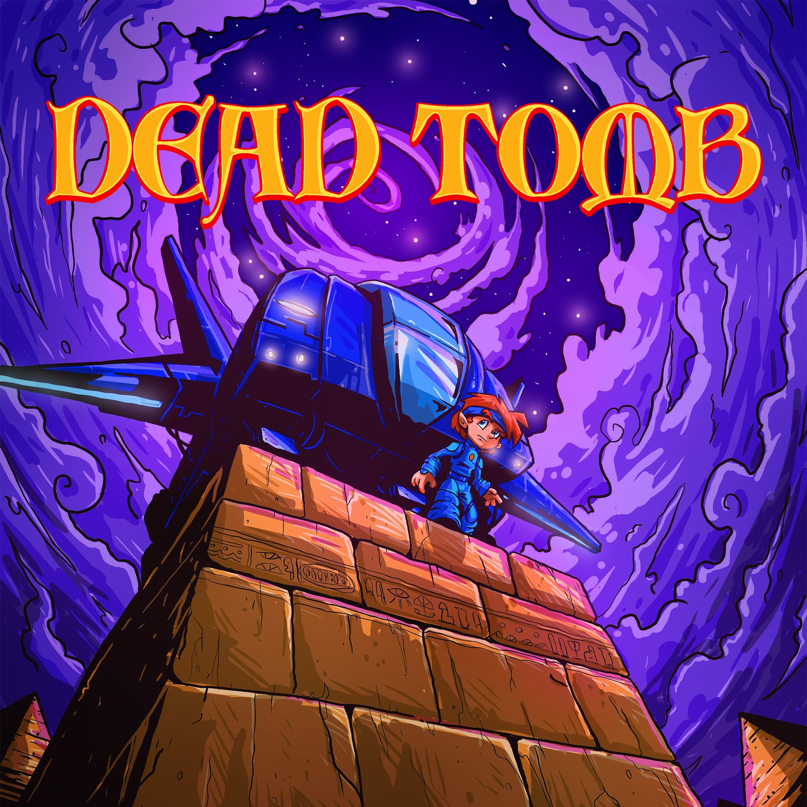
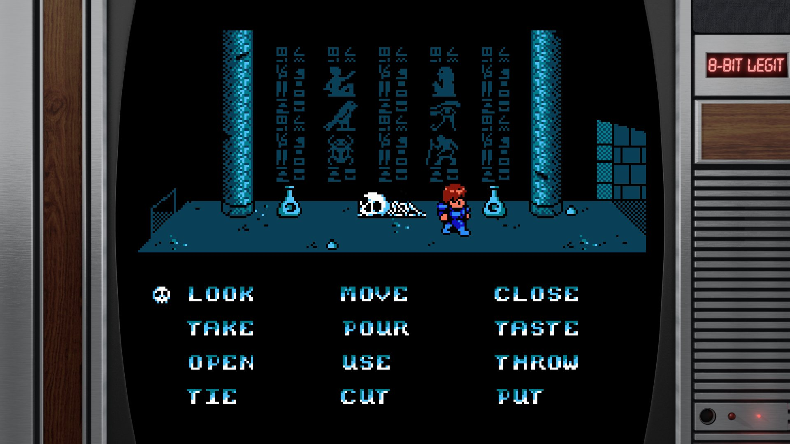

*image à la une : CollectorVision*

**La compagnie québécoise [CollectorVision](https://collectorvision.com/), connue notamment pour la série de jeux vidéo Sydney Hunter, va amener sur Nintendo Switch, Xbox et sur NES, Dead Tomb, un jeu d’aventure pointer-et-cliquer inspiré du disparu [Temporel Inc](https://www.youtube.com/watch?v=hjNg-di_F_U), que les abonnés de Vidéotron pouvaient jouer sur Videoway dans les années 90 et début 2000.**

Demandez à n’importe qui qui a connu la belle époque du Videoway quel était son jeu préféré sur cette plateforme, et il y a de bonnes chances que la réponse soit Temporel Inc., un jeu d’aventure où on se retrouve dans une ancienne pyramide remplie de mystères et de puzzles à résoudre.

Dead Tomb, développé par le studio québécois CollectorVision, et amené sur consoles en partenariat avec [8-Bit Legit](https://8bitlegit.com/), s’inspire directement de Temporel Inc. tout en modernisant un peu la jouabilité. Par contre, on garde certaines limitations techniques de l’époque volontairement, car même si le jeu sort sur Nintendo Switch et Xbox, il va également sortir en version cassette pour la mythique console 8-bits NES de Nintendo.

CollectorVision se spécialise d’ailleurs dans la création de jeux rétro qui sont publiés en cassette sur d’anciennes consoles telles que la NES et la ColecoVision, notamment.

La sortie du jeu est prévue pour le 26 janvier 2024, en numérique sur Nintendo Switch et Xbox One/Series, avec une sortie physique limitée sur NES à 300 exemplaires.

https://www.youtube.com/watch?v=HyBjRqKRYYg

**Synopsis officiel :**

*Dead Tomb est un tout nouveau jeu d’aventure en point-and-click qui vous ramènera au temps des jeux retro.* *Votre patron vous envoie sur un dossier qui vous renvoie dans le temps, mais quand le destin est taquin, vous vous retrouvez dans une sérieuse impasse.* *Une erreur de fonctionnement de votre vaisseau t’oblige à atterrir en Égypte en 1300 AC où, par chance, vous trouvez une immense pyramide sur laquelle vous poser. Vous n’êtes peut-être pas si chanceux que ça*…

**À LIRE AUSSI : [Outward Definitive Edition annoncé pour Nintendo Switch](/2023/12/21/outward-definitive-edition-annonce-pour-nintendo-switch/)**
