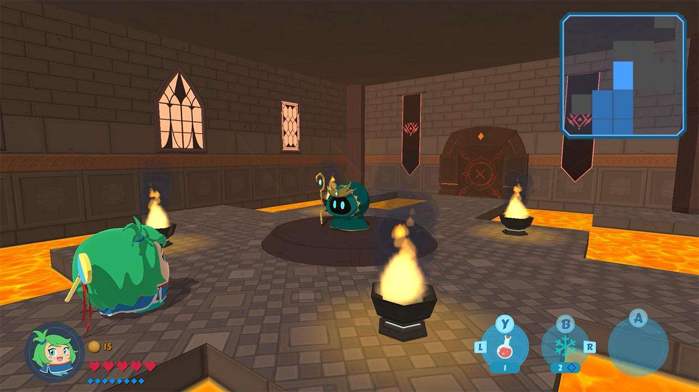
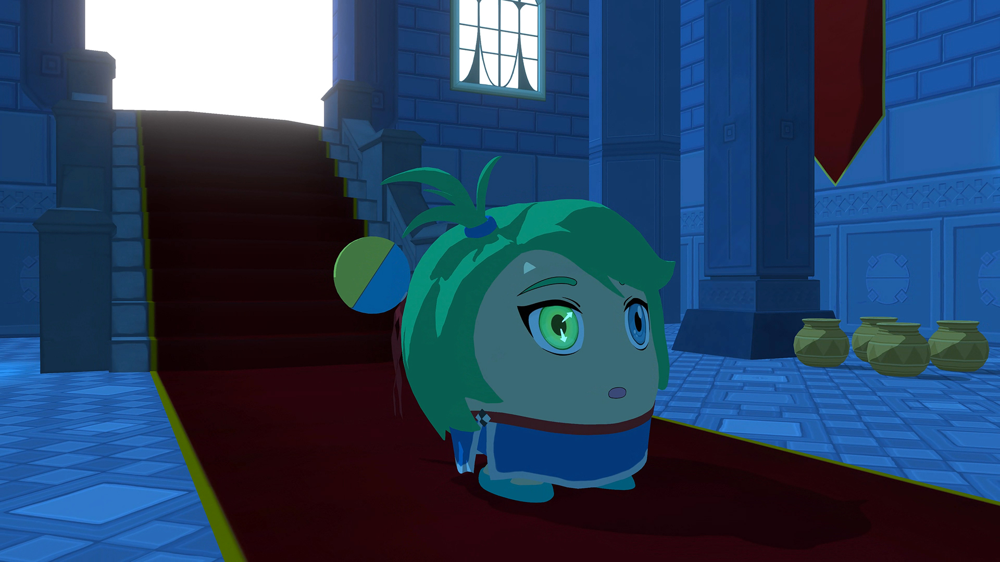
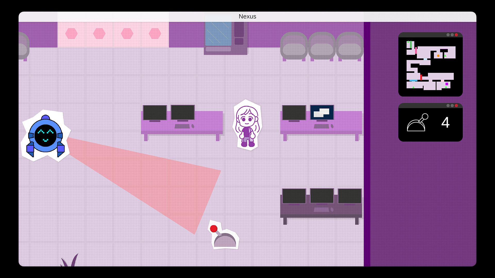

*crédit images : Shishi Studios*

**Dans cette deuxième entrevue sur l’importance de la diversité et inclusivité dans le milieu de l’industrie du jeu vidéo au Québec, on parle d’un autre aspect tout aussi essentiel : l’accessibilité. On en discute avec Frédéric McNamara, fondateur de [Shishi Studios.](https://www.shishistudios.com/fr/)**

## **Mario : Peux-tu nous raconter ton parcours académique et professionnel?**

**Frédéric :** J’ai d’abord fait des études en informatique au Cégep avant d’aller à l’université en conception de jeux vidéo. Ensuite, j’ai décidé de me lancer à temps plein sur mon premier jeu, sur lequel je travaillais déjà depuis quelques années.

## **Mario : Qu’est-ce qui t’a amené à fonder ton propre studio?**

**Frédéric :** Depuis mon jeune âge, j’ai toujours voulu créer des jeux vidéo. Lorsque je jouais à des jeux, j’imaginais des niveaux que je dessinais ensuite sur papier. J’aimais aussi créer des villes et des environnements dans SimCity et créer des scénarios dans Age of Empires.

Plus tard, je me suis mis à créer des modes pour des jeux déjà existants, avant de découvrir RPG Maker et de créer mes tout premiers jeux.

## **Mario : Comment est-ce que l’enjeu d’accessibilité informe le design des jeux de Shishi Studios? Et comment est-ce que cela informe la vie en studio?**

**Frédéric :** Dès les premières étapes de la conception, nous pensons à l’accessibilité. On veut sensibiliser chaque membre de l’équipe au sujet parce que cela concerne chaque aspect du développement.

Les concepteurs doivent y penser pour les contrôles, les artistes pour le choix des couleurs, entre autres. Cela a changé notre perception des jeux car on remarque maintenant facilement quand un jeu est accessible ou non.

## **Mario : On a vu dans les dernières années l’apparition de davantage d’options d’accessibilité dans les jeux vidéo, ainsi que l’arrivée de manettes adaptatives; que penses-tu de ces avancées? Sont-elles efficaces?**

**Frédéric :** Je crois que ce sont de très belles avancées. Je ne peux pas parler de celle de PlayStation parce que je n’ai pas eu l’occasion de l’essayer encore, mais je trouve celle de Xbox très efficace.

La seule chose que j’aimerais, ce serait qu’il y ait un modèle plus petit pour que ce soit plus facile à transporter.

## **Mario : Quelles sont les initiatives qui manquent pour rendre l’industrie plus accessible, autant pour les concepteurs que les joueurs?**

**Frédéric :** Il faudrait d’abord beaucoup plus de représentation dans les événements et que ceux-ci soient organisés dans des lieux accessibles. Ensuite, pour les concepteurs, ce serait d’offrir plus de formations en accessibilité.

Il faudrait aussi des incitatifs financiers pour les encourager à faire des jeux accessibles. Cela permettra à plus de joueurs de jouer à leurs jeux.

## **Mario : Peux-tu nous parler des projets à venir de Shishi Studios?**

**Frédéric :** Nous travaillons sur plusieurs projets en ce moment. Il y a [Shishi : Ballad of the Oracle](https://store.steampowered.com/app/1104570/Shishi__Ballad_of_the_Oracle/), qui est toujours en développement, nous n’avons pas encore de date à annoncer.

Ensuite, il y a [Mercury](https://store.steampowered.com/app/2611820/Mercury/), un jeu de puzzle sur le hacking dans lequel Lucy, une programmeuse, va devoir infiltrer les dossiers d’une multinationale pour découvrir ses sombres secrets. Finalement, nous avons commencé à travailler sur un tout nouveau projet non annoncé!

**À LIRE AUSSI : [Diversité et inclusivité : entrevue avec Jay Acevedo de Brass Lion Entertainment](/2023/12/11/diversite-et-inclusivite-entrevue-avec-jay-acevedo-de-brass-lion-entertainment/)**
