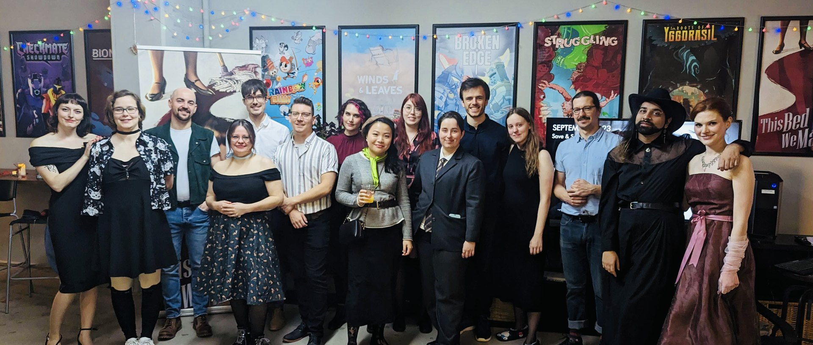
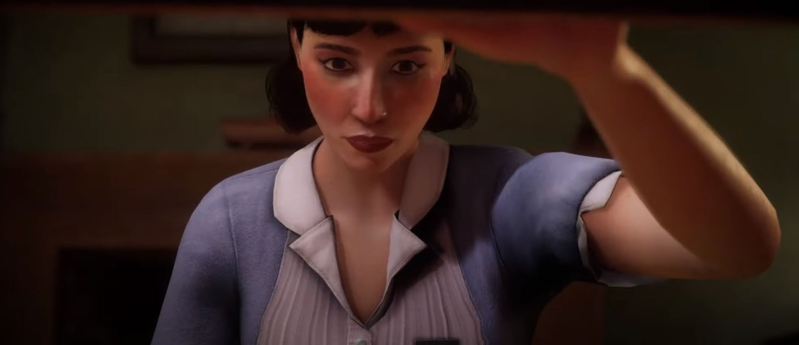
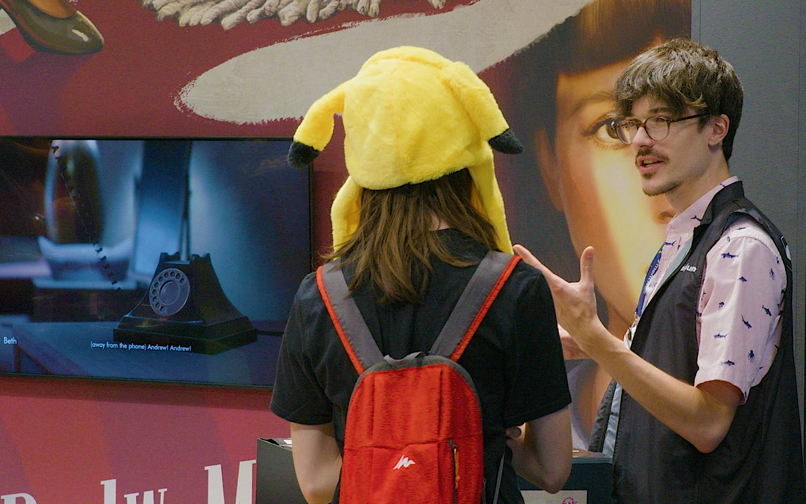
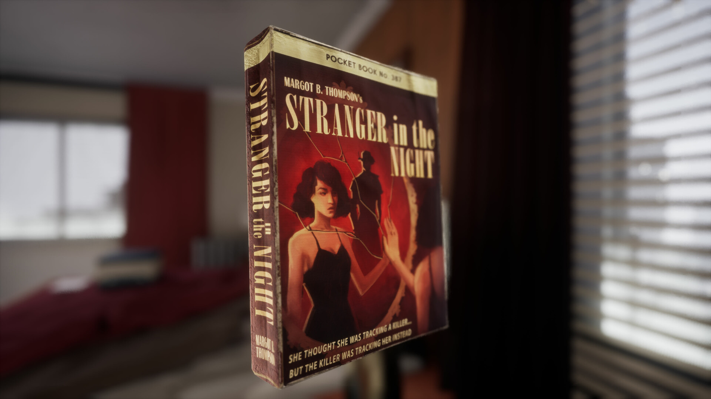

*images gracieuseté de Lowbirth Games*

**Dans le cadre de ma série d’entrevues sur la diversité et inclusivité dans l’industrie du jeu vidéo, je me suis entretenu avec Olivier Lussier, co-fondateur et directeur créatif chez [Lowbirth Games](https://lowbirthgames.com/), dont le premier jeu vidéo [This bed we made](https://store.steampowered.com/app/1243850/This_Bed_We_Made/) aborde avec sensibilité des thèmes LGBTQ dans le contexte des années 50 à Montréal.**

This bed we made vient d’ailleurs de remporter [les grands honneurs aux Prix Numix](/2024/05/30/this-bed-we-made-repart-avec-les-grands-honneurs-aux-prix-numix/), en plus [d’avoir été nommé aux prix GLAAD](https://glaad.org/glaad-celebrates-outstanding-video-game-nominees-at-the-35th-annual-glaad-media-awards-glaadawards/) plus tôt cette année.

**Mario : Peux-tu nous raconter la genèse de Lowbirth Games?**

**Olivier :** Puisque nous sommes cousins-cousines, Raphaelle, Chloé et moi réalisons des projets créatifs ensemble depuis que nous sommes tout petits. Films, romans, pièces de théâtre, vidéoclips… Nous avons presque touché à tout! À la fin de l’année 2018, durant un party de famille du temps des fêtes, nous avons discuté de l’idée de développer un jeu vidéo ensemble. Nous trouvions que mes compétences en réalisation et en scénarisation, ainsi que les aptitudes artistiques de Raphaelle, se complétaient très bien à celles de Chloé, qui étudiait alors en jeu vidéo.

Nous avons commencé à travailler sur *This Bed We Made* en juin 2019. En même temps, Chloé et moi avons suivi un programme d’été de l’UQAT dans lequel nous avons appris, entre autres choses, à faire un plan d’affaires et à « pitcher » devant des investisseurs. C’est vraiment à ce moment-là que le projet d’entreprise s’est concrétisé. Nous avons enregistré la compagnie en octobre 2019 et en juin de l’année suivante, nous embauchions nos premiers employés. Je pense qu’aucun de nous trois ne s’était jamais vraiment imaginé entrepreneur—c’est arrivé un peu malgré nous!

*L’équipe de Lowbirth Games lors du lancement du jeu This bed we made en novembre 2023*

**Mario : L’intrigue de This bed we made aborde des enjeux LGBTQ; pourquoi avez-vous choisi d’aborder cet enjeu? Pourquoi dans le contexte des années 50 à Montréal?**

**Olivier :** Plus de la moitié des membres de notre équipe appartient à la communauté LGBTQ, donc c’est un enjeu qui nous touche directement et qui nous tient à cœur. Aussi, malgré les nombreux progrès que nous avons connus dans les dernières décennies, il y a malheureusement encore beaucoup de « chemin » à faire. Je pense notamment à certains états des États-Unis qui cherchent à bannir toujours plus de livres mettant en scène des personnages LGBTQ, ou encore aux nombreuses luttes que mènent présentement les personnes trans pour que leurs droits soient reconnus et respectés.

La présence de personnages queer dans les médias contribue énormément à «normaliser» la présence des personnes LGBTQ dans la société. De plus, se sentir représenté dans une œuvre de fiction peut aider des gens queers à mieux comprendre et accepter leur propre identité. (D’ailleurs, une joueuse de *This Bed We Made* nous a dit avoir fait son coming-out après avoir joué au jeu!) Pour toutes ces raisons, ça allait de soi pour nous d’aborder ces enjeux; on ne s’est jamais vraiment posé la question.

Pour ce qui est du contexte des années 50, nous l’avons surtout choisi pour l’esthétique rétro, mais nous étions aussi intéressés d’explorer la réalité des personnes queer à cette époque, car elle est souvent exclue des livres d’Histoire.

**Mario : Quelles sont les démarches (recherche, consultation, etc.), s’il y a lieu, entreprises pour les aspects historiques du jeu, ainsi que pour la représentation LGBTQ?**

**Olivier :** Récemment, sur le compte [TikTok de Lowbirth](https://www.tiktok.com/@lowbirth), nous avons partagé des objets « troublants » que les joueurs et joueuses peuvent trouver dans *This Bed We Made*, tels qu’un journal avec une publicité très sexiste et un prospectus avertissant du danger que posent les homosexuels. Certaines personnes se sont rendues dans les commentaires pour nous accuser de « réécrire » l’histoire, et pourtant, tous ces objets sont basés sur de vrais exemples tirés des années 50!

Tout au long du développement du jeu, nous avons épluché archives, livres et films documentaires pour nous inspirer et nous aider à bien saisir le contexte historique. L’Histoire est souvent écrite de la perspective d’hommes blancs hétérosexuels, donc pour bien comprendre la réalité des femmes et des personnes queer à cette époque, il fallait parfois beaucoup fouiller!

Puisque nous avons écrit *This Bed We Made* en pleine pandémie, il ne nous a pas vraiment été possible d’interroger des gens ayant vécu dans les années 50, outre les grands-parents de quelques membres de l’équipe. Par contre, pour notre deuxième jeu, qui se déroule également dans le passé, nous avons ajouté à notre processus de recherche des rencontres avec des personnes du troisième âge pour qu’elles nous partagent leurs expériences uniques.

*Olivier Lussier au Gamescom 2023*

**Mario : Que représente pour vous une nomination aux prix GLAAD?**

**Olivier :** C’est un accomplissement dont nous sommes très fiers! D’une part, c’est très flatteur d’être nommé aux côtés d’un jeu à succès tel que *[Baldur’s Gate 3](/2023/12/08/le-quebec-fait-bonne-figure-aux-game-awards-avec-sea-of-stars-et-baldurs-gate-3-qui-remportent-les-honneurs/)*. Mais aussi, ça nous fait incroyablement chaud au cœur que notre travail soit reconnu par un organisme autant impliqué dans la représentation LGBTQ.

**Mario : Qu’est-ce qui vous a inspiré dans la création du personnage principal de Sophie et que la protagoniste soit une femme de ménage?**

**Olivier :** Chloé et moi avons tous les deux travaillé dans des hôtels durant nos études, alors c’est un milieu que nous connaissions bien et qui nous semblait très riche pour un jeu narratif. Nous étions particulièrement intéressés par le poste de femme de chambre, puisqu’il permet un accès unique et privilégié aux possessions et à la vie privée des clients. Ça nous semblait le rôle parfait pour une détective amatrice!

En faisant des recherches sur le métier de femme de chambre, nous sommes tombés sur l’œuvre de l’artiste française Sophie Calle. Dans les années 80, Calle s’est fait embaucher comme femme de chambre afin de documenter et photographier les possessions de ses clients. Elle en a tiré un livre et une exposition de photos. *This Bed We Made* est au final bien différent de l’œuvre de Sophie Calle, mais celle-ci nous a néanmoins inspiré un personnage fasciné par la vie des autres, qui tente de les comprendre à travers les biens qu’ils laissent derrière eux.

Outre son emploi, un autre aspect qui rend Sophie assez unique parmi tous les protagonistes de jeu vidéo, c’est son empathie. Peu importe qu’il s’agisse de son patron désagréable ou d’un client un peu inquiétant, Sophie est en mesure de se mettre dans les souliers d’à peu près n’importe qui. En cette époque de grandes divisions, ça nous semblait important de mettre en scène une protagoniste qui s’efforce de comprendre le point de vue des autres et qui peut voir un peu de bon chez (presque) tout le monde.

**Mario : Comment est-ce que les enjeux de diversité et inclusivité informe le design de vos jeux et la vie de studio?**

**Olivier :** Chez Lowbirth, nous aspirons à faire des jeux à impact social. Les enjeux de société sont donc au cœur de nos processus de design et d’écriture. Nous souhaitons non seulement raconter des histoires de personnages marginalisés, mais aussi faire comprendre (ou même vivre!) certains aspects de leur réalité par le biais des mécaniques de jeu.

Au niveau de la vie de studio, je crois que le type de jeu que nous développons, ainsi que la façon dont nous nous présentons en ligne et en public, nous aident grandement à attirer le genre de personnes avec qui nous avons envie de collaborer. Le studio est majoritairement composé de femmes et de personnes queer, mais nous accueillons aussi à bras ouverts tous les alliés!

**Mario : Peux-tu nous parler de projets à venir chez Lowbirth Games?**

**Olivier :** Je ne peux malheureusement pas révéler grand-chose pour l’instant, car nous sommes encore très tôt dans le développement de notre deuxième jeu. Ce que je peux dire, par contre, c’est que ce sera également un jeu de mystère à impact social et avec une esthétique rétro. Je suis donc certain que les fans de *This Bed We Made* seront très excités lorsque nous serons enfin en mesure de l’annoncer!

**À LIRE AUSSI : [Diversité et réalité autochtone : entrevue avec Alexis Gros-Louis Houle de Awastoki](/2024/04/20/diversite-et-realite-autochtone-entrevue-avec-alexis-gros-louis-houle-de-awastoki/)**

**À lire sur Bêta-Testeur : [Critique de Hellblade II : Senua’s Saga](https://www.lebetatesteur.ca/test-senuas-saga-hellblade-ii/)**
