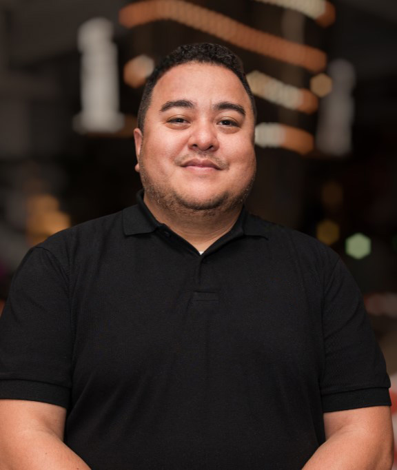
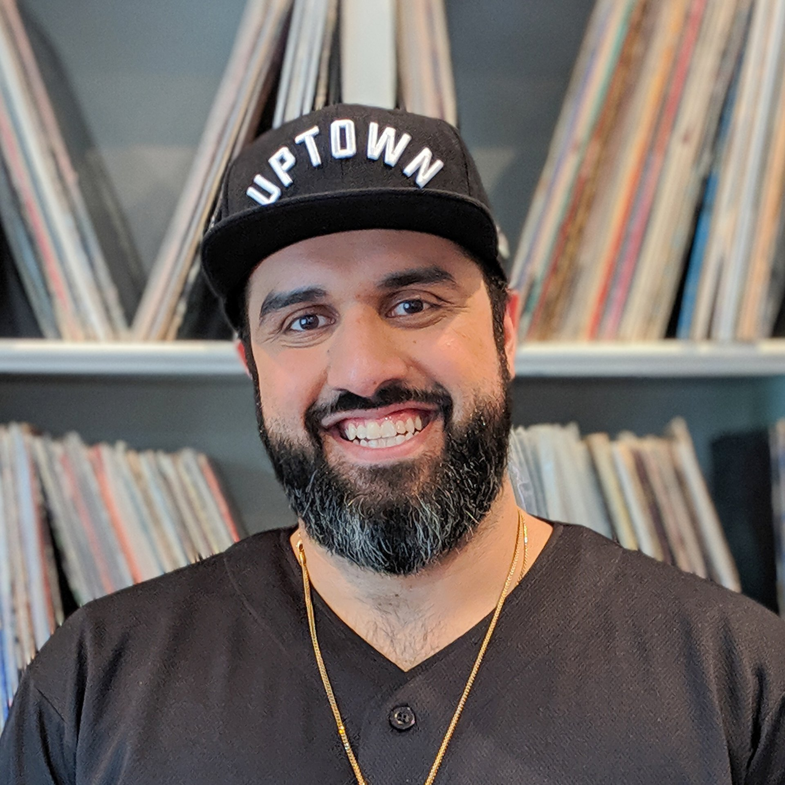
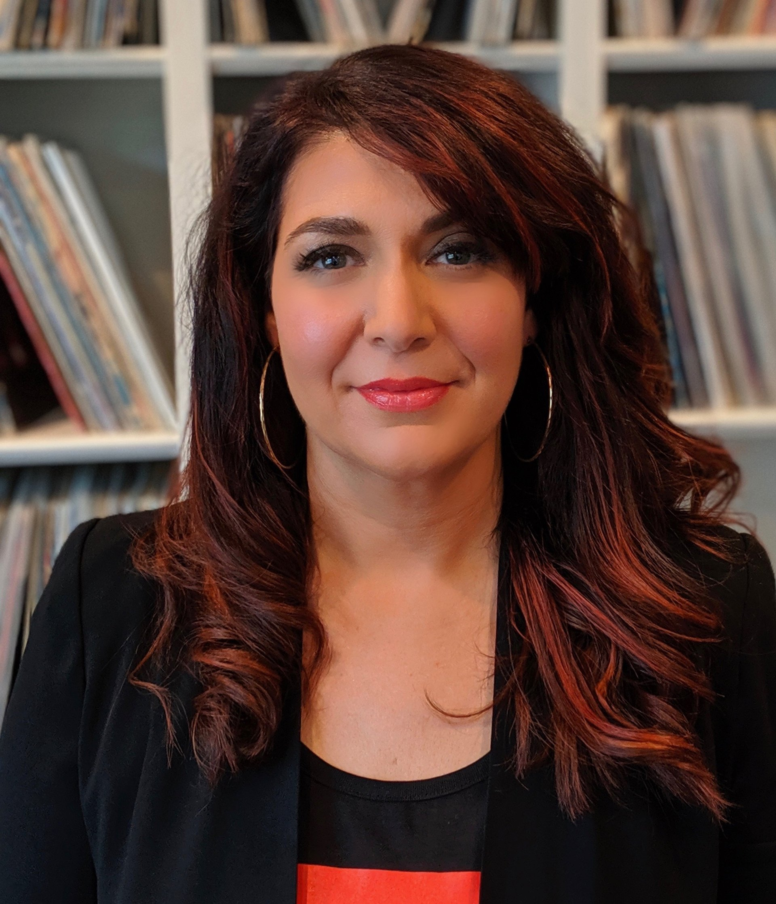
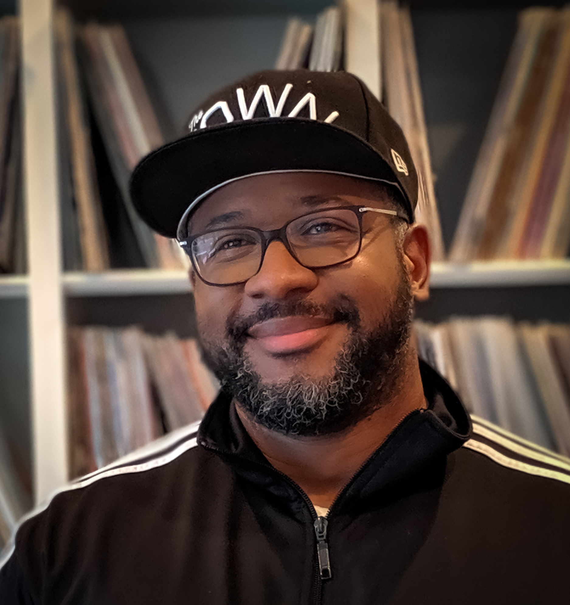

*Crédit photos : Brass Lion Entertainment*

**Voici une première entrevue d’une série qui vise à aborder les enjeux de diversité, d’inclusivité et représentation dans l’industrie du jeu vidéo au Québec. Pour briser la glace, j’ai eu le plaisir de m’entretenir avec Jay Acevedo, directeur des opérations stratégiques chez [Brass Lion Entertainment](https://brasslionentertainment.com/), un studio qui a été fondé avec une mission de diversité et d’inclusivité comme pilier principal.**

**Mario : Peux-tu nous raconter brièvement ton parcours académique et professionnel?**

**Jay :** J’ai débuté ma carrière dans l’industrie du jeu vidéo comme journaliste/blogueur en 2007 après une carrière de joueur semi-pro et entraîneur amateur de basketball. Ma carrière après-basket a commencé avec une collaboration chez Game-Focus pendant près de quatre ans pour ensuite passer du côté marketing et communications chez Ubisoft.

*Jay Acevedo, directeur des opérations stratégiques chez Brass Lion Entertainment*

**Mario : Peux-tu nous raconter la genèse de Brass Lion Entertainment?**

**Jay :** Brass Lion fut fondé en 2017 par Manveer Heir, un ex-Designer/Programmeur ayant travaillé chez Big Huge Games, Raven Software et BioWare. Après des années passées à jouer et ensuite créer des jeux chez des studios AAA, Manveer trouvait que les personnages et les narratifs dans les jeux lui parlaient rarement ou pas du tout.

Quand l’industrie n’est pas aussi diverse et inclusive elle-même, il est certain que les produits qui en ressortent vont avoir de la difficulté à rejoindre et connecter avec les gens des communautés marginalisées. La grande majorité des compagnies ne sont pas construites avec cette idée en partant. Ses propres expériences ont pesé fort sur sa décision de partir un studio ayant pour mission de créer des univers de fiction centrés sur les histoires, cultures et personnages issus de groupes traditionnellement marginalisés.

*Manveer Heir, fondateur et président de Brass Lion Entertainment*

Toutefois, ce n’est que deux ans plus tard, avec l’aide de Bryna Dabby Smith (EA, Activision) et Rashad Redic (Bethesda Game Studios), que le studio devient officiellement « actif » et annonce le premier projet *Corner Wolves*.

**Mario : Comment s’articule au quotidien et dans les prises de décisions la mission de diversité de Brass Lion? Et comment cela s’articule-t-il dans le design de vos jeux?**

**Jay :** Selon moi, quand la décision de bâtir une équipe diverse et inclusive devient intentionnelle, le reste en sera influencé à tout prix. Le tout commence avec le processus d’identification du talent, du recrutement et d’embauche, dont je suis responsable (parmis d’autres responsabilités) à titre de directeur des opérations stratégiques. La diversité n’est pas uniquement une question de genre ou groupe ethniques, mais aussi des approches de travail, des manières de penser et agir en tant que citoyen du monde ainsi que les expériences de vie personnelles ou professionnelles.

*Bryna Dabby Smith, directrice générale et cheffe de la production chez Brass Lion Entertainment*

Ces gens-là alors rejoignent d’autres qui sont aussi ouverts, empathiques et progressifs qu’eux, contribuant ainsi à des discussions nourrissantes et échanges de connaissances importantes. Alors quand il vient temps de discuter « game dev », que ce soit dans l’équipe de conception, la programmation ou ailleurs, le côté humain vient faciliter et réhausser les discussions techniques. De plus, il va sans dire qu’il serait discutable de créer des expériences narratives alignées avec la vision des fondateurs si l’équipe n’était pas représentative de ce qu’elle veut créer.

Chez Brass Lion, bien que 65% de notre équipe s’identifie comme une personne de couleur, les femmes (30%) tout comme les personnes LGBTQI+ (13%) font aussi partie de notre composition d’équipe… et on n’a pas fini. Alors qu’on vient de franchir la barre des 70 employés, la représentation à l’interne est – et continuera d’être – notre propulseur primaire.

*Rashad Redic, vice-président et directeur créatif chez Brass Lion Entertainment*

Nous aimerions que les gens se reconnaissent dans nos produits, mais aussi montrer à la nouvelle génération qu’il y a de la place pour eux dans l’industrie du divertissement.

**Mario :** **Quelles genres d’initiatives crois-tu qui seraient nécessaires pour rendre l’industrie du jeu vidéo au Québec plus accessible aux gens issus de la diversité, plus particulièrement dans les communautés défavorisées et marginalisées?**

Ça va sonner fou et simple, mais de consulter des organisations qui font la promotion du développement des talents au sein des communautés marginalisées est un début.

J’ai pris part à plusieurs évènements et conversations autour du recrutement et je suis toujours surpris du manque de connaissance sur l’existence de ces organismes à but non-lucratif. Sans surprise, l’intersectionnalité dans les équipes de recrutement – voire même des fondateurs de certaines compagnies – n’est pas encore à niveau malgré les discussions sur l’inclusivité sociale et mentions répétées pour la diversité culturelle des dernières années.

Bien sûr que le tout s’améliore avec le temps, et l’optimiste en moi espère voir des avancées non seulement continuelles, mais aussi majeures.

**Mario :** **Quels sont tes conseils à un nouveau studio indépendant qui voudrait s’inspirer de la façon de faire de Brass Lion?**

**Jay :** C’est une excellente question, Mario. Tout d’abord, je crois fortement que le tout part de ce que la (les) personne(s) fondatrice(s) veulent accomplir. Dans la grande majorité, leurs valeurs personnelles y sont rattachées et l’idée de jouer un rôle socio-rassembleur en est pour beaucoup.

*Mais est-ce que tu y crois vraiment à la diversité et inclusion ? Est-ce que tu es prêt à parler à d’autres gens qui ne viennent pas du même milieu que toi ? Connais-tu des gens qui partagent ton idée ? Peut-être qu’ils sont en train de bâtir quelque chose que tu peux joindre ?*

Manveer avait un désir de changement et ouverture sociale dans un domaine qui le passionne. Il est allé chercher des gens qui non seulement partageaient son idée d’un environnement de création pour des gens issus de communautés marginalisées, mais aussi des personnes excellant dans des domaines dont il n’était pas très connaisseur (Bryna pour son expertise dans le développement des affaires, Rashad pour son expertise en art et concepts).

L’humilité, la connaissance de ses propres limites, et un examen de conscience sur ce qu’une personne veut réellement accomplir sont des éléments importants dans une prise de décision, encore plus dans la création d’une entreprise. On n’est pas le seul studio à vouloir être inclusif et faire de la diversité un pilier d’entreprise important… et j’espère que les discussions continueront en ce sens.

**À LIRE AUSSI : [Hommage à Karl Tremblay, le gamer](/2023/11/16/hommage-a-karl-tremblay-le-gamer/)**

**À LIRE SUR BÊTA-TESTEUR : [Choisir entre la PS5 ou Xbox Series](https://www.lebetatesteur.ca/playstation-5-ou-xbox-series-x-laquelle-est-la-meilleure-en-2023/)**
