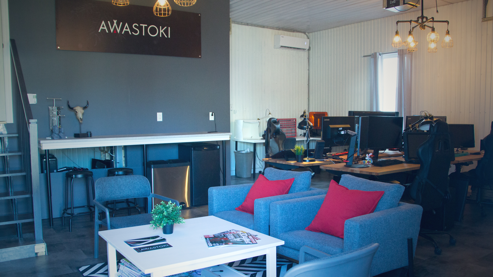
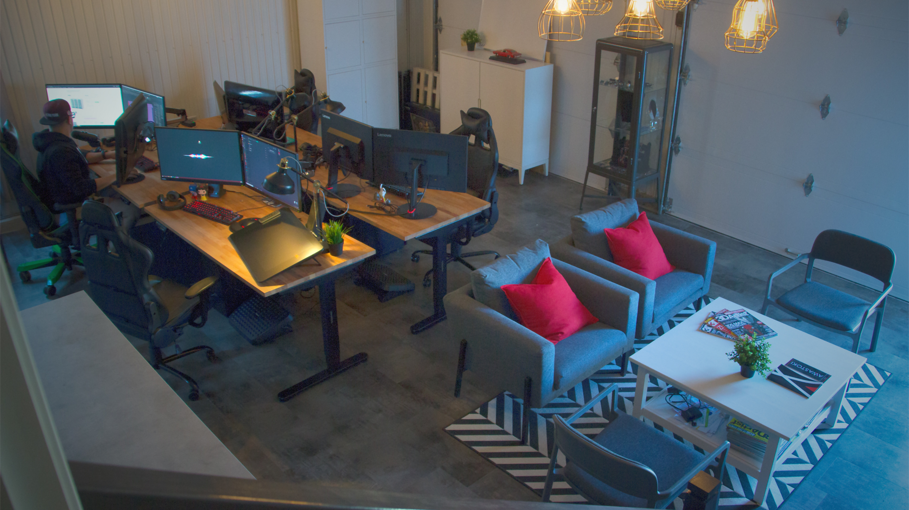
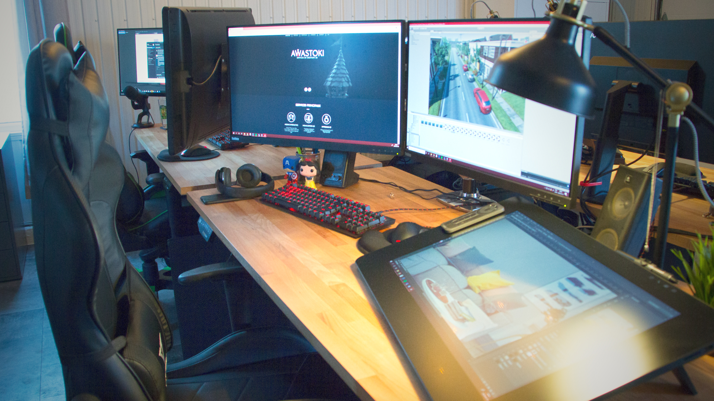

*crédit images : Awastoki*

**Dans cette troisième entrevue sur l’importance de la diversité et inclusivité dans le milieu de l’industrie du jeu vidéo au Québec**, **j’ai discuté avec Alexis Gros-Louis Houle, fondateur de [Awastoki](https://awastoki.com/), studio de services 3D établi au sein de la communauté Huronne Wendat de Wendake.**

**Mario : Peux-tu me raconter ton parcours académique et professionnel et comment tu en es venu à fonder ta propre entreprise?**
**Alexis :** Après un an à ne pas trop savoir quoi faire de ma vie en testant différents programmes au CÉGEP Ste-foy, je commençais à être un peu perdu. Les formations en graphisme ou en multimédia ne me parlaient pas trop et semblaient moins artistiques que ce que j’aurais souhaité.

**Le CÉGEP**

Mes parents commençaient un peu à s’impatienter que je ne sois pas motivé par des études et finalement, par hasard, ma mère a entendu une publicité du collège Bart jouer à la radio.  Le collège offrait une technique en animation 2D/3D et synthèse d’image et semblait correspondre à ce que je cherchais.

Malheureusement, il ne restait plus de place, mais ma mère a quand même insisté auprès de la direction pour que je fasse une visite de l’école en s’assurant que j’amène un portfolio de dessin pour montrer ce dont j’étais capable.

Il faut dire qu’ayant un trouble d’attention, mon moyen pour rester attentif au secondaire était de dessiner durant mes cours. J’ai eu la chance d’avoir des professeurs super compréhensifs et j’ai développé de bonnes capacités en dessin en plus d’avoir toujours eu un côté créatif.

Après avoir vu mon portfolio, le directeur du programme en animation 3D décide quand même de me faire une place dans la cohorte de la technique qui débute en 2007. C’est la première fois que des cours destinés à l’animation et au marché des jeux vidéo sont offerts sous forme d’une formation de 3 ans (en même temps que le CÉGEP de Limoilou, le CÉGEP du Vieux-Montréal et le collège O’Sullivan ).

Durant le programme, je vois rapidement que j’ai de bonnes capacités en tant que modeleur (à l’époque on nous disait de nous spécialiser plutôt que d’être des artistes 3D). Un enseignant en particulier me pousse dans Zbrush et en création de textures et mes capacités artistiques et techniques se développent rapidement une fois que j’ai trouvé ce qui me passionne.

**L’université**

À la fin de la formation, en 2010, l’industrie est dans une période où les emplois sont plutôt rares et difficiles à décrocher. J’ai quelques entrevues, mais je décide de poursuivre mon parcours à l’Université Laval en suivant un Baccalauréat en arts et sciences de l’animation.

Durant cette période, je rencontre un enseignant, Daniel, qui m’a particulièrement marqué de par ses expériences d’entrepreneur et dans le milieu de l’animation. J’ai la chance de faire des contrats à la pige tout au long de ma formation tout en recevant divers conseils de Daniel sur comment bien réussir et bien me faire valoir en tant que professionnel. Je suis également des formations en entrepreneuriat et des cours orientés sur le côté développement entrepreneurial en tant que pigiste ou en tant que propriétaire d’entreprise.

Ça m’a donné la piqûre et rapidement, même si je suis conscient que je dois faire mon expérience en entreprise en premier, je sais que je vais me lancer à mon compte éventuellement.

Je ne sais pas encore comment, je ne sais pas encore si ça sera seul ou avec quelqu’un, mais je sais que ça va arriver.
Je m’implique également au niveau du financement du GALA de fin de BACC et je réussi à aller chercher des bons montants auprès de différents partenaires de l’événement. Ça me donne la chance de discuter avec des dirigeants d’entreprises et de voir que je suis capable de négocier et de me sentir à l’aise dans ce genre de discussions.

**Expériences en entreprises**

Suite à la fin de mon Baccalauréat en 2013, je suis approché par l’entreprise Frima Studio pour faire un stage de 3 mois. Ça devient un emploi qui dure plus de 3 ans et demi. J’ai la chance de travailler sur différents projets qui me permettent de développer mes capacités artistiques et techniques. J’ai également la chance de gérer des petites équipes de travail sur des projets notamment pour LEGO, mais toujours de façon non-officielle et je désire que ça aille plus loin pour moi.

Je continue également de faire de la pige pour différents clients tout au long de mes années de travail chez Frima.

À l’automne 2016, on m’offre un emploi chez BKOM Studios avec plus de responsabilités, des évaluations de coûts de projets, de la gestion de ressources, donc un impact plus concret sur les productions et ses décisions.

J’accepte le poste, mais dans ma tête (et même lors de mon entrevue) l’idée de me lancer à mon compte est encore très présente.

C’est chez BKOM Studios que je rencontre Caroline qui était chargée de projet à l’époque, mais avait suivi une technique en animation 3D au CÉGEP Limoilou.

On s’entend bien et après quelque temps on devient un couple. J’apprends à comprendre les réalité des chargés de projets et ça me permet d’avoir une meilleure vue d’ensemble du fonctionnement des projets de développement de jeux vidéo.

Après 1 an et demi chez BKOM, je commence à travailler à distance et rapidement, j’aime l’efficacité et l’indépendance que ça me procure. Le timing devient propice et je décide de me lancer à mon compte.

**Awastoki**

Je quitte mon emploi et me donne 6 mois pour signer des premières ententes avec des clients.

Je fais l’annonce un lundi sur les réseaux sociaux et signe une belle entente de quelques mois comme travailleur autonome avec Frima, mon ancien employeur, le jeudi de la même semaine.

Caroline ayant décidé de prendre une pause bien méritée de travail en entreprise commence à s’impliquer dans mes démarches pour tout ce qui est rédaction de contrat de travail avec les clients et différentes tâches qui me permettent de mettre du sérieux dans la structure de mon travail.

Rapidement, elle commence également à mettre ses compétences d’artistes 3D en œuvre et en avril 2018, on fonde AWASTOKI.

Caroline propose l’idée d’utiliser mon nom Huron-Wendat qui veut dire « Bel Esprit » comme nom d’entreprise, puisque ça correspond au genre de « vibe » qu’on souhaite mettre de l’avant.

Rapidement, le travail déborde et ça nous permet d’engager nos premiers employés (on est présentement une équipe de 6 artistes 3D).

**Mario : Comment est-ce que ton identité autochtone est ancrée dans Awastoki?**

**Alexis :** Je le dis souvent et je ne m’en gène pas, mais j’apprends à m’approprier mon identité autochtone en ayant installé Awastoki sur la communauté de Wendake et en m’impliquant dans différents projets en préservation de patrimoine et culturelle.

Je n’ai pas été élevé à Wendake même si ma famille vient de la communauté. J’ai été quand même exposé à nos réalités et notre histoire, mais d’un point de vue externe.

J’essaye toujours de prioriser une partie de nos projets pour qu’ils donnent une visibilité aux gens de Wendake et que ça les rende fiers.

C’est d’ailleurs un des objectifs que nous nous étions fixés à long terme, Caroline et moi, pour notre entreprise; créer des projets soit culturels, soit qui impliquent des gens de communautés pour qu’on laisse notre marque et qu’on prouve qu’il y a une valeur ajoutée à impliquer des gens des Premières Nations dans des projets numériques.

Il n’y a pas beaucoup de main d’œuvre dans le numérique au sein des Premières Nations, mais on espère que ce qu’on fait va continuer d’avoir des ramifications et d’encourager des gens issus de différentes communautés à aller travailler dans ce milieu-là.

**Mario : Quelle est la réalité autochtone dans le milieu du jeu vidéo et des technologies numériques?**

Elle n’est que peu ou pas existante dans le milieu des technologies numériques. C’est sûr qu’il existe des gens issus des Premières Nations qui travaillent pour différentes entreprises de jeux ou de film, mais pas vraiment qui se servent de leur identité autochtone pour faire passer un message ou s’en servir pour influencer des productions comme ce qu’on essaie de faire.

Le métier d’artiste 3D et de développeur de jeu ne date pas d’hier, mais au sein des Premières Nations, il faut considérer que plusieurs communautés n’ont même pas encore d’eau potable, aussi ridicule que ça puisse sembler… Alors même si plusieurs personnes issues de différentes Nations viennent étudier à Wendake ou dans des communautés plus près des centres urbains, c’est le genre de métier ou de formation qui n’est malheureusement pas encore beaucoup connu ou mis de l’avant.

On essaie fort de se battre pour que ça devienne le cas, mais ça nécessite beaucoup de temps et de patience.

**Mario : Selon ton point de vue, quelles sont les pistes de solution pour rendre ce milieu plus inclusif?**

S’adapter aux différentes réalités des gens qui viennent des communautés. Si on est capables d’avoir une conciliation travail/famille ou encore de prendre en considération les congés parentaux, on devrait être capables de prendre en considération les modes de vie des gens qui peuplaient le territoire avant la colonisation.

Des petits gestes comme prendre en considération les périodes de chasse pour ajuster ses livrables de production (un peu comme on fait déjà avec les vacances de la construction) ou encore simplement d’accepter que si on forme de la main d’oeuvre compétente issue des Premières Nations dans le milieu du divertissement, que ces gens vont peut-être vouloir retourner dans leur communautés pour travailler à distance tout en leur offrant la possibilité de s’impliquer au sein de leur Nation.

**Mario : Comment est arrivée la collaboration sur le jeu vidéo [Two Falls](https://store.steampowered.com/app/1671740/Two_Falls_Nishu_Takuatshina/), et quel est l’apport de ton entreprise dans son développement?**

Fin 2018 on se fait contacter par Samuel Bourassa qui travaille sur l’idéation de Two Falls (Kanata à l’époque, mais qui pour des raisons évidentes change de nom en cours de production; parlez-en à Robert Lepage!)

La production aimerait impliquer des gens des Premières Nations sur un projet qui met de l’avant deux personnages, dont un issu des Premières Nations. Au départ, on se méfie parce qu’on ne veut pas être le « token Indien » du projet, mais rapidement on voit que les gens [d’Unreliable Narrators](https://www.linkedin.com/company/unreliablenarratorsgames/) font ça pour les bonnes raisons et parce qu’ils veulent un projet authentique. On fait un petit contrat avec eux pour quelques personnages et de l’idéation et rapidement
la production décide de nous impliquer pour créer tous les visuels en 3D pour le projet.

On a donc eu la chance de créer les personnages, les environnements et les différents éléments visuels qui meublent l’univers de Two Falls tout en travaillant conjointement avec la direction artistique du projet qui se faisait directement avec des membres de l’équipe d’Unreliable Narrators. Vers la fin on a pu également contribuer en Level art, donc aider un Level artist externe afin de monter les différents niveau du jeu.

Le projet devrait sortir en 2024, on a bien hâte de voir ça !

https://www.youtube.com/watch?v=2icMob_YORg

**Mario : Quels sont les projets en cours et à venir?**

On vient de terminer de monter une branche d’Awastoki en préservation de patrimoine donc des scans 3D avec différents musées et aussi une statue de bronze de 7 pieds d’un des Grands Chefs de Wendake qui a marqué notre histoire. Ça devrait être révélé à l’automne 2024.

On est en discussion pour travailler sur un projet de film dans Unreal et différents autres mandats, mais comme on dit, c’est pas signé tant que ça n’est pas signé!

**À LIRE AUSSI : [Diversité et inclusivité : entrevue avec Jay Acevedo de Brass Lion Entertainment](/2023/12/11/diversite-et-inclusivite-entrevue-avec-jay-acevedo-de-brass-lion-entertainment/)**

**À LIRE AUSSI : [Diversité et accessibilité : entrevue avec Frédéric McNamara de Shishi Studios](/2024/02/06/diversite-et-accessibilite-entrevue-avec-frederic-mcnamara-de-shishi-studios/)**

**À lire sur Bêta-Testeur : [Critique de Dune : Imperial Digital](https://www.lebetatesteur.ca/test-dune-imperium-digital/)**
