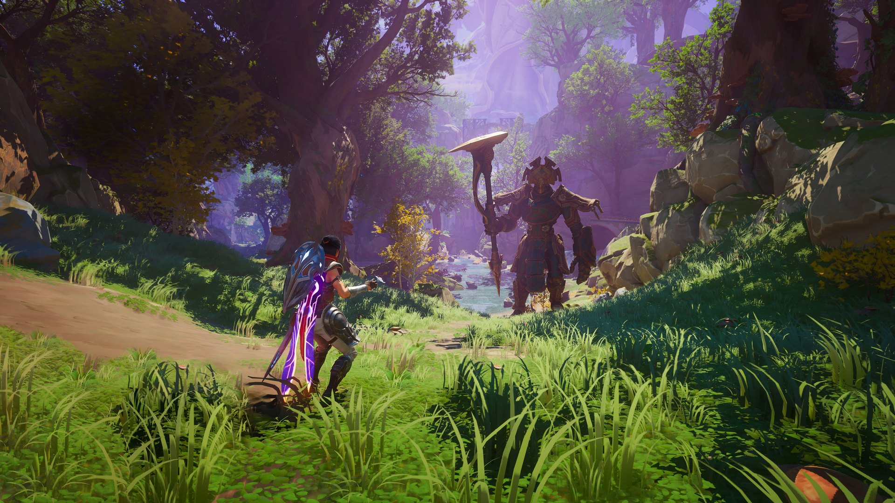
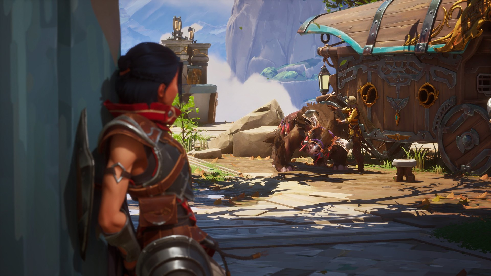
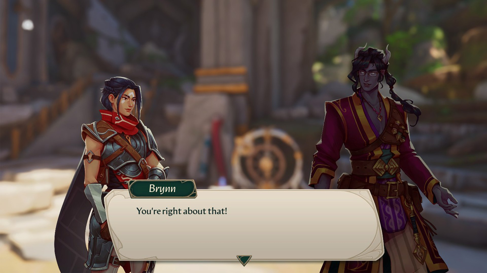
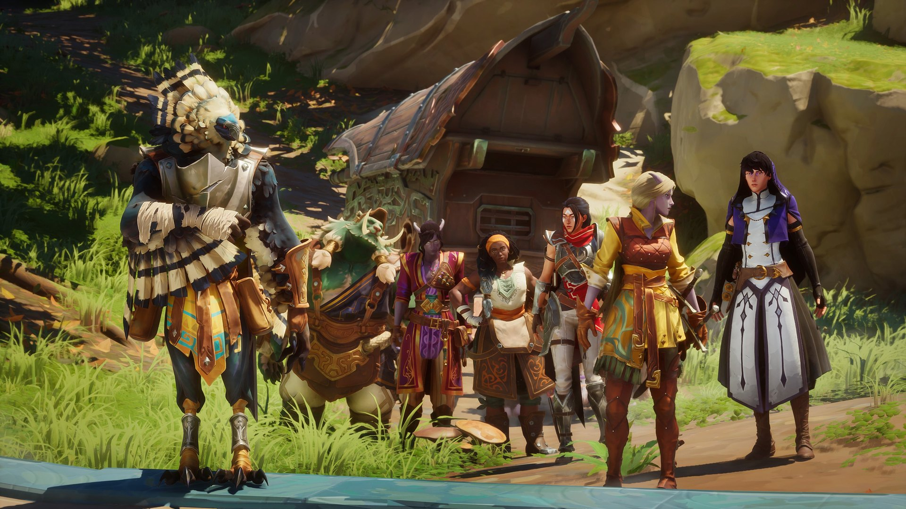

*images gracieuseté de Yellow Brick Games*

**Le studio québécois [Yellow Brick Games](https://yellowbrickgames.ca/fr/) fait son entrée dans l’industrie avec [Eternal Strands](https://store.steampowered.com/app/1491410/Eternal_Strands/), un jeu d’action-aventure qui ne cache pas ses inspirations tout en apportant sa propre saveur au genre. Cette nouvelle propriété intellectuelle nous invite à découvrir un monde mystérieux à travers les yeux de Brynn, une exploratrice déterminée à percer les secrets d’une civilisation oubliée.**

Plutôt que d’opter pour un vaste monde ouvert, les développeurs ont choisi de diviser leur univers en plusieurs régions distinctes, toutes reliées à un camp de base central et des points de téléportations à débloquer. Cette décision de design permet une exploration plus concentrée et une meilleure progression narrative, tout en conservant un sentiment de liberté appréciable.

Les environnements, remarquablement variés et rehaussés par une direction artistique distinctive, invitent à l’exploration. La verticalité des zones et le système d’escalade sans restriction (limité uniquement par l’endurance de Brynn) rappellent **The Legend of Zelda : Breath of the Wild/Tears of the Kingdom**, tout en s’intégrant naturellement dans l’expérience unique d’**Eternal Strands**.

Le système de combat offre une flexibilité impressionnante, permettant aux joueurs d’alterner entre différents styles de jeu. Que ce soit avec l’épée et le bouclier pour une approche défensive, l’épée à deux mains pour maximiser les dégâts, ou l’arc pour le combat à distance, chaque option est viable. Les pouvoirs magiques ajoutent une couche stratégique supplémentaire, notamment la capacité de manipuler la glace, entre autres éléments, ou de contrôler les objets et ennemis à distance, rappelant les pouvoirs d’un Jedi.

Les combats de boss constituent un point fort particulièrement remarquable du jeu. Ces affrontements épiques mettent en scène des créatures impressionnantes sur lesquelles Brynn peut grimper pour cibler des points faibles spécifiques, rappelant les mécaniques de jeux comme **Shadow of the Colossus**. Cette verticalité dans les combats de boss renforce le sentiment d’échelle face à ces adversaires monumentaux.

L’aspect le plus innovant du jeu réside dans son système de fabrication d’équipement. La liberté offerte dans le choix des ressources pour créer et modifier l’équipement permet une personnalisation poussée, adaptée au style de jeu de chacun. Cette flexibilité dans le *crafting* compense en partie la nécessité parfois frustrante de *farmer* des ressources pour progresser face à des ennemis particulièrement coriaces rencontrés tôt dans l’aventure.

Le camp de base sert non seulement de *hub* pour l’artisanat et l’amélioration d’équipement, mais aussi pour le développement narratif. Les interactions avec les différents membres de l’équipe d’exploration, rappelant la profondeur des relations dans la série **Fire Emblem**, enrichissent l’histoire et donnent vie à une distribution de personnages diversifiés et mémorables.

La localisation française intégrale, incluant le doublage, mérite d’être soulignée pour sa qualité d’exécution.

Visuellement, le jeu se démarque par son style artistique unique et sa palette de couleurs vibrante. Les environnements variés maintiennent l’intérêt du joueur tout au long de l’aventure, même si les allers-retours fréquents au camp de base pour gérer les ressources peuvent parfois briser le rythme de l’exploration.

Malgré quelques aspects qui mériteraient d’être peaufinés, comme le rythme de la collecte de ressources et la difficulté parfois abrupte, le jeu pose des bases solides pour l’avenir du studio.

**Eternal Strands** représente une première sortie impressionnante pour Yellow Brick Games et s’impose comme une excellente addition au genre action-aventure, particulièrement recommandé aux amateurs de The Legend of Zelda qui recherchent une expérience familière, mais suffisamment distincte pour se démarquer.

**Eternal Strands** est disponible dès maintenant sur PC, Xbox Series X|S, PS5, et il est inclus dans l’abonnement Xbox Game Pass.

### **Verdict : 8/10**

**À LIRE AUSSI : [South of Midnight de Compulsion Games sortira le 8 avril](/2025/01/23/south-of-midnight-de-compulsion-games-sortira-le-8-avril/)**
