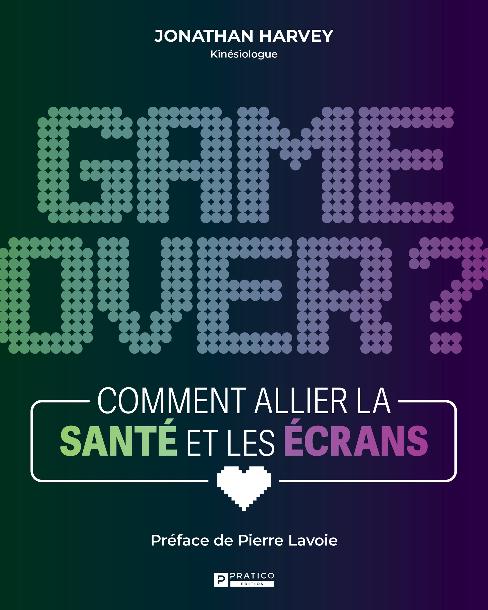
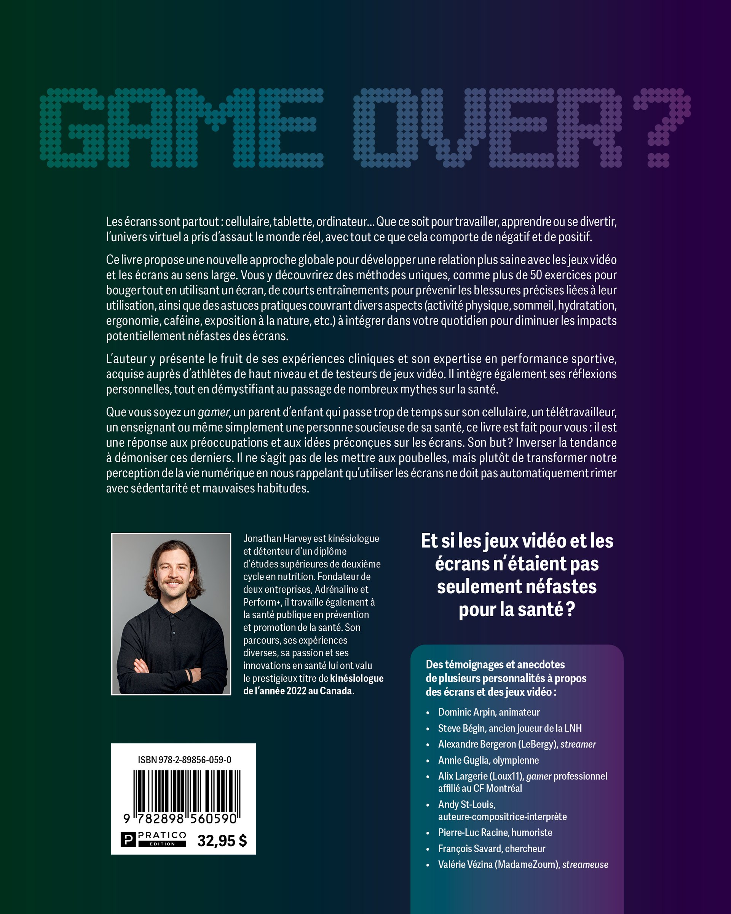

*image à la une : Éditions Pratico*

**Il y a quelques années, j’ai eu le plaisir collaborer avec le kinésiologue Jonathan Harvey sur la publication de vidéos d’exercices pour gamers sur les (feu) plateformes RDS Jeux vidéo et RDS En forme, afin de promouvoir son application web [Perform+](https://www.performplus.app/). Ce n’est donc pas surprenant de le voir signer un ouvrage sur l’enjeu des écrans et la santé, intitulé *Game Over? Comment allier la santé et les écrans.***

**Game Over?**, publié via les Éditions Pratico, est disponible depuis le 21 août dernier.

L’ouvrage présente plus de 50 exercices pour bouger tout en utilisant un écran, ainsi que des entraînements précis pour prévenir les blessures liées à leur utilisation. Jonathan Harvey aborde également des aspects cruciaux tels que l’activité physique, le sommeil, l’ergonomie, l’hydratation et l’exposition à la nature, avec des conseils pratiques pour intégrer ces éléments dans le quotidien.

Je me suis entretenu avec Jonathan Harvey à propos de son livre.

**Mario : Peux-tu nous parler de ton parcours?**

**Jonathan :** Je suis détenteur d’un baccalauréat en kinésiologie de la faculté de médecine de l’université Laval et d’un diplôme d’études supérieures en nutrition de cette même université. Je travaille actuellement à la santé publique en promotion et prévention de la santé. J’aide les milieux municipaux, scolaires et communautaires à mettre en place des environnements favorables à la santé. À travers cela, je suis aussi fondateur des entreprises Adrénaline et Perform+.

Mes expériences diversifiées en clinique avec divers patients, en performance sportive avec des sportifs et athlètes, en santé publique, ainsi que mes conférences et mes enseignements, m’ont valu le titre de [Kinésiologue de l’année au Canada en 2022](https://lelien.santesaglac.gouv.qc.ca/2022/12/19/kinesiologue-de-lannee-jonathan-harvey/#:~:text=Le%20kin%C3%A9siologue%20d'Alma%2C%20Jonathan,Awards%20le%2027%20novembre%20dernier.).

**Mario : Qu’est-ce qui t’a mené à écrire un livre pour lier la santé et les écrans?**

**Jonathan :** Depuis plusieurs années, j’ai un intérêt particulier pour la prévention des blessures et la santé chez les gamers et les travailleurs de bureau.

Dès la fin de mes études universitaires, j’ai commencé à travailler en GMF (Groupe de médecine familiale) au CIUSSS, où j’ai pratiqué pendant plus de 7 ans. Cela m’a permis de voir en consultation des milliers de patients avec différents problèmes de santé dont des personnes ayant comme hobby les jeux vidéo ou l’utilisation des écrans en général.

Mon approche avec ces personnes a toujours été différente et positive. Plutôt que de simplement dire d’abandonner les jeux vidéo, de réduire le temps d’écran, ou de se débarrasser de leur téléphone, je prenais en considération leur passion sans la stigmatiser.

Je pense que cette approche m’a bien réussi, puisque la majorité de ces personnes ont vu une amélioration significative de leur santé. De plus, plusieurs d’entre elles revenaient vers moi pour me dire qu’ils avaient aimé nos rencontres car j’étais l’un des rares professionnels à ne pas juger leur utilisation des écrans ou des jeux vidéo. Ma mentalité : «Tout ce qui est plus que zéro, est mieux que zéro. Tous les mouvements comptent ».

Pendant ce temps, j’ai lancé Perform+, une plateforme web qui pose littéralement des questions à l’utilisateur via un algorithme afin de proposer un programme d’entrainement personnalisé ou un rapport d’ajustement de poste de travail/ou de jeux en quelques secondes. Il y a plusieurs sections pour différents types de clientèles : les sportifs, les femmes enceintes, les gens blessés, et bien sûr les gamers et les travailleurs de bureau.

Quelques mois après son lancement, j’ai eu la chance d’être invité à présenter mon entreprise à l’émission « Dans l’œil du Dragon » ! Malheureusement, je n’ai pas eu d’offre et par conséquent mon segment n’a pas été retenu pour la diffusion télé. C’était dans le temps où il fallait descendre les fameuses marches sur le côté juste avant de faire son «speech». Ce fut une expérience incroyable. Suite à cela, j’ai appliqué un de leur conseil : «Ta clientèle cible est trop large. Concentre-toi sur seulement quelques sections!». C’est ce que j’ai fait. J’ai poussé les sections Gamers et Travailleurs de bureau.

Cela m’a conduit à donner des conférences dans des écoles et entreprises sur l’utilisation responsable des écrans, ainsi qu’à enseigner des cours sur les habitudes de vie saines dans des programmes de formation pour les testeurs de jeux vidéo.

À partir de là, j’ai eu un «déclic». J’ai réalisé qu’il était essentiel que je partage plus
largement ma vision positive des écrans et ma méthode pour les utiliser de manière saine. Environ deux ans plus tard, GAME OVER? est né.

**Mario : Ton livre s’adresse à qui?**

**Jonathan :** Si tu passes du temps devant des séries télé, sur les réseaux sociaux, sur ordinateur pour travailler, ou à jouer aux jeux vidéo, ce livre est fait pour toi!

Plus spécifiquement, il intéressera les gamers, mais aussi les travailleurs de bureau et les personnes en télétravail.

Les parents d’adolescents avec un cellulaire et même ceux de jeunes bébés.

Les professionnels de la santé.

C’est aussi un « must » pour le scolaire, autant pour les professeurs que pour les élèves comme il y a des techniques et des conseils qui s’appliquent très bien en classe pour une meilleure utilisation des écrans en mode apprentissage.

Je parle aussi de sujets plus nichés comme :

- L’impact de l’utilisation des écrans par les parents en compagnie de leur jeune enfant.
- Les gamers, des athlètes?
- Le dopage dans les sports électroniques.
- Quoi faire en cas de douleur physique?
- Bon ou pas l’utilisation de la glace et des anti-inflammatoires?
- L’ajustement ergonomique d’une station de jeux et de travail.
- Un ultra-marathon, c’est bon pour la santé?
- La nature comme ingrédient pour une utilisation saine des écrans (Oui oui, tu as bien lu… )

Finalement, ceux qui me connaissent savent que j’adore remettre en ordre des mythes sur la santé et l’entrainement. Donc, en plus des écrans, je touche à des sujets plus larges et « funky » comme la perte de gras localisé, les bonbons qui « font maigrir », la caféine et plusieurs autres!

Il intéressera donc aussi toute personne soucieuse de sa santé.

**Mario : Quelle est la meilleure façon de se le procurer?**

**Jonathan :** J’ai la chance de faire affaire avec la maison d’édition Pratico Édition qui possède plus de 9000 points de vente. Il est donc disponible partout au Québec!

Plus précisément, il est possible de l’acheter en personne dans les librairies, dans
certaines pharmacies et magasins spécialisés. [On peut aussi le commander via le site internet de chez Pratico Édition.](https://boutique.pratico-pratiques.com/produits/game-over/)

Il existe un format numérique en vente sur les sites internet de certaines librairies.

Voici la totalité des personnalités qui ont donné leur avis et des anecdotes pour la
section « Témoignages » :

- Dominic Arpin, animateur
- Steve Bégin, ancien joueur de la LNH
- Annie Guglia, première olympienne en skateboard pour le Canada
- Alix Largerie (Loux11), gamer professionnel affilié au CF Montréal
- Andy St-Louis, auteure-compositrice-interprète
- Pierre-Luc Racine, humoriste
- François Savard, chercheur
- Valérie Vézina (MadameZoum), streameuse
- Alexandre Bergeron (LeBergy), streamer

**À LIRE AUSSI : [Les jeux vidéo du Québec dévoilés au Gamescom 2024](/2024/08/22/les-jeux-video-du-quebec-devoiles-au-gamescom-2024/)**
