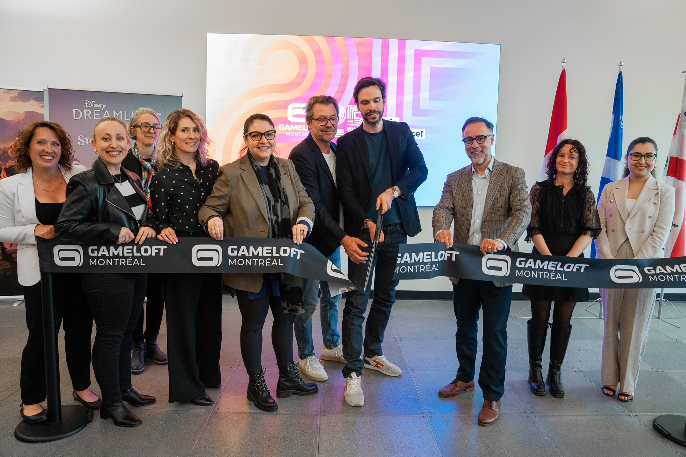
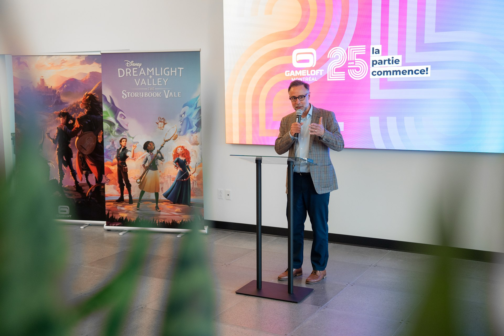

*photos gracieuseté de Gameloft Montréal*

**Le studio [montréalais de Gameloft](https://www.gameloft.com/gameloft-studios/montreal) a marqué un jalon important en inaugurant ses tout nouveaux locaux et en célébrant son 25e anniversaire. L’événement a été l’occasion de remercier chaleureusement les employés, les partenaires et la communauté de joueurs qui ont contribué au succès retentissant du studio au fil des ans.**

Gameloft Montréal, qui compte près de 400 employé.es, est un acteur clé de l’industrie du jeu vidéo, participant activement à la formation de la prochaine génération de talents. À l’échelle mondiale, Gameloft rassemble plus de 47 millions de joueurs actifs mensuels, témoignant de la portée et de l’impact de ses créations.

La célébration a été l’occasion de revenir sur 25 années de succès, notamment la transition réussie vers les jeux PC et consoles, illustrée par le populaire titre [Disney Dreamlight Valley](/tag/disney-dreamlight-valley/). Après l’inauguration des nouveaux bureaux, les dirigeants du studio ont souligné l’engagement continu de Gameloft envers l’innovation et la croissance.

L’enthousiasme était palpable alors que Gameloft Montréal a levé le voile sur ses futurs projets, incluant notamment un jeu basé sur la franchise [Donjons et Dragons.](/2024/03/15/gameloft-montreal-annonce-un-jeu-donjons-dragons-pour-console-et-pc/)

Voici l’événement en photos :

**À LIRE AUSSI : [Rencontre inspirante entre des créateurs de jeux vidéo québécois et des enfants patients du CHUL](/2024/10/07/rencontre-inspirante-entre-des-createurs-de-jeux-video-quebecois-des-enfants-patients-du-chul/)**
