**Le Québec est l'un des grands pôles mondiaux du jeu vidéo, et 2026 l'a encore prouvé. Des grosses productions aux petits studios, nos créateurs ont lancé cette année des jeux pour tous les goûts : soirées de party entre amis, récits qui restent en tête, horreur en coop… Voici notre sélection des Fêtes pour encourager le talent d'ici en faisant plaisir à quelqu'un (ou à soi-même).**

## Les nouveautés de 2026

### Scott Pilgrim EX

- **Studio :** Tribute Games
- **Genre :** Beat 'em up / aventure
- **Mode :** Solo ou coopération jusqu'à 4 joueurs
- **Plateformes :** PC, PS5, PS4, Xbox Series X|S, Xbox One, Nintendo Switch

**Où l'acheter :** [Steam](https://store.steampowered.com/app/2640950/) · [PlayStation Store](https://store.playstation.com/concept/10014026) · [Xbox](https://www.xbox.com/games/store/a/9P8RFN5P0423) · [Nintendo eShop (Switch)](https://www.nintendo.com/games/detail/scott-pilgrim-ex-switch) · [Nintendo eShop (Switch 2)](https://www.nintendo.com/en-ca/store/products/scott-pilgrim-ex-switch-2/)

Plusieurs membres de Tribute Games avaient travaillé sur le culte *Scott Pilgrim vs. the World: The Game*, et ça paraît. Cette suite spirituelle propose une toute nouvelle histoire coécrite avec Bryan Lee O'Malley, le créateur de la série, une musique signée Anamanaguchi et sept personnages jouables, dont d'anciens « ex » maléfiques passés dans le camp des héros. On explore un Toronto futuriste contrôlé par trois gangs rivaux, avec une structure plus ouverte que le jeu de 2010. Des éditions physiques sont offertes, parfait pour emballer.

<figure class="wp-block-embed wp-block-embed-youtube is-type-video">
<iframe src="https://www.youtube.com/embed/rfZMsSoZaS0" title="Scott Pilgrim EX – bande-annonce" loading="lazy" allow="accelerometer; autoplay; clipboard-write; encrypted-media; gyroscope; picture-in-picture; web-share" referrerpolicy="strict-origin-when-cross-origin" allowfullscreen></iframe>
</figure>

### Hack 'n' Stack

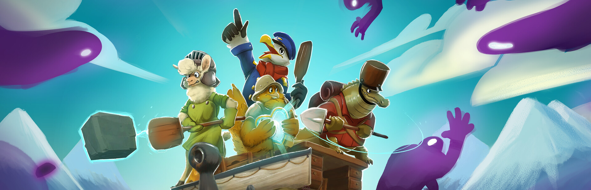

- **Studio :** Triple Boris / Dodo Tako
- **Genre :** Jeu de party / défense de tour basé sur la physique
- **Mode :** 1 à 4 joueurs, en écran partagé ou en ligne
- **Plateformes :** PC (Steam), Nintendo Switch

**Où l'acheter :** [Steam](https://store.steampowered.com/app/2228720/)

Récolter des ressources, empiler des murs et des tourelles, puis repousser des vagues de créatures gluantes : simple sur papier, chaotique en pratique. Comme tout est régi par la physique, les blocs, les ennemis étourdis et même vos coéquipiers deviennent des projectiles. Avec 24 niveaux répartis dans quatre zones et des centaines de combinaisons de chapeaux et d'armes, c'est le *Overcooked* de la défense de tour. Il brille surtout à quatre sur le divan, et son petit prix (environ 20 $) en fait un excellent cadeau pour une famille.

<figure class="wp-block-embed wp-block-embed-youtube is-type-video">
<iframe src="https://www.youtube.com/embed/W4zgBbjLlTg" title="Hack 'n' Stack – bande-annonce" loading="lazy" allow="accelerometer; autoplay; clipboard-write; encrypted-media; gyroscope; picture-in-picture; web-share" referrerpolicy="strict-origin-when-cross-origin" allowfullscreen></iframe>
</figure>

### Voidling Bound

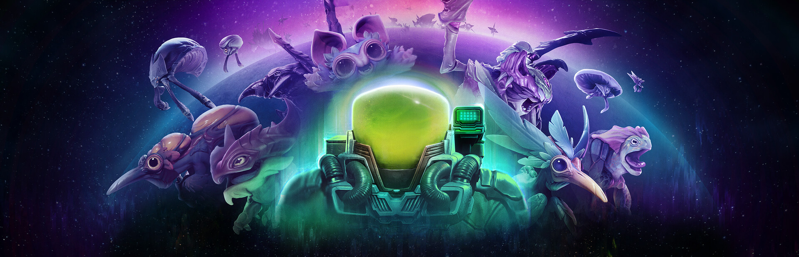

- **Studio :** Hatchery Games
- **Genre :** Action-RPG / jeu de tir à la troisième personne avec collection de créatures
- **Mode :** Solo
- **Plateformes :** PC (Steam, Epic Games Store), versions PS5, Xbox Series X|S et Switch 2 prévues plus tard

**Où l'acheter :** [Steam](https://store.steampowered.com/app/2004680/) · [Epic Games Store](https://store.epicgames.com/p/voidling-bound-f12d8b)

Fondé par d'anciens développeurs de *Skylanders*, Hatchery Games bouscule la formule du jeu de monstres : au lieu de donner des ordres à vos créatures, vous les contrôlez directement en combat. On fait éclore des œufs, on fait évoluer ses Voidlings selon des embranchements qui changent leur apparence, leur élément et leurs capacités, puis on les croise et on greffe des gènes mutants pour créer des combinaisons uniques. Les joueurs le décrivent comme un croisement entre *Spore* et *Warframe*, et c'est assez juste.

<figure class="wp-block-embed wp-block-embed-youtube is-type-video">
<iframe src="https://www.youtube.com/embed/-AkhvyL2Bjs" title="Voidling Bound – bande-annonce" loading="lazy" allow="accelerometer; autoplay; clipboard-write; encrypted-media; gyroscope; picture-in-picture; web-share" referrerpolicy="strict-origin-when-cross-origin" allowfullscreen></iframe>
</figure>

### Tears of Metal (accès anticipé)

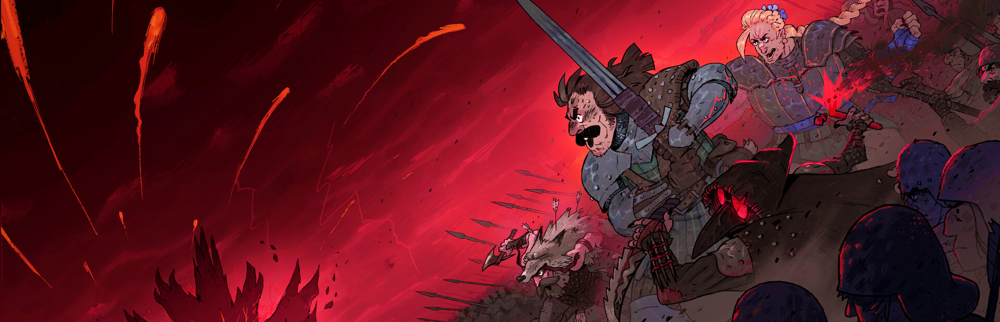

- **Studio :** Paper Cult
- **Genre :** Hack 'n' slash roguelike médiéval
- **Mode :** Solo ou coopération jusqu'à 4 joueurs
- **Plateformes :** PC (Steam, Microsoft Store et PC Game Pass), version Xbox Series X|S prévue plus tard

**Où l'acheter :** [Steam](https://store.steampowered.com/app/1913120/)

Imaginez *Dynasty Warriors* en kilt. Le studio derrière *Bloodroots* vous place à la tête d'un bataillon écossais pour reconquérir votre île, envahie par des hordes d'ennemis depuis la chute d'un mystérieux météore. On fauche des centaines de soldats, on monte des builds de pouvoirs à chaque tentative et on améliore son village entre les campagnes. L'accès anticipé contient déjà toute la boucle de progression, avec trois actes et trois héros jouables, et du contenu s'ajoute au fil des mises à jour.

<figure class="wp-block-embed wp-block-embed-youtube is-type-video">
<iframe src="https://www.youtube.com/embed/uQnK6lHd4wg" title="Tears of Metal – bande-annonce" loading="lazy" allow="accelerometer; autoplay; clipboard-write; encrypted-media; gyroscope; picture-in-picture; web-share" referrerpolicy="strict-origin-when-cross-origin" allowfullscreen></iframe>
</figure>

### 1666: Amsterdam (accès anticipé)

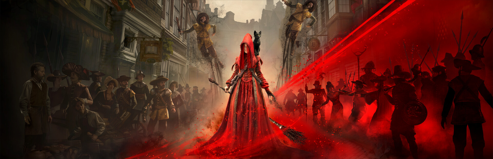

- **Studio :** Panache Digital Games
- **Genre :** Action-aventure narrative avec enquête
- **Mode :** Solo
- **Plateformes :** PC (Steam, Epic Games Store), versions consoles prévues plus tard

**Où l'acheter :** [Steam](https://store.steampowered.com/app/3949550/) · [Epic Games Store](https://store.epicgames.com/p/1666-amsterdam-c057d4)

Le nouveau projet de Patrice Désilets, cocréateur d'*Assassin's Creed* et réalisateur de *Prince of Persia: Les Sables du Temps*. On y incarne Noa, une sorcière chargée de traquer les Originels, des entités démoniaques cachées parmi les citoyens d'Amsterdam. Le jour, on enquête discrètement pour démasquer sa cible; la nuit de pleine lune, on la confronte sous sa vraie forme. Son compagnon? Aaron, un homme venu de 1999 qui voit désormais le monde à travers les yeux d'un chat noir. Un prologue gratuit permet de l'essayer avant de l'offrir.

<figure class="wp-block-embed wp-block-embed-youtube is-type-video">
<iframe src="https://www.youtube.com/embed/LWqmoqbrzy4" title="1666: Amsterdam – bande-annonce" loading="lazy" allow="accelerometer; autoplay; clipboard-write; encrypted-media; gyroscope; picture-in-picture; web-share" referrerpolicy="strict-origin-when-cross-origin" allowfullscreen></iframe>
</figure>

### The Caribou Trail

- **Studio :** Unreliable Narrators
- **Genre :** Aventure narrative à la première personne
- **Mode :** Solo
- **Plateformes :** PC (Steam, Epic Games Store), PS5

**Où l'acheter :** [Steam](https://store.steampowered.com/app/3065030/) · [Epic Games Store](https://store.epicgames.com/p/war-stories-the-caribou-trail-9cd253) · [PlayStation Store](https://store.playstation.com/concept/10015316)

Après *Two Falls (Nishu Takuatshina)*, Unreliable Narrators s'attaque à une page méconnue de la Première Guerre mondiale : la campagne de Gallipoli, vécue par un jeune pêcheur terre-neuvien et ses amis enrôlés. Inspiré de témoignages réels, le jeu ne cherche pas à faire de vous un héros : il n'y a ni pointage ni décompte de victimes, seulement l'endurance, la camaraderie et une touche de folklore et d'horreur psychologique autour du feu de camp. Une expérience courte, touchante et abordable, idéale pour les amateurs d'histoire.

<figure class="wp-block-embed wp-block-embed-youtube is-type-video">
<iframe src="https://www.youtube.com/embed/fajDQfhZveQ" title="The Caribou Trail – bande-annonce" loading="lazy" allow="accelerometer; autoplay; clipboard-write; encrypted-media; gyroscope; picture-in-picture; web-share" referrerpolicy="strict-origin-when-cross-origin" allowfullscreen></iframe>
</figure>

### Paralives (accès anticipé)

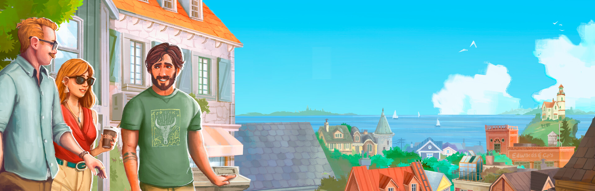

- **Studio :** Paralives Studio
- **Genre :** Simulation de vie
- **Mode :** Solo
- **Plateformes :** PC, Mac

**Où l'acheter :** [Steam](https://store.steampowered.com/app/1118520/)

Attendu depuis des années par les fans de simulation de vie, *Paralives* est enfin jouable en accès anticipé. Ce projet montréalais, financé en bonne partie par sa communauté, se positionne comme une alternative aux *Sims*, avec des outils de construction et de personnalisation pensés pour laisser le plus de liberté possible. Le studio prévoit environ deux ans d'accès anticipé avant la version 1.0 : un cadeau qui va grandir avec le temps.

<figure class="wp-block-embed wp-block-embed-youtube is-type-video">
<iframe src="https://www.youtube.com/embed/VTfP6O7vSOU" title="Paralives – bande-annonce" loading="lazy" allow="accelerometer; autoplay; clipboard-write; encrypted-media; gyroscope; picture-in-picture; web-share" referrerpolicy="strict-origin-when-cross-origin" allowfullscreen></iframe>
</figure>

### Lost & Found: A This Bed We Made Story

- **Studio :** Lowbirth Games
- **Genre :** Aventure narrative / mystère
- **Mode :** Solo
- **Plateformes :** PC (Steam)

**Où l'acheter :** [Steam](https://store.steampowered.com/app/4333200/)

Sophie Roy, la femme de chambre fouineuse de *This Bed We Made*, est de retour. Nous sommes en 1964 et elle travaille désormais comme hôtesse à bord d'un paquebot transatlantique, où les effets personnels des passagers disparaissent mystérieusement. On fait les lits, on nettoie les cabines… et on fouille tout pour résoudre l'enquête. Une histoire autonome d'une à deux heures, qu'on peut jouer sans connaître le premier jeu, et dont les choix précédents se reportent pour les fans. Un parfait cadeau de bas de Noël.

<figure class="wp-block-embed wp-block-embed-youtube is-type-video">
<iframe src="https://www.youtube.com/embed/4bgODeXJV0w" title="Lost &amp; Found: A This Bed We Made Story – bande-annonce" loading="lazy" allow="accelerometer; autoplay; clipboard-write; encrypted-media; gyroscope; picture-in-picture; web-share" referrerpolicy="strict-origin-when-cross-origin" allowfullscreen></iframe>
</figure>

### Dans l'abîme du rêve

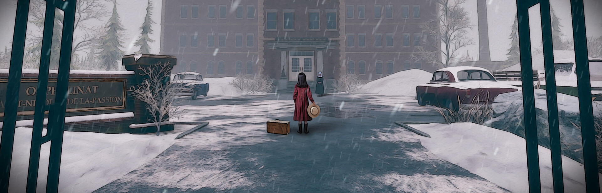

- **Studio :** Studio Chien d'Or
- **Genre :** Aventure point-and-click 3D / horreur cosmique
- **Mode :** Solo
- **Plateformes :** PC (Windows)

**Où l'acheter :** [Steam](https://store.steampowered.com/app/3346520/) · [GOG](https://www.gog.com/fr/game/an_abyss_of_dreams)

Alors que la Grande Noirceur s'abat sur le Québec, la jeune Thérèse perd sa mère et se retrouve à l'orphelinat Saint-Nicolas-de-la-Passion, un lieu régi par la brutalité, le silence et une foi aveugle. Chaque nuit, elle bascule dans un monde de rêves d'abord enchanteur, puis de plus en plus inquiétant, qui pourrait détenir la clé des événements troublants derrière les murs de l'orphelinat. Ce point-and-click 3D fait alterner les deux mondes à coups d'énigmes à la fois réalistes et surréalistes. Entièrement doublé en français, il ose aborder l'héritage sombre des institutions catholiques québécoises et le sort des enfants qu'elles ont enfermés. Un cadeau tout désigné pour les amateurs d'horreur qui aiment les récits bien de chez nous.

<figure class="wp-block-embed wp-block-embed-youtube is-type-video">
<iframe src="https://www.youtube.com/embed/LmrXOqqVBrM" title="Dans l'abîme du rêve – bande-annonce" loading="lazy" allow="accelerometer; autoplay; clipboard-write; encrypted-media; gyroscope; picture-in-picture; web-share" referrerpolicy="strict-origin-when-cross-origin" allowfullscreen></iframe>
</figure>

### Horripilant

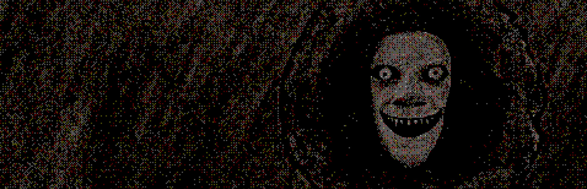

- **Studio :** Pas Game Studio
- **Genre :** Dungeon crawler incrémental / horreur
- **Mode :** Solo
- **Plateformes :** PC (Windows, Linux), Nintendo Switch

**Où l'acheter :** [Steam](https://store.steampowered.com/app/3525970/) · [Nintendo eShop](https://www.nintendo.com/store/products/horripilant-switch/)

Derrière *Horripilant* se cache Pas Game, le studio d'une seule personne fondé à Montréal par Alexandre Declos. Ce petit jeu d'horreur mélange jeu incrémental, casse-tête et auto-battler : on combat, on mine et on réfléchit pour descendre toujours plus creux dans un donjon maudit, où chaque bonus a son prix. Avec son pixel art inquiétant, ses évaluations très positives sur Steam et son petit prix, c'est un excellent cadeau de bas de Noël pour les amateurs de frissons.

<figure class="wp-block-embed wp-block-embed-youtube is-type-video">
<iframe src="https://www.youtube.com/embed/SnF7j2ECJQk" title="Horripilant – bande-annonce" loading="lazy" allow="accelerometer; autoplay; clipboard-write; encrypted-media; gyroscope; picture-in-picture; web-share" referrerpolicy="strict-origin-when-cross-origin" allowfullscreen></iframe>
</figure>

### ScopeCreep

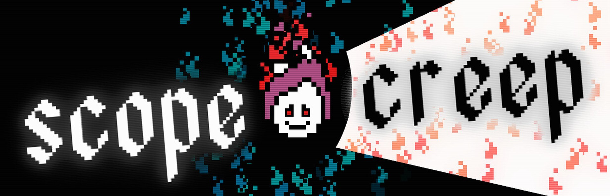

- **Studio :** Foolbox Studio (édité par Pretty Soon)
- **Genre :** Incrémental actif / défense
- **Mode :** Solo
- **Plateformes :** PC (Windows, Linux)

**Où l'acheter :** [Steam](https://store.steampowered.com/app/3595710/ScopeCreep/)

On y incarne une flamme murmurante qui convoite des âmes. Au centre de l'écran, elle affronte des vagues d'esprits errants, récolte leurs essences et les réinvestit dans un vaste arbre d'améliorations pour plonger toujours plus loin dans le vide. Le combat est simple, mais la boucle « encore une amélioration » est redoutablement efficace, portée par un pixel art aux couleurs vives et une bande-son d'ambiance. Court, intense et sans temps mort, c'est l'incrémental parfait pour ceux qui n'ont pas de temps à perdre. Le jeu sort le 16 novembre, et une démo gratuite permet de l'essayer dès maintenant sur Steam.

<figure class="wp-block-embed wp-block-embed-youtube is-type-video">
<iframe src="https://www.youtube.com/embed/VULOdzjplzg" title="ScopeCreep – bande-annonce" loading="lazy" allow="accelerometer; autoplay; clipboard-write; encrypted-media; gyroscope; picture-in-picture; web-share" referrerpolicy="strict-origin-when-cross-origin" allowfullscreen></iframe>
</figure>

### Tape to Tape

- **Studio :** Excellent Rectangle
- **Genre :** Hockey arcade / roguelite
- **Mode :** Solo ou coop sur le divan pour la campagne, jusqu'à 4 joueurs en local
- **Plateformes :** PC (Steam), PS5, Xbox, Nintendo Switch

**Où l'acheter :** [Steam](https://store.steampowered.com/app/1566200/Tape_to_Tape/) · [PlayStation Store](https://store.playstation.com/en-ca/concept/10012034) · [Xbox](https://www.xbox.com/en-CA/games/store/tape-to-tape/9P51DN776TFV) · [Nintendo eShop](https://www.nintendo.com/store/products/tape-to-tape-switch/)

Après plus de trois ans en accès anticipé, le jeu de hockey du studio de Québec est sorti en version complète le 23 octobre, en même temps sur PC et consoles. On prend les commandes d'Angus McShaggy et de sa bande de bras cassés dans une campagne roguelite : une défaite met fin à la partie, mais chaque nouvelle tentative débloque des joueurs, des talents et des escouades qui changent la façon de jouer. Le hockey arcade est rapide et nerveux, avec mises en échec, tirs sur réception et passes soulevées, contre des adversaires complètement absurdes, des arbitres tricheurs aux redoutables Golfeurs. Jouable en coop sur le divan, c'est le cadeau tout désigné pour les Fêtes au pays du hockey.

<figure class="wp-block-embed wp-block-embed-youtube is-type-video">
<iframe src="https://www.youtube.com/embed/5U1IPhyGQKw" title="Tape to Tape – bande-annonce" loading="lazy" allow="accelerometer; autoplay; clipboard-write; encrypted-media; gyroscope; picture-in-picture; web-share" referrerpolicy="strict-origin-when-cross-origin" allowfullscreen></iframe>
</figure>

### Every Day We Fight

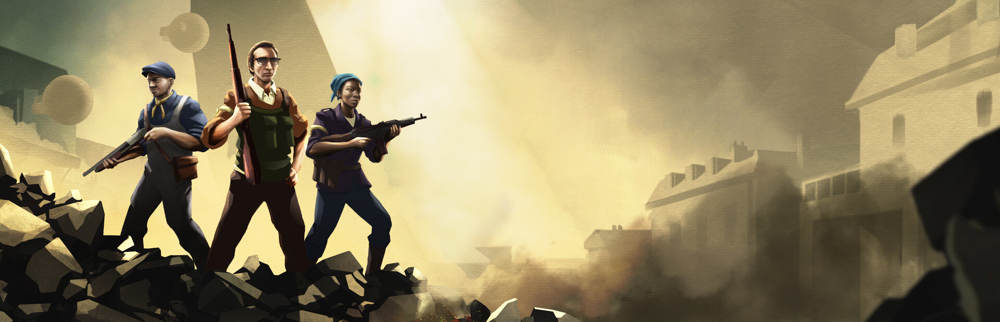

- **Studio :** Signal Space Lab
- **Genre :** Tactique au tour par tour / roguelite
- **Mode :** Solo
- **Plateformes :** PC

**Où l'acheter :** [Steam](https://store.steampowered.com/app/1546080/) · [Epic Games Store](https://store.epicgames.com/en-US/p/every-day-we-fight-923253)

Sorti de l'accès anticipé le 22 octobre, *Every Day We Fight* plonge une poignée de civils, issus des deux camps d'une guerre en cours, au cœur d'une invasion extraterrestre qui a figé le temps. Le hic : chaque fois qu'ils meurent, tout recommence. On explore la ville en temps réel, on s'infiltre pour trouver la meilleure position, puis on bascule en combat tactique au tour par tour, dans la lignée de *XCOM*. La version complète ajoute beaucoup de contenu, dont des missions bien plus variées, 70 % plus d'armes et des niveaux de difficulté pour tous les profils. Un excellent choix pour les stratèges. Destiné à un public adulte.

<figure class="wp-block-embed wp-block-embed-youtube is-type-video">
<iframe src="https://www.youtube.com/embed/uKoFLNs0CSE" title="Every Day We Fight – bande-annonce" loading="lazy" allow="accelerometer; autoplay; clipboard-write; encrypted-media; gyroscope; picture-in-picture; web-share" referrerpolicy="strict-origin-when-cross-origin" allowfullscreen></iframe>
</figure>

### Echoes of Mystralia (accès anticipé)

- **Studio :** Borealys Games
- **Genre :** Action-RPG roguelite
- **Mode :** Solo
- **Plateformes :** PC

**Où l'acheter :** [Steam](https://store.steampowered.com/app/974480/Echoes_of_Mystralia/)

Neuf ans après *Mages of Mystralia*, Borealys Games retourne dans son univers magique avec un roguelite d'action. On y incarne Mazarim, un Veilleur chargé de protéger le Cycle des Mémoires contre une faille qui menace d'engloutir Mystralia. La vedette, c'est la création de sorts : on combine des Mémoires et on change leur ordre pour obtenir des effets différents, de l'explosion de foudre à la tornade glaciale, avec des millions de combinaisons possibles. L'accès anticipé, lancé en août, propose déjà trois régions, trois Gardiens à affronter et 110 Mémoires, et les évaluations Steam sont très positives. Un beau cadeau pour les fans de *Hades* qui aiment expérimenter.

<figure class="wp-block-embed wp-block-embed-youtube is-type-video">
<iframe src="https://www.youtube.com/embed/v8QtdzJj5OU" title="Echoes of Mystralia – bande-annonce" loading="lazy" allow="accelerometer; autoplay; clipboard-write; encrypted-media; gyroscope; picture-in-picture; web-share" referrerpolicy="strict-origin-when-cross-origin" allowfullscreen></iframe>
</figure>

### Lunchbreak Tactics

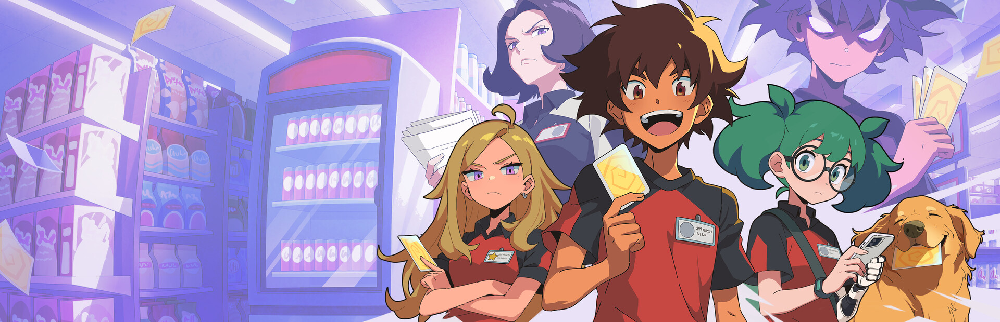

- **Studio :** Borealys Games
- **Genre :** Auto-battler de cartes
- **Mode :** Solo et JcJ asynchrone en ligne
- **Plateformes :** PC, Mac, Android

**Où l'acheter :** [Steam](https://store.steampowered.com/app/3002240/Lunchbreak_Tactics/) · [Google Play](https://play.google.com/store/apps/details?id=com.borealysgames.lbt)

Coincé dans un nouvel emploi plate au supermarché Anymart, vous tuez le temps avec le jeu de cartes qui fait fureur dans la salle des employés. On choisit un héros et deux clans, puis on bâtit son équipe à partir d'objets du magasin devenus guerriers, du maïs soufflé pirate à l'oreiller combattant, avant d'affronter les équipes d'autres joueurs. Pensé pour une vraie pause dîner de 15 minutes, sans minuterie, le jeu mise sur des synergies absurdes et un humour assumé. La version Android est gratuite pour essayer et partage la progression avec Steam : parfait pour les pauses au bureau comme dans le bus.

<figure class="wp-block-embed wp-block-embed-youtube is-type-video">
<iframe src="https://www.youtube.com/embed/hRU2zEeLlek" title="Lunchbreak Tactics – bande-annonce" loading="lazy" allow="accelerometer; autoplay; clipboard-write; encrypted-media; gyroscope; picture-in-picture; web-share" referrerpolicy="strict-origin-when-cross-origin" allowfullscreen></iframe>
</figure>

### Piece by Piece

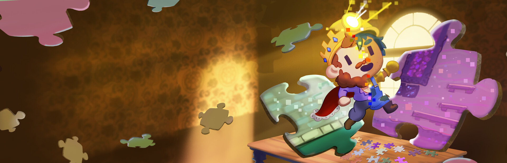

- **Studio :** Neon Polygons
- **Genre :** Casse-tête / plateforme
- **Mode :** Solo
- **Plateformes :** PC

**Où l'acheter :** [Steam](https://store.steampowered.com/app/3249380/)

Ici, le niveau est littéralement un casse-tête : chaque tableau est découpé en pièces qu'on assemble, qu'on sépare et qu'on fait pivoter pour tracer un chemin jusqu'à la porte, avant de le parcourir avec son petit personnage. Les 100 niveaux faits à la main sont répartis dans 12 boîtes de casse-tête, chacune avec son thème et sa mécanique, et les boîtes avancées combinent le tout. Avec son style douillet, sa trame sonore apaisante et son petit prix, c'est un parfait cadeau pour les amateurs de réflexion. Il est aussi vérifié sur Steam Deck.

<figure class="wp-block-embed wp-block-embed-youtube is-type-video">
<iframe src="https://www.youtube.com/embed/4jN8V4zvRUs" title="Piece by Piece – bande-annonce" loading="lazy" allow="accelerometer; autoplay; clipboard-write; encrypted-media; gyroscope; picture-in-picture; web-share" referrerpolicy="strict-origin-when-cross-origin" allowfullscreen></iframe>
</figure>

### Rivage

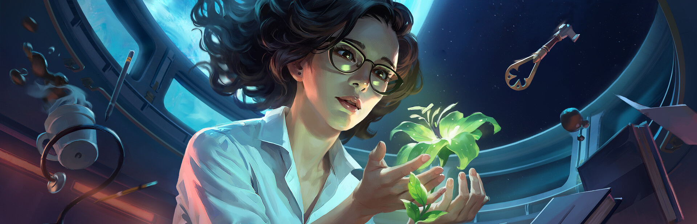

- **Studio :** Exnilo Studio (édité par Raw Fury)
- **Genre :** Aventure / casse-tête de science-fiction à la première personne
- **Mode :** Solo
- **Plateformes :** PC, PlayStation 5, Xbox Series X|S

**Où l'acheter :** [Steam](https://store.steampowered.com/app/4094660/) · [PlayStation Store](https://store.playstation.com/concept/10017506) · [Xbox / Microsoft Store](https://www.xbox.com/games/store/rivage/9NZVRP8QQZ6N)

Au 25e siècle, la station spatiale A.R.E.S. étudie VESTA, une planète qui pourrait devenir le nouveau foyer de l'humanité, jusqu'à ce qu'un phénomène inconnu la frappe. Miranda s'y réveille seule, prisonnière d'une anomalie qui la fait revivre la même boucle de temps, au milieu d'objets déplacés, de portes nouvellement ouvertes et de messages anonymes. Pour découvrir ce qui est arrivé à l'équipage, il faut fouiller une station entièrement interactive, reconstituer l'histoire de chacun à partir de journaux et de carnets, et résoudre des énigmes dont certaines solutions ne s'accomplissent pas en une seule boucle, mais préparent la suivante. Sorti le 22 septembre et entièrement traduit en français, c'est un beau cadeau pour les fans d'*Outer Wilds* et de mystères qui se dévoilent lentement.

<figure class="wp-block-embed wp-block-embed-youtube is-type-video">
<iframe src="https://www.youtube.com/embed/ZLrrwo8NcQQ" title="Rivage – bande-annonce" loading="lazy" allow="accelerometer; autoplay; clipboard-write; encrypted-media; gyroscope; picture-in-picture; web-share" referrerpolicy="strict-origin-when-cross-origin" allowfullscreen></iframe>
</figure>

### The Solitaire Tower of Doom (accès anticipé)

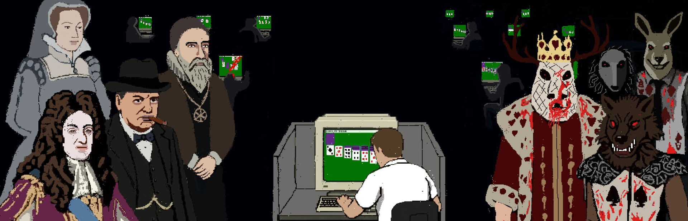

- **Studio :** emjayhar
- **Genre :** Solitaire roguelite narratif / horreur occulte
- **Mode :** Solo
- **Plateformes :** PC, Mac, Linux (Steam)

**Où l'acheter :** [Steam](https://store.steampowered.com/app/5007930/The_Solitaire_Tower_of_Doom/)

Montréal, 1990 : une secte vouée au Solitaire asservit les employés de bureau, une partie à la fois. Pour lui tenir tête, on choisit un Mécène temporel inspiré d'un personnage historique (Louis XIV, Churchill, Marie Stuart, Napoléon, John Dee…), qui influence sa façon de jouer, puis on descend les étages roguelike d'une tour en remportant des parties dans cinq variantes : Klondike, Spider, Pyramide, TriPeaks et FreeCell. Entre les étages, une boutique d'objets permet d'ajuster sa stratégie, et la progression d'une partie à l'autre débloque de nouveaux mécènes et dos de cartes. Le tout baigne dans un pixel art qui rappelle les jeux PC du début des années 90. Offert en accès anticipé depuis le 2 octobre pour moins de 5 $, c'est le petit cadeau parfait à glisser dans un bas de Noël.

<iframe src="https://store.steampowered.com/widget/5007930/" title="The Solitaire Tower of Doom sur Steam" loading="lazy" style="aspect-ratio:auto;height:190px"></iframe>

### Royal Vermin

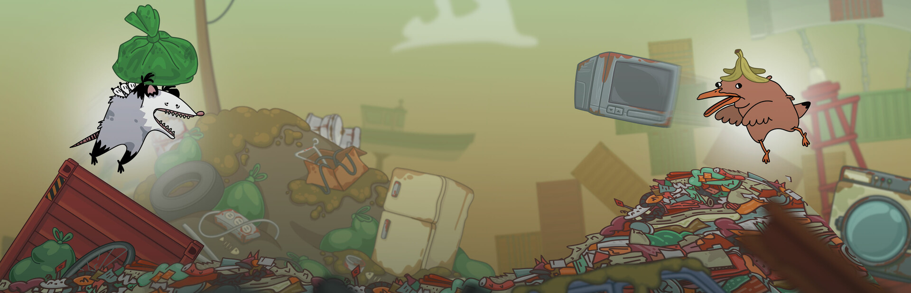

- **Studio :** Tobafeu Studio
- **Genre :** Jeu de combat de plateformes / party
- **Mode :** 2 à 4 joueurs en local
- **Plateformes :** Nintendo Switch, PC (Steam)

**Où le télécharger :** [Steam](https://store.steampowered.com/app/3660580/) · [Nintendo eShop](https://www.nintendo.com/games/detail/royal-vermin-switch)

Notre bonus gratuit vient du Saguenay. Dans un monde transformé en dépotoir géant après la disparition des humains, rats, goélands et autres nuisibles se battent pour le trône. Les contrôles sont simples, les arènes s'effondrent en plein combat et un mode Vengeance permet aux joueurs éliminés d'influencer la fin de la partie. C'est gratuit : à télécharger avant le party des Fêtes, tout simplement.

<figure class="wp-block-embed wp-block-embed-youtube is-type-video">
<iframe src="https://www.youtube.com/embed/2i2xfeUJjxs" title="Royal Vermin – bande-annonce" loading="lazy" allow="accelerometer; autoplay; clipboard-write; encrypted-media; gyroscope; picture-in-picture; web-share" referrerpolicy="strict-origin-when-cross-origin" allowfullscreen></iframe>
</figure>

## Les incontournables qui ont continué de grandir en 2026

### Hell is Us

- **Studio :** Rogue Factor
- **Genre :** Action-aventure
- **Mode :** Solo
- **Plateformes :** PC, PS5, Xbox Series X|S, Nintendo Switch 2

**Où l'acheter :** [Steam](https://store.steampowered.com/app/1620730/) · [Epic Games Store](https://store.epicgames.com/p/hell-is-us-b9c06d) · [PlayStation Store](https://www.playstation.com/fr-ca/games/hell-is-us/) · [Xbox](https://www.xbox.com/en-CA/games/store/_/9N9097G0XZMB)

Un an après sa sortie, *Hell is Us* a débarqué sur Switch 2 avec sa plus grosse mise à jour à ce jour : dix nouveaux Marcheurs creux viennent enrichir le bestiaire, sur toutes les plateformes. Le jeu se démarque par son exploration sans carte ni marqueurs : on avance en observant, en lisant et en reliant les indices soi-même, dans un pays déchiré par la guerre civile où d'étranges créatures sont apparues. Un cadeau idéal pour les joueurs qui ont envie qu'on leur fasse confiance. Destiné à un public adulte.

<figure class="wp-block-embed wp-block-embed-youtube is-type-video">
<iframe src="https://www.youtube.com/embed/D_XQDQ2-JPo" title="Hell is Us – bande-annonce" loading="lazy" allow="accelerometer; autoplay; clipboard-write; encrypted-media; gyroscope; picture-in-picture; web-share" referrerpolicy="strict-origin-when-cross-origin" allowfullscreen></iframe>
</figure>

### Marvel Cosmic Invasion

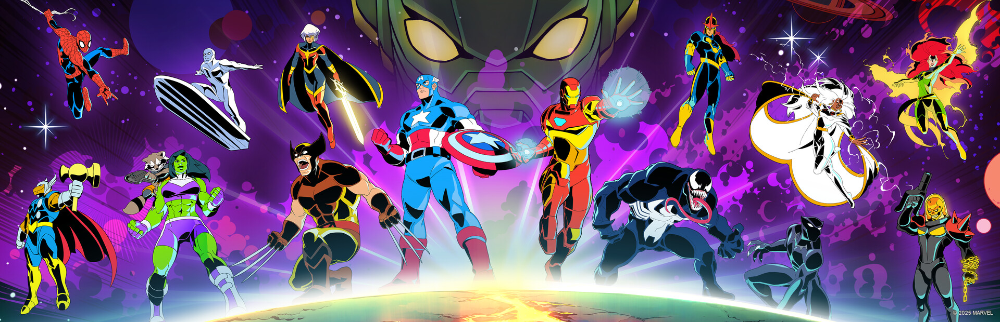

- **Studio :** Tribute Games
- **Genre :** Beat 'em up
- **Mode :** Solo ou coopération jusqu'à 4 joueurs
- **Plateformes :** PC, PS5, PS4, Xbox Series X|S, Nintendo Switch, Nintendo Switch 2

**Où l'acheter :** [Steam](https://store.steampowered.com/app/2753970/) · [PlayStation Store](https://www.playstation.com/games/marvel-cosmic-invasion) · [Xbox](https://www.xbox.com/games/store/marvel-cosmic-invasion/9N79TQTZTQQ4) · [Nintendo eShop (Switch)](https://www.nintendo.com/games/detail/marvel-cosmic-invasion-switch) · [Nintendo eShop (Switch 2)](https://www.nintendo.com/us/store/products/marvel-cosmic-invasion-switch-2/)

Lancé en décembre 2025, le beat 'em up cosmique des créateurs de *TMNT: Shredder's Revenge* a dépassé 1,5 million de joueurs et continue de s'agrandir. Après l'ajout de Cyclope et de la Chose au printemps, l'extension *The Siege of Castle Doom* arrive le 10 novembre avec Docteur Fatalis et la Femme invisible comme personnages jouables, en plus d'un nouveau mode de jeu, pour un total de 19 héros. Le système d'échange en duo en plein combat et le pixel art rétro en font une valeur sûre pour jouer en famille.

<figure class="wp-block-embed wp-block-embed-youtube is-type-video">
<iframe src="https://www.youtube.com/embed/b-rO2V3aG2I" title="Marvel Cosmic Invasion – bande-annonce" loading="lazy" allow="accelerometer; autoplay; clipboard-write; encrypted-media; gyroscope; picture-in-picture; web-share" referrerpolicy="strict-origin-when-cross-origin" allowfullscreen></iframe>
</figure>

### The Outlast Trials

- **Studio :** Red Barrels
- **Genre :** Horreur de survie
- **Mode :** Solo ou coopération jusqu'à 4 joueurs
- **Plateformes :** PC, PS5, PS4, Xbox Series X|S, Xbox One

**Où l'acheter :** [Steam](https://store.steampowered.com/app/1304930/) · [Epic Games Store](https://store.epicgames.com/p/the-outlast-trials) · [PlayStation Store](https://www.playstation.com/games/the-outlast-trials/) · [Xbox](https://www.xbox.com/games/store/a/9NR13RF1V2WV)

Red Barrels a célébré ses 15 ans en 2026 avec plus de 50 millions de jeux vendus, et *The Outlast Trials* continue de recevoir du contenu, dont la saison 7, *Project Boneyard*, cet été. En pleine guerre froide, vous êtes un cobaye des expériences de la Murkoff Corporation et devez survivre à des épreuves cauchemardesques, seul ou avec des amis. L'horreur est plus supportable à plusieurs… enfin, en théorie. Réservé aux adultes qui ont le cœur solide.

<figure class="wp-block-embed wp-block-embed-youtube is-type-video">
<iframe src="https://www.youtube.com/embed/D2grDVODodo" title="The Outlast Trials – bande-annonce" loading="lazy" allow="accelerometer; autoplay; clipboard-write; encrypted-media; gyroscope; picture-in-picture; web-share" referrerpolicy="strict-origin-when-cross-origin" allowfullscreen></iframe>
</figure>

### Dead by Daylight

- **Studio :** Behaviour Interactive 
- **Genre :** Horreur multijoueur asymétrique
- **Mode :** Multijoueur en ligne (4 survivants contre 1 tueur, plus des événements spéciaux)
- **Plateformes :** PC, PS5, PS4, Xbox Series X|S, Xbox One, Nintendo Switch

**Où l'acheter :** [Steam](https://store.steampowered.com/app/381210/) · [PlayStation Store](https://www.playstation.com/games/dead-by-daylight/) · [Xbox](https://www.xbox.com/games/store/dead-by-daylight/c0n22p73qz60)

*Dead by Daylight* a soufflé ses 10 bougies cette année et Behaviour ne ralentit pas : un premier chapitre créé avec les votes de la communauté, le retour du mode 2 contre 8, puis Art le Clown de *Terrifier* comme nouveau tueur le 12 novembre, avant une collection *Scooby-Doo* en décembre. Pour un fan qui a déjà le jeu, un chapitre ou des points en boutique font un cadeau facile. Pour un nouveau joueur, c'est le moment idéal pour commencer.

<figure class="wp-block-embed wp-block-embed-youtube is-type-video">
<iframe src="https://www.youtube.com/embed/ZOWb-BY6-Wg" title="Dead by Daylight – bande-annonce" loading="lazy" allow="accelerometer; autoplay; clipboard-write; encrypted-media; gyroscope; picture-in-picture; web-share" referrerpolicy="strict-origin-when-cross-origin" allowfullscreen></iframe>
</figure>

### The Glitch Fairy

- **Studio :** Cannon Cow
- **Genre :** Plateforme-action 2D
- **Mode :** Solo
- **Plateformes :** PC

**Où l'acheter :** [Steam](https://store.steampowered.com/app/1811910/The_Glitch_Fairy/) · [itch.io](https://cannoncow.itch.io/the-glitch-fairy)

Créé par deux amis d'enfance qui en rêvaient depuis 2016, *The Glitch Fairy* met en vedette Monie, une fée qui s'est fait voler sa capacité de voler par sa rivale, la princesse Badassia, armée d'une mitrailleuse. Pour la retrouver, elle compte sur le Rayon Glitch, qui transforme ses ennemis en toutes sortes de choses utiles ou loufoques. On saute, on tire, on dash et on « glitche » à travers 15 niveaux et une douzaine de niveaux bonus secrets, du fond des bois jusqu'à une ruche géante. Le studio prépare une importante mise à jour qui intègre les commentaires des joueurs et qui pourrait ouvrir la porte aux consoles. Toutes les évaluations Steam sont positives.

<figure class="wp-block-embed wp-block-embed-youtube is-type-video">
<iframe src="https://www.youtube.com/embed/QcM3dELVczE" title="The Glitch Fairy – bande-annonce" loading="lazy" allow="accelerometer; autoplay; clipboard-write; encrypted-media; gyroscope; picture-in-picture; web-share" referrerpolicy="strict-origin-when-cross-origin" allowfullscreen></iframe>
</figure>

## Bon magasinage!

Acheter un jeu québécois, c'est soutenir directement nos studios, petits et grands. Vous avez un coup de cœur d'ici qu'on aurait oublié? Dites-le-nous en commentaire.

**Note de transparence :** le créateur de ce blogue a travaillé sur trois des jeux présentés dans ce guide :

- *Hell is Us* : responsable des communications
- *Voidling Bound* : relations de presse au Québec
- *The Solitaire Tower of Doom* : créateur
