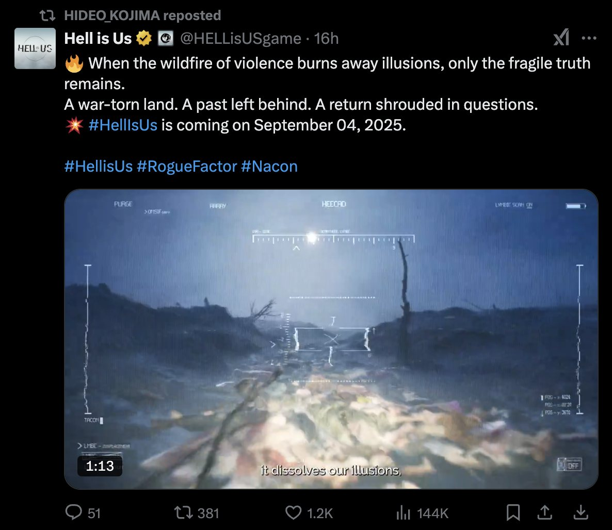

*image à la une : Rogue Factor*

**Le studio québécois [Rogue Factor](https://rogue-factor.com/) a dévoilé la date de sortie de [Hell is Us](https://store.steampowered.com/app/1620730/Hell_is_Us/) lors du [PlayStation State of Play](https://www.youtube.com/watch?v=vQtPbTOhLEc&t=13s) qui a été présenté hier.** **Le jeu d’action-aventure sera disponible sur PC, PlayStation 5 et Xbox Series le 4 septembre 2025.**

« *Dans **Hell is Us**, les joueurs incarnent Rémi, protagoniste parti à la recherche de ses origines dans un pays en proie à la guerre civile. L’autarcie quasi-totale de cette contrée cache un lourd secret : l’apparition récente de créatures surnaturelles rappelant d’anciennes stèles et monuments du pays. Equipé d’armes spécialement forgées pour combattre ces monstres, Rémi devra apprendre à les affronter et à utiliser son équipement à bon escient.* »

Voici la nouvelle bande-annonce de Hell is Us dévoilée lors du State of Play :

https://www.youtube.com/watch?v=8iZbNIAM8eQ

Cette nouvelle bande-annonce a d’ailleurs attiré l’attention d’Hideo Kojima, le célèbre créateur des franchises **Metal Gear** et **Death Stranding**, qui l’a « retweeté » sur la plateforme social X.

**À LIRE AUSSI : [E-AI de retour en 2025](/2025/02/05/e-ai-de-retour-en-2025/)**

**À lire sur Bêta-Testeur : [Critique de Avowed](https://www.lebetatesteur.ca/test-avowed/)**
