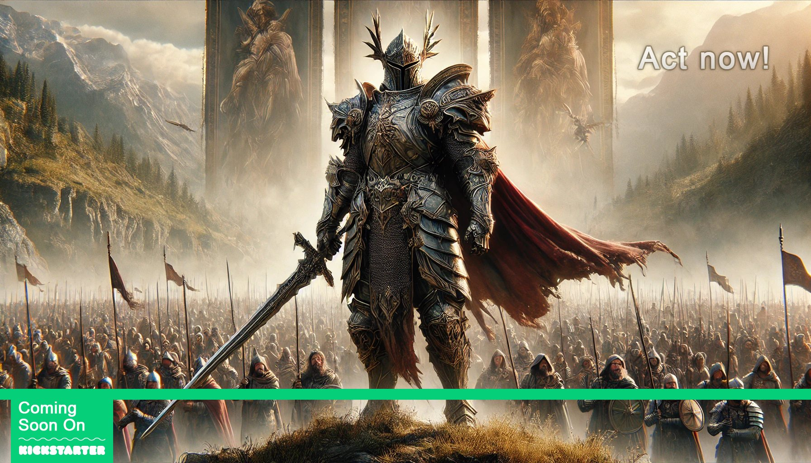

*crédit images : 3Mind Games*/*Literate Games*

**[Literate Games](https://www.literategames.org/hotdp.php), en collaboration avec [3Mind Games](https://www.3mindgames.com/), les créateurs de [The Protagonist: EX-1](https://store.steampowered.com/app/1162570/The_Protagonist_EX1/), annonce le développement de Heroes of the Dark Prophecy, un jeu de rôle en dark fantasy médiévale. Le projet, qui sera lancé sur [Kickstarter](https://www.kickstarter.com/projects/literategames/heroes-of-the-dark-prophecy) le 24 septembre 2024, se distingue par son approche de développement impliquant la communauté et son objectif de soutenir les talents émergents de l’industrie du jeu vidéo québécoise.**

Heroes of the Dark Prophecy est décrit comme un jeu de rôle solo, narratif et immersif, adapté du jeu de rôle de table Master’s Quests. Le jeu propose une trame narrative dans un univers de dark fantasy médiéval, où cinq personnages affrontent une invasion imminente.

Selon les développeurs, le jeu utilisera Unreal Engine 5, promettant des visuels réalistes et des environnements dynamiques. Les fonctionnalités annoncées incluent des combats en temps réel, une personnalisation détaillée des personnages et des scénarios ramifiés.

La campagne Kickstarter, prévue du 24 septembre au 24 octobre 2024, vise à collecter 150 000 $ pour financer le portage d’un prototype existant vers Unreal Engine 5 et poursuivre le développement du jeu. Le prototype en question a remporté le prix [Best in Play lors du GDC 2022.](https://gdconf.com/news/here-are-gdc-2022-best-play-winners)

Les développeurs proposent une phase de pré-lancement du 10 au 23 septembre 2024. Les personnes [qui suivront le projet sur Kickstarter](https://www.kickstarter.com/projects/literategames/heroes-of-the-dark-prophecy) et s[‘abonneront à l’infolettre officielle](https://docs.google.com/forms/d/e/1FAIpQLSdyuiLJZxQW4O_t6ZKXT3Z9M6OcxoABmLnMvD51QYr7TV4DtQ/viewform) pendant cette période seront éligibles pour recevoir un cadeau exclusif gratuit, à condition de s’engager à soutenir le projet pour au moins 5 $ une fois la campagne lancée. Le cadeau? Un document avec des cartes détaillées de l’univers du jeu, mettant en évidence des points d’intérêt clés et offrant des informations précieuses pour l’artisanat et l’exploration.

## Participation de la communauté

Un aspect notable du projet est l’intention d’impliquer la communauté dans le développement. L’entreprise annonce que les contributeurs pourront influencer certains aspects du jeu à travers des votes et des sondages. Les domaines mentionnés incluent la prise en charge des langues, les plateformes de distribution, ainsi que des fonctionnalités supplémentaires et des contenus téléchargeables (DLC).

Pour certains niveaux de contribution plus élevés, on évoque la possibilité pour les backers de collaborer avec les designers pour créer du contenu spécifique pour le jeu.

## Literate Games et son approche du mentorat

Au-delà du développement du jeu, Literate Games se présente comme un incubateur à but non lucratif. L’entreprise déclare avoir pour mission d’accompagner la prochaine génération de développeurs et d’artistes de jeux vidéo. Cette mission serait réalisée à travers un programme de mentorat impliquant l’équipe senior de 3Mind Games.

Ce projet Kickstarter viserait donc non seulement à financer le développement du jeu, mais aussi à soutenir leur mission de formation et d’encadrement des nouveaux talents de l’industrie du jeu vidéo.

Pour plus d’informations, vous pouvez visiter [la page Kickstarter du projet](https://www.kickstarter.com/projects/literategames/heroes-of-the-dark-prophecy) ou le site web officiel de [Literate Games.](https://www.literategames.org/hotdp.php)

**À LIRE AUSSI : [Critique – Pyrene : un dungeon crawler innovant](/2024/09/11/critique-pyrene-un-dungeon-crawler-innovant/)**
