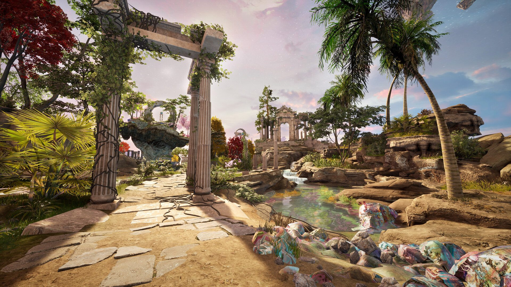

*Crédit images : Lunarch Studios*

**Le studio québécois [Behaviour Interactive](https://www.bhvr.com/) vous invite à tester gratuitement Islands of Insight, un jeu d’aventure et de puzzles relaxant dans un monde partagé.**

Behaviour agit en tant qu’éditeur pour ce jeu qui est développé par le studio américain [Lunarch Studios.](http://lunarchstudios.com/) Dans Islands of Insight, on se retrouve dans un monde fantaisiste rempli d’îles flotantes, de puzzles à résoudre et de secrets à découvrir.

Le jeu est présentement en phase de playtest sur Steam. [Essayez-le ici.](https://store.steampowered.com/app/2071500/Islands_of_Insight/)

La proposition semble une sorte de mélange entre Zelda, Myst et un MMO, mais complètement dénuée de violence, ce qui est quand même rafraichissant.

**À LIRE AUSSI : [The Outlast Trials primé aux Horror Game Awards](/2023/09/08/the-outlast-trials-prime-aux-horror-game-awards/)**

https://www.youtube.com/watch?v=PN47pZrXH0A

> *« Bienvenue dans Islands of Insight — un jeu épique d’aventure et de réflexion au cœur d’un monde partagé, situé dans un paisible royaume imaginaire de merveilles anciennes et de beauté naturelle. Regorgeant de mystérieux casse-têtes à résoudre, de secrets à dévoiler et de paysages splendides à explorer, ce monde grandiose d’îles flottantes s’offre à vous pour le découvrir à votre propre rythme. »*
>
> description officielle sur Steam

**À LIRE AUSSI : [Once a Tale : une nouvelle bande-annonce dans les Awesome Indies du Gamescom](/2023/08/23/once-a-tale-une-nouvelle-bande-annonce-dans-les-awesome-indies-du-gamescom/)**
