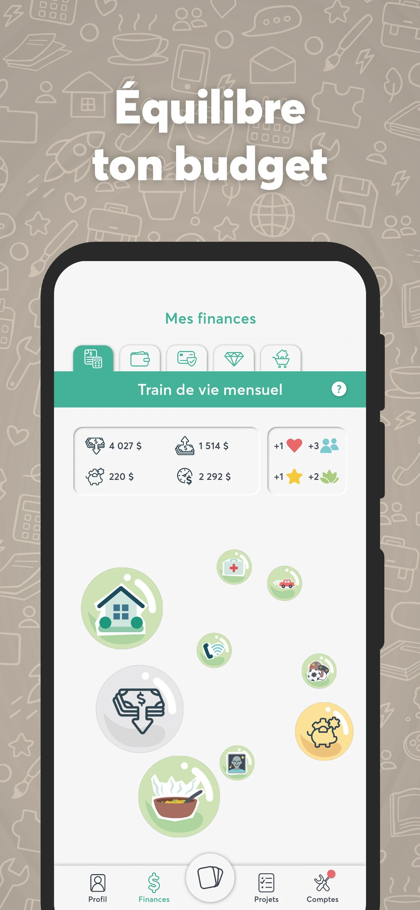

*images : Mouvement Desjardins*

**Mise à jour 12 juin 2024 : l’article initial affirmait que Aléa : le jeu de prise de décision avait remporté deux prix Octas. En fait, il s’agit de trois prix Octas, incluant le prix Coup de Coeur Jury**

**Aléa : le jeu de prise de décision est un jeu mobile éducatif qui est une initiative du [Mouvement Desjardins](https://www.desjardins.com/qc/fr/nouvelles/desjardins-lancement-alea.html) et développé par le studio montréalais [Jeux Boréalys](https://borealysgames.com/fr/). Le 30 mai dernier, ils ont été récipiendiaires de [trois prix Octas.](https://www.actionti.com/octas/)**

Les prix Octas sont une initiative du [Réseau Action TI](https://www.actionti.com/), une OBNL qui a pour mission d’informer, former, échanger, faire connaître et reconnaître l’excellence dans le milieu des technologies de l’information.

Lors de la soirée des Octas 2024, le jeu mobile Aléa : le jeu de prise de décision, s’est vu remettre le premier prix (or) dans la catégorie **« Divertissement, grande entreprise, société d’état et gouvernemental »** ainsi que le premier prix (or) dans la catégorie **« Français dans les TI »**. Ce dernier est un prix remis en collaboration avec l’Office québécois de la langue française.

Aussi, Aléa s’est vu remettre le prix **« Coup de coeur Jury »** qui est remis au meilleur projet, toutes catégories confondues.

Les prix ont été remis au Mouvement Desjardins à qui revient l’initiative du projet, en collaboration avec le studio de jeux vidéo Jeux Boréalys, à qui l’on doit le jeu d’action-aventure [Mages of Mystralia.](https://store.steampowered.com/app/529660/Mages_of_Mystralia/)

Aléa : le jeu de prise de décision, est un jeu sérieux qui combine simulation de vie et simulation de gestion financière qui a pour but d’éduquer les jeunes sur la gestion de leurs finances personnelles. Il est disponible gratuitement pour téléphones mobiles sur le [App store de Apple](https://apps.apple.com/ca/app/al%C3%A9a-jeu-de-prise-de-d%C3%A9cision/id1672117308?l=fr-CA) et le [Play Store de Google (Android).](https://play.google.com/store/apps/details?id=com.desjardins.alea&hl=fr)

**À LIRE AUSSI : [This bed we made repart avec les grands honneurs aux Prix Numix](/2024/05/30/this-bed-we-made-repart-avec-les-grands-honneurs-aux-prix-numix/)**
