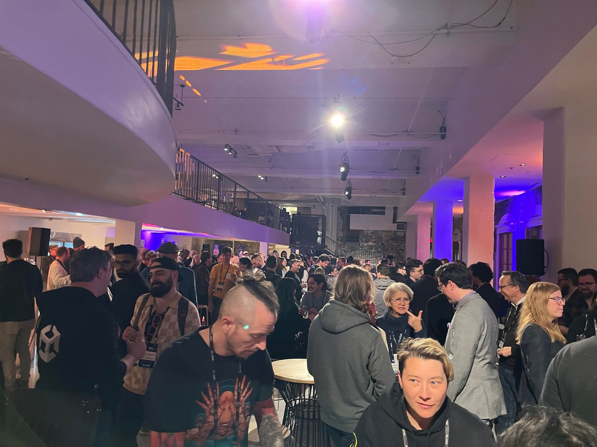
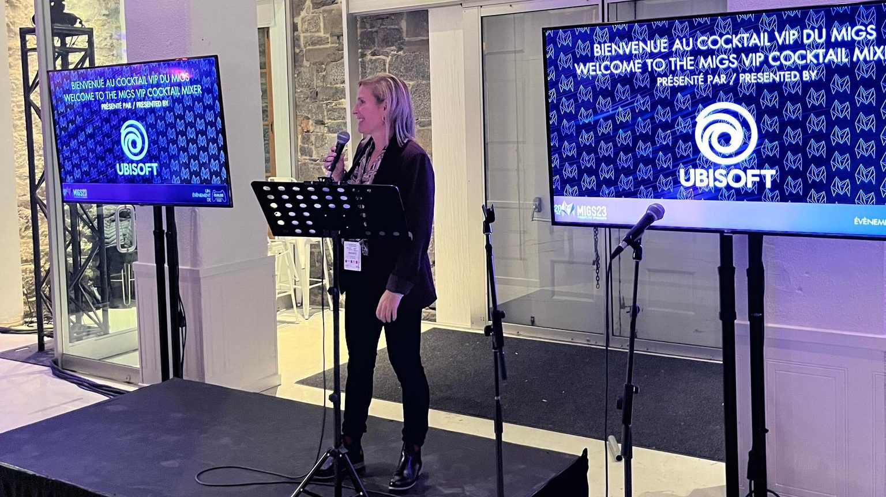
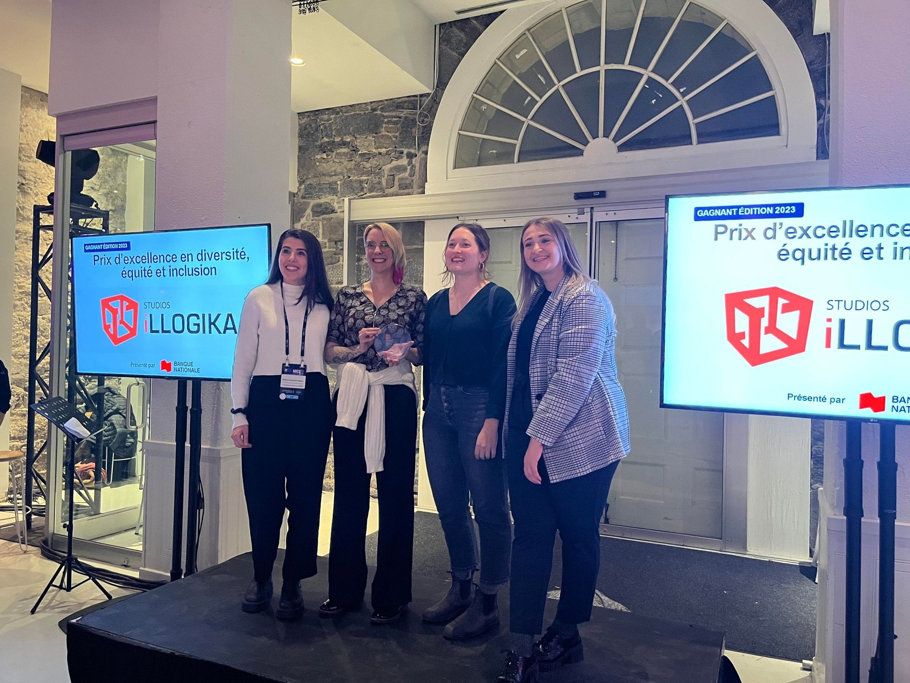

*Image à la une : La Guilde du jeu vidéo du Québec*

**Une collaboration entre la [Guilde du jeu vidéo du Québec](https://www.laguilde.quebec/fr/) et [Ubisoft](https://montreal.ubisoft.com/en/) donne naissance à la Caravane Entrepreneuriale Ubisoft, présentée par la [Banque Nationale](https://www.bnc.ca/). Cette initiative, la première du genre au Canada, promet d’être un catalyseur pour la croissance des développeurs de jeux vidéo indépendants du Québec, grâce à un parcours en quatre étapes offrant formation, réseautage, échanges professionnels et une visibilité publique des studios.**

L’annonce a été faite hier soir dans le cadre du [MIGS](https://migs.biz/fr/), le Montreal International Game Summit, qui rassemble les acteurs de l’industrie du jeu vidéo du Québec et d’ailleurs avec des opportunités de réseautage et des conférences professionnelles, entre autres.

*Les acteurs de l’industrie vidéoludique québécois étaient rassemblés lors du MIGS au Marché Bonsecours*

> « La Caravane entrepreneuriale Ubisoft adresse parfaitement la mission première de La Guilde, qui est le soutien à l’entrepreneuriat et le développement continu des studios indépendants. Grâce à l’appui d’Ubisoft et de la Banque Nationale, cette initiative unique au Canada permettra d’adapter nos programmes afin de mieux répondre aux besoins spécifiques des entreprises à toutes les étapes de leur croissance. »
>
> – Jean Jacques Hermans, directeur général, La Guilde du jeu vidéo du Québec.

> « Ubisoft a toujours été très impliqué dans le développement de l’écosystème du jeu vidéo au Québec, en créant et soutenant différentes initiatives. Avec ce nouveau programme, La Guilde propose aux studios un parcours novateur et une formule plus avancée, qui vient répondre aux besoins d’un écosystème mature et solide. »
>
> – Olivier Delisle, directeur Ubisoft Entrepreneur.

Le parcours sera composé de quatre moments phares durant l’année :

1. **La Caravane à Québec en février**
   L’entrepreneuriat en mode Startup avec des formations et des ateliers interactifs sur la gouvernance, la création et la gestion d’entreprise et le financement.
2. **La Caravane en région en mai**
   L’entrepreneuriat en mode croissance grâce à des ateliers de formation sur le marketing, la mise en marché, la découvrabilité des jeux québécois dans un marché de plus en plus compétitif et la rencontre des étudiants et du grand public dans les régions du Québec.
3. **La Caravane des éditeurs en novembre**
   L’entrepreneuriat en mode commercialisation et partenariat lors d’une rencontre annuelle des éditeurs internationaux avec l’entrepreneuriat local
4. **La Caravane hivernale en décembre**
   Le jeu vidéo tiendra un sommet des dirigeants et ira à la rencontre du public à l’approche des Fêtes (hôpitaux, centres communautaires, etc.) dans le cadre d’initiatives et actions sociales liées à notre expertise et nos produits.

Le programme sera mis sur pied dès 2024 et s’ajoute à l’offre existante de La Guilde du jeu vidéo du Québec. Les informations liées aux inscriptions sont à venir.

## Illogika remporte un prix

Le studio [Illogika](https://www.illogika.com/) s’est vu remettre un prix par la Guilde du jeu vidéo du Québec pour ses efforts en diversité, équité et inclusion.

**À LIRE AUSSI : [Cauchemars d’Octobre : un jeu vidéo sur la Crise d’Octobre](/2023/10/17/cauchemars-doctobre-un-jeu-video-sur-la-crise-doctobre/)**

**À LIRE SUR BÊTA-TESTEUR : [Critique de Robocop : Rogue City](https://www.lebetatesteur.ca/test-robocop-rogue-city/)**
