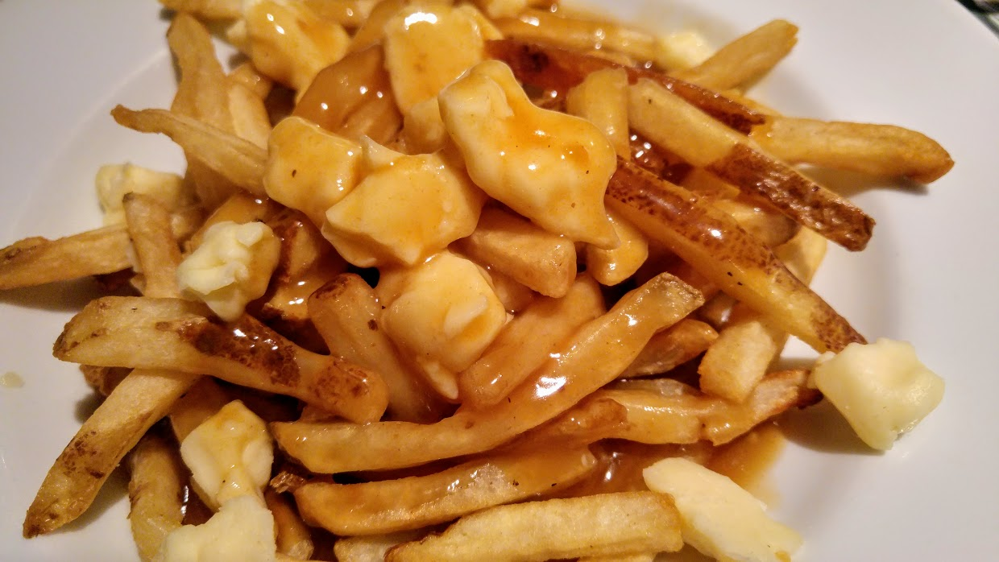
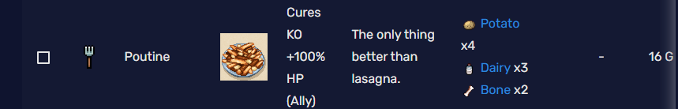
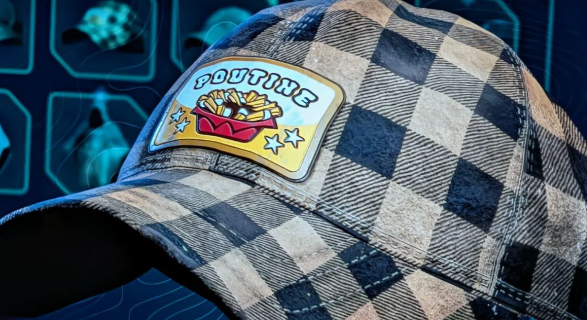
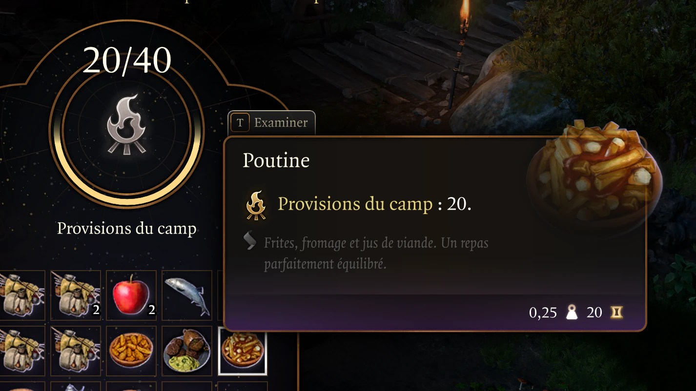
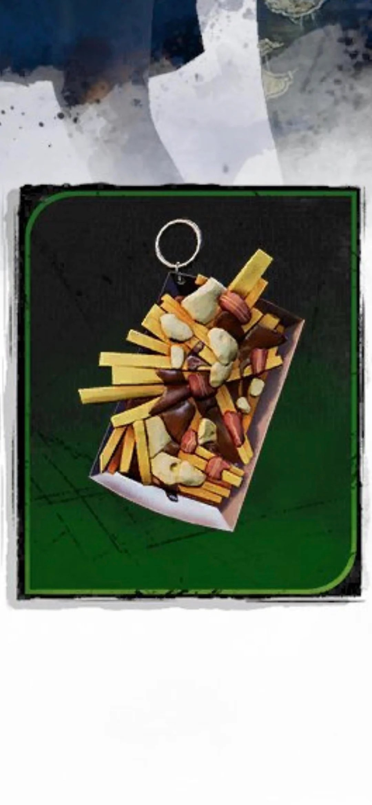
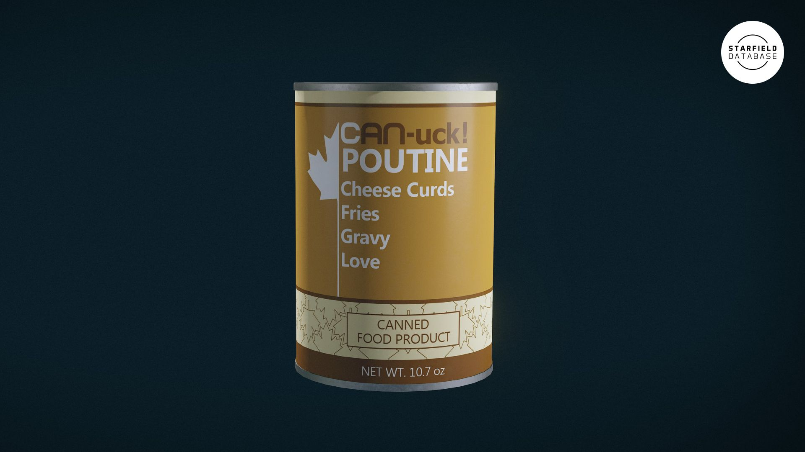

*image à la une : Bethesda*

**Dans le foisonnement de mes intérêts, il y a deux passions qui finissent inévitablement par se croiser : le jeu vidéo et la [poutine](https://en.wikipedia.org/wiki/Poutine). L’un définit mon quotidien, l’autre mon identité culturelle. J’ai eu envie de poser un regard sur ce point de rencontre, là où notre héritage canadien-français s’infiltre dans les mondes virtuels pour y laisser une trace indélébile, un pixel à la fois.**

**credit : [Camelia.boban](https://en.wikipedia.org/wiki/File:Food_at_WIkimanian_2017_02.jpg)**

Pour moi, la poutine est bien plus qu’un *comfort food*. C’est un mélange — un *poutinisme* — qui représente l’histoire des gens d’ici, de ceux qui ont bâti ce coin de pays avec leur résilience et leur simplicité. C’est aussi le reflet de ce que nous sommes devenus : un alliage de cultures différentes qui ont appris à s’unir et à travailler ensemble. La poutine, c’est cette preuve comestible qu’un mélange de plusieurs éléments disparates peut créer quelque chose d’unique et de solide. C’est un plat né de coïncidences qui, aujourd’hui, s’affiche fièrement dans des *blockbusters* mondiaux.

On a parcouru tout un chemin depuis l’époque de [**Jersey Devil**](https://en.wikipedia.org/wiki/Jersey_Devil_(video_game)) sur la première PlayStation. En 1997, on était juste heureux de prouver qu’on pouvait faire des jeux de calibre mondial à Montréal, mais on restait discret sur notre identité. Aujourd’hui, les temps ont changé. Voir notre héritage briller à travers des pixels, c’est la preuve que notre culture est vivante et qu’elle sait se partager sans complexe. Voici mon Top 5 des poutines virtuelles qui font honneur à nos racines.

### **1. [Sea of Stars](https://store.steampowered.com/app/1244090/Sea_of_Stars/) (Sabotage Studio)**

**crédit : Sabotage Studio**

*Sea of Stars* est un succès phénoménal qui prouve que le génie de Québec n’a pas de limites. Au-delà de la performance, c’est l’âme du jeu qui frappe fort, surtout grâce à **Garl**, ce « Warrior-Cook » au grand cœur qui cuisine pour ses amis. Garl, c’est le genre de gars qui serait le premier à débarquer à la **Pataterie dans Hochelaga** pour une poutine *all-dressed*, même si, venant d’un studio de Québec, il est probablement un gars de chez **Ashton** à la base. Au final, qu’elles soient en 4K ou en 2D, toutes les poutines de jeux vidéo sont des amas de pixels. Mais celle de Sabotage, en « vrai » pixel art, est un hommage ultime.

### **2. [Hell is Us](https://store.steampowered.com/app/1620730/Hell_is_Us/) (Rogue Factor)**

**crédit : Rogue Factor**

Étant moi-même chez Rogue Factor, j’ai vu passer la création de la **Poutine Cap** (un bonus via Nacon Connect). Un collègue designer en qui j’ai pleine confiance a glissé **OG Burger à Laval** dans la description comme étant la référence ultime. Je lui ai dit à la blague : « OK, je n’ai pas le choix, faut que j’aille tester ça. » Il a été le premier au courant quand j’y suis finalement allé : c’est effectivement une poutine parfaite. J’ai été tellement convaincu que la photo de mon plat est restée mon fond d’écran au bureau pendant un bon moment. *Note d’expert : OG Burger fait aussi l’un des meilleurs Smash Burgers dans un rayon de 30 km autour de Montréal.*

### **3. [Baldur’s Gate 3](https://store.steampowered.com/app/1086940/Baldurs_Gate_3/) (Larian Studios)**

*crédit : Larian Studios*

Ici, on est dans la poutine « haut de gamme ». Visuellement, ça ressemble à une réduction de bœuf riche et sombre, faite avec un vrai fond de viande. Mais ce qui est encore plus beau, c’est de savoir que c’est l’équipe de **Larian Québec** qui a insufflé ce clin d’œil culinaire au studio principal. Dans l’univers de *Faerûn*, c’est un item de luxe qui fournit **20 fournitures de camp**. Pour que ça donne autant d’énergie à un Paladin, il faut que le fromage ait le fameux « skouik-skouik ». C’est un signe de respect immense de voir notre ADN s’intégrer de façon aussi naturelle dans un jeu de cette envergure.

### **4. [Dead by Dayligh](https://store.steampowered.com/app/381210/Dead_by_Daylight/)t (Behaviour Interactive)**

On ne peut pas parler de l’industrie ici sans saluer Behaviour, une véritable institution montréalaise. Dans leur succès planétaire, ils ont inclus un **« Charm » (Charme)** de poutine. C’est un item cosmétique que tu accroches à ton personnage. On parle d’un jeu avec plus de 60 millions de joueurs; imaginez le nombre de personnes qui voient notre petit bol de carton rempli de sauce partout dans le monde. C’est une façon géniale pour Behaviour de montrer qu’on peut être une puissance mondiale sans oublier d’où l’on vient.

### **5. [Starfield](https://store.steampowered.com/app/1716740/Starfield/) (Bethesda)**

Le cas de la **Can-Poutine** de Bethesda est fascinant. Voir une poutine (même en canne !) dans un jeu de cette envergure, c’est une petite victoire culturelle qui porte la signature de l’équipe de **Bethesda Montréal**. Est-ce que ça sort de la canne comme un bloc gélatineux qu’on doit couper en tranches ? On peut se questionner sur l’état du fromage en l’an 2330, mais on salue le fait d’avoir réussi à mettre un peu de chez nous jusqu’aux confins de la galaxie.

#### **Mentions Honorables**

- **[Outward](https://store.steampowered.com/app/794260/Outward_Definitive_Edition/) (Nine Dots Studio) :** Pour son bonus de résistance au froid, l’analyse la plus juste de notre réalité climatique.
- **[Rainbow Six Siege](https://store.steampowered.com/app/359550/Tom_Clancys_Rainbow_Six_Siege/) (Ubisoft) :** Pour avoir porté notre emblème culinaire sur la scène internationale du esport.

**Le mot de la fin :** À la base, le mot « poutine » signifie un mélange. Et c’est peut-être ça le plus beau : voir des développeurs de toutes les origines s’approprier ce symbole pour en faire un pont culturel. Du grain frais de la **St-Albert** à la **Russet de PEI** double-blanchie, chaque variation est un hommage à notre stabilité culturelle.

Au-delà de la recette, c’est le geste qui compte. Voir ces clins d’œil dans nos jeux préférés, c’est constater que notre industrie a maintenant la maturité nécessaire pour s’afficher avec fierté. Peu importe le moteur graphique ou la complexité du pipeline, tant qu’il y a de la sauce et du fromage frais à l’écran, on se sent un peu plus à la maison. Alors la prochaine fois que vous croisez un bol de frites virtuel, prenez une seconde pour apprécier le travail des dévs d’ici. Bonne game… et bon appétit.

---

En bonus, combien de cannes de poutine ça prend pour briser Starfield? Un YouTuber a fait le test.

https://www.youtube.com/watch?v=9crPbObLop4

**À LIRE AUSSI : [50 jeux vidéo essentiels créés au Québec](https://mariojramos8.wordpress.com/2024/01/26/50-jeux-video-essentiels-crees-au-quebec/)**
