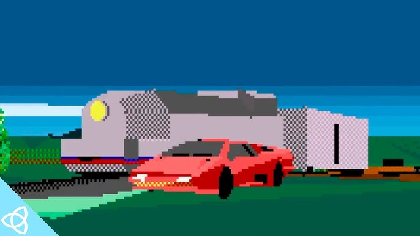

*image à la une : Microsoft*

**Avant de vous sortir mon classement, faut que je vous explique d’où je viens. Le genre « Open World Racing », c’est pas arrivé par magie, pis pour un gars comme moi qui a toujours eu une manette dans les mains, c’est une méchante épopée. Je suis pas un gars de demi-mesures quand on parle d’historique de jeu vidéo ; je les ai vécus, ces jeux-là.**

#### **Mes racines : De Gran Turismo au *sweet spot***

Mon premier contact avec la liberté totale, c’était le polygone pesant de **Test Drive 3** en 1990. C’était le début de de quoi de gros. Plus tard, y’a eu **Test Drive Unlimited (TDU)** qui, selon moi, reste encore à ce jour une des expériences de *lifestyle* les plus complètes. Tu avais le casino, les interactions sociales, le feeling d’habiter l’île… c’était tout un trip. On peut pas passer sous silence l’époque des **Need for Speed Underground** non plus. Quand ils ont ouvert la ville, ça a tout changé : c’était l’époque du *tuning*, du néon, pis de l’ambiance urbaine qui nous a tous accrochés.

*crédit : Accolade*

Je suis un gars de course, point final. Dans le temps, je capotais solide sur **Gran Turismo** 1pis 2. Je les ai torchés d’un bout à l’autre. Je pensais que c’était ça que je voulais, des simu de même, mais au fond je savais que j’étais pas le gars le plus technique au monde. Je cherchais mon *sweet spot*. C’est là que les **Need for Speed** entraient en jeu. Je les ai toutes faites, de la version 3D aux classiques. Je me rappelle être allé chercher **Need for Speed 3** pis **High Stakes** le jour de leur sortie. J’aimais ça, mais il manquait encore une petite affaire.

Quand j’ai entendu dire qu’il y avait une version « arcade » de Forza qui s’en venait, j’ai trouvé ça spécial, mais je m’attendais pas à grand-chose. Je pensais que c’était juste un petit projet de côté de la part de Playground Games, les « new kids on the block » qui arrivaient avec une version arcade de la simulation de Turn 10.

Mais quand j’ai downloadé la démo sur ma Xbox 360, la claque a été instantanée. Dès que la musique a embarqué pis que j’ai vu l’environnement, j’ai compris tout de suite à quoi on avait affaire. Ma première run dans les montagnes du Colorado, avec ce vibe-là complètement électrique… c’était de l’air frais. C’est toute la présentation, l’emballage, l’esthétique qui m’a eu. C’est là que je suis tombé amoureux de la franchise jusqu’à l’os.

#### **Mon Top 5 Personnel**

Avant de commencer, on va mettre de quoi au clair : on parle d’un top 5 de jeux qui sont tous excellents. Tu pourrais fermer tes yeux, en pointer un au hasard, pis tu vas passer une maudite belle soirée. Y’a pas de « mauvais » choix ici, juste des préférences et des émotions différentes.

#### **5. Forza Horizon 2 (Europe du Sud)**

https://www.youtube.com/watch?v=KSgyJqecz-4

Ça me fend le cœur de le mettre en cinquième place parce que c’est loin d’être un mauvais jeu. Le saut technique sur la Xbox One était impressionnant et la Côte d’Azur avait de la gueule. C’est juste que, tristement, il a passé juste après le premier qui m’avait tellement marqué, et il s’est fait rattraper par la suite par trois autres monstres qui ont fini par comprendre comment livrer l’expérience totale avec les expansions et toute la patente. C’est le *middle child* qui n’a pas eu la chance de briller autant qu’il aurait dû, mais ça reste une méchante bonne *ride.*

#### **4. Forza Horizon 3 (Australie)**

https://www.youtube.com/watch?v=wa_rtDcsuzI

L’Australie a tout changé pour le *scope* du jeu. C’est là que le Festival est devenu une affaire mondiale où c’est toi qui décidait. La diversité des biomes, entre la forêt tropicale et le désert, c’était malade. L’expansion **Hot Wheels** a prouvé que Playground n’avait pas peur d’être un peu *wild*. C’était du *fun* pur.

#### **3. Forza Horizon 5 (Mexique)**

https://www.youtube.com/watch?v=W-SpP-Z0Uu8

Le Mexique, c’est techniquement le monde le plus impressionnant de la gang. C’est là qu’on voit le raffinement ultime de leur tech. Ils ont poussé le moteur au bout : la météo dynamique, les tempêtes de sable, la distance d’affichage… c’est du grand art. Il prend le bronze parce qu’il fait tout comme il faut, c’est la formule polie au diamant, même s’il ne réinvente pas la roue.

#### **2. Forza Horizon 4 (Royaume-Uni)**

https://www.youtube.com/watch?v=ipbxICJ3RT4

Celui-là est spécial. On sent que c’est leur « Home Game », fait directement dans la cour arrière de Playground en Angleterre. Y’a un amour évident dans la façon qu’ils ont reproduit la campagne britannique. Le système de saisons qui changeait toute la *map* à chaque semaine, c’était brillant. Les expansions étaient juste débiles. J’ai eu un plaisir fou avec les Treasure Hunts ; c’est honnêtement un de mes jeux préférés de tous les temps.

#### **1. Forza Horizon 1 (Colorado)**

https://www.youtube.com/watch?v=ABk80zm2CUE

Le King. L’original. Il garde la première place à cause de son âme. À l’époque, Playground arrivait avec le moteur solide de Turn 10 (qui semble aujourd’hui rouler sur la ventilation dans le monde de la simu) et ils l’ont garé dans un party. La progression était gratifiante, tu sentais que tu montais les échelons, et l’ambiance était « peak festival ». C’est cet impact-là, ce vent de fraîcheur avec tout l’emballage esthétique, qui a fait que je suis devenu accro. C’est la fondation de tout.

#### **Le Futur : Horizon 6 et le rêve Japonais**

https://www.youtube.com/watch?v=XG1Ll2CVhug

Même si je n’ai pas encore pu y toucher, le hype pour **Forza Horizon 6** est à son maximum. On en a rêvé longtemps, et là, d’amener le festival au Japon, c’est le but ultime pour n’importe quel amateur de char.

Le potentiel est juste démentiel. Entre les autoroutes de Tokyo pour le Wangan style, les cols de montagnes pour le *drift*, et toute la culture *tuning* qui est unique là-bas, Playground a tout ce qu’il faut pour nous jeter par terre. J’ai hâte de voir comment ils vont intégrer l’art urbain et les graffitis pour donner ce feeling un peu plus underground, un peu comme ce qu’on a vu dans **Need for Speed Unbound**. Si **Horizon 6** réussit à marier la science de la conduite avec le vibe du Japon, on tient peut-être mon nouveau numéro 1.

D’ici là, je retourne brûler du *rubber* au Mexique en attendant mon billet pour Tokyo.

On se voit sur la ligne de départ.

**À LIRE AUSSI : [Mojo Party : deux studios montréalais s’associent à WatchMojo pour un jeu de party culture pop](https://mariojramos8.wordpress.com/2026/04/16/mojo-party-deux-studios-montrealais-sassocient-a-watchmojo-pour-un-jeu-de-party-culture-pop/)**
