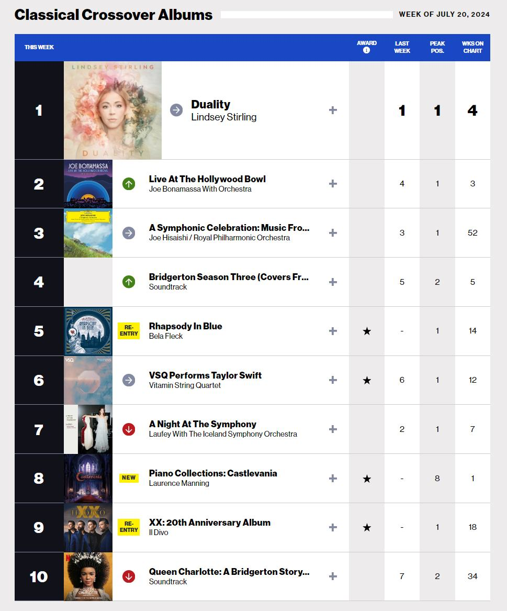

*image à la une : Laurence Manning*

**On a discuté récemment [avec la musicienne québécoise Laurence Manning pour sa contribution à la bande-sonore de Biomorph](/2024/04/11/biomorph-entrevue-avec-la-compositrice-laurence-manning/). Elle a récemment lancé l’album  Piano Collections: Castlevania qui s’est hissé au 8e rang du palmarès Classical Crossover Albums aux États-Unis.**

Le site [viberate.com](https://www.viberate.com/artist/laurence-manning/) la classe également parmi les top 100 artistes de musique classique au Canada.

Castlevania est une franchise de jeux vidéo de fantaisie gothique publiée par Konami, qui est connue, autre autres, pour ses bandes-sonores emblématiques.

Voici d’ailleurs un extrait de l’album Piano Collections : Castlevania de Laurence Manning. Il s’agit de la pièce Moonlight Nocturne tirée du jeu Castlevania : Symphony of the Night.

https://www.youtube.com/watch?v=CMs4hY4nzAw

L’album est produit aux États-Unis par [Materia Collective](https://materia.to/PianoCastlevania), et la distribution au Canada est assurée par [Very Ok Vinyl.](https://www.veryokvinyl.com/products/piano-collections-castlevania?fbclid=IwZXh0bgNhZW0CMTEAAR0WnZXu5yzi9u4-aQ4wyrDvrlrAA29xeUuKw_F_sXO-YkmKELvHEhwHmpM_aem_ZhuJZVxkQDAbUrMyEq5Q4w) L’album est disponible en format numérique sur diverses plateformes ainsi qu’en format physique en CD et vinyle.

**À LIRE AUSSI : [Unknown 9 : présentation de la jouabilité](/2024/07/20/unknown-9-presentation-de-la-jouabilite/)**
