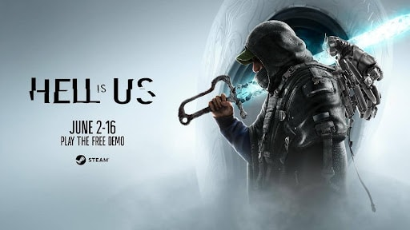
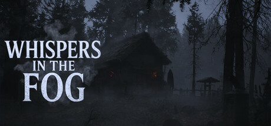
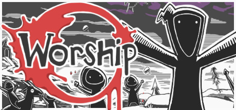
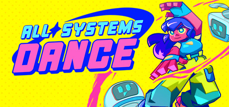
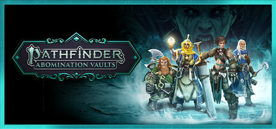
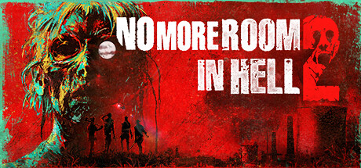
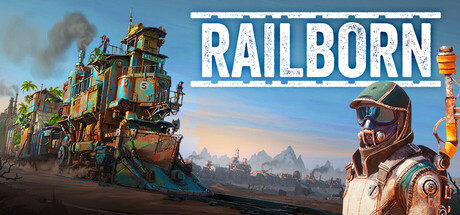
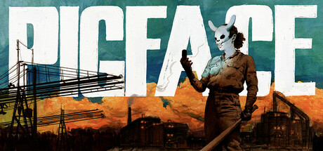

Le *Summer Games Fest* 2025 a été le théâtre de révélations captivantes pour les amateurs de jeux vidéo, particulièrement en mettant en lumière le talent des studios canadiens. De nouveaux titres prometteurs ont fait leur apparition, offrant une multitude d’expériences immersives et innovantes. Voici les jeux canadiens qui ont marqué cet événement :

1. **Hell is Us** – Rogue Factor

Développé par Rogue Factor à Montréal, **Hell is Us** offre une expérience de jeu unique avec des puzzles environnementaux et une interface utilisateur minimaliste. Le jeu se distingue par ses « Hollow walkers », des entités terrifiantes et une expérience d’enquête et de survie.

Premières impressions : Un univers sombre avec des couleurs maussades, soulignant le suspense et l’intensité de l’expérience de jeu.

PS: Vous pouvez actuellement **[jouer à la démo](//install/3623800)** de Hell is Us sur Steam!

Plateformes: PC, PS5, and Xbox Series X|S

https://www.youtube.com/watch?v=XYwiPfm6AyQ

2. **Scott Pilgrim EX** – Tribute Games

Développé par Tribute Games, basé à Montréal, Québec, **Scott Pilgrim EX** marque le retour tant attendu de Bryan Lee O’Malley dans l’univers vidéoludique. Ce jeu de combat en coopération conserve l’esthétique rétro qui a séduit les fans, tout en promettant une expérience fraîche et dynamique. Disponible sur PC, Nintendo Switch, PlayStation 5 et Xbox Series X|S, sans date de sortie précise annoncée, ce titre est à surveiller de près.

Premières impressions : Une ambiance sonore techno/rétro punk et une direction artistique colorée en pixel art qui capturent parfaitement l’univers de Scott Pilgrim. La bande-annonce promet une aventure pétillante mettant en vedette Scott et sa copine.

Plateformes: PS4, PS5, Xbox One, Xbox Series X/S, Nintendo Switch, Nintendo Switch 2, et PC

https://www.youtube.com/watch?v=xmhDqlzJ840

3. **Killer Inn** – Tactic Studios

**Killer Inn** est un jeu d’action multijoueur en ligne, développé par Tactic Studios (basé à London, Ontario) et publié par Square Enix. Rappelant l’ambiance de *And Then There Were None* d’Agatha Christie ainsi que le jeu de table *Les Loups-Garous* de Thiercelieux, Killer Inn plonge les joueurs dans une intrigue de meurtre et mystère où ils doivent démasquer les tueurs qui se cachent entre eux, ou, éliminer toutes les victimes insoupçonnées sans être démasqués.

Premières impressions : Dans une ambiance digne de “10 petits nègres”, les joueurs collectent des indices laissés par les victimes pour résoudre le mystère. Un jeu incontournable pour les amateurs de suspense.

Plateforme: Steam

[Regarder la bande-annonce sur YouTube](https://www.youtube.com/watch?v=sDoF1yyQxM0&pp=ygUSS2lsbGVyIElubiB0cmFpbGVy)

4. **ILL** – Team Clout

**ILL**, développé par Team Clout de Calgary, Alberta, est un jeu d’horreur de survie qui promet de terrifier les joueurs avec ses créatures horrifiques et une ambience qui ne pourra que vous tourmenter. Disponible sur PC, PS5, et Xbox Series X|S, c’est un incontournable pour les fans d’horreur et de frissons.

Premières impressions : Une atmosphère oppressante et des environnements glaçants le sang qui rappellent le premier Outlast. Une expérience intense pour ceux qui souhaitent tester leur sang-froid.

Plateformes: PC, PS5, et Xbox Series X|S

https://www.youtube.com/watch?v=ZBPi85S2MmA

5. **Whispers in the Fog** – Pascale Scionti

Développé par le développeur solo Pascale Scionti basé à Toronto, **Whispers in the Fog** est un simulateur de marche qui met l’accent sur l’atmosphère et l’exploration. Avec une conception sonore immersive et un système climatique dynamique, ce jeu invite les joueurs à découvrir les mystères d’une forêt sombre.

Premières impressions : Une ambiance diégétique raffinée où le mystère règne en maître. Avec seulement une lampe torche pour compagnie, les joueurs explorent les bois pour reconstituer les souvenirs d’un protagoniste sur fond de mélodies mélancoliques.

Plateforme: PC

https://www.youtube.com/watch?v=UF5p3ipgRZM

6. **Grounded 2** – Eidos-Montréal & Obsidian Entertainment

Développé en collaboration entre Eidos-Montréal et Obsidian Entertainment, Grounded 2 propose une aventure de survie en monde ouvert où les joueurs, réduits à la taille d’une fourmi, doivent explorer un parc devenu immense, seul ou en coopération. Armes, armures et constructions seront vos meilleurs alliés pour faire face aux dangers, notamment des insectes peu sympathiques…

Premières impressions : Un jeu à la croisée d’*It Takes Two* et *Honey, I Shrunk the Kids*, avec un monde riche à explorer en mode co-opération. Avis aux gens qui ne sont pas fans d’insectes: ce jeu ne sera probablement pas pour vous.

Plateformes : Xbox et Steam

https://www.youtube.com/watch?v=q0HQNOtg1WI

7. **Gears of War: Reloaded** – The Coalition Studio

Développé par The Coalition Studio à Vancouver, Gears of War: Reloaded est une version remastérisée du classique culte. Graphismes 4K, 120 FPS, cross-play et progression multiplateforme pour une expérience modernisée.

Premières impressions: Une pépite d’or pour les fans de longue date, et une superbe porte d’entrée pour les joueurs n’ayant pas grandi avec la franchise Gears of War. Mention spéciale pour le mode **co-op en écran partagé** – devenu plutôt rare de nos jours.

Plateformes : Xbox, PlayStation et PC

https://www.youtube.com/watch?v=dSTd3ClMRp8

8. **At Fate’s End** – Thunder Lotus Games

Jeu d’action-aventure développé à Montréal par Thunder Lotus Games, *At Fate’s End* vous place dans la peau de Shan, une héritière armée d’une épée divine, dans un récit tragique où chaque duel familial fait avancer l’histoire.

Premières impressions: Une direction artistique envoûtante, façon dessin animé, des mécaniques originales de combat et une ambiance mystique renforcée par une bande sonore hypnotique.

Plateformes : Steam, Epic Games, PS5, Xbox Series X|S, Xbox Game Pass

https://www.youtube.com/watch?v=XuXlG-xjENc

9. **Worship** – Chasing Rats Games

Développé à Montréal, Worship est un roguelike multijoueur dans lequel vous menez un culte en l’honneur d’un dieu terrifiant. Inspiré de Pikmin avec une touche sanglante.

Premières impressions: Un croisement déjanté entre *Pikmin* et *Cult of the Lamb*, avec un humour noir efficace et un brin sanglant.

Plateformes : PC (consoles à confirmer)

https://www.youtube.com/watch?v=amCDP3ISTik

10. **Ambrosia Sky** – Soft Rains

Développé à Toronto, *Ambrosia Sky* est un jeu narratif de nettoyage haute pression, se déroulant dans un univers de science-fiction immersif.

Premières impressions: Un jeu unique, un look singulier,  plus artsy que ce dont on s’Attend d’un jeu de science-fiction. Si Dead Space avait une version plus « relaxe » en mode « je nettoie le carnage » sans combat, ça aurait probablement l’air d’Ambrosia Sky (sans le côté gore de Dead Space). J’ai bien hâte de l’essayer!

Plateformes : Steam

https://www.youtube.com/watch?v=ow_SGYtci1o

11. All Systems Dance – Mighty Yell

Studio basé à Toronto, Mighty Yell propose un jeu d’aventure musical où la danse devient une arme de révolution dans un monde dystopique.

Premières impressions: L’esthétique *Jet Set Radio Future*, les rollerblades et une palette colorée en mode années 80 / 90 apportent une énergie folle à ce jeu de rébellion dansée.

Plateformes : Steam

https://www.youtube.com/watch?v=UN2XI8oHwSU

12. Generation Exile – Sonderlust Studio

Dans ce jeu de stratégie narrative au tour par tour, vous devez maintenir l’équilibre fragile d’un vaisseau générationnel à la dérive.

Premières impressions: Un city-builder narratif qui rappelle vaguement *Astroneer* avec une direction artistique plus réaliste et mature.

Plateformes : Steam

https://www.youtube.com/watch?v=iJYSNgQz2lI

13. Pathfinder: Abomination Vaults – BKOM Studios

Développé à Québec, ce jeu coopératif *hack and slash* vous plonge dans les profondeurs du donjon de Gauntlight avec des héros emblématiques de *Pathfinder*.

Premières impressions: Un *dungeon crawler* indispensable pour les fans de TTRPG. Tout bon fan de RPG (n’ayant pas joué au TTRPG Pathfinder) devrait découvrir la franchise Pathfinder.

Plateformes : Steam, Epic Games

https://www.youtube.com/watch?v=YrqEYEn-lYc

14. No More Room in Hell 2 – Torn Banner Studios

Studio de Toronto, Torn Banner nous livre un FPS coopératif horrifique où chaque mission dans un monde infesté de zombies est unique… et mortelle.

Premières impressions: Si Métro et Dying Light s’étaient associés pour faire un jeu de zombies, ça donnerait No More Room in Hell 2.

Plateformes : Steam, Epic Games

https://www.youtube.com/watch?v=Vdhcf4ddkDM

15. Railborn – Washbear Studio

Un jeu de survie original développé en Ontario, où vous construisez votre base… sur un train !

Premières impressions: Un concept de crafting mobile et évolutif, unique en son genre, qui fait voyager tout en gérant ses ressources.

Plateformes : Steam

https://www.youtube.com/watch?v=jXRIdOkR19A

16. PIGFACE – titolovesyou

Jeu d’action horrifique développé en Ontario, *PIGFACE* vous place dans la peau d’Exit, une femme au passé sanglant, contrainte d’accomplir des missions brutales.

Premières impressions: FPS intense, glauque et gore, parfait pour se défouler dans un univers tordu.

Plateformes : Steam

https://www.youtube.com/watch?v=yc7g9OIbGME

17. Paralives – Alex Massé and team

Ce simulateur de vie développé à Montréal permet aux joueurs de créer leur maison idéale et de gérer leur quotidien.

Premières impressions: *Paralives* est ce que les fans de *Sims* attendaient depuis des années : plus de liberté, plus de personnalisation, plus d’âme. Les visuels sont très doux, jolis, et ça promet d’être LE jeu *cozy* parfait pour l’hiver 2026.

Plateformes : Steam

https://www.youtube.com/watch?v=uvGPV6qQuQM

18. Capy Castaway – Kitten Cup Studio

Dans cette aventure adorable, un bébé capybara et son ami corbeau tentent de retrouver leur chemin vers la maison.

Premières impressions: Un jeu *cozy*, attendrissant et parfait pour jouer en famille.

Plateforme : Steam

https://www.youtube.com/watch?v=x8koRYBcBQY

---

Le *Summer Games Fest* 2025 a clairement confirmé le dynamisme et la créativité des studios canadiens, promettant une année riche en découvertes pour les amateurs de jeux vidéo.

Quels ont été les jeux qui vous ont le plus surpris, annoncés au S*ummer Game Fest*?
