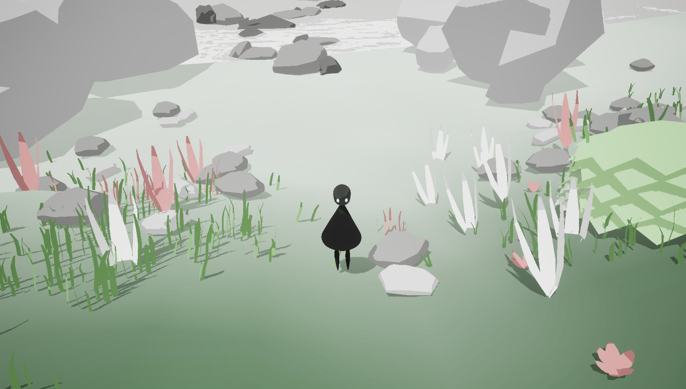
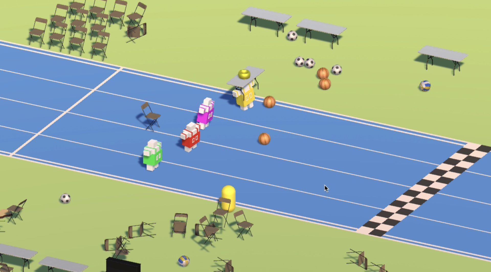
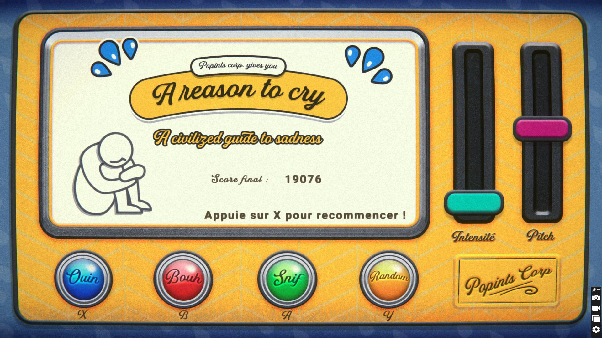

*image à la une : Game Jam de Québec*

**L’effervescence créative s’empare à nouveau de la capitale nationale alors que le [Game Jam de Québec](https://www.gamejamdequebec.ca/) annonce son retour pour une troisième édition. Du 4 au 6 octobre 2024, une soixantaine de passionnés se réuniront à [La Console – Interface humaine](https://www.laconsole.org/), au cœur du quartier Saint-Roch, pour relever un défi de taille : créer un jeu vidéo fonctionnel en seulement 48 heures.**

Cet événement unique dans la région se distingue par son approche coopérative plutôt que compétitive. Les participants, répartis en équipes de quatre, bénéficieront d’un cadre exceptionnel pour laisser libre cours à leur créativité. Au programme : un lieu de création inspirant, des repas gratuits fournis par des restaurateurs locaux et l’accompagnement de mentors reconnus de l’industrie.

Dans un contexte économique difficile pour le secteur du jeu vidéo, le Game Jam de Québec offre une opportunité précieuse de réseautage et d’échange entre professionnels.

Les amateurs de jeux vidéo ne seront pas en reste : une soirée Joue et jase se tiendra le 16 octobre à 18h, permettant au public de découvrir et d’essayer les créations des participants. Les jeux seront également disponibles sur la plateforme [itch.io](https://itch.io/).

Il est d’ailleurs possible d’aller [essayer les jeux de l’édition 2023.](https://itch.io/jam/game-jam-de-quebec-2023) Dans les coups de coeur de cette édition, on peut compter **A reason to cry**, **Can you wash the sins of your father** et **Chroma**.

*Chroma par Misault*

*Can you was the sins of your father par vincentcj*

*A reason to cry par La Maison du Jeu vidéo*

Pour plus d’informations, rendez-vous sur le site [gamejamdequebec.ca](https://www.gamejamdequebec.ca/) ou sur les réseaux sociaux de l’événement.

**À LIRE AUSSI : [Critique – Roots of Yggdrasil : une odyssée nordique entre stratégie et survie](/2024/09/05/critique-roots-of-yggdrasil-une-odyssee-nordique-entre-strategie-et-survie/)**
