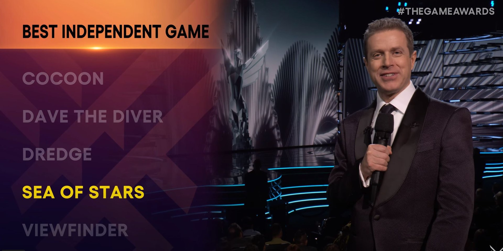
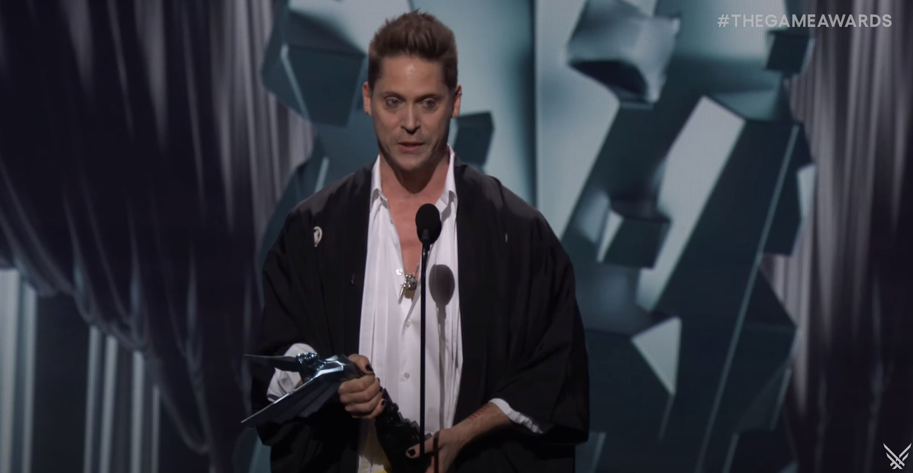

*Image à la une : Game Awards*

**C’est hier soir à Los Angeles que se déroulait les Game Awards, qui visent à récompenser ce qui se fait de mieux au cours de l’année en jeux vidéo. Le Québec a fait bonne figure notamment avec le jeu Sea of Stars de Sabotage Studio et Baldur’s Gate 3 développé en partie chez Larian Québec.**

## Sea of Stars : meilleur jeu vidéo indépendant

Le jeu de rôle [Sea of Stars](/2023/08/30/sea-of-stars-100-000-copies-vendues-en-24-heures/) était nommé dans les catégories meilleur jeu de rôle et meilleur jeu indépendant. C’est le trophée pour cette dernière catégorie qu’a remporté Sabotage Studio.

## Baldur’s Gate 3 : le jeu de l’année

[Baldur’s Gate 3](/2023/08/14/baldurs-gate-iii-un-succes-retentissant-en-partie-fait-a-quebec/) est également un jeu de rôle se campant dans le mythique univers des Forgotten Realms de Dungeons and Dragons. Développé par une équipe internationale avec des studios à travers le monde, dont un dans la ville de Québec. Baldur’s Gate 3 a remporté le titre de jeu de l’année, mais a également remporté une volée d’autres catégories, notamment meilleur jeu de rôle et meilleure interprétation par l’acteur Neil Newbon.

**Vous pouvez regarder l’intégralité des Game Awards ici :**

https://www.youtube.com/watch?v=Zu2z5M4gmno

**À LIRE AUSSI : [5 choses à savoir sur Sea of Stars](/2023/08/21/5-choses-a-savoir-sur-sea-of-stars/)**

**À LIRE SUR BÊTA-TESTEUR : [Baldur’s Gate 3 enfin disponible sur Xbox Series](https://www.lebetatesteur.ca/baldurs-gate-3-dispo-xbox-series/)**
