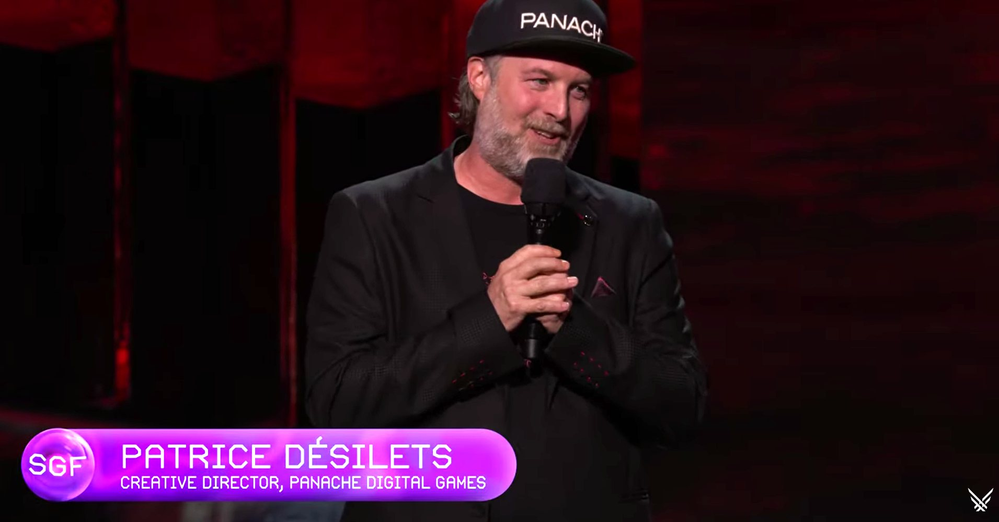
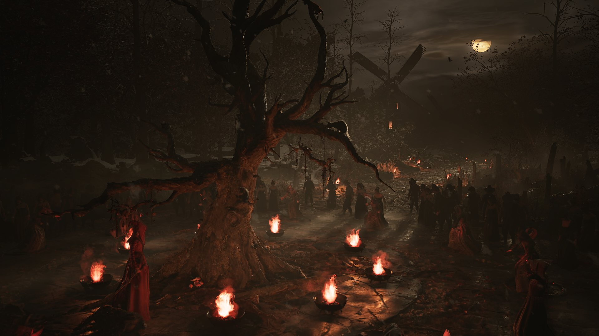
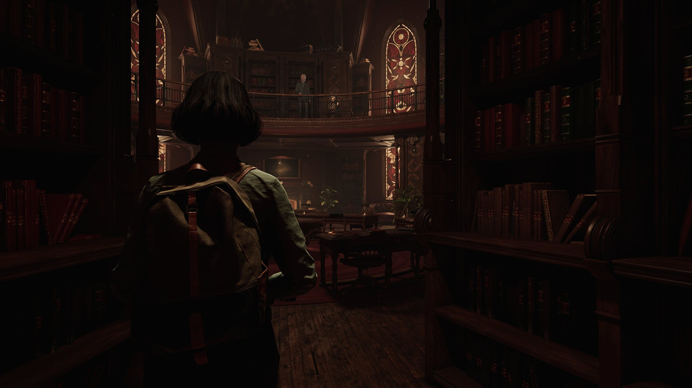
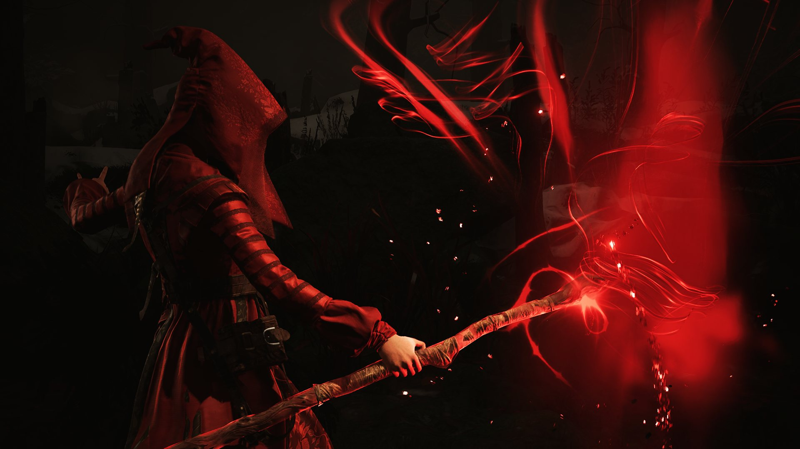
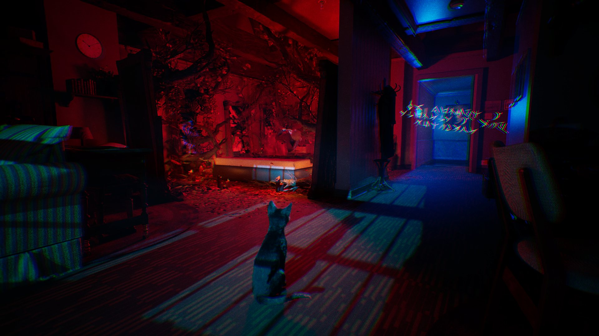

*images gracieuseté de Panache Jeux numériques*

**Le studio montréalais [Panache Jeux numériques](https://panachedigitalgames.com/) a présenté enfin un premier aperçu de [1666 : Amsterdam](http://1666amsterdam.com). Le dévoilement a lieu hier dans le cadre du Summer Games Fest, et les 30 premières minutes du jeu sont déjà offertes **gratuitement** sur [Steam](https://store.steampowered.com/app/3949550/1666_Amsterdam/) et l’[Epic Games Store](https://store.epicgames.com/p/1666-amsterdam-c057d4?lang=en-US).**

Bien que ***[Ancestors : The Humankind Odyssey](https://store.steampowered.com/app/536270/Ancestors_The_Humankind_Odyssey/)*** ait été le premier jeu développé par **Panache Jeux Numériques**, l’histoire de ***1666: Amsterdam*** remonte à avant même la fondation du studio.

Pour rappel, l’annonce de ***1666: Amsterdam*** est l’aboutissement d’une épopée qui a commencé une quinzaine d’années alors que Patrice Désilets, co-fondateur de **Panache Jeux Numériques**, développe une première version du jeu chez **THQ Montréal**. Dans la foulée de la faillite de **THQ**, **Ubisoft** rachète leur studio montréalais, et éventuellement licencie Désilets. Il s’ensuit une saga judiciaire pour les droits de la propriété intellectuelle du jeu, qui se réglera finalement à l’amiable; **Ubisoft** restitue les droits à son idéateur.

**Image tirée du Summer Game Fest 2026 diffusée sur la chaîne YouTube de The Game Awards**

On peut imaginer que le « *Panache, câlisse !* » lancé par Patrice Désilets sur la scène du Summer Game Fest était plus que cathartique.

https://www.youtube.com/watch?v=6nUzNiiCi2Q

## Sorcellerie et uchronie dans l’Amsterdam du XVIIe siècle

***1666 : Amsterdam*** est un jeu d’action-aventure à la troisième personne se déroulant au XVIIe siècle, en plein Âge d’or néerlandais, mais dans une version uchronique où l’histoire a pris un autre chemin. On y suit Noa Brooklyn, descendante d’une longue lignée de Zaindaris, des gardiens chargés de préserver l’équilibre du monde. Son rôle depuis la naissance : devenir Perceptrice et reprendre un immense pouvoir accordé il y a 333 ans aux Originaux, qui ne se laisseront pas faire. Elle ne sera pas seule dans cette quête : Aaron, un chat, l’accompagnera.

Ayant mobilisé près de 70 personnes, le jeu se décrit comme sombre, unique et envoûtant.

## Le père d’Assassin’s Creed et un catalogue qui force le respect

Derrière le projet, deux cofondateurs au parcours imposant : **Patrice Désilets**, l’idéateur original d’*Assassin’s Creed* et directeur créatif de *Prince of Persia : The Sands of Time*, et **Jean-François Boivin**, vétéran de plus de 20 ans dans l’industrie, notamment associé à *Star Wars*, *Splinter Cell* et *Assassin’s Creed* également.

Leur premier titre, [*Ancestors : The Humankind Odyssey*](https://ancestorsgame.com/fr/), s’est écoulé à plus de 2,5 millions d’exemplaires depuis 2019.

## 100 % québécois, y compris la musique

Panache s’associe à l’éditeur montréalais [Gambit Digital](https://www.gambitdigital.ca/) pour les services d’édition additionnels. La musique originale est signée **[Jorane](https://www.youtube.com/@joranemusic)**, la violoncelliste et vocaliste québécoise reconnue mondialement.

La sortie en *Accès Anticipé*, est prévue **plus tard en 2026**.

---

**📚 À LIRE AUSSI : [50 jeux vidéo essentiels créés au Québec](https://mariojramos8.wordpress.com/2024/01/26/50-jeux-video-essentiels-crees-au-quebec/)**
