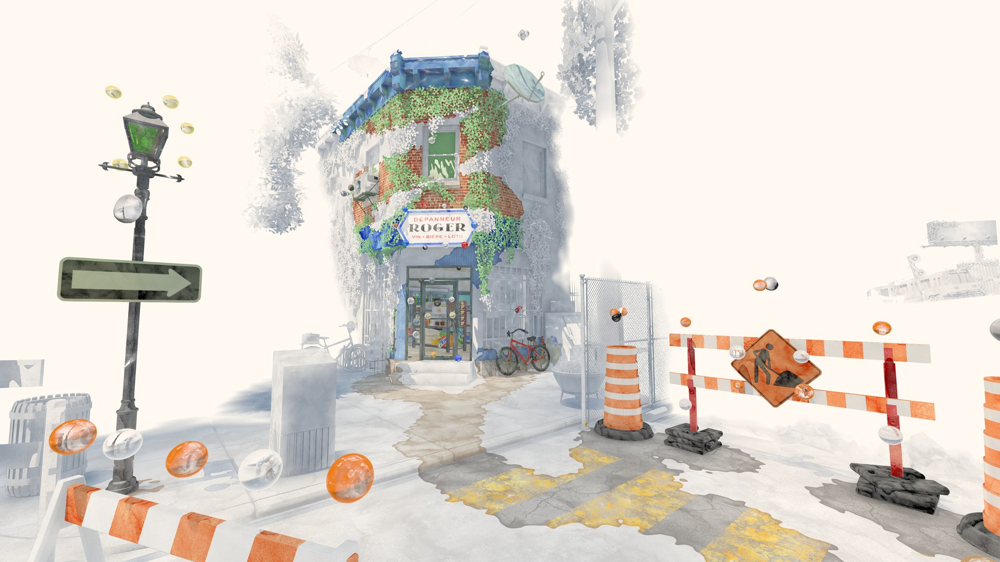
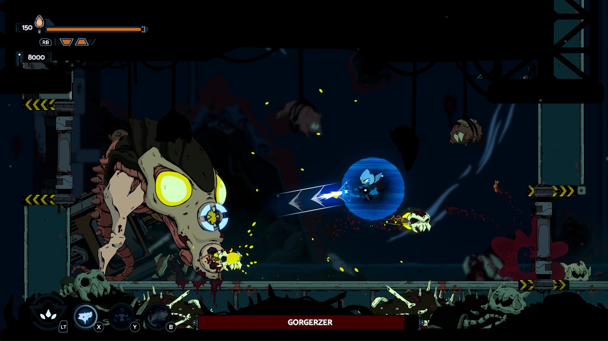

*image à la une : gracieuseté des Canadian Game Awards*

**Les [Canadian Game Awards](https://cgameawards.com/) ont dévoilé aujourd’hui la liste des nommés pour leur édition 2025, qui se tiendra le 15 février prochain au TIFF Lightbox de Toronto. Cette année, l’industrie québécoise du jeu vidéo se distingue particulièrement avec pas moins de 20 nominations, démontrant la vitalité du secteur dans la Belle Province.**

Parmi les nominations majeures, le jeu **[Biomorph](/2024/04/11/biomorph-entrevue-avec-la-compositrice-laurence-manning/)** du studio montréalais Lucid Dreams et **[Été](/2024/08/21/critique-ete-ruelles-et-colimacons/)** du studio Impossible se retrouvent tous deux en lice pour le prestigieux titre de Jeu de l’année. **Behaviour Interactive**, autre fleuron québécois, est quant à lui nommé dans la catégorie Studio de l’année.

*Été de Impossible*

**Dragon Age : The Veilguard** de BioWare domine les nominations techniques avec sa présence dans six catégories, notamment Meilleure direction artistique, Meilleur design de jeu, et Meilleure trame sonore. Le jeu indépendant **Balatro** se démarque également avec plusieurs nominations, dont Meilleur design de jeu et Meilleure innovation technologique.

L’événement **BLAST R6 Major Montreal 2024** figure parmi les événements esports nommés, soulignant l’importance grandissante de Montréal sur la scène compétitive internationale.

*Biomorph de Lucid Dreams Studio*

La cérémonie des Canadian Game Awards s’impose comme une vitrine essentielle pour l’industrie canadienne du jeu vidéo, mettant en lumière la créativité et l’innovation des studios de tout le pays. La présence marquée des studios québécois dans les nominations témoigne de la position de leader de la province dans l’industrie du jeu vidéo en Amérique du Nord.

## **Liste complète des nominations par catégorie :**

**Meilleure direction artistique**

- Lil Guardsman
- Été
- Dragon Age: The Veilguard
- 1000xRESIST
- Venture to the Vile

**Meilleur design de jeu**

- Balatro
- Été
- Dragon Age: The Veilguard
- Beastieball
- The Outlast Trials

**Meilleure bande sonore**

- Lil Guardsman
- Été
- Dragon Age: The Veilguard
- 1000xRESIST
- Spirit City: Lofi Sessions

**Meilleur scénario**

- Lil Guardsman
- Times & Galaxy
- Dragon Age: The Veilguard
- 1000xRESIST

**Meilleure performance**

- Humberly González (Star Wars: Outlaws)
- Nhi Do (1000xRESIST)
- Gordon Little (Moving Houses)
- Matthew Mercer (Dragon Age: The Veilguard)

**Meilleur design sonore**

- Lil Guardsman
- Été
- Dragon Age: The Veilguard
- 1000xRESIST
- Balatro

**Meilleure technologie/innovation**

- Times & Galaxy
- Moving Houses
- Dragon Age: The Veilguard
- Homeworld 3
- Balatro

**Meilleur premier jeu indépendant**

- Spiral
- Été
- 1000xRESIST
- Nightingale
- Balatro

**Meilleur nouveau studio**

- LocalThunk (Balatro)
- Folklore Games (Spiral)
- Sunset Visitor (1000xRESIST)
- Inflexion Games (Nightingale)
- Impossible (Été)

**Studio le plus innovant**

- Lucid Dreams Studio (BIOMORPH)
- BioWare (Dragon Age: The Veilguard)
- Red Barrels (The Outlast Trials)
- Folklore Games (Spiral)

**Joueur esport de l’année (joueur né au Canada ou représentant le Canada)**

- Sarah_frags
- Twistzz
- Scarlett
- TenZ
- Arteezy

**Organisation esport** **l’année**

- Lazarus Esports
- Toronto Defiant
- Toronto Ultra
- Luminosity Gaming
- Shopify Rebellion

**Événement esport** **de l’année**

- Electric Clash Tekken World Tour Challenger Event
- Toronto Ultra Major III Tournament 2024
- Bell Esports Challenge
- Call of Duty League: Stage 3 Major
- BLAST R6 Major Montreal 2024

**Créateur de contenu/émission de l’année**

- GHOST Cece
- NickEh30
- Aiekillu
- AshleyRoboto
- Shroud
- Pokimane

**Jeu de l’année**

- BIOMORPH
- Lil Guardsman
- Été
- Balatro
- Dragon Age: The Veilguard
- 1000xRESIST

**Studio de l’année**

- Hilltop Studio
- Inflexion
- LocalThunk
- Behaviour Interactive
- Bioware

**À LIRE AUSSI : [La Guilde du jeu vidéo du Québec dévoile sa nouvelle image de marque](/2024/12/16/la-guilde-du-jeu-video-du-quebec-devoile-sa-nouvelle-image-de-marque/)**

**À lire sur Bêta-Testeur : [Les meilleurs jeux vidéo de 2024](https://www.lebetatesteur.ca/les-10-meilleurs-jeux-video-de-2024-a-posseder-dans-sa-ludotheque-selon-paskal/)**
