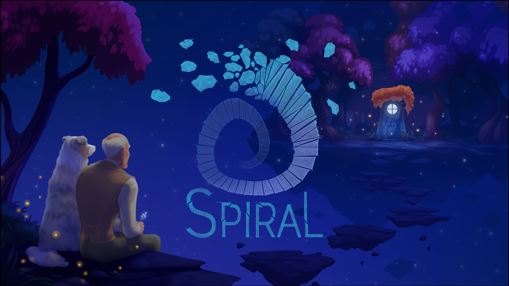
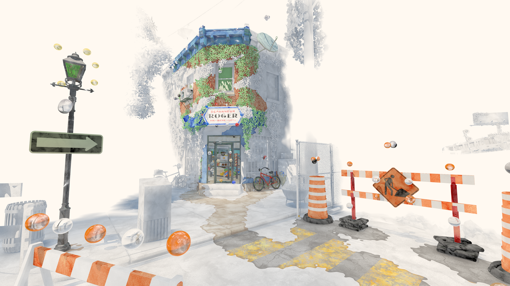
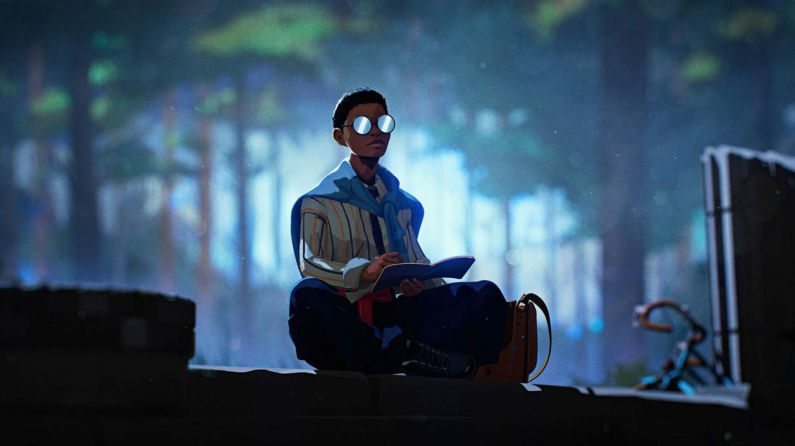
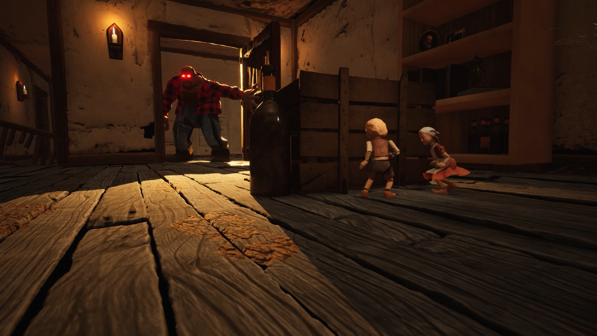
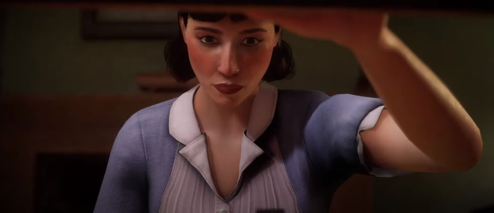
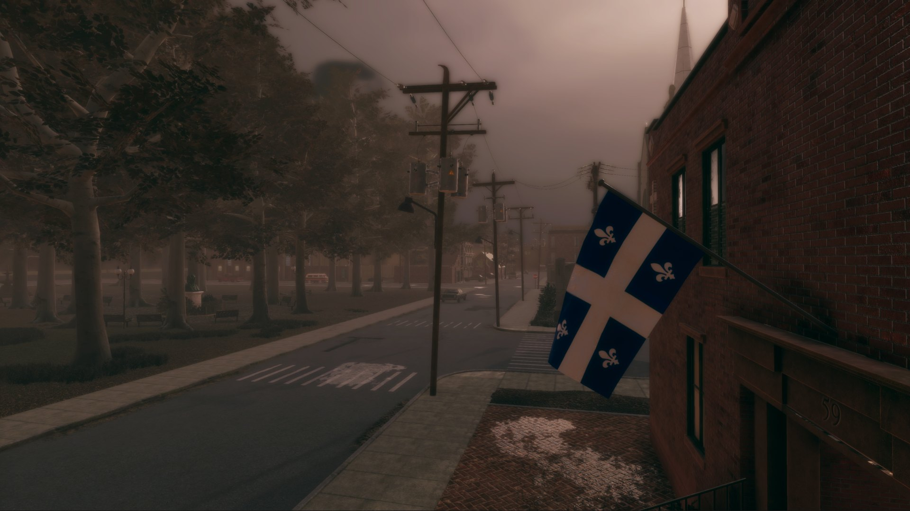

*image à la une : Lowbirth Games, Studio Chien d’Or, Impossible, Unreliable Narrators*

**Il y a maintenant près de 30 ans que Bernard Landry, alors Ministre d’État de l’Économie et des Finances sous le gouvernement de Lucien Bouchard, posait les bases d’une industrie qui allait devenir majeure au Québec : celle du jeu vidéo. L’industrie vidéoludique québécoise est peut-être née avec l’arrivée de compagnies étrangères, aujourd’hui elle est composée à 86% de propriété québécoise. C’est près de 300 studios qui sont donc créateurs de propriétés intellectuelles québécoises, c’est à dire de patrimoine québécois.**

Durant ces 30 dernières années, l’industrie a beaucoup évolué, les jeux vidéo aussi, mais qu’en est-il de la couverture des médias d’informations généralistes? Elle s’est étrangement étiolée.

On peut penser à la disparition d’émissions spécialisées telles que M.Net, la fermeture de plateformes web dédiées telles que [RDS Jeux vidéo](/2024/03/03/rds-jeux-video-une-retrospective/) (dont j’étais coordonnateur au contenu, en toute transparence), entre autres. Dans les grands médias, les chroniques et sections dédiées ont vu leur espace constamment amenuisé, compressé, relegué au fin fond « de la classe. »

Chaque fois qu’un jeu vidéo fait parler de lui dans la presse au Québec, on le retrouve invariablement dans les pages technologiques, entre l’annonce du prochain iPhone ou les dernières annonces de Meta. On retrouve parfois aussi le jeu vidéo dans la section des finances quand il est question de performance commerciale, de l’arrivée d’un studio majeur étranger ou les aléas du marché de l’emploi.

*Two Falls (Nishu Takuatshina) de Unreliable Narrators nous fait découvrir à travers ses personnages la complexité de la relation entre les Premières Nations et les colons européens dans la Nouvelle-France du 17e siècle.*

Le jeu vidéo est-il une technologie plus que le cinéma, la littérature, la musique? Il faut un ordinateur ou une console pour y jouer, oui, mais place-t-on un film dans la section techno parce qu’il nécessite un projecteur pour être visionné ? Un livre numérique dans les pages techno parce qu’il se lit sur une tablette ou le dernier album d’un chansonnier québécois parce qu’on l’écoute sur Spotify?

Tout comme le cinéma, le jeu vidéo est né comme une curiosité technologique, un divertissement purement insolite qui n’avait d’autre but que d’impressionner avec l’illusion du mouvement par la projection rapide d’images fixes.

Aujourd’hui, le jeu vidéo et le cinéma ont en commun d’être des formes d’art qui font appel à l’expertise de nombreux artistes et techniciens de différentes spécialisations et corps de métiers.

*Spiral de Folklore Games aborde avec poésie et délicatesse la maladie d’Alzheimer.*

Le jeu vidéo, c’est aussi un moyen de communication et un moyen d’expression qui permet même d’explorer notre identité québécoise et notre histoire collective, en témoignent des oeuvres telles que **[La vallée qui murmure](/tag/la-vallee-qui-murmure/)** et le tout récent **[Two Falls (Nishu Takuatshina)](/2024/11/04/two-falls-nishu-takuatshina-entre-deux-mondes-dans-la-nouvelle-france/)**, qui nous en fait découvrir sur les nations Innu et Wendat comme peu d’oeuvres cinématographiques, télévisuelles ou littéraires ont fait.

Là où le cinéma et la télévision nous racontent une histoire, le jeu vidéo nous permet de la vivre. Cette particularité en fait un médium extraordinaire pour aborder des sujets de société complexes, tels que des enjeux LGBTQ+ comme dans **[This Bed we Made](/2024/05/30/this-bed-we-made-repart-avec-les-grands-honneurs-aux-prix-numix/),** ou la réalité de la maladie d’alzheimer comme dans le jeu **[Spiral.](/2024/09/20/spiral-de-folklore-games-est-disponible-des-aujourdhui/)**

On peut retrouver dans le jeu vidéo une simple joie ludique d’exploration et de création grâce à des mécanismes spécifiques au médium, tels que dans **[Été](/2024/08/21/critique-ete-ruelles-et-colimacons/),** un jeu où on découvre Montréal à travers les yeux d’un peintre étranger en vacances dans la métropole québécoise.

*Été de Impossible nous fait découvrir un Montréal idéalisé à travers les yeux d’un peintre.*

Ces titres que j’ai nommés dans les trois derniers paragraphes sont des oeuvres québécoises d’une nouvelle vague de créateurs indépendants, qui, tout comme nos cinéastes du cinéma direct des années 1960-70, ont su profiter de la démocratisation des outils de création pour proposer des oeuvres singulières qui font évoluer leur médium respectif, tout en développant une spécificité québécoise dans leur processus de création et dans leur contenu.

Le jeu vidéo, c’est aussi un domaine de recherche et de hautes études, en témoignent la maîtrise en communication à l’UQAM dans le profil **[jeu vidéo et ludification](https://maitrise-communication.uqam.ca/jeux-video-et-ludification/)**, ou la **[maîtrise en cinéma, jeu vidéo, télévision et arts médiatiques](https://admission.umontreal.ca/programmes/maitrise-en-cinema-jeu-video-television-et-arts-mediatiques/)** de l’Université de Montréal.

C’est aussi un formidable outil pédagogique, en témoigne **[Alloprof](/2024/07/19/levolution-des-jeux-video-educatifs-entrevue-avec-alloprof/)** ou le jeu **[Aléa du Mouvement Desjardins](/2024/06/05/jeux-borealys-remporte-deux-prix-octas-pour-alea-le-jeu-de-prise-de-decision/),** pour nommer des organismes québécois.

Le jeu vidéo, c’est aussi un phénomène social qui touche toutes les tranches d’âge de la société québécoise. En fait, [une étude récente du Entertainment Software Association of Canada](https://theesa.ca/wp-content/uploads/2022/11/EF2022_EN.pdf) démontre que les joueurs ont atteint la parité des genres, bien qu’il y ait encore du chemin à faire à ce niveau dans l’industrie elle-même.

*Season : A letter to the future est un jeu d’exploration qui fait nous réfléchir sur ce qu’on laisse derrière et ce qui nous défini*

Chez les jeunes aussi, le jeu vidéo est devenu un important espace de socialisation. Une façon de rester connectés après l’école en partageant un moment de compétitivité ou de coopération ludique.

Le jeu vidéo fait maintenant partie de la culture de masse*.* Ma mère, qui a plus de 70 ans, joue régulièrement sur sa tablette alors qu’elle n’avait jamais touché à un jeu auparavant. On peut jouer sans nécessairement être un « gamer », tout comme on peut regarder un film sans nécessairement être un cinéphile.

*Once a Tale de Carcajou Games brouille les cartes de la création numérique en incorporant de l’artisanat: des personnages et décors sculptés à la main*

L’influence du jeu vidéo dépasse même le cadre du jeu vidéo lui-même. La pratique de la ludification est d’appliquer les mécaniques et la psychologie du jeu pour influencer notre perception du réel. Par exemple : des applications pour téléphones intelligents qui aident les personnes TDAH à mieux gérer leur quotidien en rendant ludique le simple fait d’avoir terminé de laver la vaisselle qui s’accumulait sur le comptoir de la cuisine. Votre programme de fidélité de votre épicerie ou votre pharmacie préférée a été pensé par un développeur de jeu.

Le jeu vidéo est aussi une discipline. L’industrie milliardaire du sport électronique s’est développée parallèlement à l’industrie du jeu elle-même, avec ses vedettes et ses championnats. Le Québec compte d’ailleurs plusieurs champions du monde dans différents jeux, qui sont de véritables *rock stars* dans certains marchés à l’étranger, mais d’illustres inconnus au Québec.

Tel que mentionné au début de cette lettre, les jeux vidéo font parfois la manchette quand il est question d’économie, et c’est normal. Bien sûr, on peut être fiers que le Québec soit le cinquième pôle mondial de création de jeux vidéo. Que chaque dollar public investi dans cette industrie [en rapporte quatre](https://www.finances.gouv.qc.ca/ministere/outils_services/consultations_publiques/consultations_prebudgetaires/2023-2024/memoires/Memoire_Guilde_jeu_video.pdf). Mais réduire le jeu vidéo à ses retombées économiques, c’est passer à côté de l’essentiel : son impact culturel et social.

*This Bed we Made de Lowbirth Games nous fait incarner une femme de ménage dans un hôtel de Montréal dans les années 50 sous fond d’enjeux LGBTQ+*

Je suis bien conscient que nos médias d’informations généralistes en arrachent, au profit des GAFA. Je suis bien conscient qu’il est difficile de générer du clic et du trafic sur des sujets moins conventionnels.

Mais il est là justement le noeud du problème et mon message aux médias généralistes : le jeu vidéo n’est plus un sujet niche; c’est vous qui le traitez et le maintenez dans cette position et ce faisant, vous vous privez de l’engouement qu’il peut susciter auprès du grand public.

*Le jeu à venir Cauchemars D’Octobre de Studio Chien d’Or nous fera redécouvrir la période sombre de notre histoire, la Crise d’Octobre*

Cette redéfinition du jeu vidéo dans l’espace public n’est pas seulement urgente dans le discours médiatique, mais également dans les organismes de financement publics. À cet effet, l’Indie Asylum, collectif de studios de jeux vidéo indépendants, vient de déposer [un mémoire](https://www.linkedin.com/posts/pascalnataf_2024-m%C3%A9moire-jeu-vid%C3%A9o-fmc-fr-activity-7247279492019159040-axlK?utm_source=share&utm_medium=member_desktop) au Fonds des Médias du Canada où il appelle le gouvernement à financer le jeu vidéo à la même hauteur que le cinéma.

Le jeu vidéo n’est plus cette curiosité technologique qu’il était à ses débuts. Il est devenu une forme d’art, un outil pédagogique, un moyen d’expression et un phénomène culturel majeur. Il est temps que notre couverture médiatique reflète cette réalité.

– **Mario Jorge Ramos**

**À LIRE AUSSI : [Dans l’abîme du rêve : un jeu vidéo qui nous plonge dans la Grande Noirceur](/2024/11/18/dans-labime-du-reve-un-jeu-video-qui-nous-plonge-dans-la-grande-noirceur/)**
