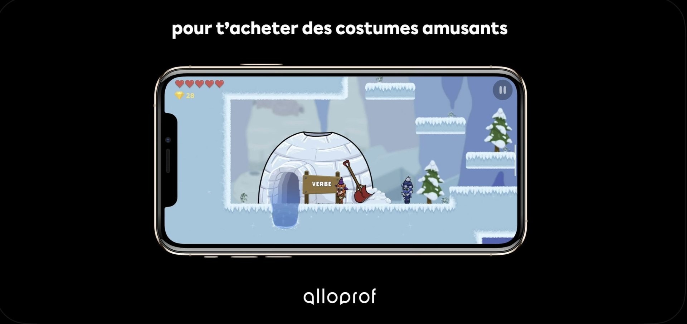
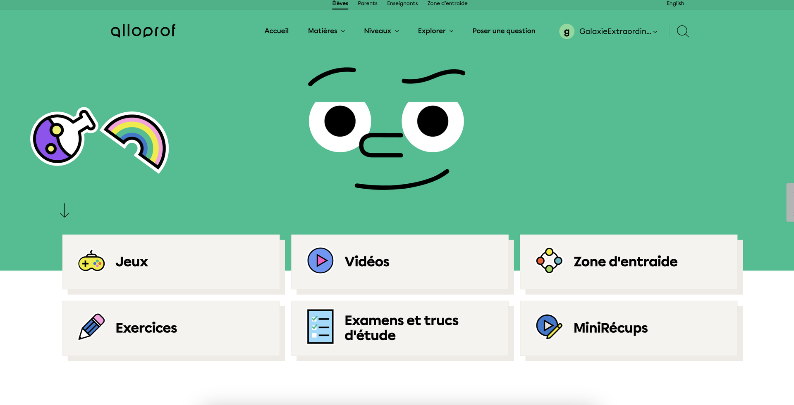

*image à la une : Alloprof*

**En tant que parent d’enfants qui commencent l’école, je me suis intéressé aux jeux vidéo éducatifs et j’ai récemment découvert l’offre de l’organisme québécois [Alloprof](https://www.alloprof.qc.ca/). Parmi les ressources pédagogiques destinées aux jeunes qu’on retrouve sur leur plateforme, il y a notamment des jeux vidéo éducatifs. J’ai été agréablement surpris de constater l’évolution des jeux vidéo éducatifs depuis ceux de mon enfance.**

Ce blogue s’intéresse à l’industrie du jeu vidéo québécoise et j’ai fait le constat que l’industrie vidéoludique et les médias qui la couvrent parlent rarement des efforts vidéoludiques dans le milieu pédagogique.

Aussi, en tant que parent, (et par extension, en tant que membre de l’équipe de la [Fondation des Gardiens virtuels](https://gardiensvirtuels.org/)), la question de l’encadrement des écrans auprès des jeunes, à la maison comme à l’école, m’interpelle.

J’ai donc décidé de contacter Alloprof pour discuter de leur approche en ce qui a trait aux jeux vidéo et sur l’enjeu du temps d’écran chez les jeunes.

**Mario : Quelle est la genèse et la mission de Alloprof?**

**Alloprof :** Alloprof est un organisme de bienfaisance né en 1996 pour lutter contre le décrochage scolaire (beaucoup plus élevé alors!) en offrant du soutien scolaire gratuit et professionnel à tous les élèves du Québec. À l’époque, Internet était encore exotique et c’est donc au téléphone que le service était offert! C’est toujours dans l’esprit de cette mission – que le plus grand nombre d’élèves possibles trouvent le soutien nécessaire pour avancer dans leurs apprentissages, réussir à l’école et obtenir leur diplôme – que l’organisme a évolué, en adoptant et en adaptant des technologies lui permettant d’accroître sa portée, la fréquence de son utilisation et l’impact de celle-ci.

Aujourd’hui, Alloprof aide les élèves du Québec à transformer leurs défis scolaires en réussites, en offrant gratuitement des services professionnels et stimulants. Nous aidons chaque année 550 000 élèves plus de 60 millions de fois! Notre objectif : donner à chaque élève le pouvoir de réussir en conjuguant le meilleur de la pédagogie et de la technologie.

**Mario : Quel est le processus derrière la création d’un jeu? Le choix des apprentissages versus le choix des mécaniques de jeu?**

**Alloprof :** Le processus de création d’un jeu vidéo pédagogique comprend plusieurs étapes, de la conceptualisation à la distribution. Une phase cruciale de notre processus consiste en des séances de tests avec notre public cible, qui nous permettent de valider la convivialité et la compréhension des interfaces et des objectifs du jeu.

Pour choisir les notions pédagogiques à intégrer dans un jeu, Alloprof favorise celles nécessitant un renforcement pratique et celles qui sont susceptibles de soutenir l’apprentissage pendant la majeure partie du parcours scolaire. Le tout est fait en collaboration avec nos équipes de pédagogues.

*Captures d’écran de la nouvelle version de Magimot, un jeu d’apprentissage d*‘*orthographe qui intègre des mécaniques de jeu de rôle*.

La plupart de nos jeux se caractérisent principalement par des mécaniques de progression linéaire avec des niveaux de difficulté croissante. Cela permet au jeu de favoriser l’apprentissage par la répétition chez l’élève. La progression doit être suffisamment stimulante pour éviter l’ennui, mais sans être trop difficile au point de causer de la frustration. Un équilibre soigneusement calibré est essentiel pour maintenir l’intérêt et encourager un apprentissage continu.

**Mario : Quelle est la relation entre Alloprof et le système scolaire québécois pour s’assurer d’une certaine synchronisation entre les apprentissages proposés dans les jeux et les salles de classe?**

**Alloprof :** Alloprof collabore étroitement avec le ministère de l’Éducation du Québec pour aligner ses ressources pédagogiques, y compris les jeux éducatifs, avec le programme des apprentissages officiel. Cette synchronisation assure que les contenus d’Alloprof complètent et renforcent les apprentissages en classe. De plus, les jeux et autres outils sont régulièrement mis à jour en fonction des évolutions du curriculum et des besoins des enseignants et des élèves. Les experts en pédagogie d’Alloprof sont eux-mêmes enseignants et travaillent en partenariat avec des collègues sur le terrain pour développer les ressources les plus pertinentes et efficaces.

**Mario : Est-ce que les jeux sont développés à l’interne ou avec des partenariats externes?**

**Alloprof :** Nos jeux sont développés en partenariat avec des firmes externes avec l’étroite collaboration et la supervision de notre équipe interne. Les aspects visuels et le “gameplay” sont proposés par nos partenaires externes, tandis qu’en interne, nous déterminons les critères de difficulté et de progression des apprentissages. Nous exécutons également des tests UX, faisons du contrôle qualité et veillons à ce que les bonnes pratiques de protection des données soient respectées.

**Mario : Les jeux vidéo sont de plus en plus présents dans notre société, et dès le plus jeune âge aujourd’hui avec l’accessibilité des applications mobiles et la multiplication des écrans; sentez-vous que vous devez être en « compétition » avec les jeux vidéo plus traditionnels? Y a-t-il des stratégies mises en place pour rendre le jeu éducatif plus « attrayant »?**

**Alloprof :** Nous voyons les jeux vidéos et l’offre plus élargie de divertissement pour le jeune public comme une source d’inspiration plus que comme une compétition. La qualité et l’inventivité des produits de divertissement, créés notamment au Québec, sont à l’origine de nombreuses innovations qui ont permis à Alloprof de répondre de mieux en mieux au besoin de soutien scolaire d’un nombre croissant d’élèves. C’est vrai que les écrans se multiplient, et il s’agit d’en tirer partie pour produire une offre éducative qui plaise au jeune et le soutienne dans ses apprentissages.

Actuellement, les jeux vidéo pédagogiques gagnent du terrain et leur pertinence dans le domaine éducatif est en constante augmentation. Les jeux vidéo pédagogiques ne cherchent pas à concurrencer les jeux vidéo traditionnels, mais plutôt à offrir une alternative éducative qui tire parti des avantages de la technologie et de l’interactivité pour améliorer le processus d’apprentissage.

L’objectif des jeux vidéo pédagogiques est de développer les compétences cognitives de manière ludique. Ils intègrent des principes éducatifs solides et sont conçus pour s’intégrer efficacement dans le programme scolaire, soutenant les enseignants dans l’enseignement de divers sujets.

Plusieurs stratégies sont mises en place pour rendre les jeux vidéo éducatifs plus attractifs pour les élèves. Dans nos jeux récents, nous incluons l’utilisation de points, de récompenses, de niveaux et de défis pour motiver les élèves à progresser et à participer activement à l’apprentissage. Nous gardons l’intérêt des joueurs en ajoutant des mondes ou des accessoires thématiques à des périodes-clés, comme le temps des fêtes ou Halloween. Nous ajoutons également de l’interactivité et un retour immédiat, un design attrayant, la personnalisation et l’adaptation.

*Screenshot*

*Screenshot*

*Captures d’écran du jeu de plateformes Potager en péril, un jeu d’apprentissage d*e *grammaire qui intègre des mécaniques de je*u *de plateformes et personnalisation du personnage principal.*

**Mario : Est-ce qu’il y a des jeux ou ressources qui sont développés en fonction des besoins d’enfants neurodivergents?**

**Alloprof :** Nos jeux visaient traditionnellement un public très large (qualifié d’« ordinaire » dans la terminologie scolaire!). Nous menons depuis quelque temps des recherches afin de mieux comprendre les spécificités des élèves présentant certains troubles et leur utilisation de nos produits. Ces recherches vont nous aider à identifier des adaptations possibles pour élargir encore davantage l’éventail de jeunes pouvant tirer des bénéfices du jeu et de l’apprentissage.

**Mario : La tablette et autres outils numériques font de plus en plus leur entrée en classe; alors que le temps d’écran chez les jeunes est un sujet qui fait couler beaucoup d’encre dans les médias actuellement. Notamment, le gouvernement qui songe à interdire les téléphones à l’école; ou les histoires médiatisées de classes de maternelle qui offrent le temps de tablette comme « récompense ».**

**Est-ce que Alloprof prend position dans ce genre de débat sur la place du numérique à l’école?**

**Alloprof :** Alloprof est très sensible à cette situation. Cela dit, nous faisons une différence entre les heures de temps d’écran consacrées à du travail scolaire et les heures passées pour du divertissement. Nos outils numériques, que ce soit nos jeux ou nos vidéos, par exemple, ont des visées pédagogiques bien précises et ont toujours une réelle valeur ajoutée. Notre objectif n’est pas d’augmenter le temps passé sur notre plateforme, mais bien que l’élève trouve rapidement des contenus pertinents qui puissent l’aider à mieux comprendre des notions, faire ses devoirs ou à se préparer à ses examens.

La mécanique de nos jeux pédagogiques priorise d’ailleurs l’optimisation des temps de pratique. Les élèves doivent pouvoir s’engager rapidement avec le contenu, maximisant ainsi le nombre d’exercices effectués en un court laps de temps. Cela permet aux enfants de pratiquer efficacement sans passer trop de temps devant l’écran.

**Mario : Est-ce que Alloprof offre aux enseignants un certain encadrement dans l’utilisation de sa plateforme?**

**Alloprof :** Alloprof a développé un volet enseignant sur sa plateforme afin d’outiller le personnel scolaire sur l’utilisation optimale de ses ressources. Nous menons également de la recherche, conjointement avec des partenaires universitaires, afin de mieux comprendre les pratiques optimales de l’écran (au sens large) dans un contexte d’enseignement et d’apprentissage. Sans doute certaines pratiques doivent-elles être favorisées dans un format matériel, alors que certaines autres donnent de meilleurs résultats dans un format numérique. Le sujet est vaste, nuancé et passionnant!

**Mario : Comment est-ce que le public peut participer au développement et à la pérennité de Alloprof?**

Alloprof est une œuvre collective qui est née et a évolué grâce aux idées et aux contributions de milliers de Québécois et Québécoises – des jeunes, des enseignants, des parents, des experts, de simples citoyens… – ayant à cœur d’offrir à tous les élèves le meilleur de la pédagogie et de la technologie. Nous menons régulièrement des consultations pour comprendre les besoins de nos utilisateurs, l’impact de nos solutions et les meilleures voies d’amélioration. Participer à ces échanges ou nous faire spontanément part de commentaires et de suggestions via nos formulaires et sondages en ligne est un moyen inestimable de participer au développement de la mission d’Alloprof.

Vous pouvez également participer aux tests UX de nos produits. Pour cela, il vous suffit de vous [inscrire à notre infolettre](https://www.alloprof.qc.ca/fr/pages/abonnez-vous-a-notre-infolettre) afin d’être à l’affût des nouvelles fonctionnalités et des opportunités de contribution.

Enfin, Alloprof est un organisme de bienfaisance qui accepte [des dons individuels](https://www.alloprof.qc.ca/fr/pages/faire-un-don) et organise des campagnes de financement pour soutenir ses projets. Les [partenariats](https://www.alloprof.qc.ca/fr/pages/devenir-partenaire) avec des entreprises et des organismes communautaires sont également cruciaux pour assurer la pérennité et l’innovation continue de ses services.

**À LIRE AUSSI : [Jeux Boréalys remporte trois prix Octas pour Aléa : le jeu de prise de décision](/2024/06/05/jeux-borealys-remporte-deux-prix-octas-pour-alea-le-jeu-de-prise-de-decision/)**
