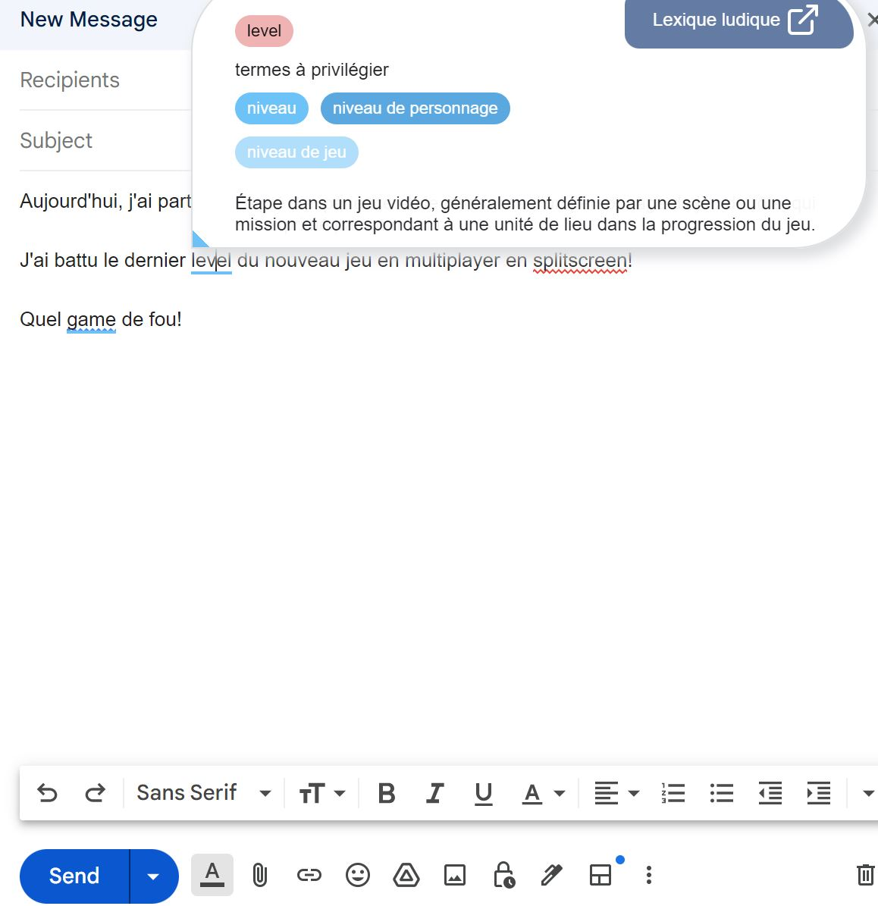

## **Un nouvel outil gratuit pour éliminer les anglicismes quand on parle de jeux vidéo**.

Lexique ludique est un nouveau plugiciel gratuit développé par [Affordance Studio](https://affordancestudio.com/), avec la collaboration de la [Guilde du jeu vidéo du Québec](https://www.laguilde.quebec/fr/) et [l’Office québécois de la langue française.](https://www.oqlf.gouv.qc.ca/)

Un plugiciel, contrairement à un logiciel, ne fonctionne pas seul, mais augmente plutôt les capacités d’un autre logiciel. Dans le cas du Lexique Ludique, il s’intègre à Google Chat et Gmail sur les fureteurs Safari et Chrome.

En temps réel, Lexique ludique repère les anglicismes et propose des alternatives francophones. Pour l’instant, il y a près de 200 termes et expressions répertoriés.

**À LIRE AUSSI : [Un 20e anniversaire pour le MIGS avec un retour aux sources et l’IA au coeur des préoccupations](/2023/08/10/un-20e-anniversaire-pour-le-migs-avec-un-retour-aux-sources/)**

Lexique ludique est téléchargeable gratuitement [ici.](https://lexiqueludique.com/plugiciel)

> « Cette initiative aidera les professionnels du jeu vidéo à devenir plus créatifs, plus précis et plus productifs. En plus de ses attributs utilitaires, l’outil est convivial, non invasif et ne ralentit pas le travail des utilisateurs. De fait, il accomplit pour eux la recherche terminologique, puis leur suggère les bons mots. Ils n’ont ensuite qu’à choisir leur préféré. »
>
> – Avery Rueb, cofondateur d’Affordance Studio et initiateur du projet

J’ai testé le plugiciel et l’installation est simple et facile. En testant un courriel sur Gmail, les anglicismes sont immédiatement soulignés en bleu et je peux choisir un autre terme en survolant avec la souris. Il est possible que certains termes ne soient pas détectés selon l’orthographe utilisé, mais on peut s’attendre à ce que la banque de mots soit constamment améliorée.

## Une plateforme démocratique

Les membres de l’industrie qui souhaitent participer au développement de la banque de mots le peuvent.

Le site web [lexiqueludique.com](https://lexiqueludique.com/) est aussi une plateforme où on retrouve un lexique; on peut y faire des recherches en français et anglais pour connaître les bonnes traductions et les termes à éviter; mais ce qui est intéressant c’est qu’il est également possible d’y suggérer des nouveaux termes et leur traduction.

**À LIRE AUSSI : [Un documentaire sur la création de Sea of Stars](/2023/08/15/un-documentaire-sur-la-creation-de-sea-of-stars/)**
