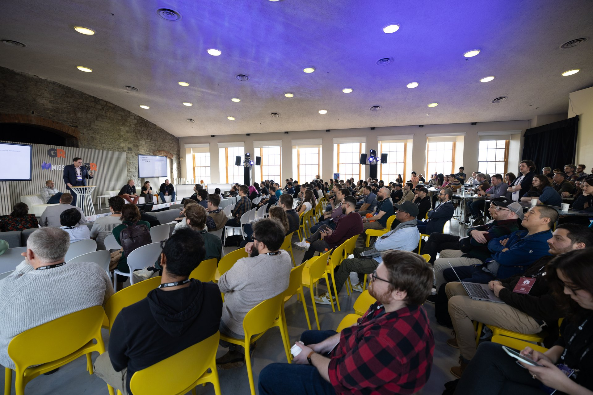
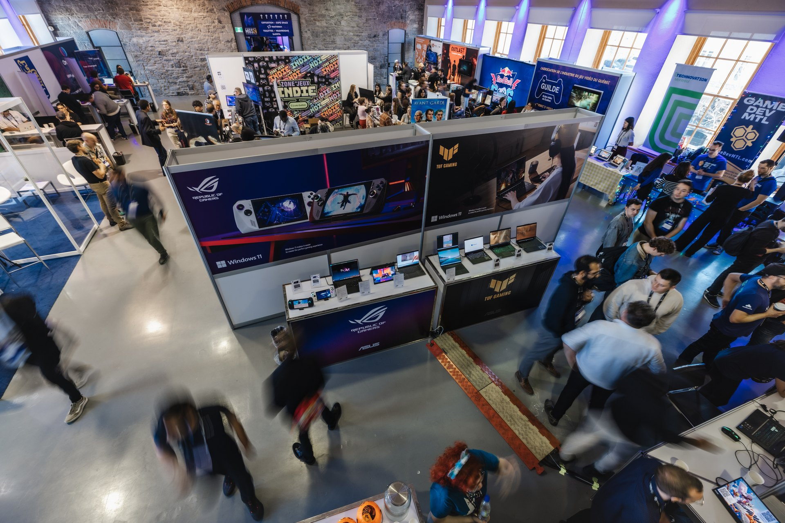
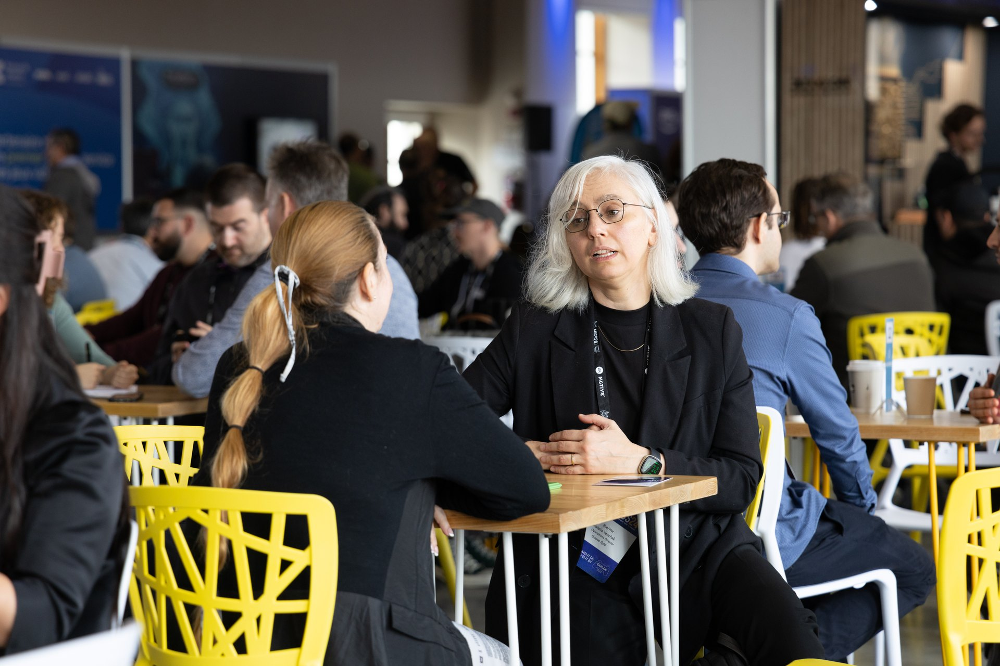
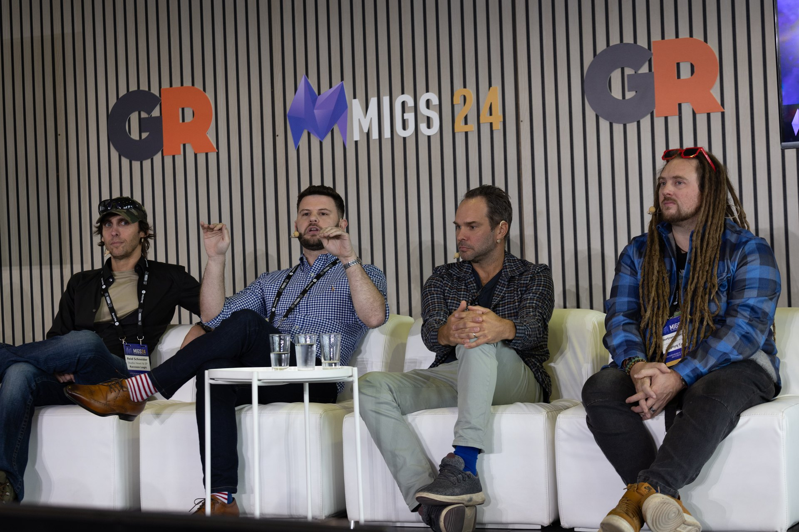

*Photos gracieuseté de XP Gaming*

**Du 11 au 12 novembre, Montréal redevient l’épicentre du jeu vidéo mondial avec la tenue du [Sommet international du jeu de Montréal 2025 (MIGS25)](https://migs.biz/fr/). Alors que l’industrie mondiale fait face à de nouvelles réalités de marché, forçant les studios et les professionnel.le.s à repenser la création, le financement et le développement de leurs projets, cette 22e édition met l’accent sur l’innovation, la compétitivité et le financement pour préparer l’avenir.**

*photo du MIGS24 au Marché Bonsecours*

Organisé par [La Guilde du jeu vidéo du Québec](https://www.laguilde.quebec/) et produit par [XP Gaming](https://xpgaming.biz/) , le MIGS25 s’installera au [Grand Quai du Vieux-Port de Montréal](https://www.port-montreal.com/fr/grand-quai) pour explorer en profondeur le développement de jeux et les stratégies d’affaires qui le propulsent. Cet événement confirme une fois de plus le rôle de Montréal comme porte d’entrée de l’industrie du jeu vidéo en Amérique du Nord.

> « *Dans le monde, on note des changements majeurs, en particulier au chapitre du financement. Par conséquent, nous voulons fournir aux participant.e.s des pistes à explorer. Nous souhaitons aussi développer en elles et eux l’esprit d’entrepreneuriat qui leur permettra d’exceller dans toutes les sphères, de la création à la commercialisation, en passant par l’édition.* »
>
> **– Jean-Jacques Hermans, directeur général de La Guilde du jeu vidéo du Québec**

Le MIGS25 accueillera d’ailleurs 90 conférencier.ère.s venant de plus de 25 pays et 2500 professionnel.le.s , faisant de lui le plus grand événement interentreprise du jeu vidéo au Canada et l’un des plus importants en Amérique du Nord. Ces expert.e.s internationaux partageront des analyses et des études de cas qui façonnent l’avenir du développement, de la production et de l’édition de jeux.

*photo du MIGS24 au Marché Bonsecours*

### Des figures de proue et leçons de succès

Les participant.e.s auront une occasion unique d’apprendre des meilleur.e.s. Les créateur.trice.s derrière des jeux à succès comme ***Clair Obscur: Expedition 33*, *Balatro*, *Helldivers 2*, *South of Midnight*, *Split Fiction*** et ***The Outer Worlds 2*** seront présents pour partager leurs choix inventifs et de production.

> « *La meilleure manière d’évoluer reste d’apprendre auprès de celles et ceux qui réussissent le mieux. MIGS25 procurera une occasion unique de côtoyer des bâtisseur.euse.s de succès, de mettre à profit leurs bons coups et d’apprendre de leurs erreurs.* »
>
> **– Jason Lepine, fondateur de XP Gaming et producteur du MIGS25**

### Réseautage et développement des affaires

Puisque l’entrepreneuriat est synonyme de collaboration, deux espaces majeurs seront dédiés aux affaires et au réseautage :

- **Salon ExDev (propulsé par Game Caviar)** : Il réunira plus de 1400 fournisseurs de services et des studios cherchant à accroître leur capacité de production et leurs partenariats.
- **Salon Affaires (propulsé par MeetToMatch)** : Il accueillera 200 acheteurs, des éditeurs et des partenaires de développement du monde entier afin de favoriser la croissance et de nouvelles occasions d’affaires.

Parmi les éditeurs ayant confirmé leur présence, on retrouve des noms majeurs tels qu’**Amazon Games, 2K, Epic Game Store, Devolver Digital, Sony/Playstation** et **Xbox Game Studios.**

*photo du MIGS24 au Marché Bonsecours*

### Soutien à la croissance professionnelle

Le MIGS25 est officiellement reconnu dans le cadre de la loi du 1% sur la formation de la main-d’œuvre du Québec. Cette reconnaissance permet aux employeurs québécois de comptabiliser la participation de leurs employé.e.s dans le calcul de leurs obligations annuelles d’investissement en formation , renforçant ainsi le rôle du MIGS25 dans le soutien à la croissance professionnelle au sein de l’industrie québécoise du jeu vidéo.

Soulignant son importance, le MIGS25 est soutenu par la Ville de Montréal, le gouvernement du Québec, le [Fonds signature métropole](https://www.quebec.ca/gouvernement/gestion-municipale/organisation-municipale/organisation-territoriale/metropole/fonds-signature-metropole), et le gouvernement du Canada.

> *« Montréal s’impose comme un pôle mondial de la créativité numérique. Ici, l’avenir du jeu vidéo se construit en vertu d’une concentration unique de talents, d’expertise et d’investissements. Grâce à cette industrie qui génère 1,4 milliard $ au PIB du Québec et offre 15 000 emplois de qualité, la métropole peut agir comme une véritable locomotive, faisant briller le savoir-faire québécois sur la scène internationale. »*
>
> **– Chantal Rouleau, ministre québécoise responsable de la Solidarité sociale et de l’Action communautaire, ministre responsable de la Métropole et de la région de Montréal, et députée de Pointe-aux-Trembles**

*photo du MIGS24 au Marché Bonsecours*

Les billets, incluant les billets Conférences et les billets Étudiant, sont en vente sur [migs.biz](https://migs.biz) et donnent accès aux conférences, à l’Expo Innovation et à la Zone Indie.

**À LIRE AUSSI : [Premières impressions : l’audace uchronique de Bonaparte : A Mechanized Revolution](/2025/05/22/premieres-impressions-laudace-uchronique-de-bonaparte-a-mechanized-revolution/)**
