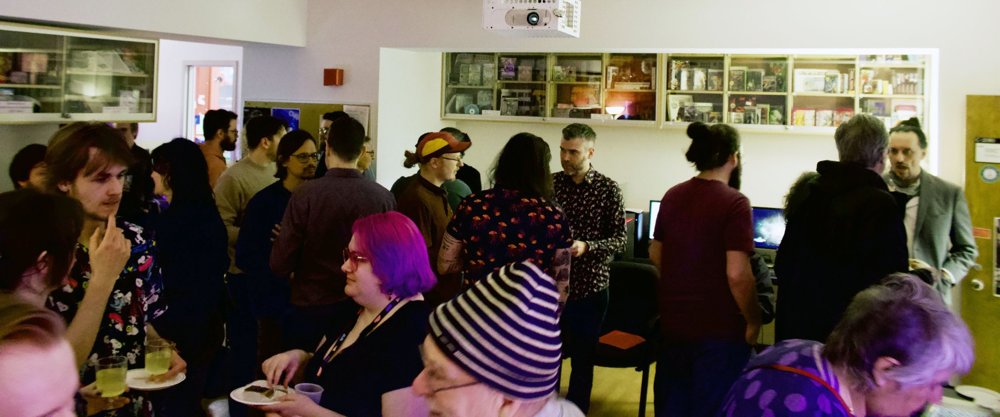
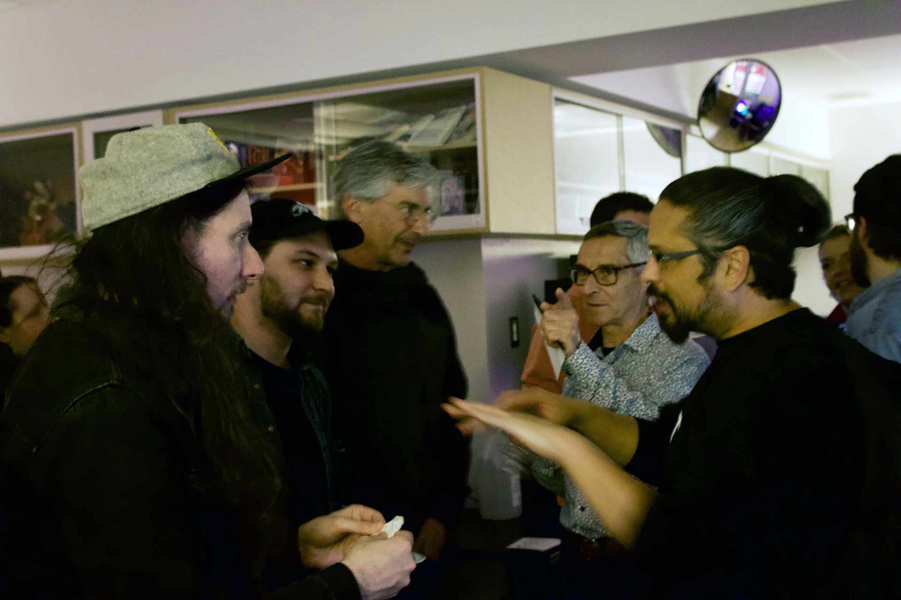
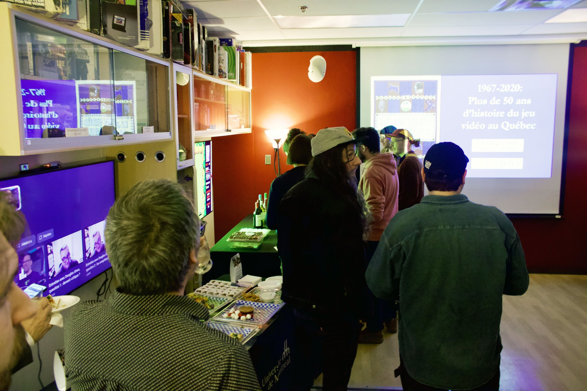

*images gracieuseté de LUDOV*

**Qui se souvient des premières salles d’arcade montréalaises ? Des jeux québécois développés dans l’ombre dans les années 1980, jamais archivés, jamais documentés ? Trois professeurs de l’[Université de Montréal](https://www.umontreal.ca/) ont décidé que cette mémoire collective ne doit pas disparaître. Financé par le Conseil de recherches en sciences humaines du Canada (CRSH),** [**leur projet vise à documenter plus de 50 ans d’histoire du jeu vidéo au Québec**, **de 1967 à 2020.**](https://www.ludov.ca/fr/documentation/le-jeu-video-au-quebec/)

Le lancement de ce projet par des chercheurs du laboratoire LUDOV avait lieu à l’Université de Montréal le 30 avril dernier, en compagnie de membres de l’équipe de recherche, journalistes et professionnels de l’industrie vidéoludique.

## Une histoire qui risque de s’effacer

Le Québec représente environ la moitié de l’industrie canadienne du jeu vidéo et constitue l’un des écosystèmes les plus actifs au monde, avec des studios de renommée mondiale comme Ubisoft, Electronic Arts et Eidos, ainsi qu’un vaste tissu de studios indépendants. Pourtant, peu de recherches ont été consacrées à son histoire. Une lacune que **Bernard Perron**, **Dominic Arsenault** et **Carl Therrien**, tous trois professeurs au Département d’histoire de l’art et d’études cinématographiques de l’UdeM, veulent combler avant qu’il ne soit trop tard.

La menace est bien réelle : les magazines spécialisés disparaissent, les supports numériques vieillissent rapidement, et les personnes qui ont créé des jeux, tenu des boutiques ou animé des salles d’arcade vieillissent avec eux. « *Plusieurs sont déjà décédés* », souligne-t-on dans la description du projet. Chaque année qui passe, c’est une voix de moins pour raconter cette histoire.

## Quatre facettes d’une culture vidéoludique

Le projet s’articule autour de quatre grands axes d’enquête : la **création** (comment les jeux ont-ils été développés et publiés ?), la **circulation** (quels étaient les réseaux de distribution et de vente ?), les **artéfacts** (comment préserver les jeux, manuels, boîtiers et publicités comme patrimoine matériel et numérique ?) et la **réception** (par qui et dans quels contextes ces jeux ont-ils été joués, et quelles communautés se sont formées autour d’eux ?).

Pour y répondre, l’équipe mobilise une méthodologie multidisciplinaire : des entrevues semi-dirigées avec des gens de divers profils, l’analyse de sources écrites (presse spécialisée, critiques, discussions en ligne), la constitution d’une archive de jouabilité pour les jeux développés au Québec, et une analyse des caractéristiques propres aux créations québécoises en matière de design, d’esthétique et de narration.

Pour dresser une histoire socioculturelle, ils parcoureront la province pour s’entretenir autant avec des acteurs clés du jeu vidéo au Québec qu’avec des gens « ordinaires » : des présidents de clubs, les propriétaires de club vidéo ou de dépanneur où on louait des jeux, et de simples *gamers* qui ont sans doute des anecdotes touchant au jeu vidéo qui sont propres à leurs patelins.

Une entrevue a d’ailleurs été publiée avec Dominic Bourret, alias Papa Cassette, fondateur de Arcade MTL, propriétaire de la boutique de jeux rétro [Retro MTL](https://retromtl.com/) et podcasteur :

https://www.youtube.com/watch?v=hOD11DsEzIM

## Un legs public, pas seulement académique

Ce qui distingue ce projet, c’est sa volonté de dépasser les cercles universitaires. Au-delà des publications scientifiques, les chercheurs prévoient une base de données d’entrevues vidéo accessibles au public, un documentaire, un ouvrage illustré grand public, une exposition muséale, et une archive matérielle et numérique d’artéfacts. L’objectif est de rendre cette histoire disponible à tous : joueurs, passionnés, et professionnels de l’industrie.

Dans un Québec qui peine parfois à reconnaître la légitimité culturelle du jeu vidéo, ce projet tombe à point : il pose noir sur blanc que cette industrie a une histoire, une identité et un patrimoine qui méritent d’être préservés au même titre que ceux du cinéma ou de la musique.

---

📚 **À LIRE AUSSI :** [Nos articles sur l’industrie du jeu vidéo](https://mariojramos8.wordpress.com/tag/industrie-du-jeu-video/)
