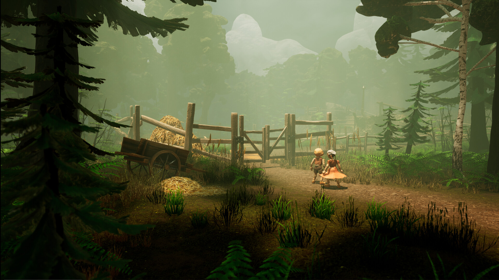

*Image à la une : Carcajou Games*

**Once a Tale, un jeu en développement chez [Carcajou Games](https://carcajougames.com/), en partenariat avec [Triple Boris](https://www.tripleboris.com/index2.html), a maintenant une démo gratuite disponible sur [Steam.](https://store.steampowered.com/app/1032690/Once_a_Tale/) Il s’agit d’un jeu d’aventure s’inspirant du conte allemand Hansel et Gretel et est d’ailleurs parmi [les jeux faits au Québec que j’attends le plus en 2024.](/2023/12/14/les-jeux-video-faits-au-quebec-attendus-en-2024/)**

J’ai personnellement eu accès il y a quelques mois à une démo du jeu avec laquelle j’ai eu beaucoup de plaisir. Visuellement, le jeu est superbe avec ses personnages sculptés et animés en *stop-motion* et une utilisation inspirée de caméras statiques qui donnent une qualité cinématographique à l’oeuvre.

En contrôlant alternativement Hansel et Gretel (on peut changer quand on veut en temps-réel) on doit résoudre des puzzles de logique dans notre environnement. Bien qu’on s’inspire du conte classique, on y intègre une histoire originale faisant référence également à d’autres contes fantastiques.

Vous pouvez wishlister le jeu et télécharger la démo [sur Steam.](https://store.steampowered.com/app/1032690/Once_a_Tale/)

Dans cette vidéo devlog, les développeurs expliquent le processus de sculptage et animation des personnages du jeu :

https://www.youtube.com/watch?v=q50JONbY5o4

La sortie de Once a Tale est prévue pour mars 2024 sur Steam.

**À LIRE AUSSI : [Les jeux vidéo faits au Québec qui ont marqué 2023](/2023/11/24/les-jeux-video-faits-au-quebec-qui-ont-marque-2023/)**

**À lire sur Bêta-Testeur : [Alan Wake arrive dans Dead by Daylight](https://www.lebetatesteur.ca/dead-by-daylight-ajoutera-le-survivant-alan-wake/)**
