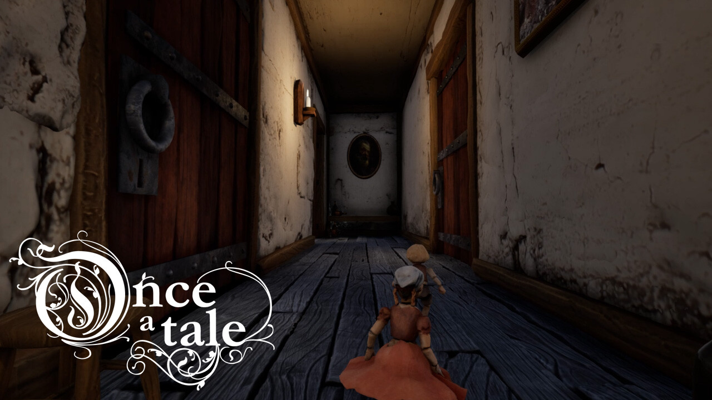

*Crédit images : Carcajou Games*

## **[Once a Tale](https://store.steampowered.com/app/1032690/Once_a_Tale/), un jeu d’aventure co-développé par les** s**tudios québécois [Carcajou Games](https://carcajougames.com/) et [Triple Boris](https://www.tripleboris.com/index2.html), a fait partie de la présentation [Awesome Indies au Gamescom](https://www.youtube.com/watch?v=CD8QcVPWn5o), à Cologne en Allemage.**

Once a Tale, un jeu inspiré du conte Hansel et Gretel, a la particularité que les animations des protagonistes sont en stop-motion. C’est à dire qu’il s’agit de figurines réelles sculptées qui ont été animées à la main, image par image. Un bon exemple de stop-motion est le [fameux film Neighbors de Norman McLaren](https://www.nfb.ca/playlists/edu-stop-motion-animation/playback/#1), produit pour l’ONF en 1952.

Aujourd’hui, se déroulait la présentation en ligne Awesome Indies dans le cadre du Gamescom 2023, qui mettait en valeur les meilleures productions à venir de studios indépendants provenant de partout dans le monde. Once a Tale en faisait partie, et pour l’occasion on a pu découvrir une nouvelle bande-annonce que voici :

https://www.youtube.com/watch?v=PbUmzPpGwiE

**À LIRE AUSSI : [5 choses à savoir sur Sea of Stars](/2023/08/21/5-choses-a-savoir-sur-sea-of-stars/)**

L’année dernière au MEGAMIGS, j’ai eu la chance de [discuter du processus de la création du jeu avec Vincent Presseau](https://www.facebook.com/watch/?v=1007338943995927), fondateur de Carcajou Games. À noter que l’entrevue date de 2022 et que certaines informations pourraient ne plus être à jour.

Once a Tale sera disponible bientôt sur Steam. [Allez le wishlister!](https://store.steampowered.com/app/1032690/Once_a_Tale/)

[À LIRE SUR BÊTA-TESTEUR : Critique de Fort Solis](https://www.lebetatesteur.ca/test-fort-solis/)
